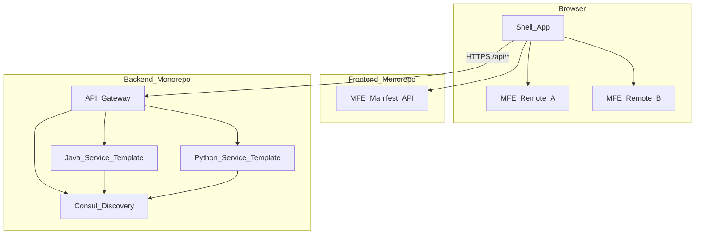
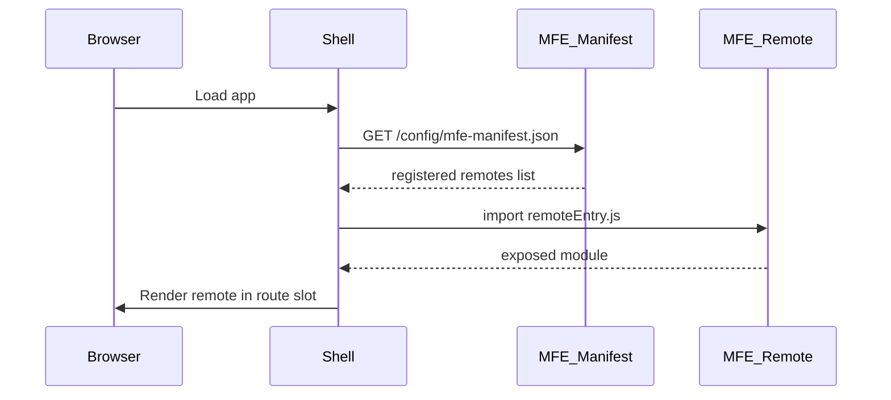

# Microservices + Microfrontends Base Project Plan

## Goals

- **Backend monorepo**: API Gateway, service discovery, starter templates for Java and Python microservices, shared contracts, per-service Docker/K8s deploy configs.
- **Frontend monorepo**: Shell (container) app, Module Federation remotes, runtime MFE registry, shared UI/types packages.
- **Optional platform repo**: Full-stack Docker Compose, K8s overlays, CI templates — the “glue” that runs everything together without coupling the two monorepos. 

You will add domain-specific microservices and microfrontends later by copying the `_template-*` scaffolds.

---

## Monorepo Tooling (Framework Choices)

There is no single tool that covers Java + Python + React well, so each monorepo uses the best-fit stack for its language ecosystem. A thin orchestration layer (Makefile / Nx) sits on top.

### Frontend monorepo — **pnpm workspaces + Nx**


| Tool                        | Role                                                                                                                      |
| --------------------------- | ------------------------------------------------------------------------------------------------------------------------- |
| **pnpm workspaces**         | Links `apps/` and `packages/`; fast installs; strict dependency hoisting                                                  |
| **Nx**                      | Task pipeline (`build`, `lint`, `test`, `serve`); dependency graph; `nx affected` for CI; generators to scaffold new MFEs |
| **@nx/vite**                | Vite integration per app with Nx executors                                                                                |
| **Vite**                    | Build tool per app (shell + each MFE)                                                                                     |
| **@module-federation/vite** | Runtime Module Federation between shell and remotes                                                                       |


Why Nx: built-in project graph, `nx affected` maps cleanly to independent MFE deploys, and generators (`nx g`) make adding new microfrontends repeatable.

Example root scripts:

```json
{
  "scripts": {
    "dev": "nx serve shell",
    "build": "nx run-many -t build",
    "lint": "nx run-many -t lint",
    "affected:build": "nx affected -t build"
  }
}
```

Nx project layout uses `project.json` (or inferred targets) per app under `apps/` and `packages/`.

### Backend monorepo — **Gradle (Java) + pip/requirements.txt (Python) + Makefile**


| Tool                       | Role                                                                                                                  |
| -------------------------- | --------------------------------------------------------------------------------------------------------------------- |
| **Gradle multi-module**    | Java gateway, `java-common`, and all Java microservices as subprojects                                                |
| **pip + requirements.txt** | Each Python service has its own `requirements.txt`; shared lib installed editable via `-e ../../shared/python-common` |
| **Makefile**               | Cross-language commands: `make build`, `make up`, `make scaffold-java`, `make scaffold-python`                        |


Why requirements.txt: familiar, Docker-friendly (`pip install -r requirements.txt`), and each Python microservice stays independently deployable with its own pinned dependencies.

Gradle `settings.gradle` includes Java modules:

```gradle
include 'gateway', 'shared:java-common', 'services:template-java'
```

Python service `requirements.txt` pattern:

```text
# services/_template-python/requirements.txt
fastapi>=0.110.0
uvicorn[standard]>=0.27.0
python-consul2>=0.1.5
-e ../../shared/python-common
```

Shared lib has its own minimal `requirements.txt` for its runtime deps. Each service Dockerfile runs `pip install -r requirements.txt` — no root-level Python workspace lockfile.

Makefile unifies both:

```makefile
build: build-java build-python
build-java:
	./gradlew build
build-python:
	pip install -r shared/python-common/requirements.txt
	pip install -r services/_template-python/requirements.txt
	pytest services/_template-python/tests
```

### Platform repo — no monorepo framework

`telemedicine-platform/` is plain Docker Compose + K8s manifests + CI templates. It references images built from the other two repos; no workspace tooling needed.

### Summary


| Repo                    | Monorepo framework                        | Package manager             | Build orchestration               |
| ----------------------- | ----------------------------------------- | --------------------------- | --------------------------------- |
| `telemedicine-frontend` | pnpm workspaces + **Nx**                  | pnpm                        | Nx (`nx run-many`, `nx affected`) |
| `telemedicine-backend`  | Gradle modules + **pip/requirements.txt** | Gradle (Java), pip (Python) | Makefile                          |
| `telemedicine-platform` | None                                      | —                           | docker compose / kubectl          |


---

## High-Level Architecture




**Traffic rules**


| Layer    | Public entry             | Internal comms                                                |
| -------- | ------------------------ | ------------------------------------------------------------- |
| Frontend | Shell only (port 3000)   | Shell loads registered MFE remotes via Module Federation      |
| Backend  | Gateway only (port 8080) | Services register with Consul; gateway routes by service name |


---

## Repository Layout (3 Artifacts)

### 1. `telemedicine-backend/` (Backend monorepo)

```
telemedicine-backend/
├── gateway/                      # Spring Cloud Gateway (Java 21)
│   ├── src/
│   ├── Dockerfile
│   └── build.gradle
├── services/
│   ├── _template-java/           # Spring Boot 3 + Consul client
│   └── _template-python/         # FastAPI + consul registration
│       ├── requirements.txt      # per-service pinned deps + editable python-common
│       ├── Dockerfile
│       └── src/
├── shared/
│   ├── contracts/                # OpenAPI 3 specs (source of truth)
│   ├── java-common/              # Shared DTOs, error model, tracing
│   └── python-common/            # Shared pydantic models, middleware
│       ├── requirements.txt      # shared lib runtime deps
│       └── setup.py              # editable install for pip -e
├── deploy/
│   ├── docker-compose.dev.yml    # consul + gateway + sample services
│   └── kubernetes/
│       ├── base/                 # gateway, consul, templates
│       └── overlays/dev|prod/
├── tools/
│   └── scaffold-service.sh       # copies template → new service folder
├── settings.gradle               # Gradle multi-module (Java)
├── Makefile                      # build-all, up, down, scaffold
└── README.md
```

**Technology choices (backend)**


| Component       | Choice                                          | Why                                                                    |
| --------------- | ----------------------------------------------- | ---------------------------------------------------------------------- |
| Gateway         | Spring Cloud Gateway                            | Mature routing, filters (auth, rate-limit), Consul integration         |
| Discovery       | HashiCorp Consul                                | Language-neutral; same in Docker Compose and K8s                       |
| Java services   | Spring Boot 3 + Spring Cloud Consul             | Standard stack, auto-registration                                      |
| Python services | FastAPI + `python-consul2` + `requirements.txt` | Lightweight; registers on startup; each service owns its own deps file |
| Contracts       | OpenAPI 3 in `shared/contracts/`                | Generate Java interfaces + Python models later                         |
| Observability   | OpenTelemetry + structured JSON logs            | Same trace context propagated gateway → services                       |


**Gateway route pattern** (example):

```yaml
# gateway/src/main/resources/application.yml
spring:
  cloud:
    gateway:
      routes:
        - id: template-java
          uri: lb://template-java
          predicates:
            - Path=/api/v1/template-java/**
          filters:
            - StripPrefix=2
        - id: template-python
          uri: lb://template-python
          predicates:
            - Path=/api/v1/template-python/**
          filters:
            - StripPrefix=2
```

Each new service gets a gateway route + Consul service name. External clients never call services directly.

**Independent deployability**

- Each folder under `services/` has its own `Dockerfile`, CI job, and K8s `Deployment`/`Service`.
- Gateway and Consul are separate deploy units in `gateway/` and `deploy/kubernetes/base/consul/`.
- Version tags per service: `template-java:1.0.0`, not one monolithic backend image.

---

### 2. `telemedicine-frontend/` (Frontend monorepo)

```
telemedicine-frontend/
├── apps/
│   ├── shell/                    # Host/container — sole browser entry
│   │   ├── vite.config.ts        # Module Federation host config
│   │   ├── src/
│   │   │   ├── App.tsx
│   │   │   ├── router/           # Dynamic routes from registry
│   │   │   └── bootstrap.tsx
│   │   └── Dockerfile
│   └── _template-mfe/              # Remote MFE scaffold
│       ├── vite.config.ts        # exposes ./App, ./routes
│       └── Dockerfile
├── packages/
│   ├── mfe-registry/               # Fetch + validate MFE manifest
│   ├── shared-ui/                # Buttons, layout, theme (optional shadcn)
│   ├── shared-types/               # API types, MFE manifest types
│   └── eslint-config/
├── deploy/
│   ├── docker-compose.dev.yml
│   └── kubernetes/
├── nx.json                       # Nx workspace config + task pipeline defaults
├── pnpm-workspace.yaml
├── package.json
└── README.md
```

**Module Federation + Registry flow**




**MFE manifest** (served by shell or a tiny config sidecar):

```json
{
  "remotes": [
    {
      "name": "templateMfe",
      "url": "http://localhost:3001/assets/remoteEntry.js",
      "route": "/template",
      "enabled": true
    }
  ]
}
```

- Only remotes listed in the manifest (or returned by a registry API) are loaded.
- Adding a new MFE = deploy remote + register in manifest — no shell redeploy required if using **runtime Module Federation** (`@module-federation/runtime`).
- Shell proxies `/api/*` to the backend gateway in dev (Vite proxy) and via Ingress in prod.

**Independent deployability**

- Each app under `apps/` builds its own static bundle + Docker image (nginx serving `remoteEntry.js`).
- Shell image is separate from remote images.
- Shared packages (`shared-ui`, `shared-types`) are versioned internally via workspace protocol; remotes pin compatible versions at build time.

---

### 3. `telemedicine-platform/` (Optional — recommended as 3rd artifact)

```
telemedicine-platform/
├── docker-compose.full-stack.yml   # consul + gateway + services + shell + mfes
├── kubernetes/
│   ├── namespaces/
│   ├── ingress/                    # single host: app.domain / api.domain
│   └── kustomization.yaml
├── ci/
│   └── templates/                  # reusable GitHub Actions per service
├── docs/
│   ├── architecture.md
│   ├── adding-a-service.md
│   └── adding-an-mfe.md
└── README.md
```

This repo does **not** contain business logic. It references images built from the two monorepos and provides one-command local startup:

```bash
docker compose -f docker-compose.full-stack.yml up
```

---

## Cross-Cutting Concerns (built into base)


| Concern            | Backend                                                               | Frontend                                                         |
| ------------------ | --------------------------------------------------------------------- | ---------------------------------------------------------------- |
| Auth (placeholder) | Gateway JWT validation filter; pass claims as headers to services     | Shell stores token; axios/fetch interceptor adds `Authorization` |
| CORS               | Gateway allows shell origin only                                      | Shell origin whitelisted at gateway                              |
| Health checks      | `/actuator/health` (Java), `/health` (Python)                         | nginx `/health` on each MFE                                      |
| Config             | Spring profiles + env vars; Consul KV optional                        | `VITE_*` env + manifest URL                                      |
| CI/CD              | Matrix job: detect changed paths → build/deploy only affected service | Same path-based matrix per app                                   |


---

## Dev vs Prod (Hybrid)


| Environment         | Discovery                                   | Routing                       | Frontend                                                        |
| ------------------- | ------------------------------------------- | ----------------------------- | --------------------------------------------------------------- |
| **Local (Compose)** | Consul container                            | Gateway → `lb://service-name` | Shell + remotes on separate ports; manifest points to localhost |
| **Prod (K8s)**      | Consul on K8s (or migrate to K8s DNS later) | Gateway Deployment + Ingress  | Shell Ingress at `/`; each MFE at `/mfe/<name>/` or subdomain   |


K8s Ingress sketch:

- `app.example.com` → shell Service
- `app.example.com/mfe/template/` → template-mfe Service
- `api.example.com` → gateway Service

---

## Starter Templates (what gets scaffolded now)

Since domain services are TBD, the base ships **two backend templates** and **one frontend template**:


| Artifact           | Purpose                          | Endpoints                                  |
| ------------------ | -------------------------------- | ------------------------------------------ |
| `_template-java`   | Copy for new Java microservice   | `GET /health`, `GET /api/v1/.../hello`     |
| `_template-python` | Copy for new Python microservice | `GET /health`, `GET /api/v1/.../hello`     |
| `_template-mfe`    | Copy for new microfrontend       | Route `/template`, exposes federated `App` |


Scaffold command (backend):

```bash
make scaffold-java NAME=patient-service
make scaffold-python NAME=appointment-service
```

Scaffold command (frontend):

```bash
nx g @telemedicine/mfe:app patient-mfe   # custom Nx generator wrapping _template-mfe
# or: nx g @nx/react:app patient-mfe --bundler=vite
```

---

## Implementation Phases

### Phase 1 — Backend monorepo skeleton

- Initialize Gradle multi-module: `gateway`, `shared/java-common`, `services/_template-java`
- Add FastAPI `_template-python` with `requirements.txt` + editable `python-common` (`setup.py`)
- Consul + gateway Docker Compose
- Gateway routes to both templates; verify via `curl localhost:8080/api/v1/template-java/hello`

### Phase 2 — Frontend monorepo skeleton

- Initialize Nx workspace with pnpm (`nx init` + `@nx/vite` plugin)
- Shell with runtime Module Federation host
- `_template-mfe` remote exposing a sample page
- `mfe-registry` package + local manifest
- Vite dev proxy to gateway; Nx custom generator for new MFEs

### Phase 3 — Platform repo + K8s base

- Full-stack Docker Compose
- K8s base manifests (Deployments, Services, Ingress)
- GitHub Actions templates: path-filtered build/deploy per service/MFE
- Docs: how to add a service, add an MFE, register in gateway/manifest

### Phase 4 — Hardening (before first real service)

- OpenTelemetry wiring gateway → services
- JWT placeholder filter on gateway
- Shared error response contract in `shared/contracts/`
- Pre-commit hooks (lint, format)

---

## What you will define later

When you provide the list of microservices and microfrontends, for each one we will:

1. Run scaffold from the appropriate template
2. Add OpenAPI contract in `shared/contracts/<name>.yaml`
3. Register gateway route + Consul service name
4. Create federated remote + manifest entry + shell route
5. Add CI/CD job and K8s overlay

No changes to gateway/shell core logic — only configuration and new deployable units.

---

## Recommended root folder under your workspace

```
c:\bupa_projects\research\telemedicine\
├── telemedicine-backend/
├── telemedicine-frontend/
└── telemedicine-platform/    # optional but recommended
```

Each repo can later become its own Git remote if your org prefers separate repos; the structure supports both mono-repo-at-root and split remotes.