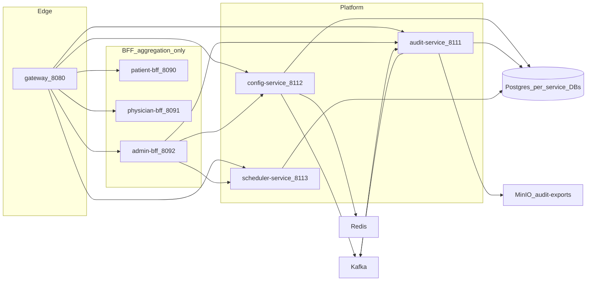

# Part 2 — Platform Edge and Platform Services

## Goal

Satisfy [telemedicine-platform/docs/build-sequence.md](telemedicine-platform/docs/build-sequence.md) Phase 2 **and** master-plan Part 2:

> Gateway routes to all three platform services; config CRUD works; audit append/query works.

Plus the three BFF skeletons listed in Part 2 (`patient-bff`, `physician-bff`, `admin-bff`) as **aggregation-only** facades. No domain logic, no BFF databases.

**Exit criteria:** `verify-phase2` is green: gateway JWT/RBAC/rate-limit/circuit-breaker; config CRUD + Redis cache + `ConfigurationChanged` on Kafka; audit append + hash-chain query + consent ledger + MinIO export; scheduler job registry fires without double-execution; admin-bff aggregates live config/audit/scheduler; patient/physician BFFs return typed journey/worklist payloads and degrade when domain services are absent.

## Locked decisions

- **Reuse Part 1 libraries.** Services do not reimplement `ApiResponse` / `ProblemDetails`, `GlobalExceptionHandler`, servlet JWT (`ResourceServerAutoConfiguration`), `EventEnvelope` / `EventTypes` / `TopicNames` / `EventPublisher`, `CorrelationIdFilter`, `BaseEntity`, `OutboxPublisher`, `AuditEvent` / `@Audited`, `Roles`, `Headers`, `IdGenerator`, `PageRequestSupport`, `IdempotencyKeyFilter`.
- **Gateway is WebFlux.** It cannot use servlet `ResourceServerAutoConfiguration`. It **reuses** `KeycloakRoleConverter`, `Roles`, `Headers`, `IdGenerator`, `ProblemDetails`, and `TelemedicineSecurityProperties` from the libraries; it does **not** copy role-mapping or correlation-header string literals.
- **Schema-per-service.** Config / audit / scheduler connect to the databases already created in [infra/postgres/initdb/01-databases.sql](telemedicine-platform/infra/postgres/initdb/01-databases.sql) (`config`, `audit`, `scheduler`). Today all three incorrectly default to `DB_NAME:telemedicine` — that is a defect to fix, not a pattern to keep.
- **Outbox ownership.** [OutboxPublisher](telemedicine-backend/shared/java-common-persistence/src/main/java/com/telemedicine/common/persistence/outbox/OutboxPublisher.java) is the only publisher poller. Scheduler must **not** grow a second outbox sweeper (the current `demoSweep` / `outbox-retry-sweep` in [SchedulerController](telemedicine-backend/platform/scheduler-service/src/main/java/com/telemedicine/schedulerservice/SchedulerController.java) is duplicate and will be removed).
- **RBAC source of truth remains Keycloak.** Admin-bff does not invent a role store. It facades realm roles from `Roles.REALM_ROLES` / Keycloak; write-RBAC is deferred until Keycloak Admin client work in a later phase.
- **Frontend is out of scope.** `api-client`, `auth`, `session-context`, `physician-shell`, and `admin-shell` already exist as stubs and belong to build-sequence Phase 5. This part does not expand them.

## Current state (verified on disk)

| Artifact | What exists | What is missing |
|---|---|---|
| Gateway | Routes for all 17 services, CORS, in-memory rate limit, correlation filter, default circuit breaker, JWT only on `!dev` | Redis limiter, RBAC path map, named per-route breakers, WAF headers, RFC 9457 fallback, OpenAPI aggregation, reuse of `Headers`/`Roles` |
| `config-service` | In-memory `Map` controller; `V1__config.sql` with 4 keys; shared `telemedicine` DB | Typed catalog, flags, history, Redis, outbox event, Flyway-owned schema, `config` DB |
| `audit-service` | Fake `AuditEvent` constructor in controller; `V1__audit.sql` (events + consent_ledger) | Hash chain, Kafka ingest, query/export/retention, `audit` DB |
| `scheduler-service` | Hardcoded job list + in-memory `demoSweep` on the controller | Quartz JDBC catalog, clustered firing, no Flyway, `scheduler` DB |
| BFFs | Hardcoded `Map` payloads | Typed contracts, RestClient aggregation, degradation |
| All six | Duplicate `HealthController` at `/health` | Actuator already exposes `/actuator/health` — delete the extras on these six apps only |

Library gaps that would force **duplicate** code if left unfixed (narrow fills only — not a replay of remaining Phase 1 library work):

- `java-common-persistence` has no `AutoConfiguration` and no `OutboxRecorder`, so `OutboxEvent` is never scanned and nothing writes outbox rows.
- `java-common-audit` `AuditedAspect` logs a fake hash and never dispatches.
- Gateway cannot call servlet security auto-config; it needs a **reactive wrapper** around the existing `KeycloakRoleConverter`.
- Future services would each HTTP-fetch config; a thin `PlatformConfigClient` in `java-common-integration` prevents that copy later. Admin-bff is the first consumer.

---

## Step 2.0 — Library gap-fills (do these first; keep them small)

Blast radius: `telemedicine-backend/shared/java-common-{persistence,audit,security,integration}` only. No new Gradle modules.

### Persistence (`java-common-persistence`)

- Add `OutboxRecorder.record(aggregateType, aggregateId, EventPayload, correlationId)` that writes `OutboxEvent` in the caller's transaction. Payload serialized with the shared `eventObjectMapper` from `java-common-events`. IDs via `IdGenerator`. Topic via `TopicNames.topicFor(type)`.
- Add `PersistenceAutoConfiguration` + `META-INF/spring/org.springframework.boot.autoconfigure.AutoConfiguration.imports`, gated on JPA, `@ConditionalOnMissingBean` for publisher/recorder.
- Add `@EnableTelemedicinePersistence` that `@EntityScan`s `com.telemedicine.common.events.outbox` and `com.telemedicine.common.persistence` so `OutboxEvent` is actually mapped (today it is not).
- Ship `src/main/resources/db/migration/common/V1__outbox_events.sql`. Services set `spring.flyway.locations: classpath:db/migration,classpath:db/migration/common`.
- Leave the existing `OutboxPublisher` poller in place (do **not** rewrite FOR UPDATE SKIP LOCKED / DLQ in this part). Do **not** add AES converters here.

### Audit (`java-common-audit`)

- Add `AuditHasher` (SHA-256 over canonical JSON of actor/action/resource/outcome/occurredAt/previousHash).
- Add `AuditEventDispatcher` SPI: `OutboxAuditDispatcher` records `AuditRecorded` via `OutboxRecorder` (so the trail cannot be lost if Kafka is down); `LoggingAuditDispatcher` fallback.
- Rewrite `AuditedAspect` to resolve the actor from `SecurityContextAccessor` (already in `java-common-security`) and dispatch; stop using `"system"` and `"hash-" + UUID`.
- Add `ConsentAuditEvents.granted(...)` / `.withdrawn(...)` helpers used later by waiting-room; audit-service also consumes the Kafka events.
- Add `AuditAutoConfiguration`. Keep the `AuditEvent` record shape (already consumed by the stub controller).

### Security (gateway reuse)

- Add `ReactiveKeycloakJwtAuthenticationConverter` that delegates to existing [KeycloakRoleConverter](telemedicine-backend/shared/java-common-security/src/main/java/com/telemedicine/common/security/jwt/KeycloakRoleConverter.java). Servlet auto-config stays `@ConditionalOnWebApplication(SERVLET)`, so the gateway can depend on `java-common-security` without getting a servlet `SecurityFilterChain`.

### Integration (config client)

- Add `PlatformConfigClient` (RestClient/WebClient) with a cached snapshot (`video.provider`, `chat.provider`, `telemetry.enabled`, notification channels, MFE remotes, telemetry rules). Cache TTL in Redis when present, in-memory fallback. This is the only config-read API later services use; they must not HTTP-call config-service ad hoc.

---

## Step 2.1 — Gateway hardening

Keep [application.yml routes](telemedicine-backend/gateway/src/main/resources/application.yml) (already complete). Harden, do not re-author.

**Dependencies:** `java-common-core`, `java-common-security`; `spring-boot-starter-data-redis-reactive`; `spring-cloud-starter-gateway` Redis rate limiter; `springdoc-openapi-starter-webflux-ui`.

**Replace / reuse (no parallel implementations):**

- [CorrelationIdGatewayFilter](telemedicine-backend/gateway/src/main/java/com/telemedicine/gateway/filter/CorrelationIdGatewayFilter.java): use `Headers.CORRELATION_ID` and `IdGenerator.correlationId()` instead of a local `"X-Correlation-Id"` + `UUID`.
- [RateLimitGatewayFilter](telemedicine-backend/gateway/src/main/java/com/telemedicine/gateway/filter/RateLimitGatewayFilter.java): **delete** the in-memory `ConcurrentHashMap`. Use Spring Cloud Gateway `RequestRateLimiter` + `RedisRateLimiter` (Redis is already passed into the gateway compose service). Per-route keys: `/bff/**` (user), `/api/**` (user+path), `/sim/**` (stricter). On 429 emit RFC 9457 with `ErrorCode.RATE_LIMITED`.
- [GatewayFallbackController](telemedicine-backend/gateway/src/main/java/com/telemedicine/gateway/web/GatewayFallbackController.java): return `application/problem+json` via `ProblemDetails` / `ErrorCode.CIRCUIT_OPEN` or `SERVICE_UNAVAILABLE`, not a bare `Map`.
- [GatewaySecurityConfig](telemedicine-backend/gateway/src/main/java/com/telemedicine/gateway/config/GatewaySecurityConfig.java):
  - JWKS from existing `KEYCLOAK_JWK_URI`.
  - Issuer/audience validators mirroring servlet `ResourceServerAutoConfiguration` (read `TelemedicineSecurityProperties`).
  - `ReactiveKeycloakJwtAuthenticationConverter` for RBAC.
  - Path RBAC (pre-filter): `/bff/patient/**` → `ROLE_PATIENT`; `/bff/physician/**` → `ROLE_PHYSICIAN`; `/bff/admin/**` and `/api/v1/config/**` writes, `/api/v1/audit/**` query, `/api/v1/scheduler/**` → `ROLE_ADMIN`; service ingest `POST /api/v1/audit` also allows `ROLE_SERVICE`; `/actuator/health|/info` permitAll; `/sim/**` authenticated in non-dev.
  - Mirror `SecurityModeGuard`: `dev` permit-all stays; **fail fast** if `prod` + permissive chain.
- CORS in [GatewayCorsConfig](telemedicine-backend/gateway/src/main/java/com/telemedicine/gateway/config/GatewayCorsConfig.java) is already origin-driven and exposes `X-Correlation-Id`. Keep it; add `Headers.IDEMPOTENCY_KEY` to allowed headers explicitly if `*` is tightened.
- **Named circuit breakers per route** (waiting-room, identity, video, config, audit, each BFF, simulators) using existing `spring-cloud-starter-circuitbreaker-reactor-resilience4j`. Default filter already exists; add `fallbackUri: forward:/fallback` per route name so open circuits do not share one breaker.
- **WAF-friendly headers** WebFilter: `X-Content-Type-Options`, `Referrer-Policy`, `Permissions-Policy`, HSTS (non-dev), strip `Server`. Reuse header values from `TelemedicineSecurityProperties.Headers` (same CSP `frame-ancestors` allow-list the physician HIS PiP needs). Do not add servlet `X-Frame-Options: DENY`.
- **OpenAPI aggregation:** gateway `/v3/api-docs` lists platform + BFF contracts; `/v3/api-docs/{service}` proxies each service's springdoc. Services must add the webmvc springdoc runtime dependency (library is `compileOnly` today).
- Request size limit at the gateway (reject oversized bodies before routing).

---

## Step 2.2 — `config-service` (:8112)

Replace [ConfigController](telemedicine-backend/platform/config-service/src/main/java/com/telemedicine/configservice/ConfigController.java) `Map` CRUD. Delete [HealthController](telemedicine-backend/platform/config-service/src/main/java/com/telemedicine/configservice/HealthController.java).

**Data:** Flyway against DB `config`. Expand [V1__config.sql](telemedicine-backend/platform/config-service/src/main/resources/db/migration/V1__config.sql); add `V2__config_revisions_and_flags.sql`.

Typed key catalog (seeded, not free-form soup):

- `video.provider` ∈ `{simulator, vonage, acs}`
- `chat.provider` ∈ `{simulator, vonage, acs}`
- `telemetry.enabled` boolean
- `telemetry.activation.rules` (JSON: appointment-type / specialty include-list)
- `notification.email|sms|whatsapp|push.enabled`
- `mfe.<remoteName>.enabled` for every remote in the patient/physician/admin manifests
- Feature flags table: `flag_key`, `enabled`, `payload_json`, `updated_at`

`config_revisions`: `id`, `config_key`, `previous_value_hash`, `new_value_hash`, `changed_by`, `changed_at` (values stored hashed in events; current value lives only in `platform_config`).

**Behaviour:**

- `GET /api/v1/config` — typed snapshot DTO (not `Map<String,Object>`).
- `GET /api/v1/config/{key}` — 404 → `ErrorCode.CONFIG_KEY_NOT_FOUND`.
- `PUT /api/v1/config/{key}` — validate; `@IsAdmin`; `@Audited`; `IdempotencyKeyFilter`; write row + revision in one TX; `OutboxRecorder` of `ConfigurationChanged` (existing payload in [ConfigurationChanged.java](telemedicine-backend/shared/java-common-events/src/main/java/com/telemedicine/common/events/payload/ConfigurationChanged.java)); evict Redis cache.
- `GET /api/v1/config/{key}/history` — revisions via `PageRequestSupport`.
- `GET/PUT /api/v1/config/flags/{flagKey}` — feature flags.
- Redis `@Cacheable` snapshot (`spring-boot-starter-data-redis`, already in the version catalog). On Redis failure, serve DB (do not 500).
- `@EnableTelemedicinePersistence`; `ddl-auto: validate`; Flyway locations include `common`.
- Datasource: `jdbc:postgresql://.../config` with role `config` (align compose env with initdb).
- Method security via existing `@IsAdmin` / `@RequiresRole`. Resource server comes from library auto-config — do not add a local `SecurityFilterChain`.

Contract: new [shared/contracts/config-service.yaml](telemedicine-backend/shared/contracts/config-service.yaml).

---

## Step 2.3 — `audit-service` (:8111)

Replace [AuditController](telemedicine-backend/platform/audit-service/src/main/java/com/telemedicine/auditservice/AuditController.java) fake constructor. Delete its `HealthController`.

**Data:** DB `audit`. Expand [V1__audit.sql](telemedicine-backend/platform/audit-service/src/main/resources/db/migration/V1__audit.sql):

- `audit_events` becomes append-only: add `actor_ip`, `user_agent`, `reason`, `sequence`, `previous_hash`, rename `hash_chain` → `hash`, `correlation_id`. **No UPDATE/DELETE** (DB revoke + repository only `save` new rows).
- `consent_ledger`: keep; add `subject_ref`, `scope`, `withdrawn_at`, unique `(appointment_id, consent_type, version, granted)`.
- `audit_chain_head` single-row table for the current tip hash (serialized with `SELECT … FOR UPDATE` on append).

**Behaviour:**

- Ingest path 1: `@DomainEventListener(EventTypes.AUDIT_RECORDED)` using existing [DomainEventListener](telemedicine-backend/shared/java-common-events/src/main/java/com/telemedicine/common/events/DomainEventListener.java) and [AuditRecorded](telemedicine-backend/shared/java-common-events/src/main/java/com/telemedicine/common/events/payload/AuditRecorded.java). Idempotent on `auditId`.
- Ingest path 2: `POST /api/v1/audit` for service-to-service fallback (`@IsService` or `@IsAdmin`); same hasher; then outbox `AuditRecorded` so the catalogue producer remains `audit-service`.
- Consent: `@DomainEventListener` on `ConsentGranted` / `ConsentWithdrawn` (payloads already exist). Do **not** invent a second consent model; map onto `consent_ledger`. Query: `GET /api/v1/audit/consent?appointmentId=`.
- Query: `GET /api/v1/audit` with filters (actor, action, resourceType, from/to) + `PageRequestSupport` allow-listed sort (`occurredAt`, `sequence`). PHI-safe: return hashes and refs, never raw PHI.
- Verify: `GET /api/v1/audit/chain/verify` walks hashes; broken chain → `ErrorCode.AUDIT_CHAIN_BROKEN` + metric.
- Export: `POST /api/v1/audit/exports` writes CSV/JSON to the existing MinIO bucket `audit-exports` (created by [init-buckets.sh](telemedicine-platform/infra/minio/init-buckets.sh)). Return object key + TTL download URL.
- Retention: `POST /api/v1/audit/retention/run` (called by scheduler). Policy: archive to MinIO then tombstone **consent** rows past retention; **never delete** `audit_events` (move to cold prefix in the same bucket if size requires). Document the policy in the operational manual.
- Hasher **must** be `AuditHasher` from the library, not a local SHA helper.

Contract: new `shared/contracts/audit-service.yaml`.

---

## Step 2.4 — `scheduler-service` (:8113)

Replace [SchedulerController](telemedicine-backend/platform/scheduler-service/src/main/java/com/telemedicine/schedulerservice/SchedulerController.java). Remove `@EnableScheduling` from the controller and the in-memory `jobLog`. Delete `HealthController`. Add Flyway (none exists today).

**Engine:** Quartz + JDBC job store in DB `scheduler` (clustered, misfire handling). Add Quartz to [libs.versions.toml](telemedicine-backend/gradle/libs.versions.toml). Two replicas must not double-fire.

**Job catalog** (persisted, enable/disable via API — matches master-plan Part 2):

| Job key | Default cron | Handler in this part |
|---|---|---|
| `appointment-reminders` | `0 */15 * * * *` | HTTP POST to `lb://notification-service` when present; **fail-open** + metric if 404/down |
| `waiting-room-timeout` | `0 */5 * * * *` | HTTP to `lb://waiting-room-service`; fail-open |
| `no-show-detection` | `0 */5 * * * *` | HTTP to waiting-room / integration; fail-open |
| `session-expiry-cleanup` | `0 */5 * * * *` | HTTP to video-service; fail-open |
| `survey-dispatch` | `0 0 * * * *` | HTTP to survey-service; fail-open |
| `report-generation` | `0 0 2 * * *` | HTTP to reporting-service; fail-open |
| `audit-retention` | `0 0 3 * * *` | HTTP to `lb://audit-service` `/api/v1/audit/retention/run` (**implemented this part**) |
| `config-cache-refresh` | `0 */1 * * * *` | no-op tick metric; consumers use `ConfigurationChanged` |

**Do not** add `outbox-retry-sweep`. That is `OutboxPublisher` in each service.

**API:** `GET /api/v1/scheduler/jobs`, `PATCH /api/v1/scheduler/jobs/{key}` enable/cron (`@IsAdmin`, `@Audited`), `GET /api/v1/scheduler/runs` paginated from `job_runs` table, `POST /api/v1/scheduler/jobs/{key}/trigger` for runbooks (replaces the operational-manual “GET /runs to sweep outbox” instruction).

RestClient calls use `ClaimPropagationInterceptor` / `ClaimPropagationExchangeFilter` from `java-common-security` and `CIRCUIT_OPEN` mapping from `ErrorCode`. Timeouts from integration defaults once present; until then explicit RestClient timeouts.

Contract: new `shared/contracts/scheduler-service.yaml`.

---

## Step 2.5 — BFF skeletons (aggregation only)

Keep ports 8090 / 8091 / 8092 and existing gateway `/bff/**` routes. **No JPA, no Kafka producers, no business rules.** Downstream via RestClient + Consul `lb://`, claim propagation, short timeouts, per-downstream circuit breaker. On failure: fill that section with `status: DEGRADED` and omit invented clinical data.

### `patient-bff`

Expand [patient-bff.yaml](telemedicine-backend/shared/contracts/patient-bff.yaml) into a real schema. Keep `GET /bff/patient/journey/{appointmentId}` as the single shell driver. Typed DTO:

- `consent` ← waiting-room (degraded until Phase 4)
- `identity` ← identity-service (degraded)
- `waitingRoom` ← waiting-room (degraded)
- `video` ← video-service (degraded)
- `documents` ← clinical-docs (degraded)
- `survey` ← survey-service (degraded)

`@IsPatient`. Do not return hardcoded `"PENDING"` maps as the success path when a downstream is up; only as the degraded placeholder.

### `physician-bff`

- `GET /bff/physician/worklist`
- `GET /bff/physician/consultation/{appointmentId}` — video/chat/telemetry join payloads + patient context
- `POST /bff/physician/documentation/{appointmentId}` — **orchestrates** a later clinical-docs call; this part returns `501` with `ErrorCode.NOT_IMPLEMENTED` rather than fake success

`@IsPhysician`. New `shared/contracts/physician-bff.yaml`.

### `admin-bff` (fully wired this part)

Replace hardcoded snapshot in [AdminDashboardController](telemedicine-backend/bff/admin-bff/src/main/java/com/telemedicine/adminbff/AdminDashboardController.java):

- `GET /bff/admin/config` and `PUT /bff/admin/config/{key}` → `config-service` (use `PlatformConfigClient` for reads)
- `GET /bff/admin/audit` → `audit-service` query
- `GET /bff/admin/scheduler` → scheduler jobs/runs
- `GET /bff/admin/snapshot` → compose config version + last audit sequence + scheduler health; KPI fields `null`/`degraded` until reporting-service exists
- `GET /bff/admin/access/roles` → `Roles.REALM_ROLES` (read-only; no homemade RBAC DB)

`@IsAdmin`. New `shared/contracts/admin-bff.yaml`.

Delete all three BFF `HealthController`s.

---

## Step 2.6 — Compose, env, contracts, Docker

- New compose profile `platform` on [docker-compose.yml](telemedicine-platform/docker-compose.yml): `config-service`, `audit-service`, `scheduler-service`, `patient-bff`, `physician-bff`, `admin-bff`. Each: Consul, healthcheck, `depends_on` postgres/kafka/redis/minio as needed, resource limits matching gateway style.
- Per-service env: `DB_NAME=config|audit|scheduler`, matching initdb roles; `REDIS_*`; `KAFKA_BOOTSTRAP`; `MINIO_*` (audit only); `KEYCLOAK_JWK_URI`; `OTEL_EXPORTER_OTLP_ENDPOINT`.
- Dockerfiles for the six apps if missing (mirror [gateway/Dockerfile](telemedicine-backend/gateway/Dockerfile) / template).
- Gateway Redis config actually consumed (`spring.data.redis.host=${REDIS_HOST}`).
- OpenAPI files listed above + springdoc on each servlet app.
- Do **not** add BFF databases to `01-databases.sql`.

---

## Step 2.7 — Tests, verify, docs

**Tests (JaCoCo ≥ 80% on these six apps + the gap-fill library classes):**

- Gateway: JWT role mapping against realm-shaped claims; 401/403 problem+json; Redis 429; correlation echo; circuit-open fallback; CORS origins; prod fail-fast.
- Config: CRUD validation, cache hit/miss, revision history, outbox row for `ConfigurationChanged`, unknown key 404.
- Audit: two-append chain integrity, tamper detection, idempotent Kafka ingest, consent ledger grant/withdraw, export object appears in MinIO Testcontainer, pagination allow-list.
- Scheduler: clustered two-instance test (one fire); disabled job does not run; trigger API; fail-open when downstream down.
- BFFs: admin aggregates WireMock/config+audit; patient journey degraded when waiting-room 503; no persistence context loaded.

Use `java-common-testing` tokens where they exist; do not add a second JWT factory in the gateway tests.

**New** `telemedicine-platform/scripts/verify-phase2.ps1` and `.sh` (Windows-first, same style as `verify-phase0`):

1. `./gradlew :gateway:check :config-service:check :audit-service:check :scheduler-service:check :patient-bff:check :physician-bff:check :admin-bff:check`
2. Compose `infra,observability,sim,edge,platform` healthy; Consul lists the six new names plus gateway
3. `PUT` config `video.provider=simulator` → `GET` returns it; Kafka topic `ConfigurationChanged` has a record
4. `POST` audit → `GET` returns the row; chain verify 200
5. `GET /api/v1/scheduler/jobs` lists the catalog
6. `GET /bff/admin/config` through gateway matches config-service
7. Unauthenticated non-dev request to `/bff/admin/**` is 401
8. `/v3/api-docs` on gateway lists platform contracts

**Docs:** update [build-sequence.md](telemedicine-platform/docs/build-sequence.md) Phase 2 exit; [technical-design-document.md](telemedicine-platform/docs/technical-design-document.md) platform section; [operational-manual.md](telemedicine-platform/docs/operational-manual.md) (runtime config + Redis); [runbooks.md](telemedicine-platform/docs/runbooks.md) (replace “GET /runs to sweep outbox” with scheduler trigger + per-service outbox); [adding-a-service.md](telemedicine-platform/docs/adding-a-service.md) (Flyway locations, `config` DB pattern, no HealthController); [traceability-matrix.md](telemedicine-platform/docs/traceability-matrix.md) ADM-01 config, audit, RBAC-at-gateway.

---

## Anti-duplication checklist

- No second `ApiResponse` / problem JSON writer in gateway or services.
- No second correlation header name; gateway uses `Headers.CORRELATION_ID`.
- No second role converter; gateway wraps `KeycloakRoleConverter`.
- No second outbox poller in scheduler.
- No second audit hash function in audit-service.
- No BFF copy of config keys; reads go through `PlatformConfigClient` / config-service.
- No homemade RBAC tables.
- No custom `/health` controllers on these six apps (Actuator only).
- No JSON mock datastore for platform services (Postgres from Phase 0 is the store).
- Do not implement waiting-room / identity / video / notification / reporting logic inside BFFs or scheduler handlers.

## Out of scope

Domain services (build-sequence Phase 3–8); frontend packages and shells; Kubernetes HA; k6 300 ms gates; remaining Phase 1 library items (AES column encryption, full resilience4j for 11 vendors, Testcontainers Keycloak module completion) except the gap-fills in Step 2.0.
