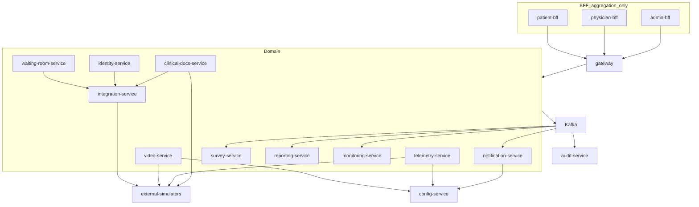

# Part 3 — Core Domain Services

## Goal

Satisfy master-plan **Part 3** (all ten domain services) and the **backend** portions of [build-sequence.md](telemedicine-platform/docs/build-sequence.md) Phases 3–8:

> Integration ACL, pre-consultation, consultation, post-consultation, and operations services are real, event-producing, schema-per-service apps. BFFs aggregate live domain APIs instead of synthesizing journey/video/docs payloads.

**Exit criteria:** `verify-part3` is green: each service uses its own Postgres DB; catalogue events appear on Kafka via `OutboxRecorder`; adapters call `external-simulators` (not hardcoded `Map.of`); patient journey and physician consultation BFFs stop inventing consent/identity/video/telemetry; scheduler internal job paths exist and fail-open; no second JWT/error/outbox/config/audit/provider-selection implementation.

Frontend (`video-adapter`, consultation MFEs, etc.) remains **out of scope** — same boundary as Part 2.

## Locked decisions

- **Reuse Part 1 libraries.** Services must not reimplement `ApiResponse` / `ProblemDetails` / `ErrorCode`, `GlobalExceptionHandler`, servlet JWT, `EventEnvelope` / `EventTypes` / `TopicNames` / `OutboxRecorder` / `OutboxPublisher`, `Headers`, `IdGenerator`, `PageRequestSupport`, `IdempotencyKeyFilter`, `@Audited` / `ConsentAuditEvents` / `AuditHasher`, `PlatformConfigClient`, `ProviderRegistry` / `ProviderSelector` / `@ProviderAdapter`, `ExternalSystemAdapter` / `AntiCorruptionMapper` / `IntegrationHttpClientFactory` / `WebhookSignatureVerifier`, `EncryptedStringConverter`, `JourneyMetrics`, `TestJwts`.
- **Reuse Part 2 platform.** Config is read **only** through `PlatformConfigClient`. Audit is append-only via outbox `AuditRecorded` + existing Kafka consumers. Scheduler already POSTs the internal job URLs below — implement those handlers; do **not** add a second job engine or outbox sweeper.
- **Adapter ownership (no ACL soup).** `integration-service` owns HIS, SAP, payment, FONASA, MPI, Zendesk. `video-service` owns Vonage/ACS/simulator **session + chat**. `telemetry-service` owns ANURA. `clinical-docs-service` owns RecMed/Medipass. `notification-service` owns email/SMS/WhatsApp/push. Domain services never HTTP-call `/sim/**` bypassing their ACL/adapter layer.
- **SCOPE-01/02.** Scheduling and payment **processing** stay external. Integration validates and projects appointment/payment state; it does not become a scheduler or payment engine.
- **Telemetry isolation.** `telemetry-service` has **zero** compile-time dependency on `video-service`. Correlation is `appointmentId` / `sessionId` in events and HTTP only.
- **Schema-per-service.** Fix `DB_NAME:telemedicine` on all ten stubs to the DBs already created in [01-databases.sql](telemedicine-platform/infra/postgres/initdb/01-databases.sql): `waiting_room`, `identity`, `video`, `telemetry`, `clinical_docs`, `notification`, `integration`, `survey`, `reporting`, `monitoring`.
- **Actuator-only health.** Delete every domain `HealthController` (`GET /health`), matching Part 2 and [adding-a-service.md](telemedicine-platform/docs/adding-a-service.md).
- **BFFs stay aggregation-only.** Wire the RestClients Part 2 already configured but left unused. Do not move consent/status/video rules into BFFs.

## Current state (verified on disk)

| Service | Port | Today | Gap |
|---|---|---|---|
| `integration-service` | 8107 | Mock JSON `AppointmentService` + `/v1/appointments/v2`; no simulator adapters, no events | Real ACL + outbox + postgres profile |
| `waiting-room-service` | 8101 | Five stub controllers; contract path `/session-link` vs code `/links` | Consent/link/device/queue/status + Redis queue + events |
| `identity-service` | 8102 | Hardcoded validate; 2FA code `"123456"` in-process | FONASA via integration; lockout; events |
| `notification-service` | 8106 | `POST /send` fake SENT | Templates, channels, event consumers, scheduler job |
| `video-service` | 8103 | Local `VideoProviderRegistry` returning UUIDs; **no** simulator HTTP; manual `POST /provider/{name}` | `ProviderSelector` + simulator adapters + chat persistence + failover |
| `telemetry-service` | 8104 | Fake ANURA token/results | Independent ANURA adapter; consent + config gates |
| `clinical-docs-service` | 8105 | Fake documentId | PDF + RecMed/Medipass + MinIO encryption + download tokens |
| `survey-service` | 8108 | NPS echo | Definitions, `ConsultationClosed` dispatch, responses |
| `reporting-service` | 8109 | Hardcoded KPIs | Event-sourced three KPI families + export |
| `monitoring-service` | 8110 | Hardcoded snapshot consumed by admin/physician BFFs | Live snapshot, quality, alerts, SLO; produces `ConnectionQualityDegraded` |

Gateway already routes all ten; **named circuit breakers are missing** for telemetry, clinical-docs, notification, integration, survey, reporting, monitoring. Compose `platform` profile has no domain services. OpenAPI exists only for waiting-room (partial/mismatched). Scheduler job targets already seeded in [V1__scheduler.sql](telemedicine-backend/platform/scheduler-service/src/main/resources/db/migration/V1__scheduler.sql).

---

## Step 3.0 — Narrow gap-fills (do first; no new Gradle modules)

Keep these small so services do not copy-paste clients or simulator stubs.

### Simulators ([VendorSimulators.java](telemedicine-backend/simulators/external-simulators/src/main/java/com/telemedicine/simulators/VendorSimulators.java))

Add missing vendor surfaces already named in `ExternalSystems`:

- ACS: `POST /sim/acs/token`, `POST /sim/acs/outage` (mirror Vonage).
- MPI: `GET /sim/mpi/patients/{patientRef}` (demographics; no extra HIS scheduling logic).
- Medipass: `POST /sim/medipass/certificates`.
- Notification channels: `POST /sim/notify/{email,sms,whatsapp,push}` (injectable latency/error via existing `X-Sim-Scenario`).
- RecMed: add `POST /sim/recmed/certificates` if prescriptions-only is insufficient for medical leave.

Do **not** add a second scenario header; keep `Headers.SIM_SCENARIO` / `SimScenario.HEADER`.

### Testing library

Extend [SimulatorStubs.java](telemedicine-backend/shared/java-common-testing/src/main/java/com/telemedicine/common/testing/wiremock/SimulatorStubs.java) beyond HIS/FONASA/Vonage to SAP, payment, ACS, ANURA, RecMed, Medipass, MPI, Zendesk, notify. Domain tests must not invent local WireMock mappings for those paths.

### Consent verifier (one HTTP implementation)

`PermissiveConsentVerifier` stays the **missing-bean** default. Add `HttpConsentVerifier` in `java-common-security` (RestClient to waiting-room `GET /api/v1/waiting-room/consent/{subjectId}?type=&version=`). Waiting-room registers a **local JPA** `ConsentVerifier` that does not loop back over HTTP. Identity, video, and telemetry use the HTTP verifier (or explicit waiting-room GET) — never a second consent table.

### Gateway

Add named circuit breakers + `fallbackUri: forward:/fallback` for the seven routes that currently rely on `defaultCircuitBreaker` only (telemetry, clinical-docs, notification, integration, survey, reporting, monitoring). Add route `Path=/api/v1/integration/webhooks/**` → `lb://integration-service` for SAP inbound.

---

## Step 3.1 — `integration-service` (:8107) — ACL first

Replace in-process “always confirm payment” behaviour. Keep `@Profile("mock")` JSON repos **for tests only**; compose/dev uses postgres + simulator adapters.

**Data:** DB `integration`. Flyway `V1` appointment projection + outbox (`classpath:db/migration,classpath:db/migration/common`). Projection is an ACL cache, not a scheduling system. `ddl-auto: validate`. `@EnableTelemedicinePersistence`.

**Adapters** (each extends `ExternalSystemAdapter`, clients from `IntegrationHttpClientFactory`, system names from `ExternalSystems`):

| Adapter | Simulator | Operations |
|---|---|---|
| HIS | `/sim/his` | get appointment, update status |
| SAP | `/sim/sap` | verify appointment; inbound `link-request` webhook |
| Payment | `/sim/payment` | validate (read-only) |
| FONASA | `/sim/fonasa` | 2FA challenge/verify |
| MPI | `/sim/mpi` | patient lookup |
| Zendesk | `/sim/zendesk` | create ticket (low priority, still ship adapter) |

Inbound: `POST /api/v1/integration/webhooks/{system}` with `WebhookSignatureVerifier` (replay cache already in the library). SAP link-request → payment+appointment verify → HTTP `POST` waiting-room session-link (when waiting-room is up; fail with `ErrorCode.INTEGRATION_ERROR` + metric if not).

**Keep/expand** [AppointmentIntegrationController](telemedicine-backend/services/integration-service/src/main/java/com/telemedicine/integrationservice/api/AppointmentIntegrationController.java):

- `POST/GET /v1/appointments/v2`, `PUT /{id}/status`, `POST /{id}/reschedule` — pass through HIS/SAP; persist projection; outbox `AppointmentCreated` / `AppointmentRescheduled` / `StatusChanged` is **not** this service’s event (`StatusChanged` producer is waiting-room). Integration publishes `AppointmentCreated`, `AppointmentRescheduled`, `PaymentConfirmed`, `ConsultationClosed`, `IntegrationFailed`.
- `POST /{id}/payment/validate` — payment adapter; on success outbox `PaymentConfirmed`. Never mark paid without the adapter.
- `GET /{id}/mpi` — MPI adapter.
- **New internal (service-to-service, `@IsService`):** `POST /api/v1/integration/fonasa/2fa/challenge|verify`, `POST /api/v1/integration/his/appointments/{id}/status`, `POST /api/v1/integration/zendesk/tickets`.

`ConsultationClosed`: physician/waiting-room/video completion calls `PUT .../status` to `COMPLETED` (or dedicated `POST /{id}/close`); integration emits `ConsultationClosed` once, idempotent on appointment id.

Contract: `shared/contracts/integration-service.yaml`.

---

## Step 3.2 — `waiting-room-service` (:8101)

Five bounded modules, one schema. Align HTTP paths with the contract and traceability (`/session-link`, not `/links`).

**Data:** DB `waiting_room`. Tables: `consents`, `session_links`, `device_tests`, `queue_entries`, `appointment_status`. Redis sorted-set for live queue (Part 8). PHI-free ids in events; consent text version only.

**Consent**

- `POST /api/v1/waiting-room/consent/platform` and `/clinical` — `@IsPatient`, `@Audited`, `IdempotencyKeyFilter`. Persist versioned grant. `ConsentAuditEvents.recordGranted` + outbox `ConsentGranted`.
- `POST /api/v1/waiting-room/consent/withdraw` — immutable withdraw trail; `ConsentWithdrawn`. Blocks further progression (`ErrorCode.CONSENT_WITHDRAWN`).
- `GET /api/v1/waiting-room/consent/{subjectId}` — used by `HttpConsentVerifier` and patient-bff.
- Types: platform T&C vs clinical informed consent; `CONSENT_VERSION_OUTDATED` when required version moves.

**Session-link**

- `POST /api/v1/waiting-room/session-link` — `@IsService` (SAP via integration) or admin. Preconditions: payment confirmed via integration `POST .../payment/validate`. Signed single-use token (HMAC/JWT), TTL, one redemption. Outbox `LinkGenerated`.
- Redeem on first authenticated patient hit: `SESSION_LINK_EXPIRED` / `SESSION_LINK_ALREADY_USED`.

**Device-test**

- `POST /api/v1/waiting-room/device-test/{appointmentId}` — camera/mic/network; outbox `DeviceTestCompleted`. Gate queue entry with `DEVICE_TEST_REQUIRED`.

**Queue**

- `GET /api/v1/waiting-room/queue/{appointmentId}` — position + `estimatedWaitSec` (this is what [PatientJourneyService](telemedicine-backend/bff/patient-bff/src/main/java/com/telemedicine/patientbff/service/PatientJourneyService.java) already calls). Entering the queue publishes `PatientEnteredWaitingRoom`. Redis + DB; Redis loss rebuilds from DB.

**Status machine** (waiting-room is source of journey status; HIS is synced through integration)

Allowed: `OPEN_PATIENT` → `CHECKED_IN` → `OPEN_DOCTOR`. Reject others with `ConflictException.invalidTransition` / `INVALID_STATUS_TRANSITION`.

Gates for `CHECKED_IN`: platform+clinical consent, identity validated (consume `IdentityValidated` or GET identity), device-test pass, payment confirmed.

`OPEN_DOCTOR`: physician admit (`@IsPhysician`). Sync HIS via integration status API. Outbox `StatusChanged`. Record `JourneyMetrics` waiting-time sample on check-in → admit.

**Scheduler jobs (`@IsService`):**

- `POST /api/v1/internal/jobs/waiting-room-timeout/run`
- `POST /api/v1/internal/jobs/no-show-detection/run`

Fail-open internally if integration is down; do not throw across the scheduler HTTP boundary in a way that double-fires (return 200 + metric, matching Part 2 scheduler fail-open).

Expand [waiting-room-service.yaml](telemedicine-backend/shared/contracts/waiting-room-service.yaml) to full schemas (consent clinical/withdraw, status, internal jobs).

---

## Step 3.3 — `identity-service` (:8102)

**Data:** DB `identity`. Tables: `identity_verifications`, `fonasa_challenges` (challenge id, attempts, lockout_until). Do **not** store raw RUT/phone in plaintext — `EncryptedStringConverter`.

**API** (keep existing paths):

- `POST /api/v1/identity/validate` — MPI lookup **through integration** `GET /v1/appointments/v2/{id}/mpi`. Outbox `IdentityValidated` or `IdentityValidationFailed`.
- `POST /api/v1/identity/fonasa/2fa/challenge` — call integration FONASA challenge; persist challenge; retry limits.
- `POST /api/v1/identity/fonasa/2fa/verify` — call integration verify; **delete** the in-controller `"123456"` check (that belongs to the simulator). Lockout → `IDENTITY_LOCKED_OUT` / `IDENTITY_2FA_*`.

`@RequiresConsent` / HTTP consent check before 2FA. No FONASA WebClient inside identity.

Contract: `shared/contracts/identity-service.yaml`.

---

## Step 3.4 — `notification-service` (:8106)

**Data:** DB `notification`. Tables: `templates` (key, locale `es`/`en`, channel, body), `notification_log` (status, attempts). Channel enablement from `PlatformConfigClient.snapshot().notificationChannels()` — do not duplicate config keys.

**Adapters:** Email/Sms/WhatsApp/Push → `/sim/notify/*` via `IntegrationHttpClientFactory`. Fallback chain: preferred → next enabled channel. Template miss → `NOTIFICATION_TEMPLATE_NOT_FOUND`; all channels down → `NOTIFICATION_CHANNEL_UNAVAILABLE`.

**API:** keep `POST /api/v1/notifications/send` (`@IsService`/`@IsAdmin`). Outbox `NotificationSent` / `NotificationFailed`.

**Event consumers** (`@DomainEventListener`, `@IdempotentConsumer`): `LinkGenerated`, `StatusChanged` (physician ready / `OPEN_DOCTOR`), `ClinicalDocumentIssued`, `SurveyRequested`. Do not also implement those triggers inside waiting-room/docs/survey beyond publishing the catalogue event.

**Scheduler:** `POST /api/v1/internal/jobs/appointment-reminders/run` — query integration appointments in the reminder window; fail-open.

Contract: `shared/contracts/notification-service.yaml`.

---

## Step 3.5 — `video-service` (:8103)

Delete [VideoProviderRegistry](telemedicine-backend/services/video-service/src/main/java/com/telemedicine/videoservice/adapter/VideoProviderRegistry.java) and `POST /api/v1/video/provider/{name}`. Annotate adapters with `@ProviderAdapter` and resolve via existing `videoProviderSelector` / `chatProviderSelector` (config keys `video.provider` / `chat.provider`). Safe default `simulator`. Health check: simulator `/outage` and HTTP failures trigger failover (Vonage → ACS → simulator).

**Adapters** call `/sim/vonage|acs|...` through `IntegrationHttpClientFactory` — stop returning random UUIDs in-process.

**Data:** DB `video`. Tables: `video_sessions` (appointmentId, provider, recordingPolicy), `session_tokens`, `chat_threads`, `chat_messages` (body via `EncryptedStringConverter`; `ChatMessageSent` payload stays PHI-free).

**API:**

- `POST /api/v1/video/sessions` — create; outbox `VideoSessionCreated`.
- `POST /api/v1/video/sessions/{id}/tokens` — per-role tokens; `VIDEO_TOKEN_ISSUE_FAILED` / `VIDEO_PROVIDER_UNAVAILABLE`.
- Join/leave tracking → `VideoSessionStarted` / `VideoSessionEnded`; `JourneyMetrics.recordVideoEnterTime`.
- `POST /api/v1/video/sessions/{id}/quality` — samples for monitoring (no new event type).
- Chat: keep `/api/v1/video/sessions/{sessionId}/chat` persist + `ChatMessageSent`.
- Recording policy flag from session create body / config; do not build a recording pipeline.

**Scheduler:** `POST /api/v1/internal/jobs/session-expiry-cleanup/run`.

No dependency on telemetry artifacts.

Contract: `shared/contracts/video-service.yaml`.

---

## Step 3.6 — `telemetry-service` (:8104)

Independently deployable. Gradle must not `project(':video-service')`.

**Data:** DB `telemetry`. Table `measurements` (normalised metrics; **no** raw clinical payload on Kafka). `TelemetryMeasured` is PHI-free (`metricType`, `measurementId` only).

**Adapter:** ANURA → `/sim/anura/token` and `/decryptResults` via `ExternalSystemAdapter`.

**Gates:** `PlatformConfigClient` `telemetry.enabled` + `telemetry.activation.rules` JSON (appointment type / specialty). Off → `TELEMETRY_NOT_ENABLED`. Consent via `HttpConsentVerifier`.

**API:** keep `POST /api/v1/telemetry/token`, `POST /api/v1/telemetry/results`.

Contract: `shared/contracts/telemetry-service.yaml`.

---

## Step 3.7 — `clinical-docs-service` (:8105)

**Data:** DB `clinical_docs`. Tables: `documents`, `prescriptions`, `medical_leaves`, `download_tokens`. Object bytes in existing MinIO buckets `clinical-documents` and `prescriptions` ([init-buckets.sh](telemedicine-platform/infra/minio/init-buckets.sh)) — SSE at bucket; no second crypto stack besides column encryption for metadata that is PHI.

**Adapters:** RecMed prescriptions; Medipass certificates; delivery stub to SAP via integration (status/document available), not a new SAP module in this service.

**API:**

- `POST /api/v1/clinical-docs` — diagnosis + document type; generate PDF; outbox `ClinicalDocumentIssued`; `JourneyMetrics.recordDocumentIssuanceTime`.
- `POST /api/v1/clinical-docs/{appointmentId}/prescriptions` → `PrescriptionIssued`.
- `POST /api/v1/clinical-docs/{appointmentId}/medical-leave` → `MedicalLeaveIssued`.
- `GET /api/v1/clinical-docs/{appointmentId}` — list + time-limited download URL (patient-bff already expects `downloadUrl`).
- Errors: `DOCUMENT_*`, `PRESCRIPTION_ISSUE_FAILED`.

This is the downstream for physician-bff documentation (replace 501).

Contract: `shared/contracts/clinical-docs-service.yaml`.

---

## Step 3.8 — `survey-service` (:8108)

**Data:** DB `survey`. Tables: `survey_definitions` (versioned), `survey_requests`, `survey_responses` (unique appointmentId → `SURVEY_ALREADY_SUBMITTED`).

**Behaviour:**

- `@DomainEventListener(ConsultationClosed)` creates request, outbox `SurveyRequested` (notification consumes it).
- Scheduler backup: `POST /api/v1/internal/jobs/survey-dispatch/run`.
- `POST /api/v1/survey/{appointmentId}/responses` — NPS score; `SurveyCompleted`.
- `GET /api/v1/survey/{appointmentId}` — availability for patient-bff (`survey.available`).

Contract: `shared/contracts/survey-service.yaml`.

---

## Step 3.9 — `reporting-service` (:8109)

**Data:** DB `reporting`. Materialised KPI snapshots keyed by day/window. Consume catalogue events (do not scrape other DBs). Reuse `JourneyMetrics` **names** for technical/functional series; do not invent parallel metric identifiers.

Three families from the master plan:

- **Technical:** availability, latency, MTTR (from gateway/actuator + `IntegrationFailed` / video failover events).
- **Functional:** avg waiting time, time-to-video, payment success rate, completed consultation rate, abandonment, document issuance time.
- **Business:** patient NPS (`SurveyCompleted.score`), physician satisfaction (placeholder field if no event yet — `null` not a fake 4.8), cost/incident reduction as derived counters from incidents/alerts.

**API:** `GET /api/v1/reporting/kpis` (replace hardcoded map), `GET /api/v1/reporting/kpis/{family}`, `POST /api/v1/reporting/exports` (CSV/Excel to MinIO; reuse audit-export style URLs, bucket can be `audit-exports` prefix `reporting/` **or** document a `reporting-exports` bucket in `init-buckets.sh` — one new bucket is OK, not a new object-store client).

**Scheduler:** `POST /api/v1/internal/jobs/report-generation/run`.

Admin-bff KPI fields stay degraded until this API is wired (thin BFF change in Step 3.11).

Contract: `shared/contracts/reporting-service.yaml`.

---

## Step 3.10 — `monitoring-service` (:8110)

**Data:** DB `monitoring`. Tables: `session_health`, `alert_rules`, `alerts`, `slo_windows`. Redis cache for the live snapshot admin-bff already consumes.

**Consumers:** `VideoSession*`, `TelemetryMeasured`, `StatusChanged`, `PatientEnteredWaitingRoom`, `IntegrationFailed`, `NotificationFailed`, plus video quality POST or a pull of `/api/v1/video/sessions/{id}/quality`. **Producer** of `ConnectionQualityDegraded` (catalogue owner is monitoring — video must not publish this type).

**API:** keep `GET /api/v1/monitoring/snapshot` field names `activeSessions`, `waitingRoomQueue`, `errorRate` (physician/admin BFFs). Extend with `connectionQuality`, `openAlerts`, `sloBurnRate` as optional fields so existing DTO mapping does not break.

Alert dispatch: POST notification-service send (service role); do not embed SMTP.

Contract: `shared/contracts/monitoring-service.yaml`.

---

## Step 3.11 — BFF wiring (aggregation only)

No new BFF databases or domain rules.

**patient-bff:** add RestClients for identity, video, survey (URLs already on `PatientBffProperties`). Journey sections from:

- consent ← waiting-room GET consent (stop inferring from `paymentStatus`)
- identity ← identity GET/status
- waitingRoom ← queue (already)
- video ← video session lookup
- documents ← clinical-docs (already)
- survey ← survey GET

Keep `DEGRADED` when a downstream fails.

**physician-bff:** use waiting-room, video, telemetry RestClients already configured. Stop synthesizing `sess-`/`tok-`. `POST /bff/physician/documentation/{appointmentId}` (align controller with [physician-bff.yaml](telemedicine-backend/shared/contracts/physician-bff.yaml)) → clinical-docs POST; remove 501.

**admin-bff:** `GET /bff/admin/snapshot` — keep monitoring snapshot; fill KPI section from reporting when present, else `DEGRADED`/`null`.

---

## Step 3.12 — Compose, env, contracts, gateway OpenAPI

- New compose profile `domain` on [docker-compose.yml](telemedicine-platform/docker-compose.yml): all ten services, Consul, healthchecks, `DB_NAME`/`DB_USER` matching initdb, Kafka, Redis (waiting-room, identity, notification, monitoring, video as needed), MinIO (clinical-docs, reporting), `KEYCLOAK_JWK_URI`, OTEL. Mirror config-service resource/healthcheck style. `depends_on` simulators for adapter traffic.
- Default `SPRING_PROFILES_ACTIVE` for integration in compose: postgres+simulators, **not** `mock`.
- Springdoc on each servlet app; gateway `/v3/api-docs` lists the new contracts.
- Internal job paths authenticated as `ROLE_SERVICE`.
- Do **not** revive `docker-compose.full-stack.yml` (deprecated empty).

---

## Step 3.13 — Tests, verify, docs

**Tests (JaCoCo ≥ 80% on the ten services + BFF wiring + gap-fill classes):**

- Integration: payment not confirmed without adapter; `X-Sim-Scenario=failure`; webhook signature reject; outbox `AppointmentCreated`/`PaymentConfirmed`; mock profile tests remain green.
- Waiting-room: consent grant/withdraw; single-use link; invalid status transition; queue position; timeout/no-show job.
- Identity: lockout after N failures; no local `123456`; MPI 404 → `MPI_PATIENT_NOT_FOUND`.
- Video: config `video.provider=vonage` then `/sim/vonage/outage` fails over to ACS/simulator; chat persisted; PHI not in `ChatMessageSent`.
- Telemetry: disabled flag → 403/problem `TELEMETRY_NOT_ENABLED`; no video-service compile dep (ArchUnit).
- Clinical-docs: object appears in MinIO Testcontainer; download token TTL.
- Survey: duplicate POST → `SURVEY_ALREADY_SUBMITTED`; `ConsultationClosed` → `SurveyRequested`.
- Notification: channel disabled in config skipped; event-driven send idempotent.
- Reporting: KPI computed from recorded events, not fixtures.
- Monitoring: snapshot numbers change after `VideoSessionStarted`; `ConnectionQualityDegraded` outbox.
- BFFs: journey not `PENDING` when waiting-room/identity up; documentation 201/200 not 501.
- Use `TestJwts` + `SimulatorStubs`; no second JWT factory.

**Scripts:** `telemedicine-platform/scripts/verify-part3.ps1` and `.sh`:

1. Gradle `:check` on the ten services + three BFFs + `external-simulators`.
2. Compose `infra,observability,sim,edge,platform,domain` healthy; Consul lists all ten.
3. Appointment create → payment validate → session-link → consent → identity → device-test → queue → status `CHECKED_IN`.
4. Video session create with simulator provider; Kafka `VideoSessionCreated`.
5. Telemetry token with `telemetry.enabled=true`.
6. Close consultation → survey request event → notification log.
7. Document POST → MinIO object; reporting KPI endpoint non-stub; monitoring snapshot non-constant.
8. Unauthenticated non-dev `/api/v1/waiting-room/**` → 401.
9. Gateway `/v3/api-docs` lists domain contracts.

**Docs:** update [build-sequence.md](telemedicine-platform/docs/build-sequence.md) Phases 3–8 backend exit; [technical-design-document.md](telemedicine-platform/docs/technical-design-document.md) domain section; [operational-manual.md](telemedicine-platform/docs/operational-manual.md) (domain profile, internal jobs); [runbooks.md](telemedicine-platform/docs/runbooks.md) (video failover, webhook, no-show); [adding-a-service.md](telemedicine-platform/docs/adding-a-service.md) if needed; [traceability-matrix.md](telemedicine-platform/docs/traceability-matrix.md) PAT-01..10, PHY, SCOPE-01/02 verification columns.

---

## Anti-duplication checklist

- No second `ApiResponse` / problem JSON writer.
- No second correlation header; use `Headers.CORRELATION_ID`.
- No second outbox poller (library `OutboxPublisher` only).
- No second config client; no ad-hoc `RestClient` to `config-service`.
- No second provider registry in video; no `POST /provider/{name}`.
- No FONASA/HIS/payment WebClients outside `integration-service`.
- No ANURA client inside `video-service`; no video client inside `telemetry-service`.
- No second consent ledger (waiting-room + existing audit-service `consent_ledger` consumer).
- No homemade RBAC tables or `/health` controllers.
- No JSON mock as the **runtime** store for compose (integration `mock` profile is test-only).
- No scheduling/payment business logic in waiting-room or BFFs.
- No duplicate scheduler job catalog.
- No parallel KPI names vs `JourneyMetrics`.
- Do not implement frontend adapters/MFEs in this part.

## Out of scope

Frontend packages and MFEs (master-plan Parts 5–6 / build-sequence Phase 5–8 UI). Kubernetes HA, k6 300 ms gates, Blue/Green (Part 9 / Phase 6). Real vendor SDKs (simulators until adapters are stable). Keycloak Admin write-RBAC. Physician satisfaction instrument if no source event exists — expose `null`, do not fake scores.
