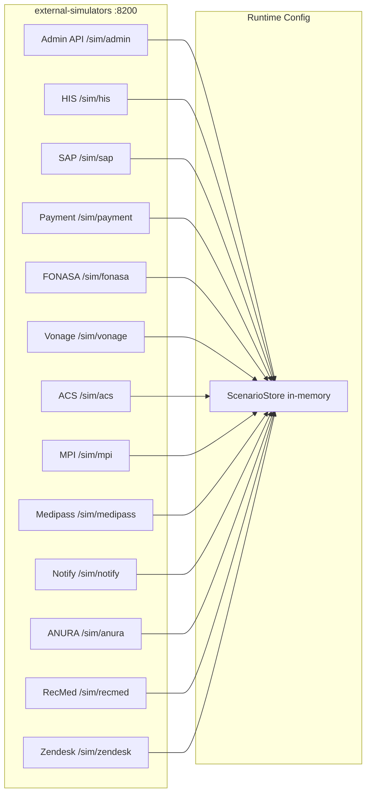

# Part 4 — External Adapters and Simulators

## Goal

Satisfy master-plan **Part 4** and validate the resilience patterns built into Part 3 domain services:

> Every external vendor is faithfully simulated with injectable latency, configurable error rates, stateful lifecycle flows, and realistic response schemas so the platform can be exercised end-to-end without vendor credentials. The simulator is excluded from production manifests.

**Exit criteria:** `verify-part4` is green: every vendor controller supports configurable latency and error-rate injection via the admin API; stateful appointment and FONASA flows work across multiple requests; provider failover triggers automatically when the outage endpoint is hit; k6 smoke-test exercises the resilience patterns; SimulatorStubs in `java-common-testing` stay in sync with the live simulator; the simulator is absent from production K8s manifests.

## Locked decisions

- **Single Spring Boot app.** All vendor controllers stay in `simulators/external-simulators` (:8200). No per-vendor microservices.
- **dev/test profiles only.** Excluded from production compose profiles and K8s manifests. Never deployed where real vendor adapters operate.
- **No vendor SDK dependencies.** The simulator uses plain Spring Web; it must never import Vonage, ACS, or ANURA SDKs.
- **Backward compatible.** Existing `X-Sim-Scenario` header and deterministic-ID logic stays unchanged. New features layer on top.
- **SimulatorStubs parity.** Every enhancement here is mirrored in `java-common-testing/SimulatorStubs.java` so domain service tests exercise the same contracts.
- **No domain service code changes.** Adapters in Part 3 services already call the `/sim/**` paths with `IntegrationHttpClientFactory`. This part hardens the simulator side only.

## Current state (verified on disk)

| Aspect | What exists | Gap |
|--------|-------------|-----|
| Vendor controllers | All 12 (HIS, SAP, payment, FONASA, Vonage, ACS, MPI, Medipass, notify, ANURA, RecMed, Zendesk) | Basic `Map.of()` responses; no realistic payloads |
| Scenario switching | `X-Sim-Scenario: success/failure/timeout` via `SimScenario.requireSuccess()` | No latency injection, no error-rate probability, no partial failures |
| Stateful flows | Vonage/ACS have `outage` boolean toggle | No appointment lifecycle state, no FONASA challenge state, no multi-step coherence |
| Configuration | None at runtime | No admin API to set latency/error rates/scenarios per vendor |
| Response schemas | Flat 3-4 field maps | Missing pagination, timestamps, error detail bodies matching vendor shapes |
| Production exclusion | Compose `sim` profile; Dockerfile exists | No K8s manifest exclusion; no prod-safety guard |
| Testing library | `SimulatorStubs.registerAll()` covers all 12 vendors with success/failure/timeout | No latency/error-rate stubs; no stateful scenario stubs |
| Documentation | None | No OpenAPI for the simulator; no scenario catalogue |



---

## Step 4.0 — Simulator engine: latency and error-rate injection

The core enhancement. Replace `SimScenario.requireSuccess()` with a richer `SimulatorEngine` that every controller delegates to.

### `SimulatorEngine`

New class in `com.telemedicine.simulators.engine`:

- **Per-vendor configuration** stored in `ConcurrentHashMap<String, VendorConfig>`:
  - `latencyMs` (fixed delay in millis; 0 = no delay)
  - `latencyJitterMs` (random jitter added to base latency)
  - `errorRate` (double 0.0–1.0; probability of returning a 503)
  - `timeoutRate` (double; probability of a simulated hang that exceeds client read timeout)
  - `scenario` (default scenario override: `success` | `failure` | `timeout` | `partial`)
  - `enabled` (boolean; disabled vendor → always 503 "vendor unavailable")
- **Resolution order for each request:**
  1. `X-Sim-Scenario` header (highest priority — tests drive explicit scenarios)
  2. Per-vendor `errorRate` / `timeoutRate` (probabilistic; `ThreadLocalRandom`)
  3. Per-vendor `latencyMs + jitter` (applied before response on success path)
  4. Vendor `enabled` flag (disabled = 503 always)
  5. Default: `success` with zero delay
- **Latency injection via `Thread.sleep()`** on the servlet thread (acceptable for a dev-only tool).
- **Timeout simulation:** sleep for 30+ seconds (longer than any downstream `time-limiter` in `java-common-integration`), so circuit breakers and timeouts actually fire.
- **Partial failure:** new scenario `partial` returns 200 with a response body containing `"status": "PARTIAL"` and missing fields, exercising the services' null-safety and defensive parsing.

### `VendorConfig` defaults

Seeded from `application.yml` with safe defaults (all zero latency, zero error rate, enabled):

```yaml
telemedicine:
  simulator:
    vendors:
      his: { latencyMs: 0, latencyJitterMs: 0, errorRate: 0.0, timeoutRate: 0.0, enabled: true }
      sap: { ... }
      payment: { ... }
      fonasa: { ... }
      vonage: { ... }
      acs: { ... }
      mpi: { ... }
      medipass: { ... }
      notify: { ... }
      anura: { ... }
      recmed: { ... }
      zendesk: { ... }
```

### Controller migration

Each existing controller calls `engine.preProcess(vendorName, scenarioHeader)` at method entry. This replaces the current `SimScenario.requireSuccess()` call. Keep `SimScenario.deterministicId()` and `SimScenario.HEADER` unchanged.

---

## Step 4.1 — Admin configuration API

New `@RestController` at `/sim/admin`:

| Endpoint | Method | Description |
|----------|--------|-------------|
| `/sim/admin/vendors` | GET | List all vendors with current config |
| `/sim/admin/vendors/{vendor}` | GET | Single vendor config |
| `/sim/admin/vendors/{vendor}` | PUT | Update latency/error-rate/enabled for one vendor |
| `/sim/admin/vendors/{vendor}/reset` | POST | Reset to YAML defaults |
| `/sim/admin/reset` | POST | Reset ALL vendors to defaults |
| `/sim/admin/scenarios/chaos` | POST | Enable "chaos mode" — random latency 100–500ms + 10% error rate on all vendors |
| `/sim/admin/scenarios/happy` | POST | Reset to zero-latency zero-error success-only |
| `/sim/admin/scenarios/resilience` | POST | Set Vonage error 100% (forces failover to ACS), payment 20% failure, HIS 200ms latency |
| `/sim/admin/state` | GET | Dump all stateful state (appointments, challenges, outages) |
| `/sim/admin/state` | DELETE | Clear all stateful state |

No authentication on the admin API (dev tool only). The `enabled: false` flag on production compose profiles means the app never starts in prod.

---

## Step 4.2 — Stateful lifecycle scenarios

Currently each vendor controller is stateless (generates deterministic IDs from input). Add optional in-memory state tracking for multi-step flows.

### Appointment lifecycle state

`AppointmentStateStore` (`ConcurrentHashMap<String, AppointmentState>`):

- Created when HIS `GET /sim/his/appointments/{id}` is first called with a new ID (or via SAP link-request)
- Tracks: `status` (SCHEDULED -> IN_PROGRESS -> COMPLETED -> CANCELLED), `paymentStatus`, `linkedAt`, `consentStatus`
- HIS `POST .../status` transitions the state machine; returns 409 on invalid transitions
- Payment `GET /validate/{id}` returns `paid: false` if appointment not in the store or payment not confirmed
- SAP `GET .../verify` returns `valid: false` if appointment doesn't exist

### FONASA 2FA state

`FonasaChallengeStore`:

- `POST /2fa/challenge` persists a challenge with a known code (`"123456"` for success, `"000000"` for failure scenario)
- `POST /2fa/verify` checks the stored challenge; increments attempt count; returns `verified: false` after 3 failed attempts (lockout simulation)
- Challenge expires after 5 minutes (in-memory TTL)
- Stale challenge → `{"verified": false, "reason": "EXPIRED"}`

### Video session state

`VideoSessionStore`:

- `POST /session` records the session (provider, appointmentId, createdAt)
- `POST /token` requires a valid session to exist; 404 if no session
- Outage toggles still work; when outage clears, existing sessions remain valid
- Optional: `DELETE /sim/vonage/sessions/{id}` to simulate provider-side disconnect

### Notification delivery tracking

`NotifyDeliveryLog` (bounded circular buffer, max 100 entries):

- Every `POST /sim/notify/{channel}` appends to the log
- `GET /sim/admin/notifications` returns recent deliveries (for E2E assertion without Kafka)
- `GET /sim/admin/notifications?appointmentId={id}` filters by appointmentId if present in body

---

## Step 4.3 — Enriched response payloads

Replace `Map.of()` with typed response DTOs that match real vendor schemas more closely. This ensures service adapters handle all fields correctly.

### HIS

```java
record HisAppointmentResponse(
    String appointmentId, String status, String patientId,
    String specialty, String physicianId, String scheduledAt,
    String facilityCode, String appointmentType
) {}
```

Add `specialty: "general"`, `physicianId: deterministicId("phy", id)`, `scheduledAt: Instant.now().toString()`, `facilityCode: "CL-SCL-001"`, `appointmentType: "TELEMEDICINE"`.

### SAP

Add `verificationTimestamp`, `engineVersion: "2.1"`, `requestedBy` to responses.

### Payment

Add `currency: "CLP"`, `amount: 25000`, `paymentMethod: "FONASA"`, `paidAt` timestamp to validate response.

### FONASA

Add `expiresAt` (5 min from challenge creation), `attemptsRemaining: 3` to challenge response. Add `reason` field to verify response on failure.

### Vonage/ACS

Add `apiKey: "sim-key"`, `createdAt`, `expiresAt: +24h`, `maxParticipants: 2` to session. Add `expiresAt`, `connectionData` to token.

### MPI

Add `gender`, `bloodType`, `insuranceType: "FONASA"`, `address: { region, city }`, `contactPhone` (masked), `emergencyContact` fields.

### ANURA

Add `measurementId`, `capturedAt`, `confidence: 0.95`, `metrics: { heartRate, respiratoryRate, stress, bloodPressureEstimate }` to decryptResults.

### RecMed / Medipass

Add `validatedAt`, `expiresAt`, `documentUrl: "/sim/documents/{id}"`, `physicianRut` (masked hash).

---

## Step 4.4 — Additional scenario modes

Beyond `success`/`failure`/`timeout`, add vendor-specific scenarios via `X-Sim-Scenario` header:

| Vendor | Scenario | Behaviour |
|--------|----------|-----------|
| HIS | `not-found` | 404 — appointment does not exist in HIS |
| HIS | `stale-status` | Returns appointment but with outdated status |
| SAP | `invalid-appointment` | `valid: false` on verify |
| SAP | `duplicate-link` | 409 — link already created |
| Payment | `unpaid` | `paid: false` |
| Payment | `payment-pending` | `paid: false, status: "PENDING"` (async not yet confirmed) |
| FONASA | `locked-out` | immediate lockout response without checking code |
| FONASA | `invalid-rut` | 400 — patient RUT not found in FONASA registry |
| Vonage/ACS | `session-expired` | 410 — session no longer valid |
| Vonage/ACS | `capacity-exceeded` | 429 — too many concurrent sessions |
| ANURA | `measurement-failed` | 200 with `confidence: 0.0` and empty metrics |
| ANURA | `consent-missing` | 403 — patient consent not recorded |
| RecMed | `validation-error` | 422 — prescription validation failed (missing fields) |
| Medipass | `certificate-rejected` | 422 — certificate rejected by regulatory body |
| Zendesk | `rate-limited` | 429 with `Retry-After` header |
| Notify | `channel-unavailable` | 503 for specific channel |
| Notify | `invalid-recipient` | 400 — recipient format invalid |
| MPI | `not-found` | 404 — patient not in MPI registry |
| MPI | `multiple-matches` | 300 with list of candidates (ambiguous match) |

Each new scenario follows the existing pattern: check `X-Sim-Scenario` header first, then fall through to engine probabilistic config.

---

## Step 4.5 — SimulatorStubs parity (`java-common-testing`)

Keep [SimulatorStubs.java](telemedicine-backend/shared/java-common-testing/src/main/java/com/telemedicine/common/testing/wiremock/SimulatorStubs.java) in sync:

- Update response bodies to match the enriched payloads from Step 4.3 (add the new fields)
- Add scenario-specific stubs for each new scenario in Step 4.4:
  - `SimulatorStubs.hisNotFound(server)` — stubs HIS 404
  - `SimulatorStubs.paymentUnpaid(server)` — stubs `paid: false`
  - `SimulatorStubs.fonasaLockedOut(server)` — stubs lockout
  - `SimulatorStubs.vonageSessionExpired(server)` — stubs 410
  - `SimulatorStubs.mpiNotFound(server)` — stubs 404
  - etc.
- Add `SimulatorStubs.withLatency(server, vendor, delayMs)` — sets a `fixedDelay` on WireMock for load testing assertions
- Add `SimulatorStubs.withErrorRate(server, vendor, rate)` — uses WireMock's scenario state machine for probabilistic failure in tests
- Keep existing `registerAll()` unchanged (backward compatible)
- New `registerAllWithScenarios(server)` that also registers the vendor-specific failure stubs alongside success stubs (priority-ordered so `X-Sim-Scenario` header selects them)

### Contract sync test

Add a test in `java-common-testing` that:
1. Loads the simulator's actual response shapes (could parse `VendorSimulators.java` or use a shared schema)
2. Asserts `SimulatorStubs` returns bodies with the same field set
3. Fails the build if they diverge (same pattern as `EventTypes` <-> `event-catalogue.yaml` sync)

---

## Step 4.6 — Production exclusion and safety guards

### Compose

Already on `sim` profile (correct). Verify:
- `docker compose --profile infra,observability,edge,platform,domain up` does NOT start simulators
- Domain service adapters fail-open with `ErrorCode.INTEGRATION_ERROR` when simulators are absent and `spring.profiles.active` includes `prod`

### Kubernetes

- Ensure no simulator `Deployment`/`Service` in `telemedicine-platform/deploy/kubernetes/` (or explicitly gated by namespace `dev`/`staging` only)
- Add a `SimulatorSafetyGuard` `@Component` in the simulator app that **refuses to start** if `TELEMEDICINE_ENVIRONMENT=production` is set (belt and suspenders)

### Domain service adapter safety

Verify (not new code — audit existing):
- Every adapter in `integration-service`, `video-service`, `telemetry-service`, `clinical-docs-service`, `notification-service` uses `TelemedicineIntegrationProperties.getSimulator().getBaseUrl()` (already configured)
- No adapter hardcodes `http://external-simulators:8200`
- All adapters have `@ConditionalOnProperty` or profile guard so they can be swapped for real vendor adapters without code change

---

## Step 4.7 — E2E journey scenario automation

New `SimulatorScenarios` utility class in the simulator app (test source set) and corresponding scripts for manual/CI execution:

### Journey scenario scripts

`telemedicine-platform/scripts/simulator-scenarios/`:

- `happy-path.http` — HTTPie/IntelliJ HTTP file exercising the full patient journey:
  1. `POST /sim/admin/scenarios/happy` (reset)
  2. HIS appointment create → payment validate → SAP verify → session-link
  3. FONASA challenge + verify
  4. Vonage session + token
  5. ANURA token + results
  6. RecMed prescription + Medipass certificate
  7. Zendesk ticket
  8. Assertions on each response

- `failover.http` — Video provider failover:
  1. `POST /sim/vonage/outage` enable=true
  2. Video session create → should fail on Vonage
  3. Service retries on ACS → succeeds
  4. `POST /sim/vonage/outage` enable=false (restore)

- `resilience.http` — Chaos scenario:
  1. `POST /sim/admin/scenarios/resilience`
  2. Multiple calls to payment → assert ~20% 503
  3. HIS calls → assert ~200ms latency
  4. Video session → assert ACS used (Vonage at 100% error)

- `fonasa-lockout.http` — FONASA lockout flow:
  1. Challenge
  2. Verify with wrong code x3
  3. Assert lockout response

### k6 load test support

`telemedicine-platform/scripts/k6/simulator-load.js`:

- Configure simulator with `POST /sim/admin/vendors/{vendor}` for realistic latencies (HIS: 150ms, payment: 80ms, Vonage: 50ms)
- Run 50 VU against the full journey through gateway + domain services
- Assert p95 < 300ms (the NFR target) with injected vendor latency included
- This proves the system meets SLA even with realistic vendor response times

---

## Step 4.8 — Simulator OpenAPI and documentation

### OpenAPI contract

New `shared/contracts/external-simulators.yaml`:

- Documents every `/sim/**` endpoint
- Documents `/sim/admin/**` configuration API
- Documents all `X-Sim-Scenario` values per vendor
- Documents response DTOs with all enriched fields
- Documents error response shapes

Springdoc on the simulator app: `GET /sim/v3/api-docs` serves the spec. Gateway already routes `/sim/**` to the simulator.

### Scenario catalogue

New `telemedicine-platform/docs/simulator-scenarios.md`:

- Table of all vendors, endpoints, supported scenarios, and expected responses
- How to configure latency/error rates via the admin API
- How to drive stateful flows (appointment lifecycle, FONASA lockout)
- How to run the k6 load test with vendor latency
- How to use SimulatorStubs in service tests

---

## Step 4.9 — Tests and verification

### Unit tests (in simulator app)

- `SimulatorEngineTest` — latency injection fires `Thread.sleep`, error rate produces failures within statistical bounds (100 calls at 50% → ~40-60 failures), timeout rate exceeds 30s, disabled vendor → always 503
- `AppointmentStateStoreTest` — lifecycle state machine, invalid transitions → 409
- `FonasaChallengeStoreTest` — challenge creation, verify success, lockout after 3 failures, expiry
- `VendorConfigTest` — YAML binding, reset to defaults
- All existing scenarios still pass (no regressions)

### Integration tests

- Admin API CRUD: set latency → call vendor → assert response time >= latency
- Stateful: create appointment via HIS → verify via SAP → payment validate (returns true)
- Provider failover: outage Vonage → video-service (via gateway) gets ACS session
- SimulatorStubs parity: run same scenario against live simulator and WireMock stubs, assert response shapes match

### Verify script

`telemedicine-platform/scripts/verify-part4.ps1` and `.sh`:

1. `./gradlew :external-simulators:check` green
2. Compose `infra,observability,sim,edge` healthy; simulator on 8200
3. `GET /sim/admin/vendors` returns 12 vendors
4. `PUT /sim/admin/vendors/his` with `latencyMs: 200` → `GET /sim/his/appointments/test-001` takes >= 200ms
5. `PUT /sim/admin/vendors/payment` with `errorRate: 1.0` → `GET /sim/payment/validate/test-001` returns 503
6. `POST /sim/admin/scenarios/happy` → all vendor calls succeed with zero delay
7. Stateful: FONASA challenge → verify with "123456" → verified: true
8. Stateful: FONASA 3x wrong code → lockout
9. `POST /sim/vonage/outage` enable → `POST /sim/vonage/session` fails; ACS still works
10. `GET /sim/v3/api-docs` returns valid OpenAPI
11. SimulatorStubs response bodies contain the enriched fields
12. Simulator absent from `docker compose --profile infra,edge,platform,domain config` service list

---

## Step 4.10 — Documentation updates

- [build-sequence.md](telemedicine-platform/docs/build-sequence.md): update Phase 0.3 and add simulator hardening exit criteria
- [operational-manual.md](telemedicine-platform/docs/operational-manual.md): add "Using the simulator admin API" section, "Running resilience scenarios" section
- [runbooks.md](telemedicine-platform/docs/runbooks.md): add "Validating provider failover" runbook using the simulator
- [technical-design-document.md](telemedicine-platform/docs/technical-design-document.md): document the simulator architecture and vendor-specific scenarios
- [traceability-matrix.md](telemedicine-platform/docs/traceability-matrix.md): verify EXT-01..08 (external systems), RES-01..03 (resilience) map to simulator scenarios
- [adding-a-service.md](telemedicine-platform/docs/adding-a-service.md): document "how to add a new vendor simulator" (add controller + config + SimulatorStub)

---

## Anti-duplication checklist

- No second scenario header; all controllers use `SimScenario.HEADER` / `Headers.SIM_SCENARIO`
- No second deterministic ID generator; keep `SimScenario.deterministicId()`
- No per-vendor configuration mechanism outside `SimulatorEngine`
- No domain logic in the simulator (it does not validate consent, JWT, or business rules)
- No real vendor SDK imports
- No second WireMock stub factory outside `SimulatorStubs`
- No simulator endpoints in production K8s manifests
- No manual `Thread.sleep` in controllers; delegate to `SimulatorEngine`

## Out of scope

Real vendor SDK integration (remains behind adapters; production uses real endpoints, not simulators). Frontend simulator adapters (`video-adapter`, `telemetry-adapter` packages have their own stubs). Load testing against 300ms NFR (Phase 9 hardening; this part provides the k6 script but not the CI gate). Kubernetes HA for the simulator (it is a dev tool). Multi-tenancy or per-team simulator isolation.
