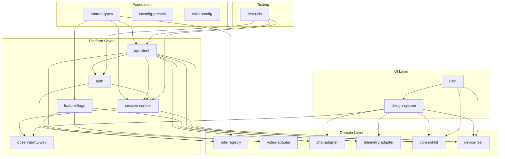

# Part 5 — Reusable Frontend Packages

## Goal

Satisfy master-plan **Part 5** and the frontend portions of [build-sequence.md](telemedicine-platform/docs/build-sequence.md) Phases 3-8:

> Every reusable frontend package is production-grade, tested, properly typed, WCAG 2.1 AA compliant where applicable, and wired into the workspace so MFEs (Part 6) consume stable APIs without duplicating auth, state, adapters, or UI components.

**Exit criteria:** `verify-part5` is green: all 17 packages build and pass lint; Vitest coverage at 80%+; `pnpm-lock.yaml` committed; `eslint-config` enforced across workspace; `tsconfig-presets` consumed by all apps; `design-system` renders themed components in Storybook; `api-client` calls gateway with auth token and correlation ID; `auth` completes PKCE flow against Keycloak; `session-context` drives journey state across MFEs; video/chat/telemetry adapters resolve from `config-service` provider setting; `i18n` renders Spanish and English; every package declares `workspace:*` dependencies (no alias-only consumption).

## Locked decisions

- **Reuse Part 3-4 backend APIs.** Packages call gateway routes established in Parts 2-3. No direct service-to-service calls from the browser.
- **No MFE feature work.** MFE apps stay at their current scaffold level. This part builds the libraries they will consume in Part 6.
- **Source-first packages with build step for types.** Keep the `"main": "./src/index.ts"` pattern for dev speed but add `tsc --emitDeclarationOnly` for `.d.ts` generation so downstream apps get autocomplete.
- **Vitest for all packages.** Consistent with the Vite toolchain already chosen. No Jest.
- **No CSS-in-JS runtime.** Design system uses CSS Modules + CSS custom properties for theming, keeping bundle size small and SSR-compatible if needed later.
- **Keycloak as OAuth2 provider.** `auth` package targets the Keycloak realm provisioned in Phase 0, matching the backend JWT validation.
- **Spanish-first, English second.** `i18n` defaults to `es` (Chilean market); `en` as secondary locale. RTL-ready structure but no RTL locale shipped.
- **Workspace protocol for all cross-package deps.** Fix the current alias-only consumption pattern; every package consumed by an app must be declared as `"@telemedicine/foo": "workspace:*"` in the app's `package.json`.

## Current state (verified via [exploration](0ce38d75-adeb-48c6-8937-c581acafda3b))

| Package | State | Gap |
|---|---|---|
| `shared-types` | `MfeRemote`, `MfeManifest`, `ApiResponse<T>` | No OpenAPI-generated DTOs; no event-type definitions |
| `shared-ui` | `ShellLayout`, `LoadingSpinner`, `ErrorMessage` (inline styles) | No theming, no accessibility, no component library |
| `design-system` | Re-exports `shared-ui` + `Button` | Stub; not consumed by any app; no theme tokens; no WCAG |
| `mfe-registry` | `fetchMfeManifest`, `getEnabledRemotes`, `loadRemoteModule` | No RBAC filtering, no config-service integration, no version negotiation, no load-failure fallback |
| `api-client` | `ApiClient`, interceptors (auth, correlation) | No OpenAPI generation, no retry/backoff, no request cancellation, no error normalisation to `ProblemDetail` |
| `auth` | PKCE helpers, `RoleGuard`, `hasRole` | Placeholder OAuth; no silent refresh, no token storage strategy, no session-expiry handling |
| `session-context` | `SessionProvider`, `useSession`, journey state machine | Functional but needs alignment with Part 3 domain events and status values |
| `video-adapter` | `SimulatorVideoAdapter` only | No Vonage/ACS implementations; no provider selection from config-service; no network-quality callbacks |
| `chat-adapter` | `InMemoryClinicalChatAdapter` | No provider adapter for Vonage/ACS; no typing/presence indicators; no message persistence integration |
| `telemetry-adapter` | `StubAnuraTelemetryAdapter` | Placeholder; no ANURA embed, no consent gate, no measurement display |
| `consent-kit` | `PlatformConsent`, `ClinicalConsent` components | UI exists but no versioned consent text, no withdrawal flow, no audit event emission, no API integration |
| `device-test` | `runPreflightChecks`, camera/mic/network tests | No speaker test, no bandwidth measurement, no remediation guidance UI |
| `i18n` | `t()`, `setLocale`, `en`/`es` catalogs | Not used in any app; incomplete catalogs; no date/number formatting |
| `feature-flags` | `ConfigServiceClient` with caching | Functional but no safe defaults when config-service unreachable; no provider toggle integration |
| `observability-web` | `ErrorBoundary` | Not used in any app; no web-vitals, no journey-step timing, no monitoring-service forwarding |
| `eslint-config` | Basic config exists | Not wired; no ESLint deps at root; no project lint targets |
| `tsconfig-presets` | `base.json`, `react.json` exist | Not consumed; apps extend `tsconfig.base.json` directly |

Additional workspace gaps:
- No `pnpm-lock.yaml`
- No test infrastructure (no Vitest config, no test targets, no spec files)
- No Storybook
- No CI lint/test gates
- Platform packages consumed via Vite/TS aliases only, not `workspace:*` deps

---

## Step 5.0 — Workspace foundation (do first)

Fix the structural gaps that every package depends on. No new packages.

### Lock file and dependency hygiene

- Run `pnpm install` to generate `pnpm-lock.yaml`; commit it
- Audit and pin all dependency versions in root `package.json`
- Add `"packageManager": "pnpm@9.15.0"` to root `package.json` (corepack enforcement)
- Add root dev deps: `vitest`, `@vitest/coverage-v8`, `@testing-library/react`, `@testing-library/jest-dom`, `@testing-library/user-event`, `jsdom`, `msw` (Mock Service Worker for API testing), `eslint`, `prettier`, `storybook`, `@storybook/react-vite`

### Wire `eslint-config`

- Add ESLint + Prettier deps to root `package.json`
- Update [packages/eslint-config](telemedicine-frontend/packages/eslint-config) with rules: `@typescript-eslint/recommended`, React hooks, accessibility (`eslint-plugin-jsx-a11y`), import ordering, no unused vars
- Add root `.eslintrc.cjs` extending `@telemedicine/eslint-config`
- Add Nx `lint` target to every project via `nx.json` `targetDefaults`
- Add Prettier config (`.prettierrc`) aligned with ESLint

### Wire `tsconfig-presets`

- Update [packages/tsconfig-presets](telemedicine-frontend/packages/tsconfig-presets) with `base.json` (lib/node), `react.json` (JSX, DOM), `vitest.json` (test paths)
- Migrate all apps to extend `@telemedicine/tsconfig-presets/react.json` instead of `tsconfig.base.json` directly
- Keep root `tsconfig.base.json` for path aliases only; `tsconfig-presets` handles compiler options

### Wire Vitest

- Add root `vitest.workspace.ts` with glob `['packages/*/vitest.config.ts', 'apps/*/vitest.config.ts']`
- Add `vitest.config.ts` template to each package (jsdom environment, coverage thresholds at 80%)
- Add Nx `test` target to every project
- Add `packages/test-utils/` package (see Step 5.14)

### Fix workspace dependency declarations

- For every app that imports a `@telemedicine/*` package via alias, add `"@telemedicine/foo": "workspace:*"` to its `package.json` `dependencies`
- Keep `vite.aliases.mts` for Vite resolution but make `package.json` the source of truth

---

## Step 5.1 — `shared-types` — OpenAPI-generated DTOs

**Current:** `MfeRemote`, `MfeManifest`, `ApiResponse<T>`

**Add:**

- OpenAPI type generation using `openapi-typescript` against the backend contracts in `telemedicine-backend/shared/contracts/*.yaml`
- Generated types for all 13 service contracts: `WaitingRoomTypes`, `IdentityTypes`, `VideoTypes`, `TelemetryTypes`, `ClinicalDocsTypes`, `NotificationTypes`, `IntegrationTypes`, `SurveyTypes`, `ReportingTypes`, `MonitoringTypes`, `ConfigTypes`, `AuditTypes`, `SchedulerTypes`
- BFF response types: `PatientJourneyResponse`, `PhysicianWorklistResponse`, `AdminSnapshotResponse`
- `ProblemDetail` type matching RFC 9457 from backend `java-common-core`
- `ErrorCode` enum mirroring backend `ErrorCode` constants
- Domain event type definitions (PHI-free payloads matching `java-common-events` payload records): `AppointmentCreated`, `ConsentGranted`, `VideoSessionStarted`, etc. — used by `session-context` for WebSocket/SSE event handling
- Journey status enum: `OPEN_PATIENT`, `CHECKED_IN`, `OPEN_DOCTOR` matching waiting-room state machine
- Consent types: `ConsentType`, `ConsentStatus`, `ConsentVersion`
- Provider types: `VideoProvider`, `ChatProvider` (`vonage | acs | simulator`)

**Generation script:** `pnpm generate:types` in package.json runs `openapi-typescript` against each contract YAML. Generated files go to `src/generated/` with a barrel re-export. Manual types stay in `src/`.

**Tests:** Type-level tests (compile-time checks) ensuring generated types match expected shapes.

---

## Step 5.2 — `design-system` — Themed component library

**Current:** Re-exports `shared-ui` `ShellLayout`/`LoadingSpinner`/`ErrorMessage` + one `Button`

**Target:** WCAG 2.1 AA accessible, themed component library replacing `shared-ui` as the single UI import for all MFEs.

**Architecture:**

- CSS custom properties for theming (no runtime CSS-in-JS)
- Two themes: `patient` (warm, approachable) and `clinical` (professional, high-contrast for physician/admin)
- `ThemeProvider` component setting `data-theme` attribute on a wrapper div
- All components use `aria-*` attributes, keyboard navigation, focus management
- Components are unstyled primitives wrapped with design tokens — not a full framework

**Components (matching master plan):**

- **Layout:** `ShellLayout` (migrate from `shared-ui`), `PageLayout`, `SplitPanel`, `Stack`, `Inline`
- **Navigation:** `Stepper` (journey progress), `Tabs`, `Breadcrumbs`
- **Data display:** `DataTable` (sortable, paginated — used by admin MFEs), `StatusBadge` (journey/connection status), `KpiCard`, `MetricBar`
- **Feedback:** `Toast` (success/error/warning/info notifications), `Skeleton` (loading placeholders), `LoadingSpinner` (migrate), `ErrorMessage` (migrate), `EmptyState`
- **Forms:** `TextField`, `Select`, `Checkbox`, `RadioGroup`, `TextArea`, `FormField` (label + error + hint), `SearchInput`
- **Overlays:** `Modal` (focus trap, escape close), `ConfirmDialog`, `Drawer`
- **Actions:** `Button` (expand existing — primary/secondary/danger/ghost variants, loading state, icon support), `IconButton`, `ButtonGroup`
- **Clinical:** `VitalSign` (telemetry display), `TimerDisplay` (consultation timer), `ConsentBanner`

**Storybook:** Configure `@storybook/react-vite` in the `design-system` package with stories per component. Both themes demonstrated. Accessibility addon (`@storybook/addon-a11y`).

**Deprecate `shared-ui`:** All MFE imports switch from `@telemedicine/shared-ui` to `@telemedicine/design-system`. `shared-ui` re-exports from `design-system` for backward compatibility during Part 5; removed in Part 6.

**Tests:** `@testing-library/react` render + interaction tests per component; axe-core accessibility audit in each test.

---

## Step 5.3 — `mfe-registry` — Production remote loading

**Current:** `fetchMfeManifest`, `getEnabledRemotes`, `loadRemoteModule` (static manifest fetch)

**Add:**

- **RBAC-aware filtering:** Accept user roles from `auth` package; filter manifest entries by a `roles` field (`roles: ["PATIENT"]` on patient MFEs, etc.); remotes the user cannot access are excluded from navigation
- **Config-service integration:** When `config-service` is reachable (via `feature-flags` package), merge `mfe.<remoteName>.enabled` flags with the static manifest; disabled MFEs are hidden even if present in the manifest file
- **Version negotiation:** Manifest entries gain `version` and `minShellVersion` fields; registry warns (console + metric) on version mismatch but still loads (graceful degradation)
- **Load-failure fallback:** Wrap `loadRemoteModule` with retry (2 attempts, 1s backoff) and a fallback error boundary that shows a branded "module unavailable" card instead of crashing the shell; emit an error event to `observability-web`
- **Caching:** Cache the resolved manifest in `sessionStorage` with a TTL; on cache hit skip the fetch for faster shell startup
- **Type safety:** All manifest types from `shared-types`; `loadRemoteModule<T>` generic for typed remote exports

**Tests:** Mock manifest fetch; RBAC filtering removes unauthorized MFEs; disabled MFE hidden; load failure shows fallback; cache hit skips fetch.

---

## Step 5.4 — `api-client` — Production HTTP client

**Current:** `ApiClient` class with auth and correlation interceptors, `createDefaultApiClient`

**Harden:**

- **Error normalisation:** All non-2xx responses parsed into the `ProblemDetail` type from `shared-types`; if the backend returns a non-RFC-9457 body (e.g. gateway HTML 503), synthesize a `ProblemDetail` with `ErrorCode.SERVICE_UNAVAILABLE`
- **Retry and backoff:** Configurable retry (default 2 attempts) with exponential backoff and jitter for 5xx and network errors; never retry non-idempotent requests without an idempotency key; honor `Retry-After` headers
- **Request cancellation:** Every request method returns an `AbortController`-aware promise; `cancelAll()` for route transitions; automatic cancellation on component unmount via a React hook `useApiClient()`
- **Auth token injection:** Read the access token from `auth` package's token store; on 401, trigger silent refresh and retry once
- **Correlation ID:** Generate or propagate `X-Correlation-Id` on every request using `crypto.randomUUID()`; propagate `X-Idempotency-Key` when provided
- **Request/response logging:** In dev mode, log request method + URL + duration + status (no PHI) to console
- **Type safety:** Generic request methods `get<T>()`, `post<T>()`, `put<T>()`, `delete<T>()` returning `ApiResponse<T>` or throwing `ApiError` wrapping `ProblemDetail`
- **Base URL:** Default to `window.location.origin` (Vite proxy in dev, same-origin in prod); overridable via `VITE_API_BASE_URL`

**New exports:** `useApiClient()` hook, `ApiError` class, `RequestConfig` type, `createApiClient(config)` factory

**Tests:** MSW-based integration tests: success, 4xx/5xx error normalisation, retry on 503, no retry on 400, cancellation, auth token refresh on 401, correlation ID header present.

---

## Step 5.5 — `auth` — OAuth2 PKCE authentication

**Current:** PKCE helper functions, `RoleGuard`, `hasRole` — placeholder OAuth flow

**Implement fully:**

- **OAuth2 Authorization Code + PKCE:** Full flow against Keycloak (`/realms/telemedicine/protocol/openid-connect/auth`, `/token`, `/logout`). Client IDs from Phase 0 realm: `patient-portal`, `physician-ui`, `admin-console`
- **Token storage:** Access token in memory (never localStorage for security); refresh token in `httpOnly` cookie via a backend proxy or in memory with silent refresh
- **Silent refresh:** Background `iframe`-based silent refresh before token expiry (configurable buffer, default 60s before `exp`); fallback to refresh-token grant if iframe blocked
- **Session expiry:** Detect expired session (no valid token + refresh fails); emit `session:expired` event; show a modal via `design-system` `Modal` prompting re-login; redirect to Keycloak login
- **Role guards:** `RequireAuth` component (redirect to login if unauthenticated), `RequireRole` component (show forbidden page if role missing), `useAuth()` hook exposing `user`, `roles`, `isAuthenticated`, `login()`, `logout()`, `getAccessToken()`
- **Route protection:** `ProtectedRoute` wrapper for React Router; integrates with `mfe-registry` RBAC filtering
- **Multi-client support:** Each shell configures its Keycloak client ID; the package reads `VITE_KEYCLOAK_CLIENT_ID` and `VITE_KEYCLOAK_URL`
- **Dev mode:** When `VITE_AUTH_MODE=dev`, bypass Keycloak and use a mock token with configurable roles (matches backend `dev` security profile)

**Exports:** `AuthProvider`, `useAuth()`, `RequireAuth`, `RequireRole`, `ProtectedRoute`, `getAccessToken()`, `AuthConfig`

**Tests:** Mock Keycloak token endpoint; PKCE verifier/challenge generation; silent refresh timing; session expiry detection; role guard rendering; dev mode bypass.

---

## Step 5.6 — `session-context` — Cross-MFE journey state

**Current:** `SessionProvider`, `useSession`, journey step state machine

**Harden:**

- **Align with Part 3 domain model:** Journey status values match `StatusChanged` event: `LINK_GENERATED`, `CONSENT_GRANTED`, `IDENTITY_VALIDATED`, `DEVICE_TEST_COMPLETED`, `OPEN_PATIENT`, `CHECKED_IN`, `OPEN_DOCTOR`, `IN_CONSULTATION`, `CONSULTATION_CLOSED`, `SURVEY_COMPLETED`
- **Appointment context:** `appointmentId`, `patientId` (from auth claims), `physicianId`, provider config snapshot
- **Consent state:** Platform and clinical consent status, tracked per appointment
- **State persistence:** `sessionStorage` for tab persistence; clear on logout
- **BFF-driven hydration:** On mount, `GET /bff/patient/journey/{appointmentId}` (or physician/admin BFF) hydrates the full state; subsequent updates from user actions or SSE/polling
- **Event dispatch:** Custom events (`journey:statusChanged`, `journey:consentGranted`, `journey:videoStarted`) so MFEs can react without direct coupling
- **Gate logic:** `useJourneyGate(requiredStatus)` hook that checks if the journey has reached the required step; blocks navigation to consultation MFE if identity not validated, etc.

**Exports:** `SessionProvider`, `useSession()`, `useJourneyGate()`, `useAppointment()`, `JourneyStatus`, `SessionState`

**Tests:** State machine transitions; invalid transitions rejected; sessionStorage persistence; BFF hydration via MSW; gate blocks unauthorized step access.

---

## Step 5.7 — `video-adapter` — Provider-abstracted video

**Current:** `SimulatorVideoAdapter` with `createVideoAdapter('simulator')`

**Implement:**

- **Interface:** `VideoAdapter` with methods: `createSession(appointmentId)`, `joinSession(sessionId, role)`, `leaveSession()`, `muteAudio(muted)`, `muteVideo(muted)`, `switchCamera(deviceId)`, `switchMicrophone(deviceId)`, `getNetworkQuality()`, `onParticipantJoined(cb)`, `onParticipantLeft(cb)`, `onNetworkQualityChanged(cb)`, `onReconnecting(cb)`, `onDisconnected(cb)`, `destroy()`
- **Three implementations:**
  - `VonageVideoAdapter` — wraps `@vonage/client-sdk` (or Vonage TokBox `@opentok/client`); maps session/token from `video-service` API
  - `AcsVideoAdapter` — wraps `@azure/communication-calling`; maps session/token from `video-service` API
  - `SimulatorVideoAdapter` (enhance existing) — local mock with fake participant events, simulated network quality changes, no real WebRTC
- **Provider selection:** `createVideoAdapter()` reads active provider from `feature-flags` (`video.provider` key from config-service); falls back to `simulator` if config unavailable
- **Network quality:** Normalised 1-5 scale across providers; emits quality events consumed by `observability-web` and `session-context`
- **React hooks:** `useVideoSession(appointmentId)` returning `{ localStream, remoteStreams, networkQuality, isConnected, isMuted, toggleAudio, toggleVideo, switchDevice }`
- **Reconnection:** Automatic reconnect with exponential backoff on transient disconnects; escalate to error after 3 attempts

**Vendor SDKs:** Added as `peerDependencies` — each shell only installs the SDK for its configured provider. Simulator has no peer deps.

**Tests:** Adapter interface contract tests (all three pass the same suite); mock Vonage/ACS SDKs; reconnection logic; provider selection from config.

---

## Step 5.8 — `chat-adapter` — Clinical chat

**Current:** `InMemoryClinicalChatAdapter` (in-memory message store)

**Implement:**

- **Interface:** `ClinicalChatAdapter` with methods: `connect(sessionId)`, `sendMessage(text)`, `getMessages()`, `onMessageReceived(cb)`, `onTypingIndicator(cb)`, `onPresenceChange(cb)`, `setTyping(isTyping)`, `disconnect()`
- **Backend integration:** Messages POST to `video-service` chat API (`POST /api/v1/video/sessions/{sessionId}/chat`); receive via polling (SSE upgrade path for future)
- **Provider implementations:**
  - `ApiChatAdapter` — calls `video-service` REST API for message persistence; polling for new messages (configurable interval, default 2s)
  - `SimulatorChatAdapter` (enhance existing) — in-memory with simulated physician echo responses
- **Typing indicators:** Debounced typing status sent to backend; displayed with timeout auto-clear
- **Presence:** Connected/disconnected status per participant
- **React components:** `ChatPanel` (message list + input), `MessageBubble`, `TypingIndicator`, `ChatHeader` — styled via `design-system` tokens
- **PHI safety:** Messages are encrypted in transit (HTTPS) and at rest (backend AES); the adapter never stores messages in localStorage/sessionStorage

**Exports:** `ChatProvider`, `useChat()`, `ChatPanel`, `ClinicalChatAdapter`, `createChatAdapter()`

**Tests:** Message send/receive cycle via MSW; typing indicator debounce; presence tracking; simulator echo; component rendering.

---

## Step 5.9 — `telemetry-adapter` — ANURA integration

**Current:** `StubAnuraTelemetryAdapter` — placeholder only

**Implement:**

- **Interface:** `TelemetryAdapter` with methods: `initialize(config)`, `startMeasurement(appointmentId)`, `stopMeasurement()`, `getResults()`, `onMeasurementComplete(cb)`, `onError(cb)`, `isSupported()`, `destroy()`
- **ANURA embed:** Load ANURA SDK script dynamically (no npm package — ANURA provides a script tag); wrap in a `TelemetryEmbed` React component that renders the ANURA camera capture UI
- **Consent gate:** Before starting measurement, verify consent via `session-context` consent state; if clinical consent not granted, show a consent prompt using `consent-kit`; never capture telemetry without consent
- **Backend integration:** Token from `telemetry-service` `POST /api/v1/telemetry/token`; results submitted to `POST /api/v1/telemetry/results` after `decryptResults` callback from ANURA
- **Measurement display:** `TelemetryResults` component showing heart rate, respiratory rate, stress level, blood pressure estimate — styled via `design-system` `VitalSign` component
- **Config gate:** Check `telemetry.enabled` and `telemetry.activation.rules` via `feature-flags`; if disabled or rules exclude this appointment type, do not render the embed
- **Simulator implementation:** `SimulatorTelemetryAdapter` generates fake measurements with realistic ranges (heart rate 60-100, respiratory 12-20, stress 1-5)

**Exports:** `TelemetryProvider`, `useTelemetry()`, `TelemetryEmbed`, `TelemetryResults`, `createTelemetryAdapter()`

**Tests:** Consent gate blocks without consent; config gate hides when disabled; simulator returns realistic ranges; results component renders all metrics; ANURA script load error handled gracefully.

---

## Step 5.10 — `consent-kit` — Consent flows with API integration

**Current:** `PlatformConsent`, `ClinicalConsent` components (UI only, no backend integration)

**Harden:**

- **Backend integration:** POST consent to `waiting-room-service` API (`POST /api/v1/waiting-room/consent/platform` and `/clinical`) via `api-client`; include idempotency key
- **Versioned consent text:** Fetch consent text and version from config or a static JSON bundle; display version; detect `CONSENT_VERSION_OUTDATED` error and prompt re-consent
- **Withdrawal flow:** New `ConsentWithdrawal` component allowing patients to withdraw consent mid-journey; calls `POST /api/v1/waiting-room/consent/withdraw`; updates `session-context`; blocks further journey progression with a clear message
- **Audit event emission:** On consent grant/withdraw, the backend emits `ConsentGranted`/`ConsentWithdrawn` events; frontend updates `session-context` on API success
- **State tracking:** Read consent status from `session-context`; show granted/pending/withdrawn badges via `design-system` `StatusBadge`
- **Accessibility:** Full keyboard navigation, screen reader announcements for consent actions, focus management after consent submission
- **i18n:** All consent text through `i18n` package; Spanish primary

**Exports:** `PlatformConsent`, `ClinicalConsent`, `ConsentWithdrawal`, `ConsentStatus`, `useConsent()`

**Tests:** Consent grant API call; withdrawal flow; version outdated re-consent; status badge updates; keyboard navigation; i18n rendering.

---

## Step 5.11 — `device-test` — Complete preflight checks

**Current:** `runPreflightChecks` with camera, mic, network tests

**Add:**

- **Speaker test:** Play a short test tone via `AudioContext`; ask user to confirm they heard it; report result
- **Bandwidth measurement:** Download a small test payload through the gateway; measure throughput; classify as `excellent` (>5 Mbps), `good` (2-5), `fair` (1-2), `poor` (<1); warn if below video threshold
- **Remediation guidance UI:** `DeviceTestPanel` component showing each test result with pass/fail/warning icons and actionable guidance (e.g. "Grant camera permission in browser settings", "Close other video calls to improve bandwidth", "Check microphone connection")
- **Device enumeration:** List available cameras/microphones/speakers; allow user to select preferred devices; persist selection in `localStorage` for next session
- **Permission handling:** Graceful handling of `NotAllowedError` (permission denied) and `NotFoundError` (no device); distinct UI for each
- **Re-test:** Allow user to re-run individual tests after fixing issues
- **API integration:** Submit test results to `waiting-room-service` (`POST /api/v1/waiting-room/device-test/{appointmentId}`) via `api-client`; gate is enforced by backend

**Exports:** `DeviceTestPanel`, `runPreflightChecks()`, `useDeviceTest()`, `DeviceTestResult`, `DeviceSelector`

**Tests:** Mock `navigator.mediaDevices`; permission denied handling; bandwidth classification; result submission; re-test flow.

---

## Step 5.12 — `i18n` — Internationalisation

**Current:** `t()`, `setLocale()`, `en`/`es` catalogs (partial, unused)

**Implement fully:**

- **Locale bundles:** Complete Spanish (`es-CL`) and English (`en`) catalogs covering all UI strings across all packages and MFEs; organised by feature namespace (`consent.*`, `identity.*`, `waitingRoom.*`, `consultation.*`, `documents.*`, `survey.*`, `admin.*`, etc.)
- **Date/number formatting:** `formatDate(date, style)`, `formatTime(date)`, `formatNumber(value, options)`, `formatCurrency(amount, currency)` using `Intl.DateTimeFormat` and `Intl.NumberFormat` with `es-CL` / `en` locale
- **React integration:** `I18nProvider` context, `useTranslation(namespace)` hook, `<Trans>` component for interpolation and rich text
- **Locale detection:** Read from `navigator.language`, fallback to `es-CL`; user preference stored in `localStorage`; overridable via `VITE_DEFAULT_LOCALE`
- **Lazy loading:** Locale bundles loaded on demand (dynamic `import()`); only the active locale is in the bundle
- **RTL-ready:** `dir` attribute set on `html` element when an RTL locale is active; no RTL locale shipped but structure supports it
- **Pluralisation:** `Intl.PluralRules`-based plural selection

**Exports:** `I18nProvider`, `useTranslation()`, `Trans`, `formatDate()`, `formatTime()`, `formatNumber()`, `formatCurrency()`, `setLocale()`, `getLocale()`

**Tests:** Spanish and English rendering; date/number formatting for `es-CL`; fallback for missing keys; namespace isolation; locale switch.

---

## Step 5.13 — `feature-flags` — Hardened config client

**Current:** `ConfigServiceClient` with caching

**Harden:**

- **Safe defaults:** When `config-service` is unreachable (network error, 5xx), return safe default values: `video.provider = 'simulator'`, `telemetry.enabled = false`, all MFEs enabled, all notification channels enabled; log warning via `observability-web`
- **Provider toggle integration:** `useProvider(key)` hook returning the active provider name; consumed by `video-adapter`, `chat-adapter`, `telemetry-adapter` for provider selection
- **Feature toggle:** `useFeatureFlag(key)` hook returning `{ enabled, loading, error }`; `FeatureGate` component conditionally rendering children
- **Config refresh:** Poll config-service every 60s (configurable); on `ConfigurationChanged` event (if SSE/WebSocket available), refresh immediately
- **Caching:** Local cache in memory with TTL; `sessionStorage` fallback for faster startup on page reload
- **Type safety:** Config keys typed via `ConfigKeys` enum from `shared-types`; TypeScript enforces valid key usage

**Exports:** `FeatureFlagProvider`, `useFeatureFlag()`, `useProvider()`, `FeatureGate`, `ConfigServiceClient`

**Tests:** Config-service down returns safe defaults; cache hit skips fetch; provider toggle returns correct value; feature gate renders/hides children.

---

## Step 5.14 — `observability-web` — Frontend observability

**Current:** `ErrorBoundary` component (not used)

**Implement:**

- **Error boundary:** Enhance `ErrorBoundary` with `design-system` error UI; report errors to `monitoring-service` `POST /api/v1/monitoring/frontend-errors` (or a dedicated endpoint); include correlation ID from `api-client`, component stack, user agent, journey step from `session-context`
- **Web vitals:** Collect LCP, FID, CLS, TTFB, INP using `web-vitals` library; batch and forward to monitoring-service every 30s
- **Journey-step timing:** Instrument key journey transitions (consent start to grant, identity start to validate, waiting-room enter to physician admit, video join to connected) using `performance.mark()`/`performance.measure()`; report to monitoring-service
- **Error reporting:** Global `window.onerror` and `unhandledrejection` handlers; deduplicate identical errors; rate-limit reports (max 10/min)
- **React integration:** `ObservabilityProvider` wrapping the app; `useTimingMark(stepName)` hook for journey-step instrumentation
- **Dev mode:** Console-only reporting when `VITE_OBSERVABILITY_MODE=dev`; no network calls

**Exports:** `ObservabilityProvider`, `ErrorBoundary`, `useTimingMark()`, `reportError()`, `reportMetric()`

**Tests:** Error boundary catches and reports; web vitals collection (mock `web-vitals`); journey timing marks; rate limiting; dev mode console-only.

---

## Step 5.15 — `test-utils` — Shared testing harness

**New package** consolidating testing utilities for all packages and MFEs.

- **Providers wrapper:** `renderWithProviders(ui, options)` that wraps a component in all required providers (`AuthProvider`, `SessionProvider`, `I18nProvider`, `FeatureFlagProvider`, `ObservabilityProvider`, `ThemeProvider`) with sensible defaults; each provider can be configured or omitted via `options`
- **MSW handlers:** Pre-built request handlers for all BFF and domain service APIs: `handlers.patientJourney()`, `handlers.consent()`, `handlers.identity()`, `handlers.video()`, etc.; configurable success/failure/error scenarios matching `X-Sim-Scenario` backend patterns
- **Test tokens:** `createMockUser({ role: 'PATIENT' })` matching `auth` package's user shape
- **Custom matchers:** `toHaveAccessibilityViolations()` (axe-core), `toHaveProblemDetail()` (API error assertion)
- **Fixtures:** Synthetic test data factories: `createAppointment()`, `createConsent()`, `createVideoSession()`, `createSurvey()`, etc.
- **Mock adapters:** Pre-configured mock `VideoAdapter`, `ChatAdapter`, `TelemetryAdapter` for component tests that don't need real adapter logic

**Exports:** `renderWithProviders()`, `handlers`, `createMockUser()`, `fixtures`, `mockAdapters`

**Tests:** Self-test: `renderWithProviders` renders a component with all providers; MSW handler returns expected data.

---

## Step 5.16 — Storybook for `design-system`

- Configure Storybook 8 with `@storybook/react-vite` in the `design-system` package
- Stories for every component (both `patient` and `clinical` themes demonstrated side by side)
- Accessibility addon (`@storybook/addon-a11y`) enabled and passing on all stories
- Interaction tests via `@storybook/test` for complex components (Modal focus trap, DataTable sort, Stepper navigation)
- `pnpm storybook` script at root
- Storybook build output can serve as living documentation

---

## Step 5.17 — Workspace integration and verification

### Dependency graph

### Verify script

`telemedicine-platform/scripts/verify-part5.ps1` and `.sh`:

1. `pnpm install --frozen-lockfile` succeeds (lock file valid)
2. `pnpm nx run-many -t lint` — all 17 packages + 18 apps pass
3. `pnpm nx run-many -t test --projects=packages/*` — all package tests pass, coverage >= 80%
4. `pnpm nx run-many -t build --projects=packages/*` — all packages build
5. `pnpm storybook build` — Storybook compiles without error
6. Type check: `pnpm tsc --noEmit` across workspace passes
7. No `@telemedicine/*` import in any app without a matching `workspace:*` dependency in `package.json`
8. `eslint-config` is the root config; no app has a local ESLint override that bypasses it
9. `tsconfig-presets` is extended by every app (no direct `tsconfig.base.json` extension)
10. `shared-types` generated types are in sync with backend contracts (compare file timestamps or hash)

---

## Step 5.18 — Documentation updates

- [build-sequence.md](telemedicine-platform/docs/build-sequence.md): update Phase 5 frontend exit criteria
- [technical-design-document.md](telemedicine-platform/docs/technical-design-document.md): add frontend packages architecture section with dependency graph
- [adding-a-service.md](telemedicine-platform/docs/adding-a-service.md): add "Adding a frontend package" section (Nx, workspace deps, test config, Storybook story)
- [traceability-matrix.md](telemedicine-platform/docs/traceability-matrix.md): map PAT-01..10 patient functions to frontend packages; update PHY and ADM columns
- [telemedicine-frontend/README.md](telemedicine-frontend/README.md): rewrite with all 17 packages, 18 apps, workspace setup instructions, dev commands, test commands, Storybook

---

## Anti-duplication checklist

- No second API client; all HTTP calls go through `api-client` — MFEs do not use raw `fetch` or `axios`
- No second auth flow; `auth` is the only OAuth2 implementation — no per-MFE token management
- No second theme system; `design-system` CSS custom properties are the single theming mechanism
- No second i18n; `i18n` package is the only translation source — no hardcoded strings in MFEs
- No second config reader; `feature-flags` is the only `config-service` client
- No second error boundary; `observability-web` `ErrorBoundary` is used by all shells
- No second state store; `session-context` is the only cross-MFE state mechanism
- No second type definition; `shared-types` is the single source for API types
- No second ESLint config; `eslint-config` is extended at root, not per-app
- No second test harness; `test-utils` provides all shared test utilities
- No second provider selection; `feature-flags` drives all adapter provider choices
- No duplicate `shared-ui` usage; migrated to `design-system` re-exports

## Out of scope

MFE feature implementation (Part 6). Docker/K8s for all MFE apps (Part 6). Real Vonage/ACS SDK integration testing against live services (requires vendor credentials). Backend API changes (Parts 3-4 are stable). CI/CD pipeline setup (Phase 6 hardening). Performance testing against 300ms NFR (Phase 6). Accessibility audit certification (Phase 6 gates). SSR/ISR (not required by design document).
