# Part 6 -- Microfrontends

## Goal

Satisfy master-plan **Part 6** and the MFE phases of [build-sequence.md](telemedicine-platform/docs/build-sequence.md):

> Every MFE is production-grade with real pages, forms, state management, i18n, accessibility (WCAG 2.1 AA), proper error handling, and tests. All 3 shells are hardened with provider stacks, RBAC-aware navigation, and design-system theming. The complete patient journey (consent -> identity -> waiting-room -> consultation -> documents -> survey), physician workflow (consultation -> documentation), and administrator dashboard (config, KPIs, audit, access, monitoring) are functional end-to-end through the gateway and BFFs.

**Exit criteria:** `verify-part6` is green: all 14 MFE remotes + 3 shells build and pass lint; Vitest coverage at 80%+; every MFE declares correct `workspace:*` dependencies; shells wrap all required providers; manifests include `roles` and `version` fields; patient journey gating enforced; physician PiP mode functional; admin CRUD operations wired; no hardcoded strings (all through `i18n`); every interactive element keyboard-accessible.

## Locked decisions

- **Consume Part 5 packages only.** No raw `fetch`/`axios` -- all HTTP through `api-client`. No custom auth -- `auth` package only. No inline styles -- `design-system` components and CSS modules. No hardcoded strings -- `i18n`.
- **BFF-first for reads.** Patient MFEs hydrate state from `GET /bff/patient/journey/{appointmentId}` via `session-context`. Physician from `GET /bff/physician/consultation/{appointmentId}`. Admin from `GET /bff/admin/snapshot`.
- **Direct service calls for mutations.** Consent grant -> `waiting-room-service`. Identity validate -> `identity-service`. Device test submit -> `waiting-room-service`. Document download -> `clinical-docs-service`. Survey submit -> `survey-service`. Config update -> `config-service` (via admin-bff).
- **Journey gating enforced.** `useJourneyGate()` from `session-context` prevents forward navigation (e.g. cannot reach consultation without identity validated).
- **Physician PiP mode.** `physician-shell` renders as an embeddable iframe-ready app with `postMessage` communication for HIS integration.
- **Spanish-first.** All user-facing strings through `i18n` with `es-CL` as primary locale.
- **No new packages.** All reusable code lives in Part 5 packages. MFE-specific components stay local to the MFE.

## Current state

| MFE | Scaffold level | Gap |
|---|---|---|
| **Patient shell** | Functional host with SessionProvider + manifest loading | No AuthProvider/I18n/FeatureFlags/Observability/ApiClient/Theme providers; uses `shared-ui` not `design-system`; no RBAC nav; no journey-step nav |
| **Physician shell** | Functional host, same pattern as patient | Same provider gaps; no PiP mode; missing workspace deps |
| **Admin shell** | Functional host, same pattern | Same provider gaps; missing workspace deps |
| `mfe-patient-consent` | Demo: renders PlatformConsent + ClinicalConsent | No API integration; no withdrawal; no journey gating; no versioned text; no i18n |
| `mfe-patient-identity` | Demo: button calls identity validate | No FONASA 2FA flow; no form; no error handling; no i18n |
| `mfe-patient-waiting-room` | Demo: preflight checks + hardcoded queue | No real queue polling; no device test panel; no guided wait; no action restriction |
| `mfe-patient-consultation` | Demo: direct adapter instantiation | No hooks; no video/chat/telemetry layout; no provider selection; no network quality |
| `mfe-patient-documents` | Demo: button fetches docs | No document list; no download; no status badges; no empty state |
| `mfe-patient-survey` | Minimal: NPS input + button | No API integration; no survey definition; no thank-you state |
| `mfe-physician-consultation` | Demo: same as patient consultation | No worklist; no session controls; no status transitions; no PiP layout |
| `mfe-physician-documentation` | Bare placeholder | No forms; no diagnosis/prescription/certificate flows |
| `mfe-physician-patient-context` | Bare placeholder | No patient summary; no HIS/MPI data display |
| `mfe-admin-config` | Demo: button loads flags | No config editing UI; no provider selection; no MFE enablement toggles |
| `mfe-admin-dashboards` | Demo: button loads KPIs | No charts; no KPI cards; no metric bars; no export |
| `mfe-admin-audit` | Bare placeholder | No search; no consent ledger; no export |
| `mfe-admin-access` | Bare placeholder | No role management; no policy display |
| `mfe-admin-monitoring` | Bare placeholder | No live sessions; no connection quality; no alerts |

Additional gaps:
- MFE `package.json` files only declare `shared-types` and `shared-ui` as workspace deps, but import many more packages via Vite aliases
- Manifests lack `roles` and `version` fields needed by `mfe-registry` RBAC filtering
- No tests in any MFE
- No internal routing within MFEs that need multi-step flows (consent, identity, waiting-room)

---

## Step 6.0 -- Shell hardening (all three shells)

All three shells share the same structural gaps. Fix them in a single step to establish the provider stack pattern that every MFE inherits at runtime.

### Provider stack

Wrap every shell's root `<App>` in the full provider stack (outermost to innermost):

```
ObservabilityProvider
  I18nProvider (locale from navigator/localStorage)
    AuthProvider (Keycloak client from VITE_KEYCLOAK_CLIENT_ID)
      ApiClientProvider (auto-attaches auth token)
        FeatureFlagProvider (polls config-service)
          ThemeProvider (patient theme for shell, clinical for physician/admin)
            SessionProvider (BFF hydration on route match)
              Router + Routes
```

Each shell's `main.tsx` already has `<BrowserRouter>` -- keep it outermost.

### Migrate from `shared-ui` to `design-system`

- All three shells import `ShellLayout`, `LoadingSpinner`, `ErrorMessage` from `@telemedicine/shared-ui` -- change to `@telemedicine/design-system`
- Use `design-system` `Stepper` for patient journey progress in the patient shell sidebar
- Use `design-system` `Tabs` or sidebar `NavLink` for physician and admin navigation
- Apply `ThemeProvider` with `patient` theme for patient shell, `clinical` theme for physician and admin shells

### RBAC-aware navigation

- Use `filterRemotesByRole()` from `mfe-registry` to filter navigation links based on the current user's roles from `useAuth()`
- Wrap MFE route rendering with `RequireAuth` from `auth` -- unauthenticated users redirect to Keycloak login
- Use `RequireRole` for role-specific route gating (patient MFEs require `PATIENT`, physician require `PHYSICIAN`, admin require `ADMINISTRATOR`)

### Patient shell -- journey-step navigation

- Replace the flat link list with a `Stepper` component showing journey progress: Consent -> Identity -> Waiting Room -> Consultation -> Documents -> Survey
- Active step derived from `useSession()` journey status
- Steps before current status show as completed; steps after are disabled
- `useJourneyGate()` on each route prevents URL-based bypass

### Physician shell -- PiP mode

- Add `VITE_PIP_MODE=true` env var support
- In PiP mode: hide navigation chrome, render only the active MFE in a minimal frame, expose `window.postMessage` API for HIS integration (`{ type: 'telemedicine:navigate', route: '...' }`, `{ type: 'telemedicine:status', status: '...' }`)
- In normal mode: standard sidebar navigation with worklist
- Add `physicianShell.pip.css` with compact layout styles

### Admin shell -- operational layout

- Sidebar navigation with icons for each section (Config, Dashboards, Audit, Access, Monitoring)
- Header with admin user info and logout
- Breadcrumbs for nested views
- Operational status indicator from `GET /bff/admin/snapshot`

### Manifest updates

Update all three `mfe-manifest.json` files to include `roles` and `version` fields:

- Patient shell manifest: add `"roles": ["PATIENT"]` and `"version": "1.0.0"` to each remote; remove `templateMfe` entry (dev-only reference)
- Physician shell manifest: add `"roles": ["PHYSICIAN"]`
- Admin shell manifest: add `"roles": ["ADMINISTRATOR"]`

### Workspace dependency fixes

- **Patient shell:** already has 10 workspace deps -- verify completeness, add any missing
- **Physician shell:** add `@telemedicine/auth`, `@telemedicine/api-client`, `@telemedicine/design-system`, `@telemedicine/i18n`, `@telemedicine/feature-flags`, `@telemedicine/observability-web`, `@telemedicine/session-context` as `workspace:*` deps
- **Admin shell:** same additions as physician shell
- **All 14 MFE remotes:** add all consumed packages as `workspace:*` deps (see per-MFE steps below)

### Tests

- Shell provider stack renders without error
- RBAC filtering hides unauthorized nav links
- Journey stepper reflects session status
- PiP mode hides chrome
- Manifest roles field used by filterRemotesByRole

---

## Step 6.1 -- `mfe-patient-consent`

**Route:** `/patient/consent` | **Port:** 3002 | **Consumed by:** Patient shell

**Purpose:** Platform T&C and clinical informed consent with versioned text, API integration, withdrawal, and audit trail.

**Pages/views (internal routing within MFE):**

- `/patient/consent` -- Default view: `PlatformConsentPage` (platform T&C)
- `/patient/consent/clinical` -- `ClinicalConsentPage` (clinical informed consent, shown after platform accepted)
- `/patient/consent/status` -- `ConsentStatusPage` (review granted consents, withdraw option)

**Implementation:**

- Use `PlatformConsent`, `ClinicalConsent`, `ConsentWithdrawal` from `@telemedicine/consent-kit`
- Use `useConsent()` hook for API calls (grant/withdraw via `waiting-room-service`)
- Use `useSession()` to read `appointmentId` and current consent status
- Use `useJourneyGate('LINK_GENERATED')` -- cannot access without a valid appointment link
- On platform consent granted: update session, navigate to clinical consent
- On clinical consent granted: update session with `CONSENT_GRANTED`, auto-navigate to `/patient/identity`
- Versioned consent text fetched from i18n bundles; display version number
- `ConsentWithdrawal` accessible from status page; on withdrawal, session resets and journey blocks further progression
- `StatusBadge` from `design-system` shows consent state (granted/pending/withdrawn)
- Full `i18n` -- all strings through `useTranslation('consent')`
- Keyboard navigation + screen reader announcements on consent actions

**Workspace deps:** `consent-kit`, `session-context`, `api-client`, `auth`, `design-system`, `i18n`, `shared-types`, `observability-web`

**Tests:** Consent grant flow end-to-end (MSW); withdrawal blocks journey; version mismatch re-consent; journey gate blocks unauthorized access; i18n renders Spanish; accessibility audit (axe-core).

---

## Step 6.2 -- `mfe-patient-identity`

**Route:** `/patient/identity` | **Port:** 3003 | **Consumed by:** Patient shell

**Purpose:** Patient identity verification with FONASA two-factor authentication.

**Pages/views:**

- `/patient/identity` -- `IdentityVerificationPage` (document input + FONASA 2FA)

**Implementation:**

- `useJourneyGate('CONSENT_GRANTED')` -- requires consent before identity
- Form: document type selector (RUT, passport), document number input, validation
- On submit: `POST /api/v1/identity/validate` via `api-client` -- triggers FONASA 2FA challenge
- 2FA step: OTP input field, resend button with cooldown timer, retry limit display (3 attempts before lockout), lockout messaging
- On `IdentityValidated` success: update session to `IDENTITY_VALIDATED`, auto-navigate to `/patient/waiting-room`
- On failure: display error via `design-system` `ErrorMessage` with clear remediation (retry, contact support)
- MPI patient data returned in response stored in session metadata (name, insurance plan) for display in later steps
- Use `design-system` `FormField`, `TextField`, `Select`, `Button`, `LoadingSpinner`
- All strings via `useTranslation('identity')`

**Workspace deps:** `session-context`, `api-client`, `auth`, `design-system`, `i18n`, `shared-types`, `observability-web`

**Tests:** Document validation; 2FA challenge/verify cycle (MSW); retry limit lockout; session update on success; journey gate enforcement; i18n.

---

## Step 6.3 -- `mfe-patient-waiting-room`

**Route:** `/patient/waiting-room` | **Port:** 3004 | **Consumed by:** Patient shell

**Purpose:** Device preflight, queue position, guided wait with status updates, and action restriction during consultation.

**Pages/views:**

- `/patient/waiting-room` -- `WaitingRoomPage` (orchestrates sub-views)
- Device test sub-view (inline, before queue join)
- Queue waiting sub-view (after device test passed)

**Implementation:**

- `useJourneyGate('IDENTITY_VALIDATED')` -- requires identity before entering waiting room
- **Device test phase:** Render `DeviceTestPanel` from `@telemedicine/device-test`; user must pass camera/mic/speaker/bandwidth checks; results submitted to `POST /api/v1/waiting-room/device-test/{appointmentId}` via `api-client`; `DeviceSelector` for choosing preferred devices
- **Queue phase:** After device test passes, poll `GET /api/v1/waiting-room/queue/{appointmentId}` every 5s for queue position and estimated wait time; display with `design-system` components; show `Stepper` progress through pre-consultation steps
- **Status tracking:** Listen for status changes (`OPEN_PATIENT` -> `CHECKED_IN` -> `OPEN_DOCTOR`); display via `StatusBadge`; when physician admits (`OPEN_DOCTOR`), show "Physician is ready" notification via `Toast` and enable "Join Consultation" button
- **Guided wait:** Informational content during wait (what to expect, tips for good video quality) via `i18n` content blocks
- **Action restriction:** When status is `IN_CONSULTATION`, disable navigation to other MFEs; show "Consultation in progress" state; prevent page close with `beforeunload` handler
- **Payment gate:** Display payment status from session context; if payment not confirmed, show pending state and block queue entry

**Workspace deps:** `device-test`, `session-context`, `api-client`, `auth`, `design-system`, `i18n`, `shared-types`, `feature-flags`, `observability-web`

**Tests:** Device test panel renders and submits results; queue polling updates position; status change shows toast; physician-ready enables join button; action restriction prevents navigation; payment gate blocks; i18n.

---

## Step 6.4 -- `mfe-patient-consultation`

**Route:** `/patient/consultation` | **Port:** 3005 | **Consumed by:** Patient shell

**Purpose:** Video call, clinical chat, and optional telemetry measurement during the consultation.

**Pages/views:**

- `/patient/consultation` -- `ConsultationPage` (main layout with video, chat panel, optional telemetry)

**Implementation:**

- `useJourneyGate('OPEN_DOCTOR')` -- physician must have admitted the patient
- **Layout:** `SplitPanel` from `design-system`: video takes primary area; chat in a collapsible side panel; telemetry (when active) in an overlay or below video
- **Video:** Use `useVideoSession(appointmentId)` from `video-adapter`; renders local and remote video streams; mute/unmute audio and video buttons; device switch via `DeviceSelector`; network quality indicator via `StatusBadge` (1-5 scale with color coding); reconnection UI on transient disconnect
- **Chat:** Use `ChatPanel` from `chat-adapter` within a `ChatProvider`; shows message history, typing indicators, presence; input field with send button; messages persisted via `video-service` API
- **Telemetry:** Conditionally rendered based on `useFeatureFlag('telemetry.enabled')` and clinical consent; `TelemetryConsentGate` + `TelemetryConfigGate` from `telemetry-adapter`; `TelemetryEmbed` for measurement capture; `TelemetryResults` display with `VitalSign` components
- **Session timer:** `TimerDisplay` from `design-system` showing consultation duration
- **End consultation:** Patient can leave (disconnect video + chat); session context updates to reflect departure
- **Error handling:** `ErrorBoundary` from `observability-web` wrapping the page; video disconnect shows reconnection UI; chat failure shows inline error
- All strings via `useTranslation('consultation')`

**Workspace deps:** `video-adapter`, `chat-adapter`, `telemetry-adapter`, `session-context`, `api-client`, `auth`, `design-system`, `i18n`, `shared-types`, `feature-flags`, `observability-web`

**Tests:** Video join/leave cycle; chat message send/receive; telemetry consent gate; network quality display; timer running; error boundary catches; i18n.

---

## Step 6.5 -- `mfe-patient-documents`

**Route:** `/patient/documents` | **Port:** 3006 | **Consumed by:** Patient shell

**Purpose:** List and securely download clinical documents (consultation summary, prescriptions, medical leave certificates).

**Pages/views:**

- `/patient/documents` -- `DocumentListPage`
- `/patient/documents/:documentId` -- `DocumentDetailPage` (optional detail/preview)

**Implementation:**

- `useJourneyGate('CONSULTATION_CLOSED')` -- documents available after consultation ends
- **Document list:** Fetch from `GET /bff/patient/journey/{appointmentId}` (documents section) via `session-context` or direct `GET /api/v1/clinical-docs/{appointmentId}/documents` via `api-client`; display as a `DataTable` or card list with columns: type (consultation summary, prescription, medical leave), issue date, status (ready/pending/error), download action
- **Document types:** `StatusBadge` for each type with appropriate icons -- consultation summary (document icon), prescription (Rx icon), medical leave certificate (certificate icon)
- **Secure download:** Download links via `GET /api/v1/clinical-docs/{appointmentId}/documents/{documentId}/download` -- returns a signed temporary URL; open in new tab or trigger browser download
- **Empty state:** `EmptyState` from `design-system` when no documents yet (with message "Documents will be available once the physician completes the consultation")
- **Polling:** If consultation recently closed and documents are pending, poll every 10s until all documents are ready
- All strings via `useTranslation('documents')`

**Workspace deps:** `session-context`, `api-client`, `auth`, `design-system`, `i18n`, `shared-types`, `observability-web`

**Tests:** Document list renders from API; download triggers correct URL; empty state shown; polling updates pending documents; journey gate blocks; i18n.

---

## Step 6.6 -- `mfe-patient-survey`

**Route:** `/patient/survey` | **Port:** 3007 | **Consumed by:** Patient shell

**Purpose:** Post-consultation patient satisfaction survey with NPS scoring.

**Pages/views:**

- `/patient/survey` -- `SurveyPage` (survey form)
- `/patient/survey/thanks` -- `ThankYouPage` (completion confirmation)

**Implementation:**

- `useJourneyGate('CONSULTATION_CLOSED')` -- survey available after consultation
- **Survey definition:** Fetch active survey from `GET /api/v1/survey/{appointmentId}` via `api-client`; survey contains questions array with types (nps, rating, text, multi-choice)
- **NPS question:** Prominent 0-10 scale selector with color gradient (red to green); labels "Not likely" to "Very likely" (from `i18n`)
- **Additional questions:** Dynamic form rendering based on survey definition: `RadioGroup` for single choice, `Checkbox` for multi-choice, `TextArea` for free text, rating stars for satisfaction
- **Submit:** `POST /api/v1/survey/{appointmentId}/response` via `api-client` with idempotency key; on success update session to `SURVEY_COMPLETED`, navigate to thank-you page
- **Thank-you page:** Confirmation message, link to download documents (cross-MFE link to `/patient/documents`), option to close the session
- **Skip option:** Survey is optional; "Skip" button updates session and navigates to thank-you with a note that feedback was not submitted
- All strings via `useTranslation('survey')`

**Workspace deps:** `session-context`, `api-client`, `auth`, `design-system`, `i18n`, `shared-types`, `observability-web`

**Tests:** Survey definition renders dynamic form; NPS selector works; submit sends correct payload; skip option works; thank-you page renders; journey gate; i18n.

---

## Step 6.7 -- `mfe-physician-consultation`

**Route:** `/physician/consultation` | **Port:** 3011 | **Consumed by:** Physician shell

**Purpose:** Physician-side video, chat, telemetry, session controls, and status transitions.

**Pages/views:**

- `/physician/consultation` -- `WorklistPage` (default: list of pending/active consultations)
- `/physician/consultation/:appointmentId` -- `ConsultationPage` (active consultation with video/chat/telemetry)

**Implementation:**

- **Worklist:** Fetch from `GET /bff/physician/worklist` via `api-client`; display as `DataTable` with columns: patient name (masked), appointment time, status (`StatusBadge`), queue position, actions (Admit, Join); auto-refresh every 10s
- **Admit action:** `PUT /api/v1/waiting-room/status/{appointmentId}` to transition to `OPEN_DOCTOR`; triggers patient notification
- **Consultation layout:** Same `SplitPanel` pattern as patient but with additional physician controls:
  - Video via `useVideoSession()` with physician role
  - Chat via `ChatPanel` with "Physician" role label
  - Telemetry via `TelemetryResults` (read-only vital signs view for physician, no measurement capture)
  - Patient context sidebar: quick summary from `GET /bff/physician/consultation/{appointmentId}` (demographics, insurance, reason for visit)
- **Session controls:** "Start Recording" toggle (policy flag from config), "End Consultation" button triggering `ConsultationClosed` event via `POST /api/v1/waiting-room/status/{appointmentId}` -> `CONSULTATION_CLOSED`
- **Status transitions:** Physician drives the state machine: `OPEN_DOCTOR` -> `IN_CONSULTATION` (on video join) -> `CONSULTATION_CLOSED` (on end consultation)
- **PiP compatibility:** When loaded in physician-shell PiP mode, renders compact layout without worklist; receives `appointmentId` via `postMessage` or URL param
- All strings via `useTranslation('physicianConsultation')`

**Workspace deps:** `video-adapter`, `chat-adapter`, `telemetry-adapter`, `session-context`, `api-client`, `auth`, `design-system`, `i18n`, `shared-types`, `feature-flags`, `observability-web`

**Tests:** Worklist loads and refreshes; admit triggers status change; consultation layout renders video/chat/telemetry; end consultation closes session; PiP layout compact; i18n.

---

## Step 6.8 -- `mfe-physician-documentation`

**Route:** `/physician/documentation` | **Port:** 3012 | **Consumed by:** Physician shell

**Purpose:** Clinical documentation -- diagnosis, prescription issuance (RecMed/Medipass), and medical leave certificates.

**Pages/views:**

- `/physician/documentation` -- `DocumentationLandingPage` (select appointment or continue in-progress)
- `/physician/documentation/:appointmentId` -- `DocumentationWorkspacePage` (tabbed workspace)

**Implementation:**

- **Tab layout:** `Tabs` component with three tabs: Diagnosis, Prescription, Medical Leave Certificate
- **Diagnosis tab:**
  - Form: ICD-10 code search/select, diagnosis description (`TextArea`), consultation notes, clinical findings
  - Submit: `POST /bff/physician/documentation/{appointmentId}` with diagnosis payload
  - Auto-generates consultation summary document on the backend
- **Prescription tab:**
  - Medication form: drug name (autocomplete from formulary), dosage, frequency, duration, quantity, instructions
  - Multiple medications support (add/remove rows)
  - Submit: triggers `PrescriptionIssued` event; backend routes to RecMed or Medipass based on `config-service` setting
  - Status display: submission status (pending/submitted/confirmed/error) via `StatusBadge`
- **Medical leave tab:**
  - Form: start date, end date, diagnosis reference (pre-filled from diagnosis tab), reason, employer information
  - Submit: triggers `MedicalLeaveIssued` event
  - Preview: read-only preview before final submission
- **Validation:** All forms use `design-system` `FormField` with validation messages; required fields enforced client-side and server-side
- **Save draft:** Auto-save form state to `sessionStorage` every 30s; restore on page reload
- All strings via `useTranslation('physicianDocumentation')`

**Workspace deps:** `session-context`, `api-client`, `auth`, `design-system`, `i18n`, `shared-types`, `observability-web`

**Tests:** Diagnosis form submits; prescription multi-medication form; medical leave form with date validation; draft auto-save/restore; validation errors display; i18n.

---

## Step 6.9 -- `mfe-physician-patient-context`

**Route:** `/physician/patient-context` | **Port:** 3013 | **Consumed by:** Physician shell

**Purpose:** Patient summary from HIS/MPI for physician reference during consultation.

**Pages/views:**

- `/physician/patient-context` -- `PatientContextPage`
- `/physician/patient-context/:appointmentId` -- `PatientDetailPage`

**Implementation:**

- **Patient summary:** Fetch from `GET /bff/physician/consultation/{appointmentId}` (patient context section) -- displays demographics, insurance plan (Fonasa/Isapre), recent consultations, active medications, allergies, chronic conditions
- **Card layout:** Use `design-system` `Stack` of `KpiCard`-style summary cards for each section
- **Clinical history:** Expandable sections for previous consultations and diagnoses (data from HIS via `integration-service`)
- **Privacy:** PHI displayed only after physician authentication; no caching in `localStorage`; `data-phi="true"` attribute for observability redaction
- **Loading/error:** `Skeleton` loading states per section; `ErrorMessage` with "Data unavailable from HIS -- proceed with patient verbal history" fallback
- **Refresh:** Manual refresh button to re-fetch from HIS (in case of stale data)
- All strings via `useTranslation('physicianPatientContext')`

**Workspace deps:** `session-context`, `api-client`, `auth`, `design-system`, `i18n`, `shared-types`, `observability-web`

**Tests:** Patient summary renders from BFF data; loading skeletons; HIS error fallback; refresh re-fetches; i18n.

---

## Step 6.10 -- `mfe-admin-config`

**Route:** `/admin/config` | **Port:** 3021 | **Consumed by:** Admin shell

**Purpose:** Platform configuration management -- provider selection, notification channels, telemetry rules, MFE enablement.

**Pages/views:**

- `/admin/config` -- `ConfigDashboardPage` (configuration overview)
- `/admin/config/:section` -- `ConfigSectionPage` (per-section editing)

**Implementation:**

- **Configuration sections** (each a card or expandable panel):
  1. **Video provider:** Select active provider (Vonage / ACS / Simulator) from dropdown; shows current status; `PUT /bff/admin/config/video.provider`
  2. **Chat provider:** Same pattern for chat provider selection
  3. **Telemetry:** Enable/disable toggle; activation rules editor (appointment types, time windows); `PUT /bff/admin/config/telemetry.*`
  4. **Notification channels:** Toggle email, SMS, WhatsApp, push on/off per event type; displayed as a `DataTable` with channel columns and event rows
  5. **MFE enablement:** Toggle each MFE remote on/off; `PUT /bff/admin/config/mfe.<remoteName>.enabled`; changes propagate via `ConfigurationChanged` event
- **Audit trail:** Each config change shows who changed it and when (from config-service history)
- **Confirmation:** `ConfirmDialog` before applying changes with impact description (e.g. "Switching video provider will affect all active consultations")
- **Current values:** Fetch from `GET /bff/admin/config` via `api-client`; display current value + last changed timestamp per key
- All strings via `useTranslation('adminConfig')`

**Workspace deps:** `session-context`, `api-client`, `auth`, `design-system`, `i18n`, `shared-types`, `feature-flags`, `observability-web`

**Tests:** Config sections render current values; provider change via PUT; confirm dialog appears; MFE enablement toggle; audit trail display; i18n.

---

## Step 6.11 -- `mfe-admin-dashboards`

**Route:** `/admin/dashboards` | **Port:** 3022 | **Consumed by:** Admin shell

**Purpose:** Technical, functional, and business KPI dashboards with visualization and export.

**Pages/views:**

- `/admin/dashboards` -- `DashboardOverviewPage` (summary of all three KPI families)
- `/admin/dashboards/technical` -- `TechnicalKpiPage`
- `/admin/dashboards/functional` -- `FunctionalKpiPage`
- `/admin/dashboards/business` -- `BusinessKpiPage`

**Implementation:**

- **Dashboard overview:** Three `KpiCard` groups (one per KPI family) showing top-line metrics; click to drill into detail page
- **Technical KPIs** (from `GET /api/v1/reporting/kpis/technical` via `api-client`):
  - Platform availability (%), API latency p50/p95/p99, MTTR, error rate
  - Displayed as `KpiCard` with trend arrows and `MetricBar` for SLO adherence
- **Functional KPIs** (from `GET /api/v1/reporting/kpis/functional`):
  - Average waiting time, time to enter video, successful payment rate, completed consultation rate, abandonment rate, document issuance time
  - `DataTable` with time-series data; `MetricBar` for each metric vs target
- **Business KPIs** (from `GET /api/v1/reporting/kpis/business`):
  - Patient NPS (gauge display), physician satisfaction, cost reduction metric, incident reduction
  - `KpiCard` with large number + trend
- **Date range filter:** Date picker for filtering KPI data by period (today, 7d, 30d, custom range)
- **Export:** "Export CSV" and "Export Excel" buttons calling `GET /api/v1/reporting/export?format=csv&family=functional&from=...&to=...`; trigger browser download
- **Auto-refresh:** Poll every 60s for live dashboards; manual refresh button
- All strings via `useTranslation('adminDashboards')`

**Workspace deps:** `session-context`, `api-client`, `auth`, `design-system`, `i18n`, `shared-types`, `observability-web`

**Tests:** KPI cards render from API data; date range filter changes request params; export triggers download; auto-refresh updates values; i18n.

---

## Step 6.12 -- `mfe-admin-audit`

**Route:** `/admin/audit` | **Port:** 3023 | **Consumed by:** Admin shell

**Purpose:** Audit log search, consent ledger review, and export for compliance.

**Pages/views:**

- `/admin/audit` -- `AuditSearchPage`
- `/admin/audit/consent-ledger` -- `ConsentLedgerPage`

**Implementation:**

- **Audit search:** Form with filters: date range, actor (user ID or name), action type (dropdown from enum), resource type, outcome (success/failure); results in `DataTable` with sortable columns: timestamp, actor, action, resource, outcome, correlation ID
- **Pagination:** Server-side pagination via `GET /bff/admin/audit?page=0&size=25&sort=timestamp,desc&...filters`; `DataTable` pagination controls
- **Detail view:** Click a row to expand inline detail showing before/after hash, full event payload (PHI redacted in UI via `[REDACTED]` markers)
- **Consent ledger:** Dedicated view for consent events only; columns: patient (masked), consent type (platform/clinical), action (grant/withdraw), timestamp, version; filter by consent type and date range
- **Export:** "Export Audit Report" button generating a PDF/CSV via `GET /api/v1/audit/export?from=...&to=...&format=csv`
- **Hash verification:** Display tamper-evident hash chain status (verified/unverified icon per entry)
- All strings via `useTranslation('adminAudit')`

**Workspace deps:** `session-context`, `api-client`, `auth`, `design-system`, `i18n`, `shared-types`, `observability-web`

**Tests:** Audit search with filters; pagination works; consent ledger filters; export triggers download; hash status displays; i18n.

---

## Step 6.13 -- `mfe-admin-access`

**Route:** `/admin/access` | **Port:** 3024 | **Consumed by:** Admin shell

**Purpose:** RBAC role and policy management via Keycloak.

**Pages/views:**

- `/admin/access` -- `AccessManagementPage`
- `/admin/access/roles` -- `RoleListPage`
- `/admin/access/roles/:roleId` -- `RoleDetailPage`

**Implementation:**

- **Role list:** Fetch from `GET /bff/admin/access/roles` -- display as `DataTable` with columns: role name, description, user count, last modified
- **Role detail:** View permissions/policies assigned to a role; display as a grouped list of resource-action pairs (e.g. "waiting-room:read", "config:write")
- **Note:** Role creation/modification requires direct Keycloak admin console access (not exposed through the BFF for security). This MFE is **read-only** with a link to Keycloak admin console for mutations
- **User search:** Search users by name/email; display assigned roles; link to Keycloak user detail
- **Policy display:** Show platform-level policies (rate limits, session timeouts, MFA requirements) from `config-service` -- read-only display
- All strings via `useTranslation('adminAccess')`

**Workspace deps:** `session-context`, `api-client`, `auth`, `design-system`, `i18n`, `shared-types`, `observability-web`

**Tests:** Role list renders from API; role detail shows permissions; user search works; policy display renders; i18n.

---

## Step 6.14 -- `mfe-admin-monitoring`

**Route:** `/admin/monitoring` | **Port:** 3025 | **Consumed by:** Admin shell

**Purpose:** Live session monitoring, connection quality tracking, alerts, and runbook links.

**Pages/views:**

- `/admin/monitoring` -- `MonitoringDashboardPage`
- `/admin/monitoring/sessions` -- `LiveSessionsPage`
- `/admin/monitoring/alerts` -- `AlertsPage`

**Implementation:**

- **Dashboard:** Operational snapshot from `GET /bff/admin/snapshot` -- active sessions count, average connection quality, active alerts count, system health status; displayed as `KpiCard` row
- **Live sessions:** `DataTable` of active video sessions from `GET /api/v1/monitoring/sessions` with columns: appointment ID, patient (masked), physician, start time, duration (`TimerDisplay`), connection quality (`StatusBadge` with 1-5 scale), status; auto-refresh every 10s
- **Session detail:** Click to expand: per-participant network quality, video/audio status, reconnection count, provider (Vonage/ACS)
- **Alerts:** List of active and recent alerts from `GET /api/v1/monitoring/alerts`; columns: severity (critical/warning/info via `StatusBadge`), message, triggered at, acknowledged status, runbook link
- **Acknowledge alert:** Button to mark alert as acknowledged via `PUT /api/v1/monitoring/alerts/{alertId}/acknowledge`
- **Runbook links:** Each alert type links to an external runbook document (URL from alert definition)
- **SLO tracking:** Display SLO burn-rate indicators for key metrics (availability, latency p95) via `MetricBar`
- All strings via `useTranslation('adminMonitoring')`

**Workspace deps:** `session-context`, `api-client`, `auth`, `design-system`, `i18n`, `shared-types`, `feature-flags`, `observability-web`

**Tests:** Dashboard snapshot renders; live sessions table refreshes; alert acknowledge call; SLO bars display; runbook links present; i18n.

---

## Step 6.15 -- i18n catalogs for all MFEs

Extend the `i18n` package locale bundles with namespaces for every MFE:

- `consent.*` -- platform T&C text, clinical consent text, withdrawal messages, status labels
- `identity.*` -- document type labels, 2FA instructions, lockout messages, validation errors
- `waitingRoom.*` -- queue messages, device test guidance, remediation tips, status labels, guided wait content
- `consultation.*` -- video controls, chat labels, telemetry labels, timer, network quality labels
- `documents.*` -- document types, status labels, empty state, download labels
- `survey.*` -- NPS labels, question types, thank-you messages, skip confirmation
- `physicianConsultation.*` -- worklist columns, session controls, admit/end labels
- `physicianDocumentation.*` -- diagnosis form labels, prescription fields, medical leave fields, validation messages
- `physicianPatientContext.*` -- patient summary labels, section headers, fallback messages
- `adminConfig.*` -- section titles, provider names, channel names, confirmation messages
- `adminDashboards.*` -- KPI names, period labels, export labels, metric units
- `adminAudit.*` -- filter labels, column headers, consent types, export labels
- `adminAccess.*` -- role labels, permission descriptions, policy labels
- `adminMonitoring.*` -- dashboard labels, alert severities, status labels, SLO labels

Both `es-CL` and `en` catalogs for every namespace.

---

## Step 6.16 -- Workspace integration and verification

### Dependency graph (shells + MFEs)

```mermaid
flowchart TD
  subgraph shells [Host Shells]
    patientShell[shell_3000]
    physicianShell[physician-shell_3010]
    adminShell[admin-shell_3020]
  end
  subgraph patientMfes [Patient MFEs]
    consent[mfe-patient-consent]
    identity[mfe-patient-identity]
    waitingRoom[mfe-patient-waiting-room]
    consultation[mfe-patient-consultation]
    documents[mfe-patient-documents]
    survey[mfe-patient-survey]
  end
  subgraph physicianMfes [Physician MFEs]
    phyConsult[mfe-physician-consultation]
    phyDocs[mfe-physician-documentation]
    phyContext[mfe-physician-patient-context]
  end
  subgraph adminMfes [Admin MFEs]
    admConfig[mfe-admin-config]
    admDash[mfe-admin-dashboards]
    admAudit[mfe-admin-audit]
    admAccess[mfe-admin-access]
    admMonitor[mfe-admin-monitoring]
  end
  subgraph packages [Part 5 Packages]
    designSystem[design-system]
    apiClient[api-client]
    authPkg[auth]
    sessionCtx[session-context]
    i18nPkg[i18n]
    featureFlags[feature-flags]
    observability[observability-web]
    mfeRegistry[mfe-registry]
    videoAdapter[video-adapter]
    chatAdapter[chat-adapter]
    telemetryAdapter[telemetry-adapter]
    consentKit[consent-kit]
    deviceTest[device-test]
  end

  patientShell -->|"loads"| consent
  patientShell -->|"loads"| identity
  patientShell -->|"loads"| waitingRoom
  patientShell -->|"loads"| consultation
  patientShell -->|"loads"| documents
  patientShell -->|"loads"| survey
  physicianShell -->|"loads"| phyConsult
  physicianShell -->|"loads"| phyDocs
  physicianShell -->|"loads"| phyContext
  adminShell -->|"loads"| admConfig
  adminShell -->|"loads"| admDash
  adminShell -->|"loads"| admAudit
  adminShell -->|"loads"| admAccess
  adminShell -->|"loads"| admMonitor

  consent --> consentKit
  consent --> sessionCtx
  waitingRoom --> deviceTest
  consultation --> videoAdapter
  consultation --> chatAdapter
  consultation --> telemetryAdapter
  phyConsult --> videoAdapter
  phyConsult --> chatAdapter
  phyConsult --> telemetryAdapter

  patientShell --> designSystem
  patientShell --> authPkg
  patientShell --> apiClient
  patientShell --> sessionCtx
  patientShell --> i18nPkg
  patientShell --> featureFlags
  patientShell --> observability
  patientShell --> mfeRegistry
```



### Patient journey flow

```mermaid
flowchart LR
  linkGen["Link Generated"] --> consentStep["Consent MFE"]
  consentStep -->|"CONSENT_GRANTED"| identityStep["Identity MFE"]
  identityStep -->|"IDENTITY_VALIDATED"| wrStep["Waiting Room MFE"]
  wrStep -->|"OPEN_DOCTOR"| consultStep["Consultation MFE"]
  consultStep -->|"CONSULTATION_CLOSED"| docsStep["Documents MFE"]
  docsStep --> surveyStep["Survey MFE"]
  surveyStep -->|"SURVEY_COMPLETED"| endNode["Session Complete"]
```



### Verify script

`telemedicine-platform/scripts/verify-part6.ps1` and `.sh`:

1. `pnpm install --frozen-lockfile` succeeds
2. `pnpm nx run-many -t lint --projects=apps/*` -- all 18 apps pass
3. `pnpm nx run-many -t test --projects=apps/*` -- all app tests pass, coverage >= 80%
4. `pnpm nx run-many -t build --projects=apps/*` -- all apps build without error
5. Type check: `pnpm tsc --noEmit` across workspace passes
6. Every `@telemedicine/*` import in any app has a matching `workspace:*` dependency in `package.json`
7. All 3 shell `App.tsx` files wrap with the full provider stack (AuthProvider, I18nProvider, FeatureFlagProvider, ObservabilityProvider, ThemeProvider, SessionProvider, ApiClientProvider)
8. All 3 `mfe-manifest.json` files include `roles` and `version` fields on every remote
9. No hardcoded user-facing strings outside of `i18n` catalogs
10. All interactive elements have `aria-*` attributes and are keyboard accessible (axe-core in test suite)
11. Patient shell Stepper reflects journey status correctly for each journey step
12. Physician shell PiP mode renders without navigation chrome

---

## Step 6.17 -- Documentation updates

- [build-sequence.md](telemedicine-platform/docs/build-sequence.md): update Phases 5-8 MFE exit criteria to reference Part 6 completion
- [technical-design-document.md](telemedicine-platform/docs/technical-design-document.md): add MFE architecture section with shell/remote relationship, provider stack, journey gating, PiP mode
- [adding-an-mfe.md](telemedicine-platform/docs/adding-an-mfe.md): update with provider stack requirements, i18n namespace convention, workspace dep requirements, test coverage expectations
- [traceability-matrix.md](telemedicine-platform/docs/traceability-matrix.md): map all PAT-01..10 patient functions to specific MFE + page; map PHY-01..07 to physician MFEs; map ADM-01..07 to admin MFEs
- [telemedicine-frontend/README.md](telemedicine-frontend/README.md): update with Part 6 MFE descriptions, dev workflow (how to run a single MFE + its shell), test commands per MFE

---

## Anti-duplication checklist

- No second provider stack -- shells provide, MFEs consume via React context
- No raw `fetch`/`axios` in any MFE -- all through `api-client`
- No per-MFE auth -- `auth` package from shell provider
- No per-MFE state store -- `session-context` from shell provider
- No inline styles -- `design-system` components only
- No hardcoded strings -- `i18n` with namespace separation
- No duplicate adapter instantiation -- use hooks (`useVideoSession`, `useChat`, `useTelemetry`) not direct class construction
- No duplicate form components -- `design-system` `FormField`/`TextField`/`Select` etc.
- No duplicate error handling -- `ErrorBoundary` from `observability-web` at shell level; `api-client` `ApiError` for HTTP errors
- No duplicate route guards -- `RequireAuth`/`RequireRole` at shell level; `useJourneyGate()` within patient MFEs

## Out of scope

- Docker/K8s manifests for MFE apps (Part 7/Phase 6 hardening)
- CI/CD pipeline for per-MFE independent deployment (Part 7)
- Real Vonage/ACS SDK testing against live services (requires vendor credentials)
- Performance testing against 300ms NFR (Phase 6 hardening)
- Accessibility audit certification (Phase 6 gates)
- Backend API changes (Parts 2-4 are stable)
- New reusable packages (Part 5 is complete)
