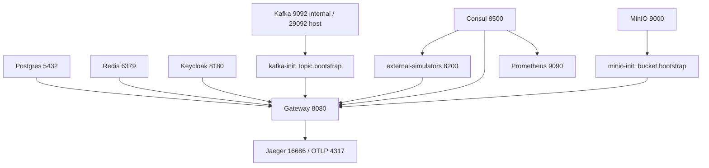

# Phase 0 — Infrastructure & Tooling (Production Grade)

## Goal

Satisfy the exit criteria in [telemedicine-platform/docs/build-sequence.md](telemedicine-platform/docs/build-sequence.md):

> `docker compose up` brings infra + gateway + consul healthy; simulators respond on `/sim/**`.

Scope is compose + local tooling only. Kubernetes manifests and CI workflow installation are explicitly deferred (Phase 9 owns HA/DR; `telemedicine-platform/ci/templates/` stays uninstalled).

## Current state (verified on disk)

- `docker-compose.infrastructure.yml` and `docker-compose.full-stack.yml` both define postgres, redis, kafka, minio, keycloak, prometheus, jaeger on **identical host ports** (5432, 6379, 9092, 9000/9001, 8180, 9090, 16686/4317). The operational manual tells operators to run both together, which cannot work.
- Consul exists in `full-stack.yml` but **not** in `infrastructure.yml`.
- **Zero bootstrap configs exist**: no `prometheus.yml`, no Keycloak realm JSON, no Kafka topic creation, no Postgres init SQL, no MinIO bucket creation, no Consul config.
- Only Consul has a healthcheck. No `.env` or `.env.example` anywhere. `minio/minio:latest` is a floating tag.
- `external-simulators` has working `/sim/**` controllers on :8200 but **no Dockerfile, no compose entry, no Consul dependency**, and **two duplicate `@SpringBootApplication` classes** (`com.telemedicine.simulators.` and `com.telemedicine.externalsimulators.`) that make `bootJar` ambiguous.
- Gateway route `- id: external-simulators / uri: lb://external-simulators` already exists but can never resolve because simulators never register with Consul.
- Kafka advertises only `PLAINTEXT://kafka:9092`, so host-side tooling on `localhost:9092` fails.

## Target startup graph



Every arrow becomes `depends_on: { condition: service_healthy }` (or `service_completed_successfully` for the two init jobs).

---

## Step 0.0 — Environment contract and canonical compose

**New: [telemedicine-platform/.env.example](telemedicine-platform/.env.example)** — committed, documented, every value overridable. Groups: image tags/digests, host port bindings, credentials, connection strings, profile selection.

```dotenv
COMPOSE_PROJECT_NAME=telemedicine
COMPOSE_PROFILES=infra,observability,sim,edge

POSTGRES_IMAGE=postgres:16.4-alpine
POSTGRES_USER=telemedicine
POSTGRES_PASSWORD=change-me-locally
POSTGRES_DB=telemedicine
POSTGRES_PORT=5432

REDIS_PASSWORD=change-me-locally
KAFKA_INTERNAL_PORT=9092
KAFKA_HOST_PORT=29092
MINIO_ROOT_USER=minio
MINIO_ROOT_PASSWORD=change-me-locally
KEYCLOAK_ADMIN=admin
KEYCLOAK_ADMIN_PASSWORD=change-me-locally
KEYCLOAK_REALM=telemedicine

CORS_ALLOWED_ORIGINS=http://localhost:3000,http://localhost:3010,http://localhost:3020
```

**New: `telemedicine-platform/.env`** — generated from the example by the Make target, added to [.gitignore](.gitignore) so credentials never land in git.

**New: [telemedicine-platform/docker-compose.yml](telemedicine-platform/docker-compose.yml)** — the single canonical stack. Profiles:

- `infra` — consul, postgres, redis, kafka + kafka-init, minio + minio-init, keycloak
- `observability` — prometheus, jaeger
- `sim` — external-simulators
- `edge` — gateway
- `apps` — template-java, template-python, shell, template-mfe (opt-in, not part of Phase 0 exit criteria)

`COMPOSE_PROFILES` in `.env` defaults to `infra,observability,sim,edge`, so a bare `docker compose up` in `telemedicine-platform/` produces exactly the Phase 0 exit state. Network is a single named `telemedicine` bridge.

**Rewrite [docker-compose.infrastructure.yml](telemedicine-platform/docker-compose.infrastructure.yml)** as a thin marker that documents `docker compose --profile infra --profile observability up` and no longer redeclares services. **Rewrite [docker-compose.full-stack.yml](telemedicine-platform/docker-compose.full-stack.yml)** likewise (it becomes `--profile apps`). This is what removes the port-collision class of bug entirely.

Cross-cutting hardening applied to every service in the canonical file:

- Pinned minor tags (no `latest`); `minio/minio:latest` becomes a dated `RELEASE.*` tag.
- `healthcheck` with `start_period` on all long-running services.
- `restart: unless-stopped`.
- `deploy.resources.limits` (cpus/memory) so the stack is bounded on a laptop.
- `logging` driver options with `max-size`/`max-file` rotation.
- Named volumes for postgres, redis, kafka, minio, prometheus, keycloak.
- Zero literal credentials — all via `${...}` from `.env`.

## Step 0.1 — Core infrastructure with real bootstrap

Currently these containers start empty and unconfigured. Each gets a bootstrap artifact under a new `telemedicine-platform/infra/` tree:

- **Consul** — moved into the `infra` profile so it is present in *every* stack variant. New `infra/consul/consul.hcl` (datacenter, UI, log level, telemetry Prometheus endpoint). Keep `test: ["CMD", "consul", "members"]`.
- **PostgreSQL** — new `infra/postgres/initdb/01-databases.sql` creating a database + owner role **per service** (`waiting_room`, `identity`, `video`, `telemetry`, `clinical_docs`, `notification`, `integration`, `survey`, `reporting`, `monitoring`, `config`, `audit`, `scheduler`), honouring the "schema-per-service, no shared tables" rule in build-sequence. Mounted at `/docker-entrypoint-initdb.d`. Healthcheck `pg_isready -U $POSTGRES_USER`. Existing per-service Flyway migrations (e.g. `platform/config-service/.../V1__config.sql`) then run against their own database.
- **Redis** — `--requirepass ${REDIS_PASSWORD}`, `--appendonly yes`, persistent volume, healthcheck `redis-cli -a ... ping`.
- **Kafka** — fix the listener map to dual-listener so both in-network and host clients work: `PLAINTEXT://kafka:9092,EXTERNAL://localhost:${KAFKA_HOST_PORT}`. Healthcheck via `kafka-broker-api-versions.sh`. New one-shot **`kafka-init`** service running `kafka-topics.sh --create --if-not-exists` for the domain event catalogue named in the design document (`AppointmentCreated`, `PaymentConfirmed`, `LinkGenerated`, `PatientEnteredWaitingRoom`, `IdentityValidated`, `ConsultationClosed`, plus `*.DLQ` companions for Phase 9 resilience), topic list held in `infra/kafka/topics.txt`.
- **MinIO** — pinned release tag, healthcheck on `/minio/health/live`. New one-shot **`minio-init`** using `minio/mc` to create versioned, encrypted-at-rest buckets (`clinical-documents`, `prescriptions`, `audit-exports`) with retention policy, matching the operational manual's "encrypted, versioned buckets" claim.
- **Keycloak** — new `infra/keycloak/realm-telemedicine.json` imported via `start-dev --import-realm`. Provisions the `telemedicine` realm that [gateway/src/main/resources/application-prod.yml](telemedicine-backend/gateway/src/main/resources/application-prod.yml) already points at via `KEYCLOAK_JWK_URI`, with clients for the three shells (`patient-portal`, `physician-ui`, `admin-console`) plus a `gateway` confidential client, realm roles `PATIENT`/`PHYSICIAN`/`ADMIN` per the RBAC requirement, and seed dev users. Healthcheck on the realm's OIDC discovery endpoint.

## Step 0.2 — Observability wired, not just running

Both Prometheus and Jaeger currently run with default configs and scrape nothing.

- **New `infra/prometheus/prometheus.yml`** — uses `consul_sd_configs` pointed at `consul:8500` with relabelling to scrape `/actuator/prometheus` on every registered service. This means services added in Phases 1-8 are scraped automatically with no config edit, which is the production-grade version of this step. Static fallback jobs for gateway, prometheus itself, and Consul's own telemetry.
- **New `infra/prometheus/rules/platform-alerts.yml`** — baseline alert rules tied to the NFRs in the design document: API p95 latency > 300 ms, service down, Consul deregistration, Kafka consumer lag. Loaded via `rule_files`.
- **Jaeger** — keep `all-in-one` (it ingests OTLP on 4317 directly, so no separate collector is needed); expose 4318 HTTP as well, set `COLLECTOR_OTLP_ENABLED=true`, add healthcheck on `:14269/`. Document `OTEL_EXPORTER_OTLP_ENDPOINT=http://jaeger:4317` as the standard env var so Phase 1's `java-common-observability` module has a fixed target.
- **Elasticsearch** — the design document lists it for logs; keep it behind an opt-in `logs` profile so it does not tax the default stack.

## Step 0.3 — `external-simulators` becomes a real service

This is the largest code change and the hardest blocker: the container does not exist today.

- **Delete the duplicate main class.** Keep `com.telemedicine.simulators.ExternalSimulatorsApplication` (same package as `VendorSimulators`), remove `com/telemedicine/externalsimulators/ExternalSimulatorsApplication.java`, and move `HealthController` into the surviving package. Without this, `:external-simulators:bootJar` has an ambiguous main class.
- **Register with Consul.** Add `spring-cloud-starter-consul-discovery` to [simulators/external-simulators/build.gradle](telemedicine-backend/simulators/external-simulators/build.gradle) and the matching `spring.cloud.consul.*` block to its `application.yml`, mirroring the gateway's config. This is what makes the pre-existing `lb://external-simulators` gateway route resolvable, which the exit criteria depend on.
- **New `simulators/external-simulators/Dockerfile`** — multi-stage mirroring [gateway/Dockerfile](telemedicine-backend/gateway/Dockerfile) but copying the modules this build actually needs (`shared/java-common-core`, `shared/java-common-web`) rather than the legacy `shared/java-common`. Add a non-root `USER`, `EXPOSE 8200`, and a JRE-slim runtime stage.
- **Compose entry** under the `sim` profile: port 8200, `CONSUL_HOST/CONSUL_PORT`, healthcheck on `/actuator/health`, `depends_on: consul (service_healthy)`.
- **Deterministic responses.** Review `VendorSimulators.java` so each of the 15 `/sim/**` endpoints returns a stable, contract-shaped payload plus a scenario switch (header or query param) for the failure paths Phase 3 needs — `/sim/vonage/outage` already hints at this pattern.

## Step 0.4 — Gateway routes and CORS

Routes for all 17 downstream services already exist in [gateway/src/main/resources/application.yml](telemedicine-backend/gateway/src/main/resources/application.yml). The work is hardening, not authoring:

- Replace the hardcoded CORS origin list with `${CORS_ALLOWED_ORIGINS}` so the three shell ports (3000 patient, 3010 physician, 3020 admin) are environment-driven; add `exposedHeaders: X-Correlation-Id` (the `CorrelationIdGatewayFilter` sets it and the operational manual tells L2 support to trace by it, but browsers cannot currently read it) and a `maxAge` for preflight caching.
- Add a **gateway healthcheck** to the canonical compose — the backend dev compose has one but the platform stack does not, and the exit criterion is "gateway healthy".
- Expand `depends_on` beyond Consul to postgres, redis, keycloak, and the two init jobs.
- Pass the full infra env set (`SPRING_DATASOURCE_*`, `KAFKA_BOOTSTRAP`, `REDIS_*`, `KEYCLOAK_JWK_URI`, `OTEL_EXPORTER_OTLP_ENDPOINT`) so Phases 1-2 inherit a working contract instead of rediscovering it.
- Confirm `/sim/**` resolves end to end through the gateway once simulators register.

## Step 0.5 — Tooling and verification

- **New [telemedicine-platform/Makefile](telemedicine-platform/Makefile)** — `env` (seed `.env` from `.env.example`), `up`, `up-all`, `down`, `nuke` (down -v), `ps`, `logs`, `verify`. Mirrors the ergonomics of the existing [telemedicine-backend/Makefile](telemedicine-backend/Makefile).
- **New `scripts/verify-phase0.ps1` and `scripts/verify-phase0.sh`** — asserts the exit criteria rather than eyeballing them: every container `healthy`, Consul catalog contains `gateway` and `external-simulators`, `GET :8080/actuator/health` is UP, `GET :8080/sim/his/appointments/{id}` returns 200 through the gateway, Prometheus `/api/v1/targets` shows targets UP, Keycloak realm discovery endpoint resolves, Kafka topics exist, MinIO buckets exist. Non-zero exit on any failure. Windows-first since that is the dev environment here; existing [scripts/verify-e2e.sh](telemedicine-platform/scripts/verify-e2e.sh) is superseded for Phase 0.
- **Doc updates** — [docs/operational-manual.md](telemedicine-platform/docs/operational-manual.md) (fix the "run both compose files" instruction that currently cannot work, document the profiles and the env contract), [docs/architecture.md](telemedicine-platform/docs/architecture.md) (environments table), [telemedicine-platform/README.md](telemedicine-platform/README.md) and root [README.md](README.md) (quick start, full port map, `.env` step).

## Port map after this phase

- 8080 gateway, 8200 external-simulators, 8500 Consul UI
- 5432 Postgres, 6379 Redis, 29092 Kafka (host) / 9092 (in-network)
- 9000 MinIO API, 9001 MinIO console, 8180 Keycloak
- 9090 Prometheus, 16686 Jaeger UI, 4317/4318 OTLP
- 3000/3010/3020 shells (`apps` profile, CORS-allowed)

## Out of scope for Phase 0

Kubernetes manifests for infra, CI workflow installation, TLS/mTLS between containers, Consul ACLs, and secret-manager integration. These belong to Phase 9 hardening; the `.env` contract created here is the seam they will plug into.