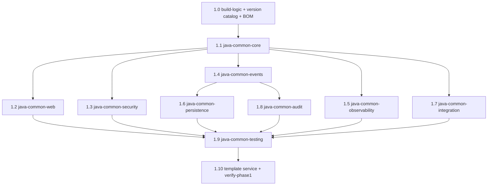

# Phase 1 — Shared Java Libraries (Production Grade)

## Goal

Satisfy the exit criteria in [telemedicine-platform/docs/build-sequence.md](telemedicine-platform/docs/build-sequence.md):

> A template service compiles against all nine modules; `./gradlew test` passes on shared libs.

Raised to production grade: every module is auto-configured, documented, semantically versioned, published, PHI-safe, observable, and covered at the >80% level the design document mandates under Testability.

## Locked decisions (confirmed)

- **Publishing**: full versioned publishing now. `maven-publish` to a real repository (GitHub Packages, Nexus-swappable), semantic versions, sources + javadoc jars, a `java-common-bom` so consumers pin one coordinate. Binary compatibility enforced by `japicmp`.
- **Blast radius**: `telemedicine-backend/shared/**` plus `services/_template-java` only. All existing public API stays source- and binary-compatible so the 17 services already declaring `project(':java-common-*')` continue to compile untouched. Their migration to pinned versions is a later, per-service one-liner.

## Current state (verified on disk)

All nine modules exist but are scaffolds — 24 production classes across the nine, **zero tests**, **zero auto-configuration**.

- The wiring gap is the headline defect: apps live in `com.telemedicine.<service>`, libs in `com.telemedicine.common.*`, no `@ComponentScan` and no `AutoConfiguration.imports` anywhere except `java-common-mock-data`. So `GlobalExceptionHandler`, `CorrelationIdFilter`, `SecurityConfig`, `OutboxPublisher` and `AuditedAspect` are on the classpath of 17 services and **never instantiated**.
- [OutboxPublisher.java](telemedicine-backend/shared/java-common-persistence/src/main/java/com/telemedicine/common/persistence/outbox/OutboxPublisher.java) has five production defects: `@EnableScheduling` declared inside a library (hijacks the host app), no row locking so two replicas double-publish, no attempt counter/backoff/DLQ, `save()` per row, and it wraps an already-serialised `payloadJson` String inside the envelope producing double-escaped JSON.
- `OutboxEvent` is an `@Entity` in `java-common-events` but no service `@EntityScan`s that package, so the table is never mapped.
- [EventTypes.java](telemedicine-backend/shared/java-common-events/src/main/java/com/telemedicine/common/events/EventTypes.java) has 11 constants; [event-catalogue.yaml](telemedicine-backend/shared/contracts/events/event-catalogue.yaml) has 28 events; [infra/kafka/topics.txt](telemedicine-platform/infra/kafka/topics.txt) creates 7 (+6 DLQ). Three sources of truth, all divergent.
- `AuditedAspect` logs to SLF4J with a hardcoded `"system"` actor and a fake hash — not an audit trail.
- `PhiSafe.mask()` is the entire PHI story; `TestTokens` is three string constants.
- No version catalog, no `maven-publish`, no JaCoCo / Checkstyle / Spotless / ArchUnit / Testcontainers. Gradle 8.10.2, Java 21, Spring Boot 3.3.5, Spring Cloud 2023.0.3.
- Legacy `shared/java-common` holds a duplicate `ApiResponse` with zero consumers.

## Module dependency and build order

1.2, 1.3, 1.4, 1.5 and 1.7 can be built in parallel once 1.1 lands.

---

## Step 1.0 — Build foundation (prerequisite, not in the original nine)

Versioned publishing and quality gates cannot be bolted on per module; they need a shared build layer first.

- **New `telemedicine-backend/gradle/libs.versions.toml`** — single version catalog: Spring Boot 3.3.5, Spring Cloud 2023.0.3, resilience4j 2.2.0, springdoc 2.6.x, logstash-logback-encoder, micrometer-tracing-bridge-otel, opentelemetry-exporter-otlp, testcontainers 1.20.x, keycloak-testcontainers, wiremock, archunit, awaitility, assertj, swagger-request-validator.
- **New `telemedicine-backend/build-logic/`** (included build) with four convention plugins:
  - `telemedicine.java-library-conventions` — Java 21 toolchain, `-Xlint:all -Werror`, sources + javadoc jars, reproducible archives, UTF-8, JUnit 5, separate `integrationTest` source set.
  - `telemedicine.quality-conventions` — Spotless (google-java-format AOSP) + Checkstyle + JaCoCo with `violationRules` at 80% line and 75% branch (the design document's ">80% coverage" NFR), ArchUnit test wiring.
  - `telemedicine.publishing-conventions` — `maven-publish`, POM metadata (name, description, licence, SCM), GitHub Packages repo + `mavenLocal()`, credentials from env (`GH_PACKAGES_USER` / `GH_PACKAGES_TOKEN`), `japicmp` binary-compatibility check against the previous release tag.
  - `telemedicine.spring-library-conventions` — `spring-boot-configuration-processor`, `AutoConfiguration.imports` presence assertion, `ApplicationContextRunner` test deps.
- **New module `shared/java-common-bom`** (`java-platform`) — publishes `com.telemedicine:java-common-bom:<version>` constraining all ten shared artifacts. This is the coordinate consumers pin.
- **Versioning** — shared libraries get their own line, `sharedLibsVersion=1.0.0` in `gradle.properties`, independent of the services' `0.1.0-SNAPSHOT`. Semver policy documented: patch = fix, minor = additive, major = breaking (blocked by japicmp without an explicit override).
- **[settings.gradle](telemedicine-backend/settings.gradle)** — add `includeBuild('build-logic')` and `:java-common-bom`. Keep the existing **flat** module names (`:java-common-core`, not `:shared:java-common-core`) so the 17 consumers' `project(...)` paths keep resolving. Remove the legacy `java-common` include.
- **Delete `shared/java-common/`** — duplicate `ApiResponse`, zero consumers, actively harmful as a second source of truth.
- Root [build.gradle](telemedicine-backend/build.gradle) keeps its current `subprojects` block for services; shared modules apply the convention plugins instead.

---

## Step 1.1 — `java-common-core` (no dependencies)

The only module with no Spring dependency. An ArchUnit rule enforces `com.telemedicine.common.core` never imports `org.springframework`.

- **`ApiResponse<T>` — frozen.** Adding a record component is a binary break and this record is mirrored in [shared/contracts/common-error.yaml](telemedicine-backend/shared/contracts/common-error.yaml), `python-common/dto.py` and the frontend `shared-types`. Keep the 3-component shape, add only factories: `ok()` for void, `ok(T, String message)`, `error(ErrorCode, String)`. Correlation and timing travel in headers, not the success envelope.
- **`ProblemDetail` — frozen record, new `ProblemDetails` builder.** Produces strict RFC 9457: `type` as `https://telemedicine.bupa/problems/{code}`, `title`, `status`, `detail`, and extensions carrying `instance`, `code`, `correlationId`, `traceId`, `timestamp`, `violations[]`. `application/problem+json` everywhere.
- **`ErrorCode` — expand from 10 to the full journey catalogue** with a stable string code (`TM-CORE-0001` style), `httpStatus()`, `category()` and `retryable()`. Enum constants and methods are additive, so this stays compatible. Covers consent, identity/FONASA, payment, provider outage, integration, video, telemetry, documents, survey, config, audit, rate limit, idempotency conflict.
- **Exception hierarchy** — `NotFoundException`, `ValidationException`, `ConflictException`, `ForbiddenException`, `IntegrationException`, `ProviderOutageException`, `ConsentRequiredException`, `IdentityValidationException`, `RateLimitedException`, all extending the existing `DomainException` (additive constructors carrying `Map<String,Object> details` and `correlationId`).
- **`IdGenerator`** — keep `newId()`, add monotonic ULID and UUIDv7 (lexicographically sortable, far better B-tree behaviour than UUIDv4 for `outbox_events` and audit tables), plus `correlationId()`, `eventId()`, `idempotencyKey()`.
- **`TimeProvider`** abstraction with `SystemTimeProvider` and `FixedTimeProvider` — mandatory for deterministic tests of outbox backoff, link TTL, session timeout and consent expiry.
- **PHI package, replacing single-method `PhiSafe`** — `PhiRedactor` with pattern-based redaction for Chilean RUT (the FONASA integration in the design document), E.164 phone, email, patient name, address, MRN, PAN and JWT; a `@Phi` field marker annotation; `PhiSafeToString`. `PhiSafe.mask()` stays and delegates.
- **`Result<T,E>`** sealed type for adapter paths that must not throw.
- **`Headers` / `MdcKeys` constants** — `X-Correlation-Id`, `X-Causation-Id`, `X-Idempotency-Key`, `X-Tenant-Id`, and `X-Sim-Scenario` (the header the Phase 0 [SimScenario](telemedicine-backend/simulators/external-simulators/src/main/java/com/telemedicine/simulators/SimScenario.java) already honours) so integration code has one definition.

Tests: unit coverage on every class, PHI redactor negative tests (must not over-redact clinical free text), ArchUnit no-Spring rule, japicmp baseline.

---

## Step 1.2 — `java-common-web` (core)

- **`GlobalExceptionHandler` — from one handler to the full set**: `DomainException`, `MethodArgumentNotValidException`, `ConstraintViolationException`, `HttpMessageNotReadableException`, `MethodArgumentTypeMismatchException`, `MissingServletRequestParameterException`, `HttpRequestMethodNotSupportedException`, `HttpMediaTypeNotSupportedException`, `NoResourceFoundException`, `OptimisticLockingFailureException` (409), `DataIntegrityViolationException` (409), `ResponseStatusException`, and a catch-all `Exception` returning 500 with **no stack trace and no PHI**. Every response is `application/problem+json`, echoes `X-Correlation-Id`, routes `detail` through `PhiRedactor`, and logs 4xx at WARN / 5xx at ERROR.
- **Pagination** — `PageResponse` stays frozen; add `PageRequestSupport` with allow-listed sort fields, default size 20, hard max 100, and a `Page` → `PageResponse` mapper.
- **`IdempotencyKeyFilter`** + `IdempotencyStore` SPI (implementations in 1.6). Required by `POST /v1/appointments/v2` in Phase 3 and every payment-adjacent call.
- **`ShallowEtagHeaderFilter`**, request/response size limits, and a sampled request-logging filter with PHI redaction.
- **OpenAPI 3.1** — springdoc as an `optional` dependency plus an `OpenApiCustomizer` that injects the shared `ProblemDetail` schema and the standard 400/401/403/404/409/422/429/500 responses into every operation, and the Keycloak security scheme from `KEYCLOAK_JWK_URI`. Keeps [docs/openapi-specification.md](telemedicine-platform/docs/openapi-specification.md) honest without per-service boilerplate.
- **`WebAutoConfiguration`** in `META-INF/spring/org.springframework.boot.autoconfigure.AutoConfiguration.imports`, guarded by `@ConditionalOnWebApplication(SERVLET)` and `@ConditionalOnProperty(telemedicine.web.enabled, matchIfMissing=true)`, every bean `@ConditionalOnMissingBean`. **This is what makes the 17 existing services actually get the handler** without editing them.
- `@ConfigurationProperties("telemedicine.web")` with generated metadata.

Tests: `@WebMvcTest` slice per handler branch, `ApplicationContextRunner` tests for enable/disable/user-bean-backoff, problem+json contract snapshot.

---

## Step 1.3 — `java-common-security` (core)

- **`ResourceServerAutoConfiguration`** — JWT resource server whose `jwk-set-uri` defaults to the Phase 0 value `http://keycloak:8080/realms/telemedicine/protocol/openid-connect/certs`; issuer + audience validators and bounded clock skew.
- **`KeycloakRoleConverter`** — maps `realm_access.roles` and `resource_access.{client}.roles` onto `ROLE_PATIENT` / `ROLE_PHYSICIAN` / `ROLE_ADMIN`, reading exactly the role and client names provisioned in [infra/keycloak/realm-telemedicine.json](telemedicine-platform/infra/keycloak/realm-telemedicine.json). A test asserts the converter and the realm file agree.
- **`Roles` / `Scopes` / method security** — keep the existing constants, add `ROLE_SERVICE`, `@EnableMethodSecurity`, and `@IsPatient` / `@IsPhysician` / `@IsAdmin` / `@RequiresRole` meta-annotations over `@PreAuthorize`.
- **`SecurityContextAccessor`** — `currentUserId()`, `currentPatientId()`, `currentPhysicianId()`, `currentRoles()`, null-safe when unauthenticated. Consumed by 1.6 JPA auditing and 1.8 audit actor resolution.
- **Claim propagation** — `RestClient`/`WebClient` interceptor forwarding `Authorization`, `X-Correlation-Id`, `X-Tenant-Id` downstream (pairs with 1.7).
- **Security headers** — HSTS, `X-Content-Type-Options`, `Referrer-Policy`, `Permissions-Policy`, CSP with a **configurable `frame-ancestors` allow-list**, because the design document requires the physician UI to run HIS-embedded in PiP mode; a blanket `X-Frame-Options: DENY` would break that requirement.
- **Consent gate** — `@RequiresConsent` + `ConsentVerifier` SPI, no-op default, implemented by `waiting-room-service` in Phase 4.
- **Dev bypass with a guardrail** — keep `DevSecurityConfig` but drive it from `telemedicine.security.mode` and **fail fast at startup** if dev mode is active while the `prod` profile is on. A permissive filter chain reaching production is the single highest-severity failure mode of this module.
- Auth entry point and access-denied handler emit the same RFC 9457 body as 1.2.

Tests: context-runner tests for prod/dev/backoff, converter tests against realm-shaped claims, fail-fast test, header assertions.

---

## Step 1.4 — `java-common-events` (core)

- **`EventEnvelope` — frozen record.** New metadata (W3C `traceparent`, tenant, schema URI) goes into **Kafka record headers**, not the body — the correct place for it and non-breaking. Add a builder and an `of(type, subject, payload, correlationId, causationId)` overload.
- **One source of truth for the catalogue.** Expand `EventTypes` from 11 to all 28 events in [event-catalogue.yaml](telemedicine-backend/shared/contracts/events/event-catalogue.yaml), add `TopicNames.topicFor(type)` / `dlqFor(type)` / `retryFor(type)` matching the Phase 0 `Event.DLQ` convention, and add a **contract test that fails the build when `EventTypes`, `event-catalogue.yaml` and [infra/kafka/topics.txt](telemedicine-platform/infra/kafka/topics.txt) diverge**. Phase 1 also extends `topics.txt` from 7 to the full 28 plus `.DLQ` and `.RETRY` companions.
- **Typed payload records** for all 28 events under `com.telemedicine.common.events.payload`, each carrying a schema-version constant. A test enforces payloads are **PHI-free** (IDs and status only) — event bodies cross service and topic boundaries and must not carry patient identifiers in the clear.
- **`EventPublisher` SPI + `KafkaEventPublisher`** — idempotent producer (`enable.idempotence=true`, `acks=all`, bounded in-flight, zstd compression, delivery timeout), key = aggregate/subject for per-appointment ordering, CloudEvents-style headers (`ce-id`, `ce-type`, `ce-source`, `ce-time`) plus `X-Correlation-Id` and `traceparent`.
- **Consumer defaults** — `ErrorHandlingDeserializer`, `DefaultErrorHandler` with `ExponentialBackOffWithMaxRetries` and a `DeadLetterPublishingRecoverer` routing to `<topic>.DLQ`, manual ack, `ConcurrentKafkaListenerContainerFactory` with a `@DomainEventListener` meta-annotation.
- **Idempotent consumption** — `ProcessedEventStore` SPI (JPA implementation in 1.6) and an `@IdempotentConsumer` aspect keyed on `eventId`.
- **Shared `eventObjectMapper`** — JavaTimeModule, ISO-8601 instants, `WRITE_DATES_AS_TIMESTAMPS` off, `FAIL_ON_UNKNOWN_PROPERTIES` off for forward compatibility.
- `EventsAutoConfiguration` gated on `@ConditionalOnClass(KafkaTemplate)`; `telemedicine.events.*` properties; `KAFKA_BOOTSTRAP` default `kafka:9092` from the Phase 0 `.env`.

Tests: Testcontainers Kafka round-trip, DLQ routing, idempotency, catalogue-sync guard.

---

## Step 1.5 — `java-common-observability` (core)

- **`CorrelationIdFilter` fixes** — accept the inbound header set by [CorrelationIdGatewayFilter](telemedicine-backend/gateway/src/main/java/com/telemedicine/gateway/filter/CorrelationIdGatewayFilter.java), generate when absent, **echo it on the response** (today it does not, yet the operational manual tells L2 support to trace by it and Phase 0 added it to gateway `exposedHeaders`), populate MDC with `correlationId`, `traceId`, `spanId`, `userId`, `appointmentId`, and always clear in `finally`.
- **MDC propagation** across `@Async` (`TaskDecorator`), scheduled tasks, Kafka producer/consumer interceptors and `RestClient`/`WebClient`. A dropped MDC is why correlation IDs usually die at the first async hop.
- **Tracing** — Micrometer Tracing bridge to OpenTelemetry with OTLP export to `OTEL_EXPORTER_OTLP_ENDPOINT` (Phase 0 fixed this at `http://jaeger:4317`), `otel.service.name` from `spring.application.name`, configurable sampling, actuator paths excluded, correlation/appointment IDs as span attributes.
- **Metrics** — Prometheus registry on `/actuator/prometheus`, which is exactly the path [infra/prometheus/prometheus.yml](telemedicine-platform/infra/prometheus/prometheus.yml) scrapes via `consul_sd_configs`; the module must guarantee that endpoint and the right Consul tags are present by default. Common tags `service`/`env`/`version`. **SLO histogram buckets at 100/200/300/500/1000 ms** so the "API latency < 300 ms" NFR and the Phase 0 `platform-alerts.yml` p95 rule are measurable from day one.
- **`JourneyMetrics` helper** — pre-named timers and counters for the design document's functional KPIs: average waiting time, time to enter video, completed consultation rate, abandonment rate, document issuance time. `reporting-service` in Phase 8 then reads a metric that already exists instead of inventing one.
- **Structured logging** — ship `logback-spring.xml` in the library: JSON via `logstash-logback-encoder` with MDC fields for Elasticsearch (the design document's log store, behind Phase 0's opt-in `logs` profile), human-readable console for dev, and a **PHI-redacting converter** delegating to `PhiRedactor` from 1.1.
- **Health** — liveness/readiness groups and `management.endpoint.health.probes.enabled` so Phase 9's K8s work needs no library change.
- `ObservabilityAutoConfiguration`; `telemedicine.observability.*`.

Tests: response-header echo, MDC survival across async and Kafka, `/actuator/prometheus` exposure, log redaction.

---

## Step 1.6 — `java-common-persistence` (core, events)

The largest correctness workload in this phase.

- **`BaseEntity`** — add JPA auditing (`@CreatedBy`/`@LastModifiedBy` sourced from `SecurityContextAccessor`), plus `SoftDeletableEntity` using `deletedAt` + `@SQLRestriction`.
- **AES-256 PHI column encryption** — `EncryptedStringConverter` / `EncryptedInstantConverter` using AES-GCM with a key-id prefix for rotation, key from a new `TELEMEDICINE_PHI_KEY` env var, plus an HMAC-SHA256 blind-index column type for searchable fields such as RUT. This is the "AES-256, encrypted PHI" NFR; today nothing implements it.
- **Outbox v2** — rewrite [OutboxPublisher](telemedicine-backend/shared/java-common-persistence/src/main/java/com/telemedicine/common/persistence/outbox/OutboxPublisher.java) to fix all five defects: claim rows with `FOR UPDATE SKIP LOCKED` so replicas never double-publish, batch publish, add `attempts` / `lastError` / `nextAttemptAt` with exponential backoff, move to `<topic>.DLQ` after N attempts, store the payload as `JsonNode` so it is not double-escaped inside the envelope, and **remove `@EnableScheduling` from the library** in favour of a dedicated `ThreadPoolTaskScheduler` owned by the auto-configuration and gated on `telemedicine.outbox.enabled`. Add `OutboxRecorder.record(...)` for transactional write-with-your-aggregate, and `outbox_pending` / `outbox_published_total` / `outbox_failed_total` metrics feeding the Phase 0 alert rules.
- **`ProcessedEventStore`** JPA implementation for 1.4's idempotent consumers, with a TTL cleanup job; **`IdempotencyStore`** JPA and Redis implementations for 1.2's filter.
- **`@EnableTelemedicinePersistence`** meta-annotation bundling `@EntityScan` over `com.telemedicine.common.persistence` and `com.telemedicine.common.events.outbox` plus `@EnableJpaRepositories`. This closes the "`OutboxEvent` is never scanned" gap.
- **Shared Flyway migrations** shipped as `db/migration/common/` (`outbox_events` with its partial index on unpublished rows, `processed_events`, `idempotency_keys`), with the documented setting `spring.flyway.locations: classpath:db/migration,classpath:db/migration/common`. Reconcile the now-redundant `services/waiting-room-service/src/main/resources/db/migration/V1__outbox.sql`. Naming convention `V{n}__{snake_case}.sql`, enforced by a lint test, targeting the per-service databases Phase 0 created in [infra/postgres/initdb/01-databases.sql](telemedicine-platform/infra/postgres/initdb/01-databases.sql).
- **Datasource defaults** — HikariCP sizing, leak detection, connection timeout, and `spring.jpa.open-in-view: false` (currently unset, and it silently holds connections through view rendering).
- **Redis cache abstraction** — `CacheNames` with per-cache TTL policy, JSON serializer, and a `CacheErrorHandler` that degrades to a cache miss instead of throwing when Redis is unavailable.
- `PersistenceAutoConfiguration`; `telemedicine.persistence.*`.

Tests (Testcontainers Postgres + Redis): a **two-publisher concurrency test proving no double-publish**, backoff and DLQ promotion, encryption round-trip and key rotation, soft delete, Flyway migrate-and-validate, cache degradation.

---

## Step 1.7 — `java-common-integration` (core)

- **`ProviderRegistry`** — keep the current API, add a `ProviderSelector` that reads the active provider from `config-service` (Phase 2) with a cached safe default, an `@ProviderAdapter("vonage")` marker, health-based automatic failover, and a `ProviderChanged` hook. This is the mechanism behind Vonage↔ACS switching.
- **Resilience4j defaults, as code and YAML**, with **named instances per external system matching the Phase 0 simulators**: `his`, `sap`, `payment`, `fonasa`, `mpi`, `zendesk`, `vonage`, `acs`, `anura`, `recmed`, `medipass`. Circuit breaker (sliding window, 50% failure rate, 30 s open, 3 half-open calls), retry with **exponential backoff plus jitter** and an idempotency-aware predicate that never retries a non-idempotent POST without an idempotency key, bulkhead, time limiter, rate limiter.
- **`RestClient`/`WebClient` factory** — connect/read timeouts, pooled connections, `SslBundle` hook for future mTLS, correlation and auth propagation, OTel instrumentation, PHI-redacted request logging, and **`X-Sim-Scenario` pass-through** so Phase 3 can drive simulator failure paths end to end.
- **ACL base classes** — `ExternalSystemAdapter<REQ,RES>`, `AntiCorruptionMapper`, and exception translation onto `ErrorCode.INTEGRATION_ERROR` / `PROVIDER_OUTAGE`, emitting `IntegrationFailed` through 1.4.
- **`WebhookSignatureVerifier`** — HMAC-SHA256 with a timestamp window and a replay cache, for inbound vendor callbacks.
- Simulator base URL contract `telemedicine.integration.simulator.base-url` defaulting to `lb://external-simulators` (Consul) / `http://external-simulators:8200`, matching the Phase 0 registration.
- `IntegrationAutoConfiguration`; `telemedicine.integration.<provider>.*`.

Tests: WireMock adapter tests, circuit-breaker state transitions, retry jitter distribution, signature verification including replay rejection.

---

## Step 1.8 — `java-common-audit` (core, events)

- **`AuditEvent` enriched** — actor (id, role, IP, user agent), action, resourceType, resourceId, outcome (`SUCCESS` / `FAILURE` / `DENIED`), reason, before/after hashes, correlationId, occurredAt, sequence, `previousHash`, `hash`. Tamper-evident SHA-256 chain over canonical JSON.
- **`@Audited`** — add `resourceIdExpression` (SpEL), `outcomeOnException`, `includeArgs`, `phiSafe`.
- **`AuditedAspect` rewrite** — real actor from `SecurityContextAccessor` (not `"system"`), real chained hash from `AuditHasher` (not a placeholder), and dispatch via an `AuditEventDispatcher` SPI with two implementations: `OutboxAuditDispatcher` (transactional, through the 1.6 outbox onto the `AuditRecorded` topic — the only way an audit record cannot be lost) and `LoggingAuditDispatcher` as fallback. Dispatch failures raise a metric and an ERROR log; they are never swallowed.
- **Consent helpers** — `ConsentAuditEvents.granted(...)` / `.withdrawn(...)` producing the immutable ledger entries for the Compliance Officer persona, writing into the `consent_ledger` table already defined in `platform/audit-service/src/main/resources/db/migration/V1__audit.sql`.
- Audit payloads pass through `PhiRedactor`; values are stored as hashes, never in clear.
- `AuditAutoConfiguration`; `telemedicine.audit.*`.

Tests: chain integrity plus tamper detection, aspect behaviour on success/exception/access-denied, outbox dispatch, redaction.

---

## Step 1.9 — `java-common-testing` (all above)

Currently three string constants. Becomes the test platform every later phase depends on.

- **Testcontainers fixtures** — `PostgresContainerExtension`, `KafkaContainerExtension`, `RedisContainerExtension`, `MinioContainerExtension`, and a `KeycloakContainerExtension` that **imports the Phase 0 realm file** [infra/keycloak/realm-telemedicine.json](telemedicine-platform/infra/keycloak/realm-telemedicine.json) so tests authenticate against the same clients and roles as runtime. Singleton-container pattern with reuse; a `@TelemedicineIntegrationTest` composed annotation.
- **JWT test tokens** — `TestJwts.patient()/physician()/admin()/service()` signed with a test RSA key plus a test `JwtDecoder`, and `@WithMockPatient` / `@WithMockPhysician` / `@WithMockAdmin`. Replaces the placeholder constants.
- **Event assertion DSL** — `assertPublished(EventTypes.LINK_GENERATED).withSubject(id).within(Duration)`, plus a `RecordingEventPublisher` for pure unit tests.
- **Contract test bases** — `OpenApiContractTest` validating controllers against [shared/contracts](telemedicine-backend/shared/contracts) via swagger-request-validator, and `EventCatalogueContractTest`.
- **Simulator stubs** — WireMock stubs shaped like the Phase 0 [VendorSimulators](telemedicine-backend/simulators/external-simulators/src/main/java/com/telemedicine/simulators/VendorSimulators.java) responses (`SimulatorStubs.his()`, `.fonasa()`, `.vonage()`), honouring `X-Sim-Scenario`.
- **ArchUnit rule library** reusable by every service: core must not depend on Spring; web must not depend on persistence; no service package depends on another service package; controllers return `ApiResponse`; entities extend `BaseEntity`; no `System.out`; no PHI-typed field without `@Phi`.
- **Fixtures** with obviously synthetic PHI, `FixedTimeProvider`, Awaitility defaults.
- Container-backed tests are tagged so `./gradlew test` stays fast and `./gradlew integrationTest` runs the heavy set — the phase exit criterion names `test`.

---

## Step 1.10 — Reference consumer, verification and docs

- **`services/_template-java` becomes the reference consumer** and the literal proof of the exit criterion. It pins `com.telemedicine:java-common-bom` and depends on all nine, then exercises each: an entity extending `BaseEntity` with an encrypted PHI column, a Flyway migration, a controller returning `ApiResponse` with a deliberate error path, an outbox emit, an `@Audited` method, a `@DomainEventListener`, and a WireMock-backed adapter — with unit and integration tests using 1.9.
- **New `telemedicine-platform/scripts/verify-phase1.ps1` and `.sh`** (Windows-first, mirroring the Phase 0 verify scripts). Asserts, with a non-zero exit on any failure: `./gradlew check` green across all shared modules; JaCoCo ≥ 80%; japicmp clean; `publishToMavenLocal` succeeds and a scratch consumer resolves the BOM; every module jar contains its `AutoConfiguration.imports`; the template service starts, returns `application/problem+json` with an echoed `X-Correlation-Id`, exposes `/actuator/prometheus`, registers in Consul, and round-trips an event through Kafka into the outbox; `EventTypes` ↔ `event-catalogue.yaml` ↔ `topics.txt` in sync.
- **Phase 0 contract extensions** (these are the Phase 0 seams Phase 1 must widen, done as part of this phase):
  - [.env.example](telemedicine-platform/.env.example) gains `TELEMEDICINE_PHI_KEY`, `OTEL_TRACES_SAMPLER_ARG`, `SPRING_FLYWAY_LOCATIONS`, `TELEMEDICINE_OUTBOX_ENABLED`, `GH_PACKAGES_USER`, `GH_PACKAGES_TOKEN`.
  - [infra/kafka/topics.txt](telemedicine-platform/infra/kafka/topics.txt) grows from 7 to the full 28 events plus `.DLQ` and `.RETRY`.
  - Keycloak realm roles/clients verified against the 1.3 converter by an automated test.
- **Docs** — new `telemedicine-platform/docs/shared-libraries.md` (per-module API and configuration-property reference, semver and publishing policy), and updates to [adding-a-service.md](telemedicine-platform/docs/adding-a-service.md), [technical-design-document.md](telemedicine-platform/docs/technical-design-document.md), [traceability-matrix.md](telemedicine-platform/docs/traceability-matrix.md) and the Phase 1 exit criteria in [build-sequence.md](telemedicine-platform/docs/build-sequence.md).

---

## NFR traceability for this phase

- Performance (<300 ms API): 1.5 SLO histogram buckets and journey timers; 1.6 Hikari and index tuning; 1.7 timeouts and bulkheads.
- Security (OAuth2/JWT/RBAC/TLS): 1.3 in full; 1.2 problem responses that never leak internals.
- Data at rest (AES-256): 1.6 encryption converters and blind index.
- Privacy (encrypted PHI, consent separation): 1.1 redaction, 1.5 log redaction, 1.8 consent ledger, 1.3 consent gate.
- Resilience (RPO/RTO/MTTR): 1.4 DLQ and idempotent consumers, 1.6 outbox with backoff, 1.7 circuit breakers and failover.
- Observability (Elasticsearch/Prometheus/OTel+Jaeger): 1.5 in full.
- Auditability (end-to-end event audit): 1.8 hash-chained audit over the 1.6 outbox.
- Interoperability (OpenAPI 3.1, event catalogue): 1.2 customizer, 1.4 catalogue sync guard, 1.9 contract tests.
- Testability (>80% coverage): 1.0 JaCoCo gate, 1.9 fixtures.

## Out of scope for Phase 1

CI workflow installation (Phase 0 deferred it; `telemedicine-backend/ci/templates` stays uninstalled), Kubernetes manifests, mTLS between services, Consul ACLs, secret-manager integration, and migrating the 17 existing services off `project()` dependencies onto pinned versions. Backward compatibility is preserved specifically so that migration can happen per service, later, without a flag day.