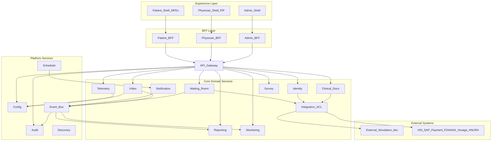

/* Telemedicine Platform - Modules and Microservices Build Plan

## Locked decisions

- All core domain services and BFFs in Java 21 / Spring Boot 3 (Python template retained for future ML/analytics only).
- External systems (Vonage/ACS, FONASA, SAP/Air Hospital HIS, ANURA, Payment, RecMed/Medipass, Zendesk) accessed through pluggable adapter interfaces, backed by a local simulator app so the full journey runs end-to-end without vendor credentials.
- Existing scaffolding is reused, not replaced: [telemedicine-backend/settings.gradle](telemedicine-backend/settings.gradle), [telemedicine-backend/gateway/src/main/resources/application.yml](telemedicine-backend/gateway/src/main/resources/application.yml), [telemedicine-frontend/nx.json](telemedicine-frontend/nx.json), [telemedicine-frontend/apps/shell/public/config/mfe-manifest.json](telemedicine-frontend/apps/shell/public/config/mfe-manifest.json).

## Gaps found in the design document (explicitly covered here)

These capabilities appear in the requirements or journeys but are missing from the design document's Core Domain Services table. All are included as first-class modules:

- Patient satisfaction survey (journey step 10) - no owning service listed -> `survey-service`.
- ANURA telemetry, required to be "developed independently from the platform" so it can be replaced -> `telemetry-service` as a separate deployable, never a library inside video.
- Secure link generation (SAP sends "URL creation request" to the Waiting Room Portal; `LinkGenerated` event) -> `session-link` bounded module inside `waiting-room-service`.
- Provider configuration layer for selecting Vonage vs ACS and notification channels -> `config-service`.
- Audit trail capture (Compliance Officer persona reviews audit logs and consent records; Reporting only *reports* audit) -> `audit-service`.
- Consent withdrawal mid-journey with its own immutable trail -> `consent` module in `waiting-room-service` writing to `audit-service`.
- Clinical Service (HIS-embedded PiP component from the source requirements) -> `physician-shell` MFE plus `physician-bff`.
- Main API `/v1/appointments/v2` (create, consult, update status, rescheduling) -> exposed by `integration-service`.
- Zendesk support integration for the Customer Support Agent persona -> adapter in `integration-service`, low priority.

## Target backend layout

```
telemedicine-backend/
├── gateway/                          # exists - extend with security + resilience filters
├── bff/
│   ├── patient-bff/                  # :8090
│   ├── physician-bff/                # :8091
│   └── admin-bff/                    # :8092
├── platform/
│   ├── config-service/               # :8112
│   ├── scheduler-service/            # :8113
│   └── audit-service/                # :8111
├── services/
│   ├── waiting-room-service/         # :8101  (consent, device test, status, session-link)
│   ├── identity-service/             # :8102  (identity + FONASA 2FA)
│   ├── video-service/                # :8103  (sessions, tokens, clinical chat)
│   ├── telemetry-service/            # :8104  (ANURA, independently deployable)
│   ├── clinical-docs-service/        # :8105  (documents, prescriptions, certificates)
│   ├── notification-service/         # :8106  (email, SMS, WhatsApp, push)
│   ├── integration-service/          # :8107  (HIS, SAP, payment, MPI, Zendesk - ACL)
│   ├── survey-service/               # :8108
│   ├── reporting-service/            # :8109  (KPIs, dashboards, exports, audit reports)
│   ├── monitoring-service/           # :8110  (connection quality, session metrics)
│   ├── _template-java/               # exists - keep as scaffold source
│   └── _template-python/             # exists - future ML/analytics only
├── simulators/
│   └── external-simulators/          # :8200  dev/test only, per-vendor controllers
└── shared/
    ├── java-common-core/             # from existing shared/java-common
    ├── java-common-web/
    ├── java-common-security/
    ├── java-common-events/
    ├── java-common-observability/
    ├── java-common-persistence/
    ├── java-common-integration/
    ├── java-common-audit/
    ├── java-common-testing/
    └── contracts/                    # OpenAPI 3.1 per service + event catalogue
```

## Part 1 - Reusable Java libraries (9 Gradle modules)

Each is a `java-library` module registered in [telemedicine-backend/settings.gradle](telemedicine-backend/settings.gradle). Every domain service depends on core, web, security, events, observability; persistence and integration as needed.

- `java-common-core` - grows out of the existing `ApiResponse`. Adds `ProblemDetail` RFC 9457 error model, error codes enum, domain exception hierarchy, `Result`/`Either`, ID/ULID generation, clock abstraction, PHI-safe `toString` helpers.
- `java-common-web` - `@RestControllerAdvice` global exception handler mapping to the shared error contract, bean-validation message bundle, pagination and sorting envelope, idempotency-key filter, request/response size limits, standard health and info endpoints.
- `java-common-security` - JWT resource-server config, RBAC role and scope constants for Patient/Physician/Administrator, `SecurityContext` accessor with patient/physician identity, claims-to-header propagation for downstream calls, method-level `@RequiresRole`, consent-gate interceptor, TLS/HSTS defaults.
- `java-common-events` - Kafka producer and consumer factories, versioned `EventEnvelope` (eventId, type, version, occurredAt, correlationId, causationId, subject), typed event records for the whole catalogue, transactional outbox pattern with a publisher poller, idempotent consumer support with a processed-event store, dead-letter topic conventions.
- `java-common-observability` - OpenTelemetry auto-config exporting to Jaeger, Micrometer registry for Prometheus, structured JSON logging to Elasticsearch with PHI redaction, correlation-ID filter and MDC propagation across HTTP and Kafka, custom KPI metric helpers (waiting time, time-to-video, completion rate).
- `java-common-persistence` - JPA `BaseEntity` with created/updated auditing, optimistic locking, soft delete, AES-256 column encryption converter for PHI, Flyway naming and migration conventions, schema-per-service datasource config, Redis cache abstraction with TTL policies.
- `java-common-integration` - resilience4j circuit breaker, retry with jitter, bulkhead and timeout defaults; `WebClient` factory with mTLS, timeouts and tracing; anti-corruption-layer base classes; provider-selection SPI (`ProviderRegistry<T>`) that drives Vonage-vs-ACS switching from `config-service`; webhook signature verification.
- `java-common-audit` - `@Audited` annotation and aspect, audit event model (actor, action, resource, outcome, before/after hash), async dispatch to `audit-service` via Kafka, tamper-evident hash chaining, consent-event helpers.
- `java-common-testing` - Testcontainers fixtures for PostgreSQL, Kafka, Redis and Keycloak; OpenAPI contract-test base; event-assertion DSL; JWT test-token factory per role; WireMock stubs pointed at `external-simulators`.

## Part 2 - Platform services

- `gateway` (extend existing) - add JWT validation and introspection, RBAC pre-filter, per-route rate limiting via Redis, request correlation, circuit breaker per route, WAF-friendly header hardening, CORS tightened to the three shell origins, routes for every service and BFF, OpenAPI aggregation.
- `patient-bff` - aggregates journey state for the patient portal: consent status, identity status, waiting-room position, video join payload, documents list, survey availability. One `GET /bff/patient/journey/{appointmentId}` call drives the whole shell.
- `physician-bff` - consultation worklist, patient context from HIS/MPI, video/chat/telemetry join payloads, documentation submission orchestration.
- `admin-bff` - configuration read/write, KPI dashboard aggregation, audit query facade, RBAC administration, live operational snapshot.
- `config-service` - typed configuration and feature flags with audit history: active video provider, active chat provider, telemetry on/off rules, notification channel enablement, MFE remote enablement, business rules for telemetry activation. Backed by PostgreSQL, cached in Redis, published as `ConfigurationChanged` events.
- `scheduler-service` - quartz-style jobs: appointment reminders, waiting-room timeouts, no-show detection, session-expiry cleanup, outbox retry sweeps, survey dispatch delay, report generation windows.
- `audit-service` - append-only audit store with hash chaining, consent ledger (grant, withdraw, scope), retention policy, query API for compliance, export to object storage.

## Part 3 - Core domain services

Each service owns its schema, publishes events, and exposes an OpenAPI 3.1 contract in `shared/contracts/`.

- `waiting-room-service` - bounded modules: `consent` (platform T&C vs clinical informed consent, withdrawal), `session-link` (secure signed link creation requested by SAP, TTL, single-use, `LinkGenerated`), `device-test` (camera/mic/network result capture), `queue` (position, estimated wait), `status` (OPEN_PATIENT, CHECKED_IN, OPEN_DOCTOR state machine synchronised to HIS). Blocks progression until payment validated via `integration-service` and identity validated.
- `identity-service` - patient identity verification, FONASA 2FA orchestration (challenge, verify, retry limits, lockout), MPI patient lookup through `integration-service`, `IdentityValidated` event, step-up authentication hooks.
- `video-service` - provider-agnostic session lifecycle: create session, issue per-role tokens, join/leave tracking, recording policy flag, clinical chat threads and message persistence, provider failover on outage, `VideoSessionStarted/Ended` and `ChatMessageSent` events. Adapters: `VonageTokBoxAdapter`, `AzureAcsAdapter`, `SimulatorAdapter`, selected via `ProviderRegistry`.
- `telemetry-service` - independently deployable ANURA integration: token issuance, `decryptResults` handling, measurement normalisation and storage, consent-gated activation per business rules, `TelemetryMeasured` event. Zero compile-time coupling to `video-service`.
- `clinical-docs-service` - clinical document generation (PDF), diagnosis capture, prescription issuance via RecMed/Medipass adapters, medical leave certificates, delivery to SAP/Aidbox, encrypted object-storage persistence, patient download tokens, `ClinicalDocumentIssued` / `PrescriptionIssued` / `MedicalLeaveIssued` events.
- `notification-service` - template registry with locale support, channel adapters for email, SMS, WhatsApp and push, channel-preference and fallback chain, send-status tracking and retries, event-driven triggers (link ready, physician ready, documents available, survey request).
- `integration-service` - the anti-corruption layer. Exposes `/v1/appointments/v2` (create, consult, update status, rescheduling). Adapters for Air Hospital HIS appointment status, SAP/Bupa Engine appointment verification, payment validation before link creation, FONASA, MPI patient data, Zendesk support tickets. Outbound webhook receiver with signature verification, per-integration circuit breakers and dead-letter queues.
- `survey-service` - survey definition and versioning, dispatch after `ConsultationClosed`, response capture, NPS scoring, aggregation feed into `reporting-service`.
- `reporting-service` - KPI computation for the three metric families in the design document: technical (availability, latency, MTTR), functional (average waiting time, time to enter video, successful payment rate, completed consultation rate, abandonment rate, document issuance time), business (patient NPS, physician satisfaction, cost and incident reduction). Dashboard query API, CSV/Excel export, scheduled audit reports.
- `monitoring-service` - consumes all domain events, tracks connection quality and session health, alert rule evaluation and dispatch, SLO burn-rate tracking, operational snapshot API for the admin console.

## Part 4 - External adapters and simulators

`simulators/external-simulators` is a single Spring Boot app with one controller group per vendor, deployed only in dev and test profiles and excluded from production manifests:

- Air Hospital HIS - appointments, status changes, MPI patient records.
- SAP / Bupa Engine - link-creation request trigger, appointment verification.
- Payment Platform - payment validation responses including failure cases.
- FONASA - 2FA challenge and verify.
- Vonage TokBox and Azure ACS - session create, token issue, plus a forced-outage endpoint to exercise provider failover.
- ANURA - token and `decryptResults`.
- RecMed / Medipass - prescription and certificate submission.
- Zendesk - ticket creation.

Each simulator endpoint supports injectable latency and error rates so resilience patterns and the risk mitigations in the design document can be tested.

## Part 5 - Reusable frontend packages

Extending the three existing packages in [telemedicine-frontend/packages](telemedicine-frontend/packages):

- `shared-types` (exists) - add OpenAPI-generated DTOs and the shared event-type definitions.
- `design-system` (grows from `shared-ui`) - accessible themed component library: buttons, forms, layout, modal, stepper, status badge, data table, toast, skeleton; WCAG 2.1 AA; clinical and patient themes.
- `mfe-registry` (exists) - add RBAC-aware remote filtering, `config-service`-driven remote enablement, version negotiation, load-failure fallback.
- `api-client` - typed client generated from the OpenAPI contracts, auth-token and correlation-ID interceptors, retry and backoff, error normalisation to the shared error model, request cancellation.
- `auth` - OAuth2 Authorization Code + PKCE, silent refresh, token storage, role guards, route protection, session-expiry handling.
- `session-context` - cross-MFE journey state (appointment, consent, identity, consultation status) shared through the shell without prop drilling.
- `video-adapter` - one interface, three implementations (Vonage, ACS, simulator); handles join, leave, mute, device switch, network-quality callbacks.
- `chat-adapter` - clinical chat UI plus provider adapter, message persistence and typing/presence indicators.
- `telemetry-adapter` - ANURA embed wrapper, consent gate, measurement display.
- `consent-kit` - separate platform T&C and clinical informed-consent flows, versioned consent text, withdrawal UI, audit event emission.
- `device-test` - camera, microphone, speaker and bandwidth preflight with remediation guidance.
- `i18n` - locale bundles (Spanish and English), date/number formatting, RTL-ready.
- `feature-flags` - client for `config-service`, provider and feature toggles, safe defaults when config is unreachable.
- `observability-web` - error boundary, error reporting, web-vitals and journey-step timing forwarded to `monitoring-service`.
- `test-utils` plus `eslint-config` and `tsconfig-presets` - shared testing harness and lint/TS presets (the presets were referenced in the base plan but never created).

## Part 6 - Microfrontends

Three shells, thirteen remotes, each independently deployable and registered in the manifest.

Patient (shell = existing [telemedicine-frontend/apps/shell](telemedicine-frontend/apps/shell), port 3000):
- `mfe-patient-consent` - T&C and clinical consent, withdrawal.
- `mfe-patient-identity` - identity validation and FONASA 2FA.
- `mfe-patient-waiting-room` - queue position, device test, guided wait, action restriction while in consultation.
- `mfe-patient-consultation` - video plus chat plus optional telemetry.
- `mfe-patient-documents` - clinical document list and secure download.
- `mfe-patient-survey` - satisfaction survey and NPS.

Physician (`physician-shell`, port 3010, embeddable in HIS in PiP mode):
- `mfe-physician-consultation` - video, chat, telemetry, session controls, status transitions.
- `mfe-physician-documentation` - diagnosis, prescription, medical leave certificate.
- `mfe-physician-patient-context` - HIS/MPI patient summary.

Administrator (`admin-shell`, port 3020):
- `mfe-admin-config` - provider selection, notification channels, telemetry business rules, MFE enablement.
- `mfe-admin-dashboards` - technical, functional and business KPIs.
- `mfe-admin-audit` - audit search, consent ledger, exports.
- `mfe-admin-access` - RBAC role and policy management.
- `mfe-admin-monitoring` - live sessions, connection quality, alerts, runbook links.

## Part 7 - Event catalogue

Published to Kafka via the outbox in `java-common-events`, documented in `shared/contracts/events/`:

- Journey entry: `AppointmentCreated`, `AppointmentRescheduled`, `PaymentConfirmed`, `LinkGenerated`.
- Pre-consultation: `ConsentGranted`, `ConsentWithdrawn`, `IdentityValidated`, `IdentityValidationFailed`, `DeviceTestCompleted`, `PatientEnteredWaitingRoom`, `StatusChanged` (OPEN_PATIENT, CHECKED_IN, OPEN_DOCTOR).
- Consultation: `VideoSessionCreated`, `VideoSessionStarted`, `VideoSessionEnded`, `ChatMessageSent`, `TelemetryMeasured`, `ConnectionQualityDegraded`.
- Post-consultation: `ClinicalDocumentIssued`, `PrescriptionIssued`, `MedicalLeaveIssued`, `ConsultationClosed`, `SurveyRequested`, `SurveyCompleted`.
- Operational: `NotificationSent`, `NotificationFailed`, `IntegrationFailed`, `ConfigurationChanged`, `AuditRecorded`.

## Part 8 - Data and infrastructure

Added to [telemedicine-platform/docker-compose.full-stack.yml](telemedicine-platform/docker-compose.full-stack.yml) and the Kubernetes bases:

- PostgreSQL with schema-per-service and Flyway migrations; HA cluster manifest for production.
- Redis for cache, rate limiting and waiting-room queue state; cluster mode in production.
- Kafka with three brokers plus Schema Registry.
- MinIO as S3-compatible encrypted object storage for clinical documents.
- Keycloak as the OAuth2 identity provider with Patient, Physician and Administrator realms/roles and MFA.
- Elasticsearch/OpenSearch, Prometheus, Grafana, Jaeger and the OpenTelemetry collector.

## Part 9 - Cross-cutting NFR implementation

- Security: OAuth2 + JWT + RBAC at gateway and service level, TLS 1.3 with HSTS and PFS, AES-256 column encryption and TDE, encrypted backups, secret rotation, MFA, anomaly detection hooks, WAF/CDN and rate limiting.
- Resilience: circuit breakers, retries with jitter, bulkheads, dead-letter queues, multi-provider video failover, Blue/Green and Canary deployment manifests with automated rollback.
- HA/DR: gateway replicas behind a load balancer, three Kafka brokers, PostgreSQL HA, Redis cluster, multi-node pools, object-storage replication, secondary-region cluster, continuous replication, restore automation and DR runbooks targeting RPO under 15 minutes and RTO under 2 hours.
- Performance: p95 API latency under 300 ms validated by k6 load tests per service and per journey.
- Quality: over 80 percent automated coverage enforced in CI, contract tests against OpenAPI, journey-level end-to-end tests using the simulators, over 95 percent deployment success tracked in CI.

## Part 10 - Service interaction



## Part 11 - Delivery phases

- Phase 0 - Foundation: split `shared/java-common` into the nine libraries, register them in `settings.gradle`, stand up Kafka, PostgreSQL, Redis, MinIO, Keycloak and the observability stack in compose, wire the event envelope and outbox, add `external-simulators` skeleton.
- Phase 1 - Platform: harden `gateway` (JWT, RBAC, rate limit, resilience), build `config-service`, `scheduler-service`, `audit-service`, and the three BFF skeletons; create `physician-shell` and `admin-shell` plus the frontend `api-client`, `auth` and `session-context` packages.
- Phase 2 - Pre-consultation: `waiting-room-service` (consent, session-link, device-test, queue, status), `identity-service`, `integration-service` with HIS/SAP/payment/FONASA/MPI adapters, `notification-service`; patient MFEs for consent, identity and waiting room; `consent-kit` and `device-test` packages.
- Phase 3 - Consultation: `video-service` with Vonage/ACS/simulator adapters and provider failover, clinical chat, `telemetry-service`; `video-adapter`, `chat-adapter` and `telemetry-adapter` packages; patient and physician consultation MFEs.
- Phase 4 - Post-consultation: `clinical-docs-service` with RecMed/Medipass adapters and encrypted object storage, `survey-service`; patient documents and survey MFEs, physician documentation MFE.
- Phase 5 - Operations: `reporting-service` and `monitoring-service` with the three KPI families, alerting and SLOs; all five admin MFEs.
- Phase 6 - Hardening and go-live readiness: security review, k6 performance validation against the 300 ms target, HA/DR manifests and DR exercise, Blue/Green and Canary pipelines, coverage gates, and the four go-live documents required by the design document (Technical Design Document, OpenAPI specification, operational manual, runbooks and the event/API catalogue).

## Part 12 - Requirements traceability

Every requirement line in the design document maps to at least one module. Highlights:

- Patient functions 1-10 -> `session-link` and `mfe-patient-consent`, `consent-kit`, `identity-service` and `mfe-patient-identity`, `device-test`, `waiting-room-service` and `mfe-patient-waiting-room`, `video-service` and `video-adapter`, `chat-adapter`, `telemetry-service`, `clinical-docs-service` and `mfe-patient-documents`, `survey-service` and `mfe-patient-survey`.
- Physician functions 1-7 -> `physician-shell` PiP, `physician-bff`, `video-service`, `telemetry-service`, `clinical-docs-service`, `waiting-room-service` status machine, `ConsultationClosed` event fan-out.
- Administrator functions 1-7 -> `config-service` and `mfe-admin-config`, `monitoring-service` and `mfe-admin-monitoring`, `reporting-service` and `mfe-admin-dashboards`, Keycloak plus `java-common-security` and `mfe-admin-access`, alerting plus runbooks, `audit-service` and `mfe-admin-audit`.
- All twelve NFR rows -> Part 9, verified by the Phase 6 gates.
- Both scope-boundary rows in Appendix A -> scheduling and payment remain read-only through `integration-service`; no scheduling or payment logic is implemented in the platform.

A machine-checkable matrix will be written to `telemedicine-platform/docs/traceability-matrix.md` so future changes can be validated against the source requirements.
*/