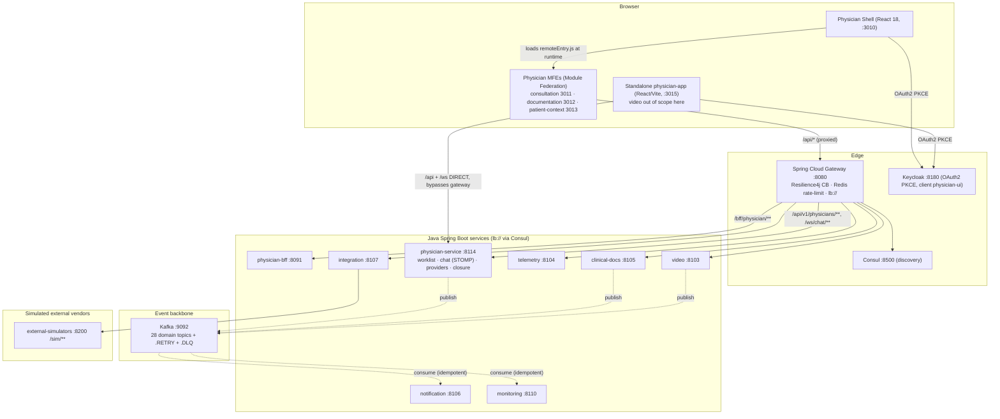
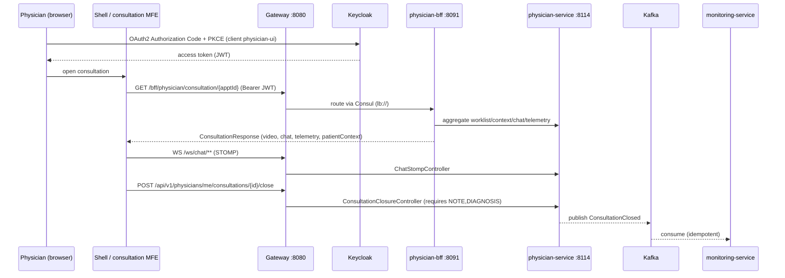
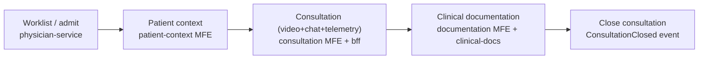

# Telemedicine Physician — Architecture (HLD + LLD) & Flows

Current state of the repo. Grounded in the code, configs, and the verified
`Features.md` / `Skills.md`. Diagrams are Mermaid. This is the **physician**
repo; it shares the microservices + microfrontends base with the patient repo
but adds `physician-service` and the physician portal/BFF.

## 1. High-Level Design (HLD)

**Request landing (how a call flows):**
- **MFE portal path:** Browser → Physician Shell (:3010) → MFE remote →
  `/api/*` proxied → Gateway (:8080) validates Keycloak JWT, CB + rate-limit,
  Consul `lb://` → `physician-bff` (`/bff/physician/**`) or `physician-service`
  (`/api/v1/physicians/**`). Real-time chat is STOMP over WebSocket via the
  gateway at `/ws/chat/**`.
- **Standalone physician-app path:** physician-app (:3015) proxies `/api` and
  `/ws` **directly to physician-service (:8114), bypassing the gateway** — so it
  needs `physician-service` running (Gradle `:physician-service:bootRun`), which
  is **not** in docker-compose.

## 2. Low-Level Design (LLD) — consultation slice

**Key LLD facts (from code):**
- `physician-bff` aggregates downstream calls and can return
  `AggregationStatus.DEGRADED` with an advisory message.
- `physician-service` owns worklist (Kafka-fed projection), clinical chat (REST
  + STOMP WebSocket), providers, and consultation closure (emits
  `ConsultationClosed` only when the minimum completion set `NOTE,DIAGNOSIS` is met).
- Role guards: `@IsPhysician` / `@RequiresRole`; dev bypass via
  `DevPhysicianAuthFilter` (`TELEMEDICINE_SECURITY_MODE=DEV`).
- Events use `@DomainEventListener` + `@IdempotentConsumer`; `.RETRY` + `.DLQ` per topic.

## 3. Journey flow diagram (brief)

Chat is real-time STOMP/WebSocket; closure is gated on NOTE+DIAGNOSIS and emits
a Kafka event consumed by notification/monitoring.

## 4. What is what (quick legend)

| Layer | Tech | Examples |
|-------|------|----------|
| Microfrontends | React 18 + Vite + Module Federation | physician-shell + 3 MFEs |
| Standalone app | React 18 + Vite (no MF) | physician-app :3015 (direct to :8114) |
| Edge | Spring Cloud Gateway | :8080, JWT, CB, rate-limit, /ws/chat/** |
| Discovery / auth | Consul / Keycloak | :8500 / :8180 (physician-ui) |
| Services | Java 21 + Spring Boot 3.3.5 | physician-bff :8091, physician-service :8114 + shared domain svcs |
| Real-time | STOMP over WebSocket | clinical chat /ws/chat/** |
| Async | Kafka | 28 domain events + RETRY + DLQ |
| External (sim) | external-simulators | :8200 /sim/** |
| Observability | Prometheus + Jaeger | :9090 / :16686 |
