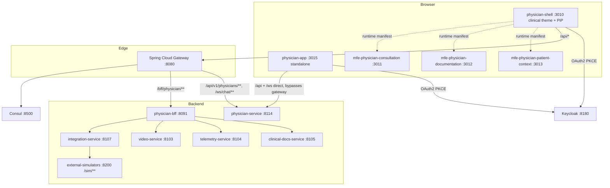

# Features — Telemedicine Physician

A functional overview of the **physician** experience across the three sub-repositories in
`telemedicinePhysician/`: the Java backend (`telemedicine-backend`), the Nx/React frontend
(`telemedicine-frontend`), and the orchestration layer (`telemedicine-platform`).

> Scope note: this is the **physician** repository. It shares the same microservices + microfrontends
> base as the patient repository, but the physician portal, physician BFF, and `physician-service`
> are the focus here. Everything below was verified against the actual source, config, and manifest
> files in this repo. Where a README and the filesystem disagree, the filesystem wins and the
> discrepancy is called out.

---

## 1. What the product does for physicians

The platform supports remote clinical consultations. The physician side of the product lets a
clinician:

1. **Review the worklist** — see which patients are ready, how long they have waited, their
   technical/readiness status, and any clinical red flags; admit a patient and acknowledge red flags.
2. **Open patient context** — demographics, insurance, medications, allergies and history pulled
   from the hospital systems (via the integration ACL and Master Patient Index).
3. **Conduct the consultation** — clinical chat (real-time), read-only remote telemetry (ANURA
   vitals), and consultation closure. Video session/token data is aggregated server-side by the
   physician BFF.
4. **Document the encounter** — diagnosis, prescription, and medical leave, with autosave, and a
   gated closure that requires a minimum completion set.
5. **Manage providers** (where the standalone physician app is used) — search/filter the provider
   directory, change provider status, view availability, credentials, and productivity metrics.

### End-to-end physician journey

```
Worklist (ready patients, waiting time, red flags)
   └─ Admit / acknowledge red flag
        └─ Patient context (demographics, insurance, meds, allergies, history)
             └─ Consultation workspace (clinical chat + read-only telemetry + closure)
                  └─ Documentation (diagnosis, prescription, medical leave — autosave)
                       └─ Close consultation (minimum completion set enforced)
```

### Two physician frontends exist in this repo

There are **two distinct physician front ends**, and they take different architectural approaches.
Both are present in `telemedicine-frontend/apps/`.

| Front end | Type | Port | Notes |
|-----------|------|------|-------|
| `physician-shell` + physician MFEs | Module Federation host + remotes | `3010` (host) | The MFE-based physician portal. Uses the `clinical` design-system theme and supports a Picture-in-Picture (PiP) mode. |
| `physician-app` | Single standalone React app (no Module Federation) | `3015` | Every physician screen is a local route in one deployable app. Explicitly states **video conferencing is out of scope** here. |

The MFE portal (`physician-shell` + its three remotes) proxies `/api/*` to the backend gateway on
`:8080`. The standalone `physician-app` is different — its dev server proxies `/api` and `/ws`
**directly to `physician-service` on `:8114`**, bypassing the gateway (see §3). Both reuse the same
shared packages.

---

## 2. Physician portal — Module Federation (physician-shell)

The `physician-shell` is a Module Federation **host**. It does not statically declare remotes
(`remotes: {}` in `vite.config.mts`); instead it loads them **at runtime** from a manifest and
mounts each remote under its declared route.

- Manifest: `apps/physician-shell/public/config/mfe-manifest.json`
- Loader: `apps/physician-shell/src/App.tsx` (`fetchMfeManifest('/config/mfe-manifest.json')` →
  `getEnabledRemotes` → `filterRemotesByRole` → `mergeConfigEnablement`)
- Theme: `ThemeProvider theme="clinical"` (set in `src/components/ShellProviders.tsx`)
- Auth: every remote route is wrapped in `RequireAuth` + `RequireRole(['PHYSICIAN'])`

### Registered remotes (verified from the manifest)

| Remote (MF name) | App directory | Dev port | Route | Roles | Enabled |
|------------------|---------------|----------|-------|-------|---------|
| `mfePhysicianConsultation` | `apps/mfe-physician-consultation` | `3011` | `/physician/consultation` | `PHYSICIAN` | true |
| `mfePhysicianDocumentation` | `apps/mfe-physician-documentation` | `3012` | `/physician/documentation` | `PHYSICIAN` | true |
| `mfePhysicianPatientContext` | `apps/mfe-physician-patient-context` | `3013` | `/physician/patient-context` | `PHYSICIAN` | true |

Each remote exposes `./App` via `@module-federation/vite` with `react`/`react-dom` shared as
singletons and `strictPort: true`.

> Manifest URL note: the manifest points each remote at `http://localhost:30xx/assets/remoteEntry.js`
> while the Vite federation plugin produces `remoteEntry.js` at the server root. This is a known
> serving nuance — if a remote fails to load, confirm the served path of `remoteEntry.js` for that
> MFE's dev server.

### Picture-in-Picture (PiP) mode

The shell reads `isPipMode = import.meta.env.VITE_PIP_MODE === 'true'`
(`apps/physician-shell/src/config/authConfig.ts`). When enabled:

- The shell renders a compact `physician-pip` layout (styles in `physicianShell.pip.css`) with no nav.
- `PipBridge` listens for `postMessage` `telemedicine:navigate` events and emits
  `telemedicine:status` `ready` back to the parent window (using the `appointmentId` query param).
- The default route renders the consultation remote directly, so the physician sees the consultation
  workspace docked beside the patient's video window.

---

## 3. Standalone physician app (physician-app)

`physician-app` is a single React 18 + Vite app using `BrowserRouter` — **not** a Module Federation
host or remote. It reuses the shared packages (`design-system`, `api-client`, `auth`,
`feature-flags`, `i18n`, `observability-web`, `chat-adapter`, `telemetry-adapter`, `shared-types`).

Routes (from `apps/physician-app/README.md`, aligned to the product requirements document):

| Route | Screen |
|-------|--------|
| `/worklist` | Physician worklist — readiness, waiting time, technical status, flags, admit, red-flag ack |
| `/worklist/:appointmentId/context` | Patient context — demographics, insurance, medications, allergies, history |
| `/consultation/:appointmentId` | Consultation workspace — clinical chat + read-only telemetry + closure (no video) |
| `/consultation/:appointmentId/documentation` | Documentation — diagnosis, prescription, medical leave (autosave) |
| `/providers` | Provider management — search/filter |
| `/providers/:providerId` | Provider detail — status change, availability, credentials, productivity metrics |

> The six rows above mirror `apps/physician-app/README.md` (the PRD-aligned routes). The actual
> `src/App.tsx` defines additional close-out/review screens beyond these — e.g.
> `/consultation/:appointmentId/review`, `/consultation/:appointmentId/send`,
> `/consultation/:appointmentId/close`, `/consultation/:appointmentId/withdrawn`, and `/previous`
> (previous patients).

Access is guarded by `RequireAuth` + `RequireRole(['PHYSICIAN'])`. Unlike the MFE portal, this app's
dev Vite proxy (`apps/physician-app/vite.config.mts`) does **not** go through the gateway: it proxies
both `/api` and `/ws` (the chat WebSocket) directly to `physician-service` on
`http://localhost:8114`, with a config comment noting it is "bypassing the gateway." Running
`physician-app` locally therefore requires `physician-service` (`:8114`) to be up — which is **not**
in docker-compose, so start it via Gradle (`:physician-service:bootRun`, see `Skills.md`) — not the
gateway. The Keycloak client id is `physician-ui`.

> The standalone app deliberately **does not render video**: media sessions are owned by the HIS
> video component / `video-service`. Note this differs from the physician **BFF**, which *does*
> aggregate a physician video token in its consultation response (see §5).

---

## 4. Feature catalog by domain

Each feature below is tied to the frontend route/app and the backend service/BFF/endpoints that back
it. Backend ports are from each service's `application.yml` and the backend architecture doc.

### 4.1 Physician worklist

| Aspect | Detail |
|--------|--------|
| Frontend | `physician-app` `/worklist`; MFE portal consumes `GET /bff/physician/worklist` |
| BFF | `physician-bff` (`:8091`) — `GET /bff/physician/worklist` (`PhysicianWorklistController`) |
| Domain | `physician-service` — `GET /api/v1/physicians/me/worklist`, `POST .../{appointmentId}/admit`, `POST .../{appointmentId}/red-flag/ack` (`WorklistController`) |
| Behavior | BFF aggregates downstream data and can return `AggregationStatus.DEGRADED` with an advisory message. Worklist projection is fed by Kafka (`WorklistProjectionListener`). Physician is resolved from the JWT; market via `X-Market` header (default `IN`). |

### 4.2 Patient context

| Aspect | Detail |
|--------|--------|
| Frontend | `mfe-physician-patient-context` (`:3013`, route `/physician/patient-context`); `physician-app` `/worklist/:appointmentId/context` |
| BFF | `physician-bff` consultation aggregation derives `PatientContext` from integration-service appointment + MPI (`/v1/appointments/v2/{id}` and `.../{id}/mpi`) |
| Data | demographics, insurance, medications, allergies, history |

### 4.3 Consultation workspace (chat + telemetry + closure)

| Aspect | Detail |
|--------|--------|
| Frontend | `mfe-physician-consultation` (`:3011`, route `/physician/consultation`); `physician-app` `/consultation/:appointmentId` |
| BFF | `physician-bff` — `GET /bff/physician/consultation/{appointmentId}` returns `ConsultationResponse` with `video` (`VideoJoinPayload`), `chat` (`ChatContext`), `telemetry` (`TelemetryContext`), `patientContext` |
| Chat (domain) | `physician-service` clinical chat: REST `GET/POST /api/v1/physicians/me/consultations/{appointmentId}/chat` (`ChatController`) plus real-time **STOMP over WebSocket** (`ChatStompController`, `ChatWebSocketConfig`), gateway-routed at `/ws/chat/**` |
| Telemetry | read-only ANURA vitals; BFF pre-fetches a telemetry token via `POST /api/v1/telemetry/token` |
| Closure (domain) | `physician-service` — `POST /api/v1/physicians/me/consultations/{appointmentId}/close` (`ConsultationClosureController`); emits `ConsultationClosed` only when the minimum completion set (`NOTE,DIAGNOSIS`) is met or an audited exception is supplied |

BFF consultation aggregation downstream calls (`PhysicianConsultationService`):

| Downstream service | Call | Produces |
|--------------------|------|----------|
| integration-service | `GET /v1/appointments/v2/{id}` | appointment summary |
| integration-service | `GET /v1/appointments/v2/{id}/mpi` | patient demographics |
| video-service | `GET /api/v1/video/appointments/{id}/session` | session metadata |
| video-service | `POST /api/v1/video/sessions/{sessionId}/tokens` (role `PHYSICIAN`) | physician video token |
| telemetry-service | `POST /api/v1/telemetry/token` | ANURA embed token |

Any failed fragment downgrades that section to `DEGRADED`; overall status is `DEGRADED` if any part is.

### 4.4 Clinical documentation

| Aspect | Detail |
|--------|--------|
| Frontend | `mfe-physician-documentation` (`:3012`, route `/physician/documentation`); `physician-app` `/consultation/:appointmentId/documentation` |
| BFF | `physician-bff` — `POST /bff/physician/documentation/{appointmentId}` → `ClinicalDocumentResponse` |
| Domain | authoritative clinical documents live in `clinical-docs-service` (`:8105`, `/api/v1/clinical-docs/**`) — documents, prescriptions, medical leave |
| UX | diagnosis, prescription, medical leave with autosave |

### 4.5 Provider / physician management

| Aspect | Detail |
|--------|--------|
| Frontend | `physician-app` `/providers` and `/providers/:providerId` |
| Domain | `physician-service` — `GET /api/v1/physicians` (search), `GET /api/v1/physicians/{providerId}` (detail), `PUT /api/v1/physicians/{providerId}/status` (`ProviderController`, roles `PHYSICIAN`/`ADMIN`) |
| Data model | provider entity with specialties, languages, modes, availability, credentials, metrics (JPA entities under `domain/provider`) |
| Behavior | status changes take effect immediately on routing; market via `X-Market` (default `IN`) |

---

## 5. Backend capabilities

### 5.1 Gateway routing (Spring Cloud Gateway, `:8080`)

Source: `telemedicine-backend/gateway/src/main/resources/application.yml`. All north-south traffic
enters the gateway; the frontend never calls domain services directly. Each route has a Resilience4j
circuit breaker with `forward:/fallback`, plus a Redis-backed rate limiter and Consul load balancing
(`lb://`).

| Route id | Predicate | Upstream |
|----------|-----------|----------|
| patient-bff | `/bff/patient/**` | `lb://patient-bff` |
| **physician-bff** | `/bff/physician/**` | `lb://physician-bff` |
| admin-bff | `/bff/admin/**` | `lb://admin-bff` |
| waiting-room-service | `/api/v1/waiting-room/**` | `lb://waiting-room-service` |
| identity-service | `/api/v1/identity/**` | `lb://identity-service` |
| video-service | `/api/v1/video/**` | `lb://video-service` |
| telemetry-service | `/api/v1/telemetry/**` | `lb://telemetry-service` |
| clinical-docs-service | `/api/v1/clinical-docs/**` | `lb://clinical-docs-service` |
| notification-service | `/api/v1/notifications/**` | `lb://notification-service` |
| **physician-service** | `/api/v1/physicians/**` | `lb://physician-service` |
| **physician-chat-ws** | `/ws/chat/**` | `lb://physician-service` (STOMP/WebSocket) |
| integration-service | `/v1/appointments/v2/**` | `lb://integration-service` |
| integration-webhooks | `/api/v1/integration/**` | `lb://integration-service` |
| survey-service | `/api/v1/survey/**` | `lb://survey-service` |
| reporting-service | `/api/v1/reporting/**` | `lb://reporting-service` |
| monitoring-service | `/api/v1/monitoring/**` | `lb://monitoring-service` |
| config-service | `/api/v1/config/**` | `lb://config-service` |
| audit-service | `/api/v1/audit/**` | `lb://audit-service` |
| scheduler-service | `/api/v1/scheduler/**` | `lb://scheduler-service` |
| external-simulators | `/sim/**` | `lb://external-simulators` |

> The `physician-service` and `physician-chat-ws` routes are specific to this physician repo.

### 5.2 Service discovery — Consul

Every service registers with Consul (`spring.cloud.consul.discovery`), prefers IP, and exposes a
health check at `/actuator/health`. The gateway uses `lb://<service>` to resolve instances. Consul UI
is on `:8500`.

### 5.3 Auth — Keycloak (OAuth2/OIDC)

- Browser uses OAuth2 Authorization Code + **PKCE** against Keycloak (`:8180`, realm `telemedicine`).
- Physician Keycloak client id: `physician-ui`.
- Gateway validates JWTs via the JWK set URI; services run as resource servers with method-level
  role annotations (`@IsPhysician`, `@RequiresRole`).
- Local dev bypass: `VITE_AUTH_MODE=dev` in the frontend; `TELEMEDICINE_SECURITY_MODE=DEV` /
  `DevSecurityConfiguration` + `DevPhysicianAuthFilter` seed a physician principal in
  `physician-service`.

### 5.4 Observability

- Prometheus metrics via actuator `/actuator/prometheus` (Prometheus UI `:9090`).
- Distributed tracing with OpenTelemetry/Jaeger (Jaeger UI `:16686`).
- Correlation IDs propagated end-to-end.

### 5.5 External integrations and simulators

- `integration-service` is the anti-corruption layer (ACL) for HIS, SAP, FONASA, MPI, payment,
  Vonage/ACS, ANURA, RecMed, Medipass, Zendesk, notification channels.
- `external-simulators` (`:8200`, routed at `/sim/**`) provides deterministic vendor mocks with
  latency/error injection and an admin API at `/sim/admin/**`. Dev/test only — excluded from
  production.

### 5.6 BFFs

| BFF | Port | Audience | Key endpoints |
|-----|------|----------|---------------|
| patient-bff | 8090 | patients | `GET /bff/patient/journey/{id}` |
| **physician-bff** | 8091 | physicians | `GET /bff/physician/worklist`, `GET /bff/physician/consultation/{id}`, `POST /bff/physician/documentation/{id}` |
| admin-bff | 8092 | admins | config/audit/snapshot/role endpoints |

BFFs hold no domain persistence; they aggregate downstream reads and return degraded partial
responses when a fragment fails.

### 5.7 Complete backend service inventory (from `settings.gradle`)

- **Gateway:** `gateway`
- **BFFs:** `patient-bff`, `physician-bff`, `admin-bff`
- **Platform services:** `config-service`, `scheduler-service`, `audit-service`
- **Domain services:** `waiting-room-service`, `identity-service`, `video-service`,
  `telemetry-service`, `clinical-docs-service`, `notification-service`, `integration-service`,
  `survey-service`, `reporting-service`, `monitoring-service`, **`physician-service`**
- **Templates/simulators:** `template-java` (`services/_template-java`), `external-simulators`.
  A Python template exists at `services/_template-python` (FastAPI) but is not a Gradle module.
- **Shared libraries:** `java-common-bom`, `-core`, `-web`, `-security`, `-events`, `-observability`,
  `-persistence`, `-integration`, `-audit`, `-mock-data`, `-testing` (+ `shared/python-common`,
  `shared/contracts`).

> Port note: `physician-service` binds `:8114` (per its `application.yml`) with a PostgreSQL schema
> `physician`, Redis, Kafka, and Flyway. See the accuracy note in §7.

---

## 6. Cross-cutting features from packages

Verified from `telemedicine-frontend/packages/` (18 packages present). Physician-relevant ones first.

| Package | What it provides (physician relevance) |
|---------|----------------------------------------|
| `design-system` | WCAG 2.1 AA component library; **`clinical` theme** used by the physician shell (`ThemeProvider`, `tokens.css`) |
| `auth` | OAuth2 PKCE (Keycloak), silent refresh, `RequireAuth`/`RequireRole` guards |
| `mfe-registry` | Runtime manifest loading, role filtering, config-driven enablement, retry/fallback (drives physician-shell remotes) |
| `api-client` | Typed HTTP client with JWT, correlation IDs, idempotency, RFC 7807 parsing, retry |
| `session-context` | Cross-MFE journey state + BFF hydration |
| `video-adapter` | Vonage/ACS/Simulator video abstraction (used where video is in scope) |
| `chat-adapter` | Clinical chat with API persistence |
| `telemetry-adapter` | ANURA embed with consent/config gates (read-only telemetry in the consultation) |
| `consent-kit` | Platform + clinical consent flows |
| `device-test` | Camera/mic/speaker/bandwidth preflight |
| `i18n` | es-CL + en locale bundles, Intl formatters (physician default locale `es`) |
| `feature-flags` | config-service client with safe defaults |
| `observability-web` | Error boundary, web-vitals, journey timing |
| `shared-types` | OpenAPI-aligned DTOs, ProblemDetail, ErrorCode, journey/event types |
| `shared-ui` | Backward-compat re-exports from design-system |
| `test-utils` | renderWithProviders, MSW handlers, fixtures |
| `eslint-config` / `tsconfig-presets` | Shared lint and TS config |

---

## 7. Architecture diagram



---

## Accuracy notes (verified against the filesystem)

- **Package count:** the frontend README says "17 packages"; the filesystem shows **18** under
  `packages/` (the extra being `shared-ui`). Count independently before relying on the README.
- **App count:** the README lists physician MFEs but omits the standalone `physician-app`; there are
  **19 entries** under `apps/` (3 shells, 15 MFEs, `physician-app`), including `_template-mfe`.
- **`physician-service` is not in `docker-compose.yml`.** It is a real Gradle module
  (`services/physician-service`, `:8114`, schema `physician`) with full controllers, but the platform
  compose `domain` profile stops at `monitoring-service` (`:8110`). To run the physician worklist/chat
  domain service locally today you must run it outside the standard compose profiles (e.g. Gradle
  `bootRun` against the infra containers). The physician **BFF** *is* wired into compose (`platform`
  profile, `:8091`).
- **Physician front ends are not containerized in the main compose.** The `apps` profile only builds
  the patient `shell` and `template-mfe`. Run `physician-shell`, `physician-app`, and the physician
  MFEs via Nx dev servers (see `Skills.md`).
- The physician **BFF** aggregates a physician **video token**, but the standalone `physician-app`
  intentionally does not render video. Both statements are true and intentional.
