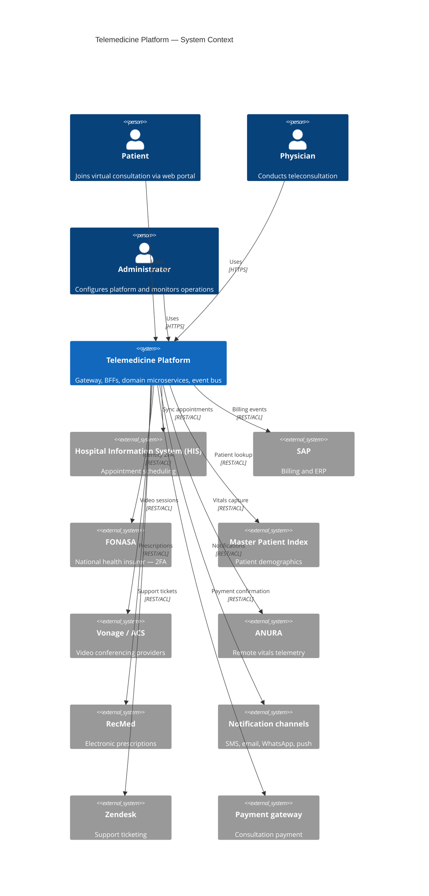
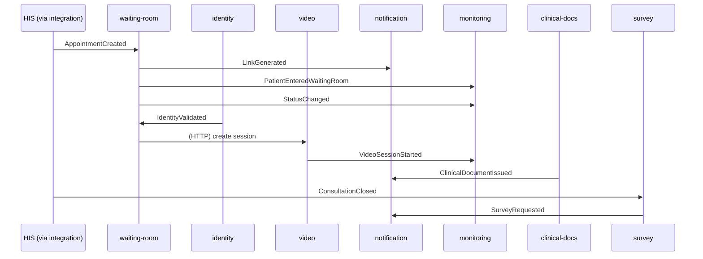
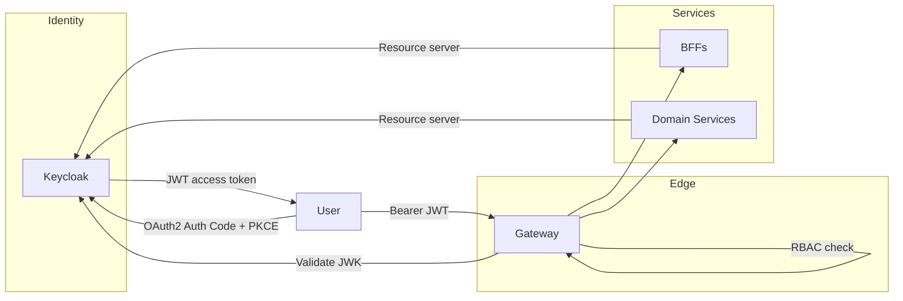
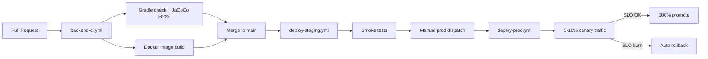

# Telemedicine Backend — Enterprise Architecture Document

| Field | Value |
|-------|-------|
| **Version** | 1.0 |
| **Status** | As-built (derived from codebase) |
| **Scope** | `telemedicine-backend` and its platform dependencies |
| **Audience** | Enterprise architects, platform engineers, security, operations |
| **Last updated** | August 2026 |

---

## Table of contents

1. [Executive summary](#1-executive-summary)
2. [Architecture principles](#2-architecture-principles)
3. [System context](#3-system-context)
4. [Logical architecture](#4-logical-architecture)
5. [Component inventory](#5-component-inventory)
6. [Microservice catalogue](#6-microservice-catalogue)
7. [Backend-for-Frontend layer](#7-backend-for-frontend-layer)
8. [Platform services](#8-platform-services)
9. [Shared platform libraries](#9-shared-platform-libraries)
10. [Event-driven architecture](#10-event-driven-architecture)
11. [Data architecture](#11-data-architecture)
12. [External integration architecture](#12-external-integration-architecture)
13. [Security architecture](#13-security-architecture)
14. [Observability and operations](#14-observability-and-operations)
15. [Deployment and infrastructure](#15-deployment-and-infrastructure)
16. [CI/CD and release management](#16-cicd-and-release-management)
17. [High availability and disaster recovery](#17-high-availability-and-disaster-recovery)
18. [Non-functional requirements](#18-non-functional-requirements)
19. [Technology stack matrix](#19-technology-stack-matrix)
20. [Related documentation](#20-related-documentation)

---

## 1. Executive summary

The Telemedicine Backend is an enterprise-grade, cloud-native microservices platform supporting remote clinical consultations for patients, physicians, and administrators. It implements a **domain-driven, event-sourced integration model** with strict data ownership, healthcare-grade security controls, and production-ready operational patterns.

The platform delivers:

- **Patient journey orchestration** — consent, identity validation, waiting room, video consultation, clinical documentation, and post-consultation surveys
- **Physician workflow support** — worklist, live consultation context (video, telemetry, chat), and documentation submission
- **Administrative control plane** — configuration, audit, scheduling, operational snapshots, and KPI reporting
- **Enterprise integration** — anti-corruption layer (ACL) for hospital systems, national health insurers, payment gateways, video providers, and third-party clinical services

The backend is built as a **Gradle monorepo** containing 17 deployable Java services (1 gateway, 3 BFFs, 3 platform services, 10 domain services), 10 shared libraries, contract definitions, and Kubernetes deployment manifests. Runtime orchestration, HA/DR overlays, and full-stack Docker Compose live in the companion `telemedicine-platform` repository.

---

## 2. Architecture principles

| Principle | Implementation |
|-----------|----------------|
| **Domain ownership** | Each microservice owns its PostgreSQL schema; no cross-service database access |
| **API-first design** | OpenAPI contracts in `shared/contracts/`; gateway as single north-south entry point |
| **Event-driven decoupling** | Kafka with transactional outbox; 28 versioned domain events |
| **Defense in depth** | JWT at gateway, RBAC, network policies, PHI encryption, hash-chained audit |
| **Resilience by default** | Circuit breakers, rate limiting, provider failover, retry/DLQ topics |
| **Observable by design** | Correlation IDs, structured logging, Prometheus metrics, OTLP tracing |
| **Contract-driven evolution** | JSON Schema event contracts, japicmp on shared libs, 80% test coverage gate |
| **Environment parity** | Same service images from dev Compose through prod Kubernetes |
| **Least privilege** | Role-based access (PATIENT, PHYSICIAN, ADMINISTRATOR); gateway-only ingress to BFFs |
| **Compliance readiness** | Consent ledger, immutable audit chain, 7-year retention, DR targets |

---

## 3. System context



### Repository topology

| Repository | Responsibility |
|------------|----------------|
| **telemedicine-backend** | Gateway, BFFs, domain/platform services, shared libraries, contracts, K8s base manifests |
| **telemedicine-frontend** | Module Federation shells and microfrontends (Patient, Physician, Admin) |
| **telemedicine-platform** | Full-stack Docker Compose, production K8s overlays, infra configs, k6 tests, runbooks |

---

## 4. Logical architecture

The platform follows a **six-layer architecture**:

```
┌─────────────────────────────────────────────────────────────────────────┐
│  L1 — Experience Layer (telemedicine-frontend)                          │
│  Patient Shell │ Physician PiP Shell │ Admin Console                    │
│  14 Module Federation MFEs loaded via runtime manifest                  │
└───────────────────────────────────┬─────────────────────────────────────┘
                                    │ HTTPS /api/*
┌───────────────────────────────────▼─────────────────────────────────────┐
│  L2 — Edge Layer                                                        │
│  Spring Cloud Gateway (:8080) — JWT, RBAC, rate limit, circuit breakers │
└───────────────────────────────────┬─────────────────────────────────────┘
                                    │ Consul lb://
┌───────────────────────────────────▼─────────────────────────────────────┐
│  L3 — BFF Layer (journey aggregation, no domain persistence)            │
│  patient-bff │ physician-bff │ admin-bff                                │
└───────────────────────────────────┬─────────────────────────────────────┘
                                    │ REST (Consul service discovery)
┌───────────────────────────────────▼─────────────────────────────────────┐
│  L4 — Domain Layer (10 microservices, schema-per-service)               │
│  waiting-room │ identity │ video │ telemetry │ clinical-docs │        │
│  notification │ integration (ACL) │ survey │ reporting │ monitoring     │
└───────────────┬─────────────────────────────────────┬───────────────────┘
                │ Kafka (EventEnvelope)               │ REST adapters
┌───────────────▼───────────────┐   ┌─────────────────▼─────────────────┐
│  L5 — Platform Layer          │   │  External Systems (via ACL)       │
│  config │ audit │ scheduler   │   │  HIS, SAP, FONASA, Vonage, ...    │
└───────────────┬───────────────┘   └───────────────────────────────────┘
                │
┌───────────────▼─────────────────────────────────────────────────────────┐
│  L6 — Data & Infrastructure Layer                                       │
│  PostgreSQL │ Redis │ Kafka │ MinIO │ Keycloak │ Consul                 │
│  Prometheus │ Jaeger │ cert-manager (prod)                              │
└─────────────────────────────────────────────────────────────────────────┘
```

### Request flow

```
Browser → Frontend Shell (:3000)
            ├─ loads MFE remotes from mfe-manifest.json
            └─ /api/* → Gateway (:8080)
                          ├─ JWT validation + RBAC (prod)
                          ├─ Correlation ID injection
                          ├─ Rate limiting (Redis)
                          └─ Consul lb://<service-name> → BFF or Domain Service
```

External clients **never** call microservices directly. All north-south traffic enters through the gateway.

---

## 5. Component inventory

Components are classified by origin and operational role.

### 5.1 Built — custom platform components

| Component | Type | Description |
|-----------|------|-------------|
| **gateway** | Edge service | Spring Cloud Gateway — routing, security, resilience |
| **patient-bff** | BFF | Patient journey aggregation |
| **physician-bff** | BFF | Physician worklist and consultation context |
| **admin-bff** | BFF | Admin control plane aggregation |
| **waiting-room-service** | Domain | Consent, queue, device test, status lifecycle |
| **identity-service** | Domain | Identity validation, FONASA 2FA orchestration |
| **video-service** | Domain | Video/chat sessions, multi-provider failover |
| **telemetry-service** | Domain | ANURA vitals ingestion (independently deployable) |
| **clinical-docs-service** | Domain | Clinical documents, prescriptions, medical leave |
| **notification-service** | Domain | Template-based multi-channel notifications |
| **integration-service** | Domain ACL | Anti-corruption layer for all external systems |
| **survey-service** | Domain | Post-consultation NPS surveys |
| **reporting-service** | Domain | KPI aggregation and export |
| **monitoring-service** | Domain | Live operational snapshot and alerts |
| **config-service** | Platform | Feature flags and typed configuration |
| **audit-service** | Platform | Hash-chained append-only audit ledger |
| **scheduler-service** | Platform | Clustered Quartz job orchestration |
| **external-simulators** | Dev/test only | Vendor mock layer (not deployed in production) |
| **java-common-*** (10 modules) | Shared libs | Cross-cutting platform capabilities |
| **shared/contracts** | Contracts | OpenAPI specs, event JSON schemas, error catalogue |

### 5.2 Open source — runtime infrastructure

| Component | Version / Notes | Role |
|-----------|-----------------|------|
| **Java (Temurin)** | 21 LTS | Runtime for all services |
| **Spring Boot** | 3.3.5 | Application framework |
| **Spring Cloud** | 2023.0.3 | Gateway, Consul discovery, circuit breakers |
| **Spring Kafka** | (via Boot BOM) | Event publishing and consumption |
| **Spring Data JPA + Flyway** | — | Persistence and schema migration |
| **PostgreSQL** | 15+ | Primary relational store (13 schemas) |
| **Apache Kafka** | 3.x | Event bus (28 topics + RETRY + DLQ = 84 topics) |
| **Redis** | 7.x | Rate limiting, caching, snapshot store |
| **HashiCorp Consul** | — | Service discovery and health checks |
| **Keycloak** | — | OAuth2/OIDC identity provider |
| **MinIO** | — | S3-compatible object storage |
| **Quartz Scheduler** | JDBC store | Clustered job scheduling |
| **Resilience4j** | — | Circuit breakers (gateway + integration) |
| **Micrometer + Prometheus** | — | Metrics collection |
| **OpenTelemetry / Jaeger** | — | Distributed tracing |
| **SpringDoc OpenAPI** | 2.6.0 | API documentation |
| **Testcontainers** | — | Integration test infrastructure |
| **ArchUnit** | — | Architecture constraint tests |
| **Gradle** | — | Build and dependency management |
| **Kubernetes + Kustomize** | — | Container orchestration |
| **cert-manager** | — | TLS certificate automation (prod) |
| **k6** | — | Performance and load testing |

### 5.3 External — third-party systems (production integrations)

| System | Code | Consuming service | Purpose |
|--------|------|-------------------|---------|
| Hospital Information System | `his` | integration-service | Appointment lifecycle |
| SAP ERP | `sap` | integration-service | Billing and financial events |
| Payment gateway | `payment` | integration-service | Payment confirmation |
| FONASA | `fonasa` | integration-service, identity-service | National insurer identity 2FA |
| Master Patient Index | `mpi` | integration-service | Patient demographics |
| Vonage | `vonage` | video-service | Primary video provider |
| Azure Communication Services | `acs` | video-service | Failover video provider |
| ANURA | `anura` | telemetry-service | Remote vitals measurement |
| RecMed | `recmed` | clinical-docs-service | Electronic prescriptions |
| Medipass | `medipass` | clinical-docs-service | Medical leave certificates |
| Notification channels | `notify` | notification-service | SMS, email, WhatsApp, push |
| Zendesk | `zendesk` | integration-service | Support ticket creation |

All external integrations follow the **Adapter + ACL pattern** via `java-common-integration`, with deterministic simulators in `external-simulators` for development and CI.

---

## 6. Microservice catalogue

### 6.1 Domain services

| Service | Port | Database | Redis | MinIO | Primary responsibility |
|---------|------|----------|-------|-------|------------------------|
| waiting-room-service | 8101 | `waiting_room` | Yes | — | Consent, session links, device test, queue, status |
| identity-service | 8102 | `identity` | — | — | Identity validation, FONASA 2FA |
| video-service | 8103 | `video` | — | — | Video/chat sessions, provider failover |
| telemetry-service | 8104 | `telemetry` | — | — | ANURA vitals (independently deployable) |
| clinical-docs-service | 8105 | `clinical_docs` | — | Yes | Documents, prescriptions, medical leave |
| notification-service | 8106 | `notification` | — | — | Multi-channel templated notifications |
| integration-service | 8107 | `integration` | — | — | ACL for all external systems |
| survey-service | 8108 | `survey` | — | — | Post-consultation NPS |
| reporting-service | 8109 | `reporting` | — | Yes | KPI aggregation and exports |
| monitoring-service | 8110 | `monitoring` | Yes | — | Live snapshot, alerts, connection quality |

### 6.2 Standard service stack

Every domain service includes:

- Java 21, Spring Boot 3.3.5, Spring Cloud Consul Discovery
- PostgreSQL with Flyway migrations (dedicated schema)
- Kafka producer/consumer with transactional outbox
- Spring Actuator health + Prometheus metrics endpoint
- OpenAPI contract in `shared/contracts/`
- All eight production shared libraries (core, web, security, events, observability, persistence, integration, audit)
- JaCoCo coverage gate: **80% line / 75% branch**

### 6.3 Gateway routes

| Route ID | Path prefix | Upstream |
|----------|-------------|----------|
| patient-bff | `/bff/patient/**` | patient-bff |
| physician-bff | `/bff/physician/**` | physician-bff |
| admin-bff | `/bff/admin/**` | admin-bff |
| waiting-room-service | `/api/v1/waiting-room/**` | waiting-room-service |
| identity-service | `/api/v1/identity/**` | identity-service |
| video-service | `/api/v1/video/**` | video-service |
| telemetry-service | `/api/v1/telemetry/**` | telemetry-service |
| clinical-docs-service | `/api/v1/clinical-docs/**` | clinical-docs-service |
| notification-service | `/api/v1/notifications/**` | notification-service |
| integration-service | `/v1/appointments/v2/**`, `/api/v1/integration/**` | integration-service |
| survey-service | `/api/v1/survey/**` | survey-service |
| reporting-service | `/api/v1/reporting/**` | reporting-service |
| monitoring-service | `/api/v1/monitoring/**` | monitoring-service |
| config-service | `/api/v1/config/**` | config-service |
| audit-service | `/api/v1/audit/**` | audit-service |
| scheduler-service | `/api/v1/scheduler/**` | scheduler-service |
| external-simulators | `/sim/**` | external-simulators (dev/test only) |

Gateway resilience defaults:

- **Rate limiting:** Redis token bucket — 100 req/s replenish, 200 burst (prod: 600/1200)
- **Circuit breakers:** Resilience4j per route with `/fallback` forward
- **CORS:** Restricted to configured shell origins in production

---

## 7. Backend-for-Frontend layer

BFFs aggregate downstream REST calls via **Consul `lb://` + RestClient**. They hold no domain persistence and return **degraded partial responses** when downstream services are unavailable.

### patient-bff (:8090)

| Aspect | Detail |
|--------|--------|
| **Audience** | Patients |
| **Security** | `@IsPatient`, JWT via Keycloak |
| **Downstream services** | waiting-room, identity, integration, video, clinical-docs, survey |
| **Key endpoint** | `GET /bff/patient/journey/{appointmentId}` — aggregates appointment, queue, consent, identity, video, documents, survey state |

### physician-bff (:8091)

| Aspect | Detail |
|--------|--------|
| **Audience** | Physicians |
| **Security** | `@IsPhysician` |
| **Downstream services** | integration, waiting-room, video, telemetry, monitoring |
| **Key endpoints** | `GET /bff/physician/worklist`, `GET /bff/physician/consultation/{appointmentId}`, `POST /bff/physician/documentation/{appointmentId}` |

### admin-bff (:8092)

| Aspect | Detail |
|--------|--------|
| **Audience** | Administrators |
| **Security** | `@IsAdmin`, MFA required in production |
| **Downstream services** | config, audit, scheduler, monitoring, reporting |
| **Key endpoints** | Config CRUD, audit query, scheduler jobs, operational snapshot, role listing |

---

## 8. Platform services

| Service | Port | Database | Purpose |
|---------|------|----------|---------|
| **config-service** | 8112 | `config` (+ Redis cache) | Platform configuration, feature flags; publishes `ConfigurationChanged` |
| **audit-service** | 8111 | `audit` (+ MinIO exports) | Hash-chained append-only audit ledger, consent ledger |
| **scheduler-service** | 8113 | `scheduler` (Quartz JDBC) | Clustered job orchestration with HTTP downstream triggers |

### Pre-configured scheduler jobs

| Job key | Target service | Schedule |
|---------|----------------|----------|
| appointment-reminders | notification-service | Every 15 min |
| waiting-room-timeout | waiting-room-service | Every 5 min |
| no-show-detection | waiting-room-service | Every 5 min |
| session-expiry-cleanup | video-service | Every 5 min |
| survey-dispatch | survey-service | Hourly |
| report-generation | reporting-service | Daily 02:00 |
| audit-retention | audit-service | Daily 03:00 |
| config-cache-refresh | config-service | Every 1 min |

---

## 9. Shared platform libraries

Nine versioned Gradle modules under `shared/`, published via **java-common-bom** (v1.0.0) to GitHub Packages. Breaking changes blocked by japicmp unless baseline is deliberately moved.

| Module | Responsibility |
|--------|----------------|
| **java-common-bom** | Bill of Materials — pins all shared library versions |
| **java-common-core** | API envelopes, RFC 9457 Problem Details, error catalogue, IDs, PHI redaction utilities |
| **java-common-web** | Global exception handling, pagination, idempotency filter, OpenAPI conventions |
| **java-common-security** | Keycloak JWT resource server, RBAC annotations, `@RequiresConsent`, security headers |
| **java-common-events** | `EventEnvelope`, `EventTypes`, Kafka publishing, idempotent consumption |
| **java-common-observability** | Correlation ID, MDC, Micrometer/Prometheus, OTLP tracing, structured JSON logging |
| **java-common-persistence** | JPA auditing, AES-256 PHI column encryption, transactional outbox, idempotency store |
| **java-common-integration** | `ExternalSystemAdapter`, provider selection/failover, Resilience4j HTTP clients |
| **java-common-audit** | `@Audited` aspect, tamper-evident audit event emission, consent ledger helpers |
| **java-common-mock-data** | Optional JSON mock datastore for `@Profile("mock")` |
| **java-common-testing** | Testcontainers, JWT test helpers, event assertions, ArchUnit architecture rules |

Additionally:

- **`shared/python-common/`** — pip-editable utilities for polyglot services (FastAPI template)
- **`shared/contracts/`** — 18 OpenAPI specs, 28 JSON Schema event definitions, common error catalogue

---

## 10. Event-driven architecture

### 10.1 Pattern

```
┌──────────────┐    ┌─────────────┐    ┌──────────────┐    ┌─────────────┐
│ Domain       │    │ Outbox      │    │ Outbox       │    │ Kafka       │
│ Transaction  │───▶│ Table       │───▶│ Publisher    │───▶│ Topic       │
│ (same TX)    │    │ (same TX)   │    │ (poll)       │    │             │
└──────────────┘    └─────────────┘    └──────────────┘    └──────┬──────┘
                                                                   │
                    ┌─────────────┐    ┌──────────────┐           │
                    │ Processed   │◀───│ Consumer     │◀──────────┘
                    │ Event Store │    │ (idempotent) │
                    └─────────────┘    └──────────────┘
                                              │
                              ┌───────────────┼───────────────┐
                              ▼               ▼               ▼
                         .RETRY topic     .DLQ topic    Downstream action
```

Key characteristics:

- **Transactional outbox** — domain write and event record in same database transaction
- **Versioned `EventEnvelope`** — correlation/causation IDs, subject as Kafka partition key
- **Idempotent consumption** — processed-event store prevents duplicate handling
- **Retry + DLQ** — each of 28 event types has primary, `.RETRY`, and `.DLQ` topics (84 total)
- **Contract tests** — `EventTypes.java`, `event-catalogue.yaml`, and `topics.txt` kept in sync

### 10.2 Event catalogue (28 types)

| Event | Producer | Primary consumers |
|-------|----------|-------------------|
| AppointmentCreated | integration-service | waiting-room |
| AppointmentRescheduled | integration-service | waiting-room, notification |
| PaymentConfirmed | integration-service | reporting |
| LinkGenerated | waiting-room | notification |
| ConsentGranted / ConsentWithdrawn | waiting-room | audit |
| IdentityValidated / IdentityValidationFailed | identity | waiting-room; notification (failed) |
| DeviceTestCompleted | waiting-room | monitoring |
| PatientEnteredWaitingRoom | waiting-room | monitoring, reporting |
| StatusChanged | waiting-room | monitoring, notification, reporting |
| VideoSessionCreated / Started / Ended | video | monitoring, reporting |
| ChatMessageSent | video | audit |
| TelemetryMeasured | telemetry | monitoring |
| ConnectionQualityDegraded | monitoring | reporting |
| ClinicalDocumentIssued | clinical-docs | notification, reporting |
| PrescriptionIssued / MedicalLeaveIssued | clinical-docs | notification, reporting |
| ConsultationClosed | integration | survey |
| SurveyRequested / SurveyCompleted | survey | notification; reporting |
| NotificationSent / NotificationFailed | notification | reporting; monitoring |
| IntegrationFailed | integration | monitoring, reporting |
| ConfigurationChanged | config-service | notification, video, telemetry |
| AuditRecorded | audit-service | audit (chain verification) |

Event schemas: `shared/contracts/events/schemas/*.v1.json` (JSON Schema Draft 2020-12).

### 10.3 Patient journey event flow



---

## 11. Data architecture

### 11.1 Database-per-schema model

PostgreSQL hosts **13 isolated schemas** — one per service. Cross-service data access is prohibited; integration occurs via REST APIs and Kafka events only.

| Schema | Owner service | Notable data |
|--------|---------------|--------------|
| `waiting_room` | waiting-room-service | Consent records, queue state, device test results |
| `identity` | identity-service | Validation attempts, 2FA state |
| `video` | video-service | Session metadata, provider selection |
| `telemetry` | telemetry-service | Vitals measurements |
| `clinical_docs` | clinical-docs-service | Document metadata (blobs in MinIO) |
| `notification` | notification-service | Templates, delivery log |
| `integration` | integration-service | Appointment sync state, webhook receipts |
| `survey` | survey-service | Survey requests and responses |
| `reporting` | reporting-service | KPI aggregates |
| `monitoring` | monitoring-service | Snapshot state, alert history |
| `config` | config-service | Configuration keys and values |
| `audit` | audit-service | Hash-chained audit entries, consent ledger |
| `scheduler` | scheduler-service | Quartz job definitions and fire history |

### 11.2 Object storage (MinIO)

| Bucket | Owner | Content |
|--------|-------|---------|
| `clinical-documents` | clinical-docs-service | Clinical document PDFs |
| `prescriptions` | clinical-docs-service | Prescription artifacts |
| Audit/report exports | audit-service, reporting-service | Compliance exports |

Production: server-side encryption (SSE) and bucket replication.

### 11.3 Caching (Redis)

| Use case | Service |
|----------|---------|
| Gateway rate limiting | gateway |
| Configuration cache | config-service |
| Waiting room session state | waiting-room-service |
| Monitoring live snapshot | monitoring-service |

Production: Redis cluster mode (6 nodes) for HA.

### 11.4 Data protection

| Control | Implementation |
|---------|----------------|
| PHI column encryption | AES-256 via `java-common-persistence` JPA converter |
| PHI log redaction | `java-common-observability` MDC filter |
| Audit immutability | Append-only hash-chained ledger in audit-service |
| Consent ledger | Separate immutable consent module in audit-service |
| Backup encryption | PostgreSQL WAL + encrypted snapshots |
| Retention | 7-year audit retention via scheduler job |

---

## 12. External integration architecture

### 12.1 Anti-corruption layer (ACL)

The **integration-service** acts as the single ACL boundary for enterprise systems. Domain services interact with external systems through typed adapter interfaces in `java-common-integration`, never calling vendor APIs directly.

```
Domain Service ──▶ Adapter Interface ──▶ ExternalSystemAdapter ──▶ Vendor API
                         ▲
                         │ (dev/test)
                   external-simulators (:8200)
```

Adapter capabilities:

- Per-system Resilience4j circuit breakers and timeouts
- Provider selection and automatic failover (e.g., Vonage → ACS)
- Standardized failure reporting via `IntegrationFailed` events
- Webhook signature verification for inbound events

### 12.2 Simulator layer (non-production)

`external-simulators` provides deterministic vendor responses for development, CI, and chaos testing:

- Per-vendor latency, error-rate, and timeout injection via `SimulatorEngine`
- Admin API at `/sim/admin/**` for runtime tuning
- `X-Sim-Scenario` header for failure mode injection
- Stateful in-memory stores for appointment lifecycle, FONASA 2FA, video sessions
- **Explicitly excluded from production Kubernetes manifests**

---

## 13. Security architecture

### 13.1 Authentication and authorization



| Layer | Control |
|-------|---------|
| **Authentication** | OAuth2 Authorization Code + PKCE via Keycloak |
| **Token validation** | Gateway + all services as OAuth2 resource servers |
| **RBAC roles** | PATIENT, PHYSICIAN, ADMINISTRATOR — enforced at gateway path level |
| **MFA** | TOTP required for administrators in production realm |
| **Step-up auth** | FONASA 2FA via identity-service before consultation |
| **Consent gating** | `@RequiresConsent` annotation with HTTP consent verifier |
| **Dev bypass** | `TELEMEDICINE_SECURITY_MODE=DEV` disables JWT at gateway (local only) |

### 13.2 Production security controls (35-point checklist)

Full checklist: `telemedicine-platform/docs/security-review.md`

| Category | Key controls |
|----------|--------------|
| Identity & access | OAuth2 + PKCE, JWT at gateway, RBAC, MFA for admins, step-up 2FA |
| Transport & network | TLS 1.3, HSTS, Kafka TLS, Kubernetes NetworkPolicies, gateway-only BFF ingress |
| Data protection | PHI redaction, AES-256 encryption, MinIO SSE, encrypted backups, audit hash chain |
| Application security | Rate limiting, circuit breakers, CORS restriction, webhook signatures, idempotency keys |
| Secrets & operations | K8s Secrets/vault, rotation procedures, cert expiry monitoring, CVE scanning in CI |
| Compliance | Immutable consent ledger, 7-year audit retention, DR RPO/RTO validation |

### 13.3 Network segmentation (Kubernetes)

```
Internet → Ingress (TLS) → Gateway pods
                              ↓ (NetworkPolicy allow)
                           BFF pods
                              ↓ (NetworkPolicy allow)
                           Domain/Platform pods
                              ↓ (NetworkPolicy allow)
                           Infrastructure pods (PostgreSQL, Kafka, Redis)
```

Direct pod-to-pod access outside the allow-list is denied.

---

## 14. Observability and operations

### 14.1 Three pillars

| Pillar | Technology | Details |
|--------|------------|---------|
| **Metrics** | Micrometer → Prometheus | `/actuator/prometheus`; Consul tag `metrics-path=/actuator/prometheus` |
| **Tracing** | Micrometer Tracing + OTLP → Jaeger | Correlation/causation IDs propagated gateway → downstream |
| **Logging** | Structured JSON (Logstash encoder) | PHI redaction; correlation ID in MDC |

### 14.2 Health and alerting

- **Health checks:** Spring Actuator `/actuator/health` registered with Consul
- **Alert rules:** `telemedicine-platform/infra/prometheus/rules/platform-alerts.yml`
- **SLO monitoring:** Burn-rate recording rules for 99.9% availability target
- **Custom metrics:** `outbox.published.total`, `telemedicine.scheduler.downstream_failures`, etc.

### 14.3 Operational runbooks

| Runbook | Scenario |
|---------|----------|
| RB-001 | Gateway 5xx errors |
| RB-002 | Video provider failover |
| RB-003 | Kafka consumer lag |
| RB-004 | DR failover exercise |
| RB-005 | Secret rotation |
| RB-006 | Blue/green rollback |
| RB-007–RB-011 | Additional operational scenarios |

See: `telemedicine-platform/docs/runbooks.md`

---

## 15. Deployment and infrastructure

### 15.1 Environment model

| Environment | Orchestration | Security mode | Notes |
|-------------|---------------|---------------|-------|
| **Local dev** | Docker Compose (profile-driven) | JWT disabled | Profiles: infra, observability, sim, edge, platform, domain, apps |
| **Staging** | K8s Kustomize overlay | PROD-like | Automated deploy on main branch |
| **Production** | K8s Kustomize overlay | PROD | Blue/green + canary, manual promotion |

### 15.2 Docker Compose profiles

```bash
# Full stack
COMPOSE_PROFILES=infra,observability,sim,edge,platform,domain,apps \
  docker compose up -d --build
```

| Profile | Components |
|---------|------------|
| `infra` | PostgreSQL, Redis, Kafka, MinIO, Keycloak, Consul |
| `observability` | Prometheus, Jaeger |
| `sim` | external-simulators |
| `edge` | gateway |
| `platform` | config, audit, scheduler |
| `domain` | All 10 domain services |
| `apps` | Frontend shells |

### 15.3 Kubernetes architecture

| Component | Manifest location | Production notes |
|-----------|-------------------|------------------|
| Service Deployments | `telemedicine-backend/deploy/kubernetes/base/` | One Deployment per service |
| Gateway HA | `telemedicine-platform/kubernetes/ha/gateway-ha.yaml` | HPA 3–10 replicas, PDB minAvailable 2 |
| Ingress | `telemedicine-platform/kubernetes/ingress/` | TLS via cert-manager, blue/green traffic split |
| Network policies | `telemedicine-platform/kubernetes/security/` | Gateway → BFF → domain segmentation |
| HA overlays | `telemedicine-platform/kubernetes/ha/` | PostgreSQL, Kafka, Redis, domain HA |
| DR | `telemedicine-platform/kubernetes/dr/` | Postgres failover, backup cronjob, DR exercise |

### 15.4 Port reference

| Service | Port |
|---------|------|
| Gateway | 8080 |
| patient-bff | 8090 |
| physician-bff | 8091 |
| admin-bff | 8092 |
| waiting-room-service | 8101 |
| identity-service | 8102 |
| video-service | 8103 |
| telemetry-service | 8104 |
| clinical-docs-service | 8105 |
| notification-service | 8106 |
| integration-service | 8107 |
| survey-service | 8108 |
| reporting-service | 8109 |
| monitoring-service | 8110 |
| audit-service | 8111 |
| config-service | 8112 |
| scheduler-service | 8113 |
| external-simulators | 8200 |
| Consul UI | 8500 |
| Keycloak | 8180 |
| PostgreSQL | 5432 |
| Redis | 6379 |
| Kafka (host) | 29092 |
| MinIO | 9000 / 9001 |
| Prometheus | 9090 |
| Jaeger UI | 16686 |

---

## 16. CI/CD and release management

### 16.1 Pipeline overview



### 16.2 GitHub Actions workflows

| Workflow | Trigger | Purpose |
|----------|---------|---------|
| `backend-ci.yml` | Push/PR to backend paths | Gradle check, JaCoCo, path-filtered Docker builds (17 services) |
| `deploy-staging.yml` | CI success on main | Kustomize staging overlay, rollout wait, smoke test |
| `deploy-prod.yml` | Manual dispatch | Blue/green + canary, health validation, rollback on failure |
| `performance-test.yml` | Weekly + PR + manual | k6 suite (p95 < 300ms threshold) |

### 16.3 Deployment strategies

1. **Blue/Green** — ingress color annotation switches traffic; previous color kept warm 1 hour
2. **Canary** — 5–10% traffic to new color; auto-rollback on SLO burn-rate alert
3. **Gate** — `verify-part7.ps1` must pass before production promotion

### 16.4 Quality gates

| Gate | Threshold |
|------|-----------|
| Unit/integration test coverage | ≥ 80% line, ≥ 75% branch |
| Breaking change detection | japicmp on shared libraries |
| Performance | k6 p95 < 300ms across all suites |
| Security | No critical CVEs (OWASP/Trivy in CI) |
| Architecture | ArchUnit rules in `java-common-testing` |

---

## 17. High availability and disaster recovery

| Target | Design | Verification |
|--------|--------|--------------|
| **RPO** | < 15 minutes | PostgreSQL continuous replication + WAL shipping |
| **RTO** | < 2 hours | DR runbook RB-004; secondary region ingress failover |
| **Gateway availability** | 3+ replicas, HPA, PDB | `gateway-ha.yaml` |
| **Kafka durability** | 3 brokers, TLS, replication factor 3 | Consumer lag alerts |
| **PostgreSQL HA** | Primary + hot standby | `postgres-failover.yaml` promotion procedure |
| **Redis resilience** | Cluster mode (6 nodes) | Cache/rate-limit failover |
| **Object storage** | MinIO bucket replication | Clinical document durability |

DR exercise procedure: promote standby → update DNS → smoke test patient journey BFF → document timeline.

---

## 18. Non-functional requirements

| NFR | Target | Verification |
|-----|--------|--------------|
| **API latency (p95)** | < 300 ms | k6 load test suite |
| **Availability (patient journey)** | 99.9% | SLO burn-rate alerts |
| **Test coverage** | ≥ 80% automated | JaCoCo in CI |
| **Event delivery** | At-least-once with idempotent consumers | Outbox + processed-event store |
| **Audit integrity** | Tamper-evident hash chain | `GET /api/v1/audit/chain/verify` |
| **Data retention** | 7 years audit | Scheduler retention job |
| **Concurrent users** | Validated by k6 BFF and gateway load tests | Performance test workflow |
| **Recovery** | RPO < 15 min, RTO < 2 hr | DR exercise runbook |

Traceability matrix: `telemedicine-platform/docs/traceability-matrix.md`

---

## 19. Technology stack matrix

| Layer | Built (custom) | Open source | External (SaaS/on-prem) |
|-------|----------------|-------------|-------------------------|
| **Runtime** | 17 Java microservices | Java 21, Spring Boot 3.3.5, Spring Cloud 2023.0.3 | — |
| **Edge** | gateway | Spring Cloud Gateway, Resilience4j | — |
| **API aggregation** | 3 BFFs | Spring Web, RestClient | — |
| **Domain logic** | 10 domain services | Spring Data JPA, Flyway, Spring Kafka | — |
| **Platform** | config, audit, scheduler | Quartz, Spring Data Redis | — |
| **Cross-cutting** | 10 java-common libs | Spring Security OAuth2, Micrometer, OTel | — |
| **Identity** | JWT integration layer | Keycloak | Corporate IdP federation (future) |
| **Discovery** | Consul registration | HashiCorp Consul | — |
| **Messaging** | EventEnvelope, outbox | Apache Kafka | — |
| **Relational DB** | 13 schemas, migrations | PostgreSQL | Managed DB (prod option) |
| **Cache** | Snapshot/cache patterns | Redis | Managed Redis (prod option) |
| **Object storage** | Document workflows | MinIO | S3-compatible cloud storage |
| **Observability** | Correlation, custom metrics | Prometheus, Jaeger, Logstash encoder | APM/SIEM integration (future) |
| **Orchestration** | K8s manifests | Kubernetes, Kustomize, cert-manager | Cloud K8s (EKS/AKS/GKE) |
| **CI/CD** | Workflow definitions | GitHub Actions, Gradle, Docker | Container registry |
| **Testing** | Contract tests, ArchUnit | Testcontainers, k6, JaCoCo | — |
| **Integrations** | ACL adapters | — | HIS, SAP, FONASA, Vonage, ACS, ANURA, RecMed, MPI, Zendesk, Payment, Notify |

---

## 20. Related documentation

| Document | Location | Purpose |
|----------|----------|---------|
| **Frontend-to-backend integration** | `telemedicine-frontend/docs/FRONTEND-BACKEND-INTEGRATION.md` | API routing, auth, contracts, endpoint catalogue |
| Frontend architecture | `telemedicine-frontend/docs/ARCHITECTURE.md` | MFE platform, shells, shared packages |
| Technical Design Document | `telemedicine-platform/docs/technical-design-document.md` | Detailed design decisions |
| Platform Architecture | `telemedicine-platform/docs/architecture.md` | Three-repo layout and request flow |
| Security Review Checklist | `telemedicine-platform/docs/security-review.md` | 35 production security controls |
| Production Readiness | `telemedicine-platform/docs/production-readiness.md` | Go-live gate checklist |
| Operational Manual | `telemedicine-platform/docs/operational-manual.md` | Deployment, secret rotation, Kafka TLS |
| Runbooks | `telemedicine-platform/docs/runbooks.md` | RB-001 through RB-011 |
| Build Sequence | `telemedicine-platform/docs/build-sequence.md` | Phased implementation order |
| Traceability Matrix | `telemedicine-platform/docs/traceability-matrix.md` | NFR verification map |
| Event Catalogue | `shared/contracts/events/event-catalogue.yaml` | Canonical event registry |
| OpenAPI Contracts | `shared/contracts/*.yaml` | Per-service API specifications |

---

## Appendix A — Deployable unit count

| Category | Count | Units |
|----------|-------|-------|
| Edge | 1 | gateway |
| BFF | 3 | patient-bff, physician-bff, admin-bff |
| Domain | 10 | waiting-room, identity, video, telemetry, clinical-docs, notification, integration, survey, reporting, monitoring |
| Platform | 3 | config, audit, scheduler |
| Dev/test only | 1 | external-simulators |
| **Total production deployables** | **17** | |

## Appendix B — Gradle module registry

Source: `settings.gradle`

```
gateway
java-common-bom, java-common-core, java-common-web, java-common-security,
java-common-events, java-common-observability, java-common-persistence,
java-common-integration, java-common-audit, java-common-mock-data, java-common-testing
patient-bff, physician-bff, admin-bff
config-service, scheduler-service, audit-service
waiting-room-service, identity-service, video-service, telemetry-service,
clinical-docs-service, notification-service, integration-service,
survey-service, reporting-service, monitoring-service
template-java, external-simulators
```

---

*This document is derived from the as-built codebase in `telemedicine-backend` and its companion `telemedicine-platform` infrastructure. For implementation details of individual services, refer to the OpenAPI contracts in `shared/contracts/` and service-specific source code.*
