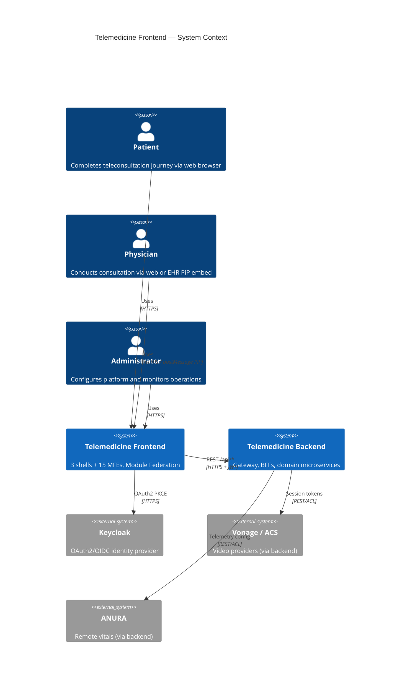
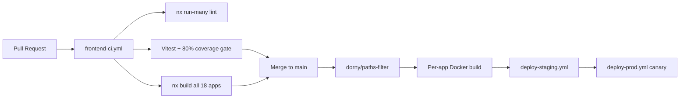

# Telemedicine Frontend — Enterprise Architecture Document

| Field | Value |
|-------|-------|
| **Version** | 1.0 |
| **Status** | As-built (derived from codebase) |
| **Scope** | `telemedicine-frontend` and its platform dependencies |
| **Audience** | Enterprise architects, frontend engineers, security, operations, UX |
| **Last updated** | August 2026 |

---

## Table of contents

1. [Executive summary](#1-executive-summary)
2. [Architecture principles](#2-architecture-principles)
3. [System context](#3-system-context)
4. [Logical architecture](#4-logical-architecture)
5. [Component inventory](#5-component-inventory)
6. [Application catalogue](#6-application-catalogue)
7. [Shared platform libraries](#7-shared-platform-libraries)
8. [Module Federation architecture](#8-module-federation-architecture)
9. [Authentication and authorization](#9-authentication-and-authorization)
10. [Session and journey orchestration](#10-session-and-journey-orchestration)
11. [API integration layer](#11-api-integration-layer)
12. [Real-time and clinical adapters](#12-real-time-and-clinical-adapters)
13. [Design system and UX](#13-design-system-and-ux)
14. [Internationalization and accessibility](#14-internationalization-and-accessibility)
15. [Configuration and feature flags](#15-configuration-and-feature-flags)
16. [Observability](#16-observability)
17. [Security architecture](#17-security-architecture)
18. [Testing strategy](#18-testing-strategy)
19. [Deployment and infrastructure](#19-deployment-and-infrastructure)
20. [CI/CD and release management](#20-cicd-and-release-management)
21. [High availability and disaster recovery](#21-high-availability-and-disaster-recovery)
22. [Non-functional requirements](#22-non-functional-requirements)
23. [Technology stack matrix](#23-technology-stack-matrix)
24. [Related documentation](#24-related-documentation)

---

## 1. Executive summary

The Telemedicine Frontend is an enterprise-grade, **microfrontend (MFE) platform** that delivers three role-specific web portals — Patient, Physician, and Administrator — for remote clinical consultations. It implements **runtime Module Federation** with config-driven remote loading, healthcare-grade authentication, cross-MFE session orchestration, and production-ready operational patterns.

The platform delivers:

- **Patient journey UX** — consent, identity validation, device preflight, waiting room, video consultation, clinical documents, and post-visit survey
- **Physician workflow UX** — consultation (video/chat/telemetry), clinical documentation, and patient context panels; optional Picture-in-Picture (PiP) embed mode for EHR integration
- **Administrative control plane** — configuration, dashboards, audit review, access management, and operational monitoring
- **Enterprise integration surface** — typed API client to backend BFFs, config-service feature flags, frontend telemetry to monitoring-service, and provider-abstracted video/chat/telemetry adapters

The frontend is built as an **Nx + pnpm monorepo** containing 3 portal shells, 15 domain microfrontends, 17 shared libraries, scaffolding tools, and Kubernetes deployment manifests. Runtime orchestration, full-stack Docker Compose, production K8s overlays, and runbooks live in the companion `telemedicine-platform` repository.

---

## 2. Architecture principles

| Principle | Implementation |
|-----------|----------------|
| **Independent deployability** | Each MFE is a separate Vite build, Docker image, and K8s Deployment; shells load remotes at runtime via manifest |
| **Shared nothing at runtime** | MFEs communicate via session context, custom DOM events, and BFF APIs — not direct imports between remotes |
| **Contract-driven types** | OpenAPI → `shared-types/generated/`; RFC 7807 ProblemDetail for errors |
| **Defense in depth** | OAuth2 PKCE, in-memory tokens, RBAC at manifest + route level, correlation IDs on all API calls |
| **Graceful degradation** | Safe feature-flag defaults, MFE load retry/fallback, config-service offline fallback |
| **Observable by design** | Error boundary, web-vitals, journey timing marks, frontend error reporting to monitoring-service |
| **Accessibility first** | WCAG 2.1 AA design system, jsx-a11y linting, Storybook a11y addon, vitest-axe in CI |
| **Environment parity** | Same static assets from dev Vite servers through prod nginx containers |
| **Least privilege** | Role-filtered MFE manifest; per-portal Keycloak clients |
| **Compliance readiness** | Consent flows with withdrawal, session-scoped PHI state (no localStorage tokens), audit-friendly correlation |

---

## 3. System context



### Repository topology

| Repository | Responsibility |
|------------|----------------|
| **telemedicine-frontend** | Shells, MFEs, shared packages, design system, K8s base manifests, Dockerfiles |
| **telemedicine-backend** | Gateway, BFFs, domain/platform services, OpenAPI contracts, event schemas |
| **telemedicine-platform** | Full-stack Docker Compose, production K8s overlays, infra configs, k6 tests, runbooks |

### Browser-to-backend request path

```
Browser
  ├─ Shell (nginx :80 / Vite dev :3000|:3010|:3020)
  │    ├─ GET /config/mfe-manifest.json → load remoteEntry.js from MFE origins
  │    └─ /api/* → Gateway (:8080) → BFF or domain service
  └─ Remote MFE (separate origin per deployment)
       └─ Shared React singleton via Module Federation runtime
```

External clinical SDKs (Vonage OpenTok, Azure Communication Services, ANURA embed) are **not bundled in the frontend**. Provider-specific session creation and token exchange are delegated to the backend `video-service` and `telemetry-service`, keeping secrets off the client and enabling provider failover without frontend redeployment.

---

## 4. Logical architecture

The frontend follows a **five-layer architecture**:

```
┌─────────────────────────────────────────────────────────────────────────┐
│  L1 — Portal Shell Layer                                                │
│  shell (:3000) │ physician-shell (:3010) │ admin-shell (:3020)          │
│  Auth, routing, manifest resolution, provider tree, journey navigation  │
└───────────────────────────────────┬─────────────────────────────────────┘
                                    │ runtime Module Federation
┌───────────────────────────────────▼─────────────────────────────────────┐
│  L2 — Domain Microfrontend Layer (15 MFEs)                              │
│  Patient (6) │ Physician (3) │ Admin (5)                                │
│  Journey-specific UI composed from shared packages                      │
└───────────────────────────────────┬─────────────────────────────────────┘
                                    │ npm workspace imports (build-time)
┌───────────────────────────────────▼─────────────────────────────────────┐
│  L3 — Shared Platform Libraries (17 packages)                             │
│  auth │ session-context │ api-client │ mfe-registry │ design-system     │
│  adapters (video, chat, telemetry) │ consent-kit │ i18n │ observability │
└───────────────────────────────────┬─────────────────────────────────────┘
                                    │ HTTPS /api/*
┌───────────────────────────────────▼─────────────────────────────────────┐
│  L4 — Backend Integration Layer (telemedicine-backend)                  │
│  Gateway → patient-bff │ physician-bff │ admin-bff → domain services    │
└───────────────────────────────────┬─────────────────────────────────────┘
                                    │
┌───────────────────────────────────▼─────────────────────────────────────┐
│  L5 — Identity & Configuration Layer                                    │
│  Keycloak (:8180) │ config-service (feature flags, provider selection)  │
└─────────────────────────────────────────────────────────────────────────┘
```

### Provider composition (shell bootstrap)

Each portal shell wraps the application in a consistent provider tree:

```
ObservabilityProvider
  └─ I18nProvider
       └─ AuthProvider (Keycloak PKCE)
            └─ ApiClientProvider (Bearer token injection)
                 └─ FeatureFlagProvider (config-service)
                      └─ ThemeProvider (patient | clinical)
                           └─ SessionProvider (journey state — patient shell)
                                └─ Shell routes + dynamically loaded MFEs
```

Source: `apps/shell/src/components/ShellProviders.tsx`

---

## 5. Component inventory

Components are classified by origin and operational role.

### 5.1 Built — custom platform components

| Component | Type | Description |
|-----------|------|-------------|
| **shell** | Portal host | Patient journey shell; manifest-driven remote loading, journey nav |
| **physician-shell** | Portal host | Physician portal; PiP embed mode via `postMessage` bridge |
| **admin-shell** | Portal host | Administrator console shell |
| **mfe-patient-consent** | Domain MFE | Platform and clinical consent capture with withdrawal |
| **mfe-patient-identity** | Domain MFE | Identity verification (FONASA 2FA orchestration via BFF) |
| **mfe-patient-waiting-room** | Domain MFE | Device preflight and waiting room queue UX |
| **mfe-patient-consultation** | Domain MFE | Video, chat, and gated telemetry during consultation |
| **mfe-patient-documents** | Domain MFE | Post-consultation document delivery |
| **mfe-patient-survey** | Domain MFE | NPS / satisfaction survey |
| **mfe-physician-consultation** | Domain MFE | Physician-side video, chat, telemetry |
| **mfe-physician-documentation** | Domain MFE | Clinical documentation submission |
| **mfe-physician-patient-context** | Domain MFE | Patient context panel for active consultation |
| **mfe-admin-config** | Domain MFE | Platform configuration management |
| **mfe-admin-dashboards** | Domain MFE | KPI and operational dashboards |
| **mfe-admin-audit** | Domain MFE | Audit ledger query and export |
| **mfe-admin-access** | Domain MFE | Role and access management |
| **mfe-admin-monitoring** | Domain MFE | Live operational snapshot and alerts |
| **@telemedicine/mfe-registry** | Platform lib | Manifest fetch, RBAC filter, config enablement, remote load |
| **@telemedicine/auth** | Platform lib | OAuth2 PKCE, silent refresh, route guards |
| **@telemedicine/session-context** | Platform lib | Cross-MFE journey state, BFF hydration, gate logic |
| **@telemedicine/api-client** | Platform lib | Typed HTTP client with interceptors |
| **@telemedicine/design-system** | Platform lib | WCAG 2.1 AA component library |
| **@telemedicine/video-adapter** | Adapter lib | Vonage / ACS / Simulator video abstraction |
| **@telemedicine/chat-adapter** | Adapter lib | Clinical chat with API persistence |
| **@telemedicine/telemetry-adapter** | Adapter lib | ANURA embed with consent/config gates |
| **@telemedicine/consent-kit** | Domain lib | Reusable consent flows |
| **@telemedicine/device-test** | Domain lib | Camera/mic/speaker/bandwidth preflight |
| **@telemedicine/observability-web** | Platform lib | Error boundary, web-vitals, journey timing |
| **@telemedicine/feature-flags** | Platform lib | Config-service client with safe defaults |
| **@telemedicine/i18n** | Platform lib | es-CL + en locale bundles |
| **@telemedicine/shared-types** | Contract lib | OpenAPI-aligned DTOs, journey/MFE types |
| **@telemedicine/test-utils** | Dev lib | renderWithProviders, MSW handlers, fixtures |
| **tools/mfe-generator** | Scaffolding | Nx generator for new MFE apps |

### 5.2 Open source — runtime and build infrastructure

| Component | Version / Notes | Role |
|-----------|-----------------|------|
| **React** | 18.3.x | UI framework |
| **React Router** | 6.28.x | Client-side routing in shells and MFEs |
| **TypeScript** | 5.6.x strict | Type safety across monorepo |
| **Vite** | 5.4.x | Dev server, bundler, production build |
| **Nx** | 20.4.x | Monorepo orchestration, build cache, generators |
| **pnpm** | 9.15.x | Workspace package manager |
| **Module Federation** | `@module-federation/vite` ^1.2, `@module-federation/runtime` ^0.8 | Build-time federation plugin + runtime remote loading |
| **Vitest** | 2.1.x | Unit and integration testing |
| **Testing Library** | 16.x | Component testing |
| **MSW** | 2.7.x | API mocking in tests |
| **Storybook** | 8.4.x | Design system documentation and visual testing |
| **axe-core / vitest-axe** | 4.10.x | Accessibility test assertions |
| **ESLint** | 9.x + typescript-eslint 8.x | Static analysis |
| **openapi-typescript** | 7.4.x | OpenAPI → TypeScript code generation |
| **web-vitals** | 4.2.x | Core Web Vitals measurement |
| **nginx** | 1.27-alpine | Static asset serving in production containers |
| **Node.js** | 20 LTS Alpine | Build-stage container runtime |

### 5.3 External — third-party systems (integrated via backend)

| System | Frontend integration | Purpose |
|--------|---------------------|---------|
| **Keycloak** | `@telemedicine/auth` — OAuth2 Authorization Code + PKCE | Identity, JWT issuance, role claims |
| **Vonage** | `video-adapter` → backend `POST /v1/video/sessions` | Primary video provider |
| **Azure Communication Services** | `video-adapter` → backend video-service | Failover video provider |
| **ANURA** | `telemetry-adapter` — gated embed/stub | Remote vitals measurement |
| **config-service** | `feature-flags` → `GET /api/v1/config` | Feature flags, provider selection, MFE enablement |
| **monitoring-service** | `observability-web` → `POST /api/v1/monitoring/*` | Frontend errors and web-vitals metrics |

The frontend never holds provider API keys. All vendor credentials remain in backend ACL adapters.

---

## 6. Application catalogue

### 6.1 Portal shells

| App | Dev port | Federation name | Keycloak client | Theme | Audience |
|-----|----------|-----------------|-----------------|-------|----------|
| `shell` | 3000 | `shell` | `patient-portal` | `patient` | Patients |
| `physician-shell` | 3010 | `physicianShell` | `physician-ui` | `clinical` | Physicians |
| `admin-shell` | 3020 | `adminShell` | `admin-console` | `clinical` | Administrators |

**Shell responsibilities:**

- Bootstrap provider tree (auth, API, flags, i18n, observability)
- Fetch and filter `mfe-manifest.json` by role and config enablement
- Register React Router routes for each enabled remote
- Hydrate session from patient BFF (`GET /bff/patient/journey/{appointmentId}`)
- Render journey navigation (patient shell) or worklist entry (physician/admin)

**Physician PiP mode:** When `VITE_PIP_MODE=true`, the physician shell runs as a compact embeddable frame communicating with the parent EHR via `postMessage` (`telemedicine:navigate`, `telemedicine:status`).

### 6.2 Patient microfrontends

| App | Port | Route | BFF / API domains | Key packages |
|-----|------|-------|-------------------|--------------|
| `mfe-patient-consent` | 3002 | `/patient/consent` | waiting-room (consent) | consent-kit, session-context |
| `mfe-patient-identity` | 3003 | `/patient/identity` | identity-service via BFF | session-context |
| `mfe-patient-waiting-room` | 3004 | `/patient/waiting-room` | waiting-room (device test, queue) | device-test |
| `mfe-patient-consultation` | 3005 | `/patient/consultation` | video, chat, telemetry | video/chat/telemetry adapters |
| `mfe-patient-documents` | 3006 | `/patient/documents` | clinical-docs via BFF | session-context |
| `mfe-patient-survey` | 3007 | `/patient/survey` | survey-service via BFF | session-context |

### 6.3 Physician microfrontends

| App | Port | Route | BFF / API domains | Key packages |
|-----|------|-------|-------------------|--------------|
| `mfe-physician-consultation` | 3011 | `/physician/consultation` | video, chat, telemetry, monitoring | video/chat/telemetry adapters |
| `mfe-physician-documentation` | 3012 | `/physician/documentation` | physician-bff documentation | api-client, design-system |
| `mfe-physician-patient-context` | 3013 | `/physician/patient-context` | physician-bff consultation context | api-client, design-system |

### 6.4 Admin microfrontends

| App | Port | Route | BFF / API domains |
|-----|------|-------|-------------------|
| `mfe-admin-config` | 3021 | `/admin/config` | admin-bff → config-service |
| `mfe-admin-dashboards` | 3022 | `/admin/dashboards` | admin-bff → reporting-service |
| `mfe-admin-audit` | 3023 | `/admin/audit` | admin-bff → audit-service |
| `mfe-admin-access` | 3024 | `/admin/access` | admin-bff → Keycloak role APIs |
| `mfe-admin-monitoring` | 3025 | `/admin/monitoring` | admin-bff → monitoring-service |

### 6.5 Patient journey flow

```mermaid
stateDiagram-v2
    [*] --> consent: LINK_GENERATED
    consent --> identity: CONSENT_GRANTED
    identity --> waiting-room: IDENTITY_VALIDATED
    waiting-room --> consultation: DEVICE_TEST_COMPLETED / CHECKED_IN
    consultation --> documents: CONSULTATION_CLOSED
    documents --> survey: documents delivered
    survey --> complete: SURVEY_COMPLETED
    complete --> [*]
```

Journey step gating uses `useJourneyGate(requiredStatus)` from `@telemedicine/session-context`, backed by `hasReachedStatus()` in `@telemedicine/shared-types`. The shell's `JourneyGateRoute` component prevents navigation to steps the patient has not yet reached.

---

## 7. Shared platform libraries

### 7.1 Contract layer — `@telemedicine/shared-types`

| Export category | Examples |
|-----------------|----------|
| Journey types | `JourneyStep`, `JourneyStatus`, `JOURNEY_STATUS_ORDER`, `hasReachedStatus()` |
| BFF DTOs | `PatientJourneyResponse`, `PhysicianWorklistResponse` |
| API envelope | `ApiResponse<T>`, `ProblemDetail`, `ErrorCode` |
| MFE manifest | `MfeManifest`, `MfeRemote`, `mfeConfigKey()` |
| Config keys | `ConfigKeys.VIDEO_PROVIDER`, `ConfigKeys.TELEMETRY_ENABLED` |

Types are generated from backend OpenAPI specs via `pnpm generate:types` → `packages/shared-types/src/generated/`.

### 7.2 Cross-cutting libraries

| Package | Responsibility | Consumed by |
|---------|----------------|-------------|
| `mfe-registry` | Manifest cache (5 min TTL), RBAC filter, config merge, remote load with retry | All shells |
| `auth` | PKCE flow, in-memory tokens, silent refresh, guards | All shells |
| `api-client` | HTTP with auth/correlation/idempotency interceptors, RFC 7807 errors | All MFEs and libs |
| `session-context` | Journey state in sessionStorage, BFF hydration, custom events | Patient shell + MFEs |
| `feature-flags` | Config-service polling (60s), safe defaults, MFE enablement keys | Shells, adapters |
| `observability-web` | Global error handlers, web-vitals, journey timing | All shells |
| `i18n` | Lazy locale loading, Intl formatters | All user-facing MFEs |
| `design-system` | Themed components, Storybook catalogue | All MFEs |
| `test-utils` | Provider-wrapped render, MSW handlers, fixtures | All test suites |

### 7.3 Domain adapter libraries

| Package | Pattern | Providers |
|---------|---------|-----------|
| `video-adapter` | Factory + hook (`createVideoAdapter`, `useVideoSession`) | `simulator`, `vonage`, `acs` |
| `chat-adapter` | Factory + hook (`useChat`, `ChatPanel`) | `simulator`, `api` (Vonage/ACS persisted) |
| `telemetry-adapter` | Consent/config gates + embed | `simulator`, `stub-anura` |
| `consent-kit` | PlatformConsent, ClinicalConsent, withdrawal | consent + waiting-room APIs |
| `device-test` | Preflight checks (camera, mic, speaker, bandwidth) | waiting-room APIs |

Provider selection reads `ConfigKeys.VIDEO_PROVIDER`, `ConfigKeys.CHAT_PROVIDER`, and `ConfigKeys.TELEMETRY_ENABLED` from the feature-flag snapshot — enabling runtime provider switching without frontend redeployment.

---

## 8. Module Federation architecture

### 8.1 Build-time configuration

Each app uses `@module-federation/vite`:

**Hosts (shells):** declare federation name only; `remotes: {}` — all remotes resolved at runtime.

**Remotes (MFEs):** expose `./App` → `src/App.tsx`, output `remoteEntry.js`, share React/ReactDOM as singletons.

Example remote config pattern (`apps/mfe-patient-consent/vite.config.mts`):

```typescript
federation({
  name: 'mfePatientConsent',
  filename: 'remoteEntry.js',
  exposes: { './App': './src/App.tsx' },
  shared: { react: { singleton: true }, 'react-dom': { singleton: true } },
})
```

### 8.2 Runtime loading flow

Source: `packages/mfe-registry/src/index.ts`

```
1. fetchMfeManifest('/config/mfe-manifest.json')
   └─ sessionStorage cache (5 min TTL)

2. getEnabledRemotes(manifest)
   └─ filter remote.enabled === true

3. filterRemotesByRole(remotes, user.roles)
   └─ match remote.roles against JWT roles

4. mergeConfigEnablement(remotes, configSnapshot)
   └─ AND remote.enabled with config key mfe.{name}.enabled

5. checkVersionCompatibility(manifest, remote)
   └─ manifest.shellVersion >= remote.minShellVersion

6. loadRemoteModule(remote, './App')
   └─ @module-federation/runtime init() + loadRemote()
   └─ 2 retries, 1s delay; dispatches mfe:loadFailed on failure
```

### 8.3 Manifest schema

```json
{
  "shellVersion": "1.0.0",
  "remotes": [{
    "name": "mfePatientConsent",
    "url": "https://mfe-patient-consent.example/assets/remoteEntry.js",
    "route": "/patient/consent",
    "enabled": true,
    "module": "./App",
    "roles": ["PATIENT"],
    "version": "1.0.0",
    "minShellVersion": "1.0.0"
  }]
}
```

Manifests are static files served from each shell's `public/config/` directory. In production, per-environment manifests are injected at deploy time or served from a config sidecar.

### 8.4 Independent deployment model

| Artifact | Build output | Container | K8s resource |
|----------|-------------|-----------|--------------|
| Each shell | `dist/apps/{shell}/` | `telemedicine/{shell}:tag` | Deployment + Service |
| Each MFE | `dist/apps/mfe-*/` | `telemedicine/mfe-*:tag` | Deployment + Service |

A single MFE can be redeployed without rebuilding the shell, provided `minShellVersion` compatibility is maintained.

---

## 9. Authentication and authorization

### 9.1 OAuth2 PKCE flow

| Step | Implementation |
|------|----------------|
| 1. Challenge | `createPkceChallenge()` — S256 code challenge, random state |
| 2. Redirect | `buildAuthorizationUrl()` → Keycloak `/protocol/openid-connect/auth` |
| 3. Callback | Exchange code + verifier for access/refresh tokens |
| 4. Storage | **In-memory only** — module-level `accessToken`, `refreshToken` (never localStorage) |
| 5. Refresh | Timer fires 60s before expiry; failure triggers session-expired modal |
| 6. Dev bypass | `VITE_AUTH_MODE=dev` → synthetic user with `dev-token` |

PKCE verifier and state are temporarily stored in `sessionStorage` during the redirect dance and cleared after token exchange.

### 9.2 Role model

| Role | Portal | MFE access |
|------|--------|------------|
| `PATIENT` | shell | Patient MFEs (6) |
| `PHYSICIAN` | physician-shell | Physician MFEs (3) |
| `ADMIN` | admin-shell | Admin MFEs (5) |
| `NURSE` | physician-shell (limited) | Configurable via manifest roles |
| `SERVICE` | — | Machine-to-machine (not browser) |

Roles are extracted from JWT `realm_access.roles` claim.

### 9.3 Authorization guards

| Guard | Package | Usage |
|-------|---------|-------|
| `RequireAuth` | auth | Wraps all remote MFE routes |
| `RequireRole` / `RoleGuard` | auth | Component-level role checks |
| `ProtectedRoute` | auth | Declarative route protection |
| Manifest RBAC | mfe-registry | Remote not registered if role mismatch |
| `useJourneyGate` | session-context | Journey step progression enforcement |

### 9.4 Environment variables

| Variable | Purpose |
|----------|---------|
| `VITE_KEYCLOAK_URL` | Keycloak base URL |
| `VITE_KEYCLOAK_REALM` | Realm name |
| `VITE_KEYCLOAK_CLIENT_ID` | Per-portal client ID |
| `VITE_AUTH_MODE` | `dev` for local bypass |
| `VITE_API_BASE_URL` | Override default `/api` base |

---

## 10. Session and journey orchestration

### 10.1 Session state model

```typescript
interface SessionState {
  sessionId: string | null;
  appointmentId: string | null;
  journeyStep: JourneyStep;       // consent | identity | waiting-room | ...
  journeyStatus: JourneyStatus;     // LINK_GENERATED | CONSENT_GRANTED | ...
  appointment: AppointmentContext | null;
  metadata: Record<string, unknown>; // BFF section snapshots
}
```

Persisted in `sessionStorage` under key `telemedicine.session`. Cleared on explicit `reset()` or browser session end.

### 10.2 BFF hydration

On shell mount, the patient shell reads `appointmentId` from URL query params or session state and calls:

```
GET /api/bff/patient/journey/{appointmentId}
```

The BFF aggregates consent, identity, waiting room, video, documents, and survey status. `mapBffToState()` derives the current `journeyStep` from the highest completed section.

### 10.3 Cross-MFE communication

MFEs do not import each other. Coordination mechanisms:

| Mechanism | Event / API | Use case |
|-----------|-------------|----------|
| Session context | `useSession()`, `setJourneyStep()` | Shared journey state |
| Custom DOM events | `journey:stepChanged`, `journey:statusChanged` | Decoupled listeners |
| Custom DOM events | `mfe:loadFailed` | Remote load failure notification |
| Custom DOM events | `session:expired` | Auth session expiry |
| BFF re-hydration | `hydrateFromBff()` | Refresh state after mutations |

---

## 11. API integration layer

### 11.1 ApiClient capabilities

Source: `packages/api-client/src/client.ts`

| Capability | Detail |
|------------|--------|
| Base URL | `/api` (override via `VITE_API_BASE_URL`) |
| Auth interceptor | `Authorization: Bearer {token}` from AuthProvider |
| Correlation | `X-Correlation-Id: {uuid}` per request |
| Idempotency | `X-Idempotency-Key` for safe POST retries |
| Retry | Exponential backoff + jitter; max 2 retries on 5xx/429 |
| 401 handling | Single token refresh attempt via `TokenRefresher` |
| Error parsing | RFC 7807 `application/problem+json` → `ApiError` |
| Cancellation | `AbortController` registry; `cancelAll()` on logout |

### 11.2 BFF endpoint mapping

| Portal | Primary BFF prefix | Key endpoints |
|--------|---------------------|---------------|
| Patient | `/bff/patient/` | `GET journey/{appointmentId}`, consent, identity actions |
| Physician | `/bff/physician/` | `GET worklist`, `GET consultation/{id}`, `POST documentation/{id}` |
| Admin | `/bff/admin/` | Config CRUD, audit query, scheduler, monitoring snapshot |

All requests traverse the backend gateway (`:8080`). Dev Vite servers proxy `/api/*` → `http://localhost:8080`.

### 11.3 Type generation pipeline

```
telemedicine-backend/shared/contracts/*.openapi.yaml
  └─ pnpm generate:types (openapi-typescript)
       └─ packages/shared-types/src/generated/
            └─ imported by api-client, MFEs, test-utils
```

Contract changes in the backend trigger frontend type regeneration in CI.

---

## 12. Real-time and clinical adapters

### 12.1 Video adapter

```
┌──────────────┐     POST /v1/video/sessions      ┌───────────────┐
│  MFE (React) │ ────────────────────────────────► │ video-service │
│ video-adapter│ ◄── sessionId, token, provider ── │  (backend)    │
└──────────────┘                                   └───────────────┘
        │
        ▼
┌──────────────────────────────────────────────────┐
│  VonageVideoAdapter │ AcsVideoAdapter │ Simulator │
└──────────────────────────────────────────────────┘
```

- **Simulator:** Local mock for dev/CI — no network calls
- **Vonage / ACS:** Backend returns session credentials; frontend wraps provider SDK interface (mock wrappers — no vendor npm SDK bundled)
- **Hook:** `useVideoSession({ appointmentId })` manages join/leave, participants, network quality

### 12.2 Chat adapter

- **Simulator:** In-memory messages for dev/test
- **ApiChatAdapter:** Persists messages via backend video-service chat endpoints
- **UI components:** `ChatPanel`, `MessageBubble`, `TypingIndicator`
- **Hook:** `useChat({ sessionId, autoConnect })`

### 12.3 Telemetry adapter

Gated by two independent checks before render:

1. **TelemetryConsentGate** — clinical consent must be granted (`consent-kit`)
2. **TelemetryConfigGate** — `ConfigKeys.TELEMETRY_ENABLED` must be `true`

Adapters: `SimulatorTelemetryAdapter` (dev), `StubAnuraTelemetryAdapter` (production stub awaiting full ANURA embed integration).

### 12.4 Device test

`@telemedicine/device-test` runs preflight checks in the waiting-room MFE:

- Camera availability and permission
- Microphone availability and permission
- Speaker output test
- Bandwidth estimation

Results submitted to waiting-room-service via API client.

---

## 13. Design system and UX

### 13.1 `@telemedicine/design-system`

| Aspect | Detail |
|--------|--------|
| **Themes** | `patient` (consumer-friendly) and `clinical` (dense, information-rich) |
| **Token system** | CSS custom properties in `theme/tokens.css`; applied via `data-theme` attribute |
| **Components** | Button, Modal, ShellLayout, PageLayout, SplitPanel, Stepper, Tabs, Form fields, DataTable, StatusBadge, LoadingSpinner, ErrorMessage, EmptyState, Toast, KPI widgets |
| **Documentation** | Storybook on `:6006` with addon-a11y |
| **Legacy compat** | `@telemedicine/shared-ui` re-exports design-system for backward compatibility |

### 13.2 Shell layouts

| Shell | Layout | Navigation |
|-------|--------|------------|
| Patient | `ShellLayout` + `PatientJourneyNav` | Stepper showing journey progress |
| Physician | `ShellLayout` or compact PiP frame | Worklist → consultation routes |
| Admin | `ShellLayout` | Sidebar navigation to admin MFEs |

### 13.3 Error and loading states

- **Remote load failure:** `createRemoteUnavailableFallback()` → `EmptyState` with retry guidance
- **API errors:** `ErrorMessage` component rendering `ProblemDetail.detail`
- **Global errors:** `ObservabilityErrorBoundary` catches render errors and reports to monitoring-service

---

## 14. Internationalization and accessibility

### 14.1 i18n (`@telemedicine/i18n`)

| Feature | Detail |
|---------|--------|
| Locales | `en` (fallback), `es-CL` (primary market) |
| Loading | Lazy locale bundle fetch with session cache |
| API | `I18nProvider`, `useTranslation(namespace)`, `Trans` component |
| Formatters | `formatDate`, `formatTime`, `formatNumber`, `formatCurrency`, `pluralize` |
| Detection | `detectLocale()` from browser `Accept-Language` |

Translation namespaces are organized per MFE domain (consent, identity, consultation, admin, etc.).

### 14.2 Accessibility compliance

| Control | Implementation |
|---------|----------------|
| WCAG 2.1 AA | Design token contrast ratios; focus management in Modal/Stepper |
| ESLint | `eslint-plugin-jsx-a11y` enforced workspace-wide |
| Storybook | `@storybook/addon-a11y` for component-level checks |
| CI tests | `vitest-axe` assertions in design-system and critical MFE tests |
| Keyboard | All interactive components support keyboard navigation |
| Screen readers | ARIA labels on form fields, status badges, and journey stepper |

---

## 15. Configuration and feature flags

### 15.1 Config-service integration

Source: `packages/feature-flags/src/index.ts`

```
GET /api/v1/config → ConfigSnapshot
  ├─ 60s in-memory cache
  ├─ 60s polling interval (FeatureFlagProvider)
  ├─ sessionStorage fallback on network failure
  └─ SAFE_DEFAULTS when config-service unreachable
```

### 15.2 Safe defaults

| Key | Default | Rationale |
|-----|---------|-----------|
| `video.provider` | `simulator` | Prevent accidental prod provider calls |
| `chat.provider` | `simulator` | Same |
| `telemetry.enabled` | `false` | Clinical telemetry requires explicit opt-in |
| `notification.*` | `true` | Notifications safe to attempt |

### 15.3 MFE enablement

Config key pattern: `mfe.{remoteName}.enabled` (via `mfeConfigKey()`)

The shell merges manifest `enabled: true` **AND** config-service flag before registering a remote route. This allows operators to disable individual MFEs without redeployment.

### 15.4 React integration

- `FeatureFlagProvider` — context at shell level
- `useFeatureFlag(key)` — boolean flag with loading state
- `useProvider(key)` — string provider selection (video, chat)
- `FeatureGate` — conditional render wrapper

---

## 16. Observability

### 16.1 Client-side telemetry

Source: `packages/observability-web/`

| Signal | Destination | Trigger |
|--------|-------------|---------|
| Uncaught errors | `POST /api/v1/monitoring/frontend-errors` | `window.onerror`, `unhandledrejection` |
| React render errors | Same | `ObservabilityErrorBoundary` |
| Web Vitals (LCP, INP, CLS, TTFB) | `POST /api/v1/monitoring/metrics` | `web-vitals` library on mount |
| Journey timing | Same | `useTimingMark(step)` in MFE lifecycle |

### 16.2 Operational controls

| Control | Value |
|---------|-------|
| Dev mode | `VITE_OBSERVABILITY_MODE=dev` → console-only, no network |
| Rate limit | 10 reports/minute per browser session |
| Payload | Includes `correlationId`, `journeyStep`, `userAgent`, ISO timestamp |

### 16.3 Correlation with backend

Every API request carries `X-Correlation-Id`. Frontend error reports should include the same ID when available, enabling end-to-end trace correlation with backend logs and Jaeger spans.

---

## 17. Security architecture

### 17.1 Threat model summary

| Threat | Mitigation |
|--------|------------|
| Token theft (XSS) | Tokens in memory only; no localStorage/sessionStorage for JWT |
| CSRF | Stateless JWT in Authorization header (not cookies) |
| Unauthorized MFE access | Manifest RBAC + route guards |
| Unauthorized API access | Gateway JWT validation + BFF role annotations |
| Provider credential exposure | All vendor tokens issued by backend; never in frontend bundle |
| Session fixation | PKCE state validation; fresh code verifier per login |
| MFE supply chain | Version compatibility checks; manifest served from same origin as shell |

### 17.2 Data handling

| Data class | Storage | Lifetime |
|------------|---------|----------|
| JWT access/refresh tokens | In-memory | Until refresh failure or tab close |
| Journey state (PHI metadata) | sessionStorage | Browser session |
| MFE manifest | sessionStorage cache | 5 minutes |
| Config snapshot | sessionStorage fallback | Until cache refresh |
| PKCE verifier | sessionStorage | During OAuth redirect only |

### 17.3 Production hardening checklist

| Control | Status | Recommendation |
|---------|--------|----------------|
| HTTPS / HSTS | Ingress responsibility | Enforce at load balancer / ingress |
| Content-Security-Policy | Not in frontend repo | Add CSP allowing shell origin + MFE remote origins |
| Subresource Integrity | Not implemented | Consider SRI hashes for remoteEntry.js in high-security deployments |
| CORS | Gateway-controlled | Shell origins whitelisted in gateway CORS config |
| Dependency scanning | CI (recommended) | npm audit / Snyk in frontend-ci pipeline |
| Secrets in bundle | None by design | Vite env vars are build-time public config only |

### 17.4 Admin portal security

Production admin-bff requires MFA (enforced at Keycloak realm level). Admin shell should only be served on internal network or VPN in production deployments.

---

## 18. Testing strategy

### 18.1 Test pyramid

```
                    ┌─────────────┐
                    │  Manual /   │  (Future: Playwright E2E)
                    │  Exploratory│
                    ├─────────────┤
                    │ Integration │  Vitest + MSW + Testing Library
                    │  (packages  │  renderWithProviders()
                    │   + MFEs)   │
                    ├─────────────┤
                    │    Unit     │  Vitest (pure functions, adapters)
                    └─────────────┘
```

### 18.2 Tooling

| Tool | Scope | Config |
|------|-------|--------|
| Vitest 2 | All packages and apps | `vitest.workspace.ts`, `vitest.shared.ts` |
| jsdom | DOM environment | Per-project vitest config |
| Testing Library | Component behavior | `@testing-library/react` |
| MSW 2 | API mocking | `packages/test-utils/src/handlers.ts` |
| vitest-axe | a11y assertions | design-system, critical flows |
| Storybook | Visual + a11y manual QA | design-system |

### 18.3 Coverage gates

| Metric | Threshold | Enforced in |
|--------|-----------|-------------|
| Lines | ≥ 80% | `vitest.shared.ts` thresholds + CI aggregate gate |
| Branches | ≥ 75% | Same |
| Functions | ≥ 80% | Same |
| Statements | ≥ 80% | Same |

CI workflow (`frontend-ci.yml`) aggregates lcov across all projects and fails below 80% line coverage.

### 18.4 Test utilities

`@telemedicine/test-utils` provides:

- `renderWithProviders()` — full shell provider tree for integration tests
- MSW handlers for BFF journey, consent, video session endpoints
- Fixtures for appointments, consent records, video sessions
- Mock adapter implementations for video, chat, telemetry

### 18.5 Verification scripts

Platform-level verification (from `telemedicine-platform/`):

- `verify-part5.ps1` — shared package tests
- `verify-part6.ps1` — MFE and shell builds

---

## 19. Deployment and infrastructure

### 19.1 Build pipeline

```
Source (apps/ + packages/)
  └─ pnpm install
       └─ nx run-many -t build (per app)
            └─ vite build → dist/apps/{app-name}/
                 └─ Docker multi-stage build
                      └─ nginx:1.27-alpine serves static assets
```

### 19.2 Container image

Each app has a Dockerfile following the pattern in `apps/shell/Dockerfile`:

1. **Build stage:** `node:20-alpine` + pnpm → `vite build`
2. **Runtime stage:** `nginx:1.27-alpine` → static files on port 80

Generic template: `docker/Dockerfile.mfe` with `ARG NX_APP` for parameterized builds.

### 19.3 nginx configuration

| Location | Behavior |
|----------|----------|
| `/health` | Returns `200 ok` for K8s probes |
| `/config/` | Serves MFE manifest and runtime config |
| `/` | SPA fallback → `index.html` |
| `/api/` | Not proxied in standalone mode; full-stack variant in `nginx.full-stack.conf` proxies to gateway |

### 19.4 Kubernetes

Base manifests: `deploy/kubernetes/base/`

- **Namespace:** `telemedicine-frontend`
- **Resources:** Deployment + Service per app (18 total in kustomization)
- **Image:** `telemedicine/{app}:0.1.0`
- **Probes:** HTTP GET `/health`

Production overlays (replicas, ingress, resource limits, manifest URLs) are in `telemedicine-platform`.

### 19.5 Port reference

| App | Dev (Vite) | Container |
|-----|------------|-----------|
| shell | 3000 | 80 |
| physician-shell | 3010 | 80 |
| admin-shell | 3020 | 80 |
| mfe-patient-consent | 3002 | 80 |
| mfe-patient-identity | 3003 | 80 |
| mfe-patient-waiting-room | 3004 | 80 |
| mfe-patient-consultation | 3005 | 80 |
| mfe-patient-documents | 3006 | 80 |
| mfe-patient-survey | 3007 | 80 |
| mfe-physician-consultation | 3011 | 80 |
| mfe-physician-documentation | 3012 | 80 |
| mfe-physician-patient-context | 3013 | 80 |
| mfe-admin-config | 3021 | 80 |
| mfe-admin-dashboards | 3022 | 80 |
| mfe-admin-audit | 3023 | 80 |
| mfe-admin-access | 3024 | 80 |
| mfe-admin-monitoring | 3025 | 80 |
| design-system Storybook | 6006 | — |

---

## 20. CI/CD and release management

### 20.1 Pipeline overview



### 20.2 GitHub Actions workflows

| Workflow | Path | Trigger | Purpose |
|----------|------|---------|---------|
| `frontend-ci.yml` | `.github/workflows/` | Push/PR to frontend paths | Lint, test, coverage gate, build all apps |
| `deploy-staging.yml` | `.github/workflows/` | CI success on main | Kustomize staging overlay, rollout |
| `deploy-prod.yml` | `.github/workflows/` | Manual dispatch | Blue/green canary, rollback on SLO burn |
| `performance-test.yml` | `.github/workflows/` | Weekly + PR | k6 load tests (backend-focused) |

### 20.3 Path-filtered Docker builds

Changed apps and shared packages trigger selective Docker image builds via `dorny/paths-filter`. Changes to `packages/*` rebuild all dependent apps.

### 20.4 Release strategy for MFEs

| Strategy | Detail |
|----------|--------|
| **Independent MFE releases** | Deploy single MFE image; manifest URL points to new remoteEntry.js |
| **Shell releases** | Required when provider tree, auth, or manifest schema changes |
| **Compatibility gate** | `minShellVersion` in manifest prevents incompatible pairings |
| **Rollback** | Revert K8s Deployment to previous image tag; manifest version pin |

### 20.5 Quality gates

| Gate | Threshold |
|------|-----------|
| ESLint | Zero errors across all projects |
| Unit test coverage | ≥ 80% aggregate line coverage |
| Build | All 18 apps compile without error |
| Type check | `tsc --noEmit` against `tsconfig.base.json` |

---

## 21. High availability and disaster recovery

### 21.1 Frontend HA characteristics

The frontend tier is **stateless**. All session state is either:

- In the browser (sessionStorage — user must re-authenticate on new device)
- In backend services (source of truth for journey, consent, audit)

HA is achieved by:

| Mechanism | Detail |
|-----------|--------|
| **Horizontal scaling** | Multiple nginx pod replicas behind K8s Service / Ingress |
| **CDN / caching** | Static assets (JS, CSS) cacheable with content-hash filenames from Vite |
| **MFE isolation** | Failure of one MFE remote does not crash the shell (fallback UI) |
| **Config fallback** | Feature flags degrade to safe defaults if config-service unavailable |
| **Auth resilience** | Silent refresh; session-expired modal on refresh failure |

### 21.2 Disaster recovery

| Scenario | Impact | Recovery |
|----------|--------|----------|
| Single MFE pod failure | Route shows fallback UI | K8s restarts pod; user refreshes |
| Shell pod failure | Portal unavailable | Roll Deployment; CDN may serve stale assets briefly |
| Keycloak outage | No new logins; existing tokens work until expiry | IdP DR per Keycloak runbook |
| Gateway outage | All API calls fail | Backend DR; frontend shows error states |
| Manifest misconfiguration | Remotes fail to load | Roll back manifest ConfigMap |

**RPO/RTO:** Frontend static assets can be rebuilt from source at any time (RPO = 0 for code). Runtime RTO depends on K8s rollout speed (~minutes).

---

## 22. Non-functional requirements

| NFR | Target | Implementation |
|-----|--------|----------------|
| **Initial load (LCP)** | < 2.5s on 4G | Vite code splitting; lazy MFE loading; shell-only first paint |
| **MFE remote load** | < 1s (cached) | remoteEntry.js cached by browser; retry on failure |
| **API latency** | p95 < 300ms | Backend responsibility; client retry with backoff |
| **Accessibility** | WCAG 2.1 AA | Design system, eslint-plugin-jsx-a11y, vitest-axe |
| **Browser support** | Last 2 versions of Chrome, Firefox, Safari, Edge | React 18 + Vite targets |
| **i18n** | es-CL primary, en fallback | Full locale bundle coverage for patient journey |
| **Test coverage** | ≥ 80% line | Vitest + CI gate |
| **Security** | OWASP Top 10 mitigations | PKCE, in-memory tokens, RBAC, no secrets in bundle |
| **Observability** | Core Web Vitals tracked | web-vitals → monitoring-service |
| **Deployability** | Independent MFE deploys | Module Federation + separate K8s Deployments |
| **Scalability** | Stateless horizontal scale | nginx pods; no sticky sessions required |

---

## 23. Technology stack matrix

| Layer | Technology | Version | Origin |
|-------|-----------|---------|--------|
| UI framework | React | 18.3.x | Open source |
| Routing | React Router | 6.28.x | Open source |
| Language | TypeScript | 5.6.x | Open source |
| Bundler | Vite | 5.4.x | Open source |
| Monorepo | Nx | 20.4.x | Open source |
| Package manager | pnpm | 9.15.x | Open source |
| Microfrontends | Module Federation (vite + runtime) | 1.2 / 0.8.x | Open source |
| Identity | Keycloak OIDC + PKCE | — | Open source (external deploy) |
| HTTP client | Custom ApiClient | — | Built |
| Design system | @telemedicine/design-system | — | Built |
| Testing | Vitest + Testing Library + MSW | 2.1.x | Open source |
| a11y testing | axe-core + vitest-axe | 4.10.x | Open source |
| Documentation | Storybook | 8.4.x | Open source |
| Linting | ESLint 9 + typescript-eslint | 8.x | Open source |
| Type generation | openapi-typescript | 7.4.x | Open source |
| Observability | web-vitals + custom reporting | 4.2.x | Mixed |
| Web server | nginx | 1.27-alpine | Open source |
| Build container | Node.js | 20-alpine | Open source |
| Orchestration | Kubernetes + Kustomize | — | Open source |
| CI/CD | GitHub Actions | — | External service |

---

## 24. Related documentation

| Document | Location | Content |
|----------|----------|---------|
| **Frontend-to-backend integration** | `telemedicine-frontend/docs/FRONTEND-BACKEND-INTEGRATION.md` | API routing, auth flow, contracts, endpoint catalogue, gaps |
| Backend architecture | `telemedicine-backend/docs/ARCHITECTURE.md` | Gateway, BFFs, microservices, events |
| Frontend README | `telemedicine-frontend/README.md` | Quick start, dev workflow |
| OpenAPI contracts | `telemedicine-backend/shared/contracts/` | API schemas for type generation |
| Platform runbooks | `telemedicine-platform/` | Full-stack compose, prod overlays, k6, verify scripts |
| Design system Storybook | `pnpm storybook` (:6006) | Component catalogue and a11y states |
| MFE scaffold guide | `tools/mfe-generator/` | Nx generator for new microfrontends |

---

## Appendix A — Monorepo directory structure

```
telemedicine-frontend/
├── apps/
│   ├── shell/                      # Patient portal host
│   ├── physician-shell/            # Physician portal host
│   ├── admin-shell/                # Admin portal host
│   ├── mfe-patient-*/              # 6 patient MFEs
│   ├── mfe-physician-*/            # 3 physician MFEs
│   ├── mfe-admin-*/                # 5 admin MFEs
│   └── _template-mfe/              # MFE scaffold template
├── packages/
│   ├── shared-types/               # OpenAPI-aligned types
│   ├── design-system/              # Component library + Storybook
│   ├── shared-ui/                  # Legacy re-exports
│   ├── mfe-registry/               # Module Federation runtime
│   ├── api-client/                 # HTTP client
│   ├── auth/                       # OAuth2 PKCE
│   ├── session-context/            # Journey state
│   ├── video-adapter/              # Video provider abstraction
│   ├── chat-adapter/               # Clinical chat
│   ├── telemetry-adapter/          # ANURA telemetry
│   ├── consent-kit/                # Consent flows
│   ├── device-test/                # Device preflight
│   ├── i18n/                       # Locales
│   ├── feature-flags/              # Config-service client
│   ├── observability-web/          # Frontend telemetry
│   ├── test-utils/                 # Test harness
│   ├── eslint-config/              # Shared ESLint
│   └── tsconfig-presets/           # Shared TS configs
├── tools/
│   ├── mfe-generator/              # Nx generator plugin
│   └── scaffold-mfe.mjs            # CLI scaffolder
├── deploy/
│   ├── docker-compose.dev.yml
│   └── kubernetes/base/            # K8s base manifests
├── docker/
│   └── Dockerfile.mfe                # Parameterized MFE Dockerfile
├── docs/
│   └── ARCHITECTURE.md               # This document
├── nx.json
├── pnpm-workspace.yaml
├── tsconfig.base.json
├── vite.aliases.mts
└── vitest.workspace.ts
```

## Appendix B — Environment variable reference

| Variable | Apps | Purpose |
|----------|------|---------|
| `VITE_KEYCLOAK_URL` | Shells | Keycloak server URL |
| `VITE_KEYCLOAK_REALM` | Shells | OIDC realm |
| `VITE_KEYCLOAK_CLIENT_ID` | Shells | Per-portal client |
| `VITE_AUTH_MODE` | Shells | `dev` bypass for local development |
| `VITE_API_BASE_URL` | All | Override `/api` base URL |
| `VITE_PIP_MODE` | physician-shell | Enable Picture-in-Picture embed mode |
| `VITE_OBSERVABILITY_MODE` | Shells | `dev` (console) or `prod` (network reporting) |

---

*This document reflects the as-built architecture of `telemedicine-frontend` as of August 2026. Update when adding MFEs, changing federation strategy, or modifying security controls.*
