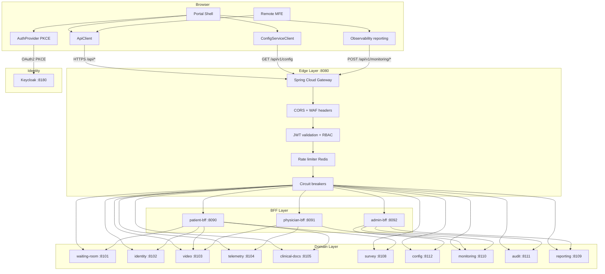
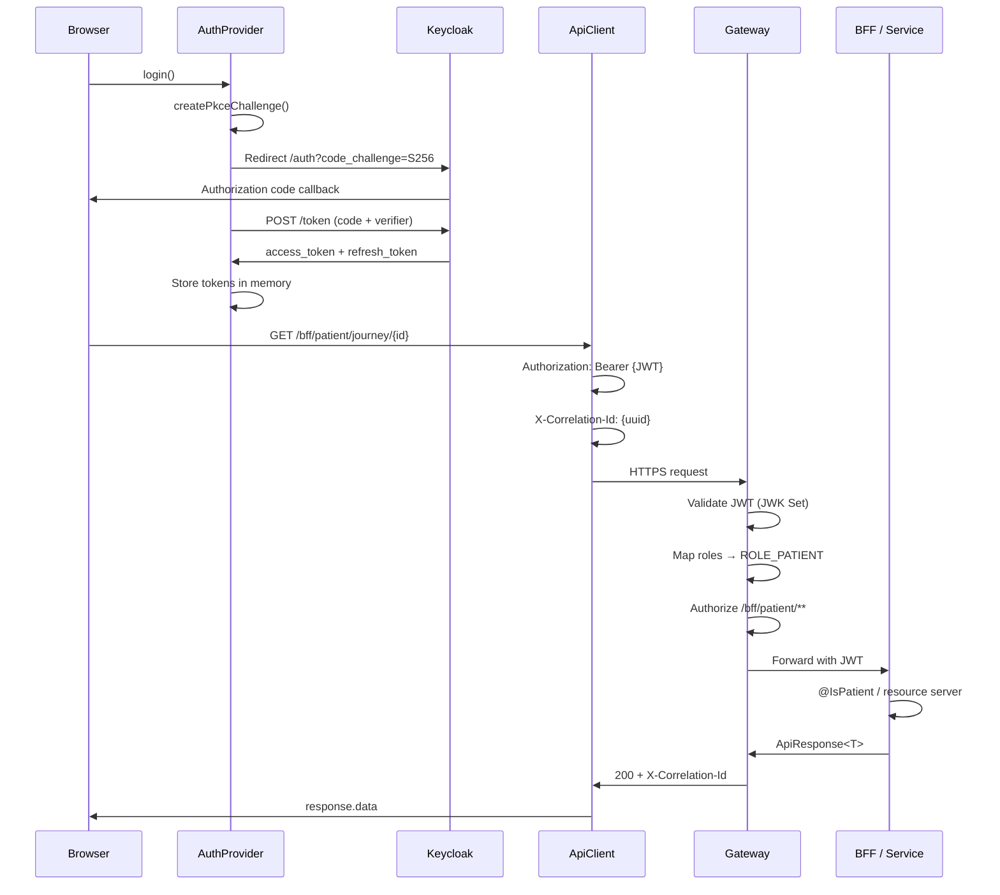
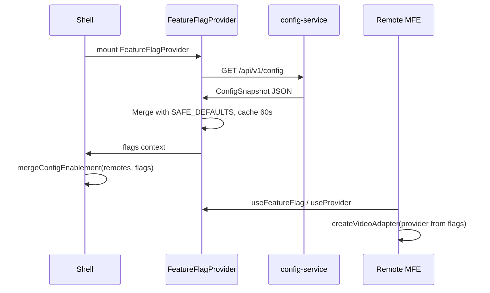
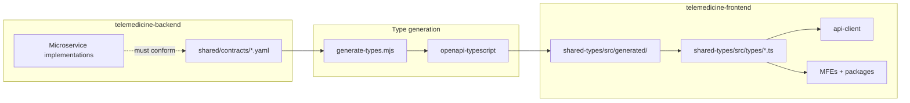
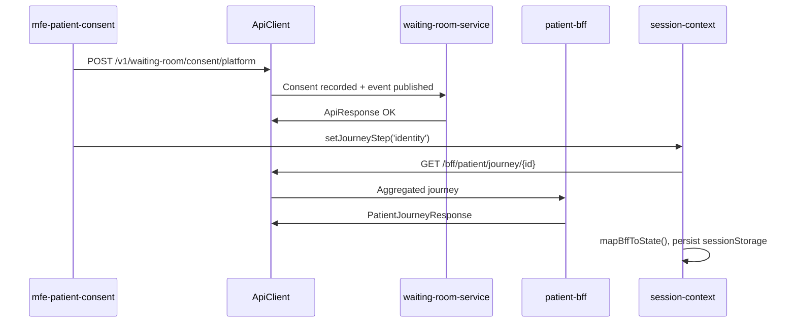
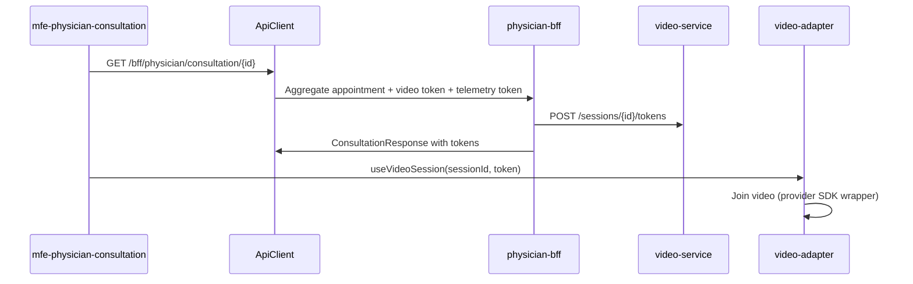
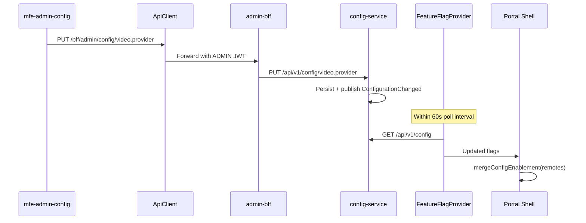

# Telemedicine Platform — Frontend-to-Backend Integration Architecture

| Field | Value |
|-------|-------|
| **Version** | 1.0 |
| **Status** | As-built (derived from codebase) |
| **Scope** | Integration boundary between `telemedicine-frontend` and `telemedicine-backend` |
| **Audience** | Enterprise architects, full-stack engineers, security, API owners, SRE |
| **Last updated** | August 2026 |

---

## Table of contents

1. [Executive summary](#1-executive-summary)
2. [Integration principles](#2-integration-principles)
3. [Integration topology](#3-integration-topology)
4. [URL resolution and routing](#4-url-resolution-and-routing)
5. [Authentication integration](#5-authentication-integration)
6. [API contracts and envelopes](#6-api-contracts-and-envelopes)
7. [Cross-cutting HTTP headers](#7-cross-cutting-http-headers)
8. [Backend-for-Frontend integration](#8-backend-for-frontend-integration)
9. [Direct domain service integration](#9-direct-domain-service-integration)
10. [Clinical adapter integration](#10-clinical-adapter-integration)
11. [Configuration and feature flags](#11-configuration-and-feature-flags)
12. [Observability integration](#12-observability-integration)
13. [Error handling and resilience](#13-error-handling-and-resilience)
14. [Idempotency and retry semantics](#14-idempotency-and-retry-semantics)
15. [Environment-specific deployment](#15-environment-specific-deployment)
16. [Security boundary](#16-security-boundary)
17. [Contract and type generation pipeline](#17-contract-and-type-generation-pipeline)
18. [Complete endpoint catalogue](#18-complete-endpoint-catalogue)
19. [Integration sequence diagrams](#19-integration-sequence-diagrams)
20. [Known gaps and remediation](#20-known-gaps-and-remediation)
21. [Related documentation](#21-related-documentation)

---

## 1. Executive summary

The Telemedicine platform integrates browser-based microfrontends with a cloud-native Java microservices backend through a **single north-south API entry point** — the Spring Cloud Gateway. The frontend never calls domain microservices directly; all traffic flows through gateway routes to either **Backend-for-Frontend (BFF) aggregators** or **domain REST APIs**.

The integration model is characterized by:

- **Typed HTTP client** (`@telemedicine/api-client`) with JWT injection, correlation IDs, idempotency keys, RFC 7807 error parsing, and exponential backoff retry
- **OAuth2 PKCE** against Keycloak for browser-native authentication without client secrets
- **Dual API access pattern** — journey aggregation via BFFs; granular mutations and real-time features via domain services
- **Contract alignment** — OpenAPI specs in `telemedicine-backend/shared/contracts/` generate TypeScript types in `@telemedicine/shared-types`
- **Defense in depth** — JWT validation and RBAC at gateway, BFF, and domain service layers

This document defines the **integration boundary**: how URLs resolve, how auth propagates, which endpoints each MFE calls, and how errors, retries, and observability behave at the seam between frontend and backend.

---

## 2. Integration principles

| Principle | Implementation |
|-----------|----------------|
| **Single entry point** | All API traffic enters gateway `:8080`; no direct microservice URLs in frontend |
| **BFF for aggregation** | Journey, worklist, consultation context, and admin snapshots aggregated server-side |
| **Direct calls for mutations** | Consent, identity, device test, chat, survey — domain services when action is localized |
| **Contract-first** | OpenAPI specs are source of truth; frontend types regenerated via `pnpm generate:types` |
| **Fail gracefully** | BFF returns `DEGRADED` partial responses; feature flags fall back to safe defaults |
| **Traceable requests** | `X-Correlation-Id` on every request; echoed in ProblemDetail and gateway responses |
| **Safe retries** | Idempotency keys on consent, device test, survey; retry only safe methods or keyed POSTs |
| **No secrets in browser** | Video/telemetry provider tokens issued by backend; Keycloak uses public PKCE client |
| **Role-aligned portals** | Patient, physician, admin shells use separate Keycloak clients and gateway path RBAC |

---

## 3. Integration topology



### Layer responsibilities at the integration boundary

| Layer | Integration role |
|-------|------------------|
| **Frontend ApiClient** | Resolves URLs, attaches JWT/correlation/idempotency headers, parses envelopes, retries |
| **Gateway** | Route matching, JWT validation, path RBAC, CORS, rate limiting, circuit breaking |
| **BFF** | Journey/worklist/consultation aggregation; reduces frontend fan-out; degraded partial responses |
| **Domain service** | Authoritative business logic, consent enforcement, persistence, event publishing |
| **Keycloak** | Token issuance; roles in `realm_access.roles` JWT claim |

---

## 4. URL resolution and routing

### 4.1 Resolution formula

```
Resolved URL = {VITE_API_BASE_URL || '/api'} + {relative path}
```

| ApiClient base | Relative path | Resolved URL | Gateway match |
|----------------|---------------|--------------|---------------|
| `/api` (default) | `/bff/patient/journey/apt-1` | `/api/bff/patient/journey/apt-1` | **No match** — see §4.3 |
| `/api` (default) | `/v1/waiting-room/queue/apt-1` | `/api/v1/waiting-room/queue/apt-1` | `/api/v1/waiting-room/**` ✓ |
| `https://api.example.com` | `/bff/patient/journey/apt-1` | `https://api.example.com/bff/patient/journey/apt-1` | `/bff/patient/**` ✓ |
| `https://api.example.com/api` | `/v1/config` | `https://api.example.com/api/v1/config` | `/api/v1/config/**` ✓ |

**Convention:** Domain service paths in frontend code use the `/v1/...` prefix (without `/api`). The ApiClient base `/api` prepends to produce `/api/v1/...`, which matches gateway predicates.

BFF paths use `/bff/...` prefix. With default base `/api`, resolved URLs become `/api/bff/...` which **does not match** gateway predicates registered at `/bff/...`.

### 4.2 Gateway route table

Source: `telemedicine-backend/gateway/src/main/resources/application.yml`

| Route ID | Gateway predicate | Upstream service | Port |
|----------|-------------------|------------------|------|
| `patient-bff` | `/bff/patient/**` | `lb://patient-bff` | 8090 |
| `physician-bff` | `/bff/physician/**` | `lb://physician-bff` | 8091 |
| `admin-bff` | `/bff/admin/**` | `lb://admin-bff` | 8092 |
| `waiting-room-service` | `/api/v1/waiting-room/**` | `lb://waiting-room-service` | 8101 |
| `identity-service` | `/api/v1/identity/**` | `lb://identity-service` | 8102 |
| `video-service` | `/api/v1/video/**` | `lb://video-service` | 8103 |
| `telemetry-service` | `/api/v1/telemetry/**` | `lb://telemetry-service` | 8104 |
| `clinical-docs-service` | `/api/v1/clinical-docs/**` | `lb://clinical-docs-service` | 8105 |
| `notification-service` | `/api/v1/notifications/**` | `lb://notification-service` | 8106 |
| `integration-service` | `/v1/appointments/v2/**` | `lb://integration-service` | 8107 |
| `integration-webhooks` | `/api/v1/integration/**` | `lb://integration-service` | 8107 |
| `survey-service` | `/api/v1/survey/**` | `lb://survey-service` | 8108 |
| `reporting-service` | `/api/v1/reporting/**` | `lb://reporting-service` | 8109 |
| `monitoring-service` | `/api/v1/monitoring/**` | `lb://monitoring-service` | 8110 |
| `audit-service` | `/api/v1/audit/**` | `lb://audit-service` | 8111 |
| `config-service` | `/api/v1/config/**` | `lb://config-service` | 8112 |
| `scheduler-service` | `/api/v1/scheduler/**` | `lb://scheduler-service` | 8113 |
| `external-simulators` | `/sim/**` | `lb://external-simulators` | 8200 (dev/test) |

Each route has a dedicated Resilience4j circuit breaker with fallback to `GatewayFallbackController` (`503 TM-CORE-0001`).

### 4.3 Recommended production URL strategy

| Pattern | Configuration | Use case |
|---------|---------------|----------|
| **Dedicated API host** (recommended) | `VITE_API_BASE_URL=https://api.example.com` | BFF paths resolve correctly; domain paths use `/v1/...` → requires base `https://api.example.com/api` OR path prefix `/api/v1/...` |
| **Same-origin proxy** | nginx `location /api/` → gateway; add `RewritePath` for BFF | Single origin; requires gateway rewrite `/api/bff/(?<segment>.*)` → `/bff/${segment}` |
| **Split bases** | ApiClient for domain; raw fetch for BFF at `/bff/...` | Not implemented — would require dual clients |

**Production recommendation:** Deploy `api.example.com` ingress to gateway. Set:

```
VITE_API_BASE_URL=https://api.example.com/api
```

This resolves:
- BFF: `/bff/patient/...` → `https://api.example.com/api/bff/patient/...` — still requires gateway rewrite **OR** change frontend BFF paths to not use `/api` base (dual-base pattern).

**Cleanest fix (architecture target):** Add gateway filter:

```yaml
- RewritePath=/api/bff/(?<segment>.*), /bff/${segment}
```

This allows default dev/prod configuration with `VITE_API_BASE_URL=/api` (same-origin) without frontend code changes.

---

## 5. Authentication integration

### 5.1 End-to-end auth sequence



### 5.2 Frontend auth implementation

**Package:** `@telemedicine/auth` (`packages/auth/src/index.ts`)

| Concern | Detail |
|---------|--------|
| Protocol | OAuth2 Authorization Code + PKCE (S256) |
| Token endpoint | `{keycloakUrl}/realms/{realm}/protocol/openid-connect/token` |
| Token storage | In-memory module variables — **never localStorage** |
| PKCE transient state | `sessionStorage`: `pkce_verifier`, `pkce_state` (cleared after exchange) |
| Silent refresh | Timer 60s before `tokenExpiry`; `grant_type=refresh_token` |
| Session expiry | Modal + `session:expired` DOM event on refresh failure |
| Dev bypass | `VITE_AUTH_MODE=dev` → synthetic user, token `dev-token` |

### 5.3 Per-portal Keycloak clients

| Shell | Config file | Client ID | Default dev role |
|-------|-------------|-----------|------------------|
| Patient | `apps/shell/src/config/authConfig.ts` | `patient-portal` | `PATIENT` |
| Physician | `apps/physician-shell/src/config/authConfig.ts` | `physician-ui` | `PHYSICIAN` |
| Admin | `apps/admin-shell/src/config/authConfig.ts` | `admin-console` | `ADMIN` |

### 5.4 JWT claims consumed by frontend

| Claim | Usage |
|-------|-------|
| `sub` | User ID |
| `email` | Display identity |
| `realm_access.roles` | Mapped to `PATIENT \| PHYSICIAN \| ADMIN \| NURSE \| SERVICE` |
| `patient_id` | Optional — patient context |
| `physician_id` | Optional — physician context |

### 5.5 Gateway RBAC (production)

Source: `gateway/.../GatewaySecurityConfig.java`

| Path pattern | Required role |
|--------------|---------------|
| `/bff/patient/**` | `ROLE_PATIENT` |
| `/bff/physician/**` | `ROLE_PHYSICIAN` |
| `/bff/admin/**` | `ROLE_ADMIN` |
| `/api/v1/config/**` (writes) | `ROLE_ADMIN` |
| `/api/v1/audit/**` | `ROLE_ADMIN` |
| `/api/v1/scheduler/**` | `ROLE_ADMIN` |
| `/sim/**` | Authenticated |
| `/actuator/health`, swagger | Public |

Dev profile (`DevGatewaySecurityConfig`) permits all exchanges for local development.

### 5.6 Token propagation to ApiClient

```typescript
// apps/shell/src/components/ShellProviders.tsx
<AuthProvider config={authConfig}>
  <ApiClientProvider getToken={getAccessToken}>
```

The auth interceptor attaches `Authorization: Bearer {token}` on every ApiClient request. On **401**, ApiClient attempts one token refresh before surfacing error.

### 5.7 BFF and service secondary auth

BFFs run as OAuth2 resource servers with method-level annotations (`@IsPatient`, `@IsPhysician`, `@IsAdmin`). Downstream RestClient calls propagate JWT claims via `ClaimPropagationInterceptor`.

Domain services enforce additional constraints:
- `@RequiresConsent("CLINICAL_INFORMED")` on telemetry endpoints
- `@IsPatient` on consent and patient-scoped mutations
- `@IsService` on certain video session creation endpoints

---

## 6. API contracts and envelopes

### 6.1 Success envelope — `ApiResponse<T>`

**Backend:** `java-common-core/.../ApiResponse.java`  
**Frontend:** `packages/shared-types/src/types/api.ts`  
**OpenAPI:** `shared/contracts/common-error.yaml`

```json
{
  "success": true,
  "data": { },
  "message": "Optional advisory — e.g. DEGRADED aggregation warning"
}
```

ApiClient methods (`get`, `post`, `put`, `delete`) return `Promise<ApiResponse<T>>`. Callers access payload via `response.data`.

### 6.2 Error envelope — RFC 7807 ProblemDetail

```json
{
  "type": "https://telemedicine.bupa/problems/TM-CORE-0100",
  "title": "TM-CORE-0100",
  "status": 403,
  "detail": "Platform consent required before proceeding",
  "code": "TM-CORE-0100",
  "correlationId": "a1b2c3d4-e5f6-7890-abcd-ef1234567890",
  "traceId": "otel-trace-id",
  "timestamp": "2026-08-31T10:00:00Z",
  "violations": [
    { "field": "consentType", "message": "must not be null" }
  ]
}
```

| Property | Purpose |
|----------|---------|
| `Content-Type` | `application/problem+json` |
| `type` | Stable problem type URI |
| `code` | Catalogue code (`TM-CORE-xxxx`) |
| `correlationId` | Links to gateway logs and distributed trace |
| `violations` | Bean validation field errors (400 responses) |

ApiClient `parseError()` prefers problem+json; synthesizes `ApiError` with `ErrorCode` for non-JSON responses.

### 6.3 BFF degraded responses

BFF aggregation endpoints return **HTTP 200** with per-section status when downstream fragments fail:

```json
{
  "success": true,
  "data": {
    "appointmentId": "apt-001",
    "overallStatus": "DEGRADED",
    "consent": { "status": "OK" },
    "video": { "status": "DEGRADED", "reason": "video-service timeout" }
  },
  "message": "One or more journey sections could not be loaded"
}
```

Frontend `session-context` maps this to journey step/state without throwing. MFEs should handle `DEGRADED` sections gracefully.

---

## 7. Cross-cutting HTTP headers

Source: `java-common-core/.../Headers.java`

| Header | Set by | Direction | Purpose |
|--------|--------|-----------|---------|
| `Authorization: Bearer {JWT}` | ApiClient auth interceptor | Request | Authentication |
| `X-Correlation-Id` | ApiClient correlation interceptor | Request + response | End-to-end tracing |
| `X-Idempotency-Key` | Per-request config or interceptor | Request | Safe POST replay |
| `X-Idempotent-Replay: true` | Backend idempotency filter | Response | Indicates cached replay |
| `X-Causation-Id` | Backend event publishing | Request | Event causality chain |
| `X-Request-Id` | Gateway | Request | Per-attempt identifier |
| `Retry-After` | Gateway rate limiter | Response (429) | Backoff hint |
| `Content-Type: application/json` | ApiClient POST/PUT | Request | JSON payloads |

### Frontend interceptor registration

```typescript
// packages/api-client/src/client.ts — createDefaultApiClient()
client.addRequestInterceptor(createCorrelationInterceptor(() => crypto.randomUUID()));
client.addRequestInterceptor(createAuthInterceptor(getToken));  // when provided
// Idempotency: passed per-request via RequestConfig.idempotencyKey
```

**Note:** `createIdempotencyInterceptor` exists but is not globally registered. Call sites pass `idempotencyKey` in request config; the key is sent as `X-Idempotency-Key` when configured.

---

## 8. Backend-for-Frontend integration

BFFs aggregate multiple downstream REST calls into journey-optimized responses. The frontend should prefer BFF endpoints for **read aggregation** and use domain services for **targeted mutations**.

OpenAPI contracts: `telemedicine-backend/shared/contracts/{patient,physician,admin}-bff.yaml`

### 8.1 Patient BFF (`patient-bff :8090`)

| Frontend call | BFF endpoint | Frontend consumer |
|---------------|--------------|-------------------|
| `GET /bff/patient/journey/{appointmentId}` | `GET /bff/patient/journey/{appointmentId}` | `@telemedicine/session-context` |

**Downstream aggregation** (`PatientJourneyService`):

| Downstream service | Path | Journey section |
|--------------------|------|-----------------|
| waiting-room-service | `GET /api/v1/waiting-room/queue/{id}` | waitingRoom |
| integration-service | `GET /v1/appointments/v2/{id}` | appointment |
| waiting-room-service | `GET /api/v1/waiting-room/consent/{subjectId}` | consent |
| identity-service | `GET /api/v1/identity/{id}/status` | identity |
| video-service | `GET /api/v1/video/appointments/{id}/session` | video |
| clinical-docs-service | `GET /api/v1/clinical-docs/{id}` | documents |
| survey-service | `GET /api/v1/survey/{id}` | survey |

**Response type:** `PatientJourneyResponse` — `packages/shared-types/src/types/bff.ts`

### 8.2 Physician BFF (`physician-bff :8091`)

| Frontend call | BFF endpoint | Frontend consumer |
|---------------|--------------|-------------------|
| `GET /bff/physician/worklist` | `GET /bff/physician/worklist` | `mfe-physician-consultation` |
| `GET /bff/physician/consultation/{id}` | `GET /bff/physician/consultation/{id}` | `mfe-physician-consultation`, `mfe-physician-patient-context` |
| `POST /bff/physician/documentation/{id}` | `POST /bff/physician/documentation/{id}` | `mfe-physician-documentation` |

**Consultation aggregation downstream:**

| Service | Path | Aggregated data |
|---------|------|-----------------|
| integration-service | `GET /v1/appointments/v2/{id}` | Appointment details |
| integration-service | `GET /v1/appointments/v2/{id}/mpi` | Patient demographics |
| video-service | `GET /api/v1/video/appointments/{id}/session` | Session metadata |
| video-service | `POST /api/v1/video/sessions/{sessionId}/tokens` | Physician video token |
| telemetry-service | `POST /api/v1/telemetry/token` | ANURA embed token |

Physician consultation MFE reads pre-aggregated video/telemetry tokens from BFF response rather than calling video-service directly.

### 8.3 Admin BFF (`admin-bff :8092`)

| Frontend call | BFF endpoint | Frontend consumer |
|---------------|--------------|-------------------|
| `GET /bff/admin/snapshot` | `GET /bff/admin/snapshot` | `admin-shell` |
| `GET /bff/admin/config` | `GET /bff/admin/config` | `mfe-admin-config` |
| `PUT /bff/admin/config/{key}` | `PUT /bff/admin/config/{key}` | `mfe-admin-config` |
| `GET /bff/admin/audit` | `GET /bff/admin/audit` | `mfe-admin-audit` |
| `GET /bff/admin/access/roles` | `GET /bff/admin/access/roles` | `mfe-admin-access` |

**Admin snapshot aggregation:**

| Service | Path |
|---------|------|
| monitoring-service | `GET /api/v1/monitoring/snapshot` |
| reporting-service | `GET /api/v1/reporting/kpis` |

**Config write flow:**

```
mfe-admin-config → PUT /bff/admin/config/{key}
  → admin-bff → PUT /api/v1/config/{key}
  → config-service (audited, publishes ConfigurationChanged event)
  → FeatureFlagProvider poll picks up change within 60s
```

---

## 9. Direct domain service integration

Domain services are called directly when the action is **localized**, **write-heavy**, or requires **real-time polling** — avoiding unnecessary BFF indirection.

### 9.1 Patient portal — direct calls

| Method | Resolved path | Frontend source | Backend service |
|--------|---------------|-----------------|-----------------|
| `POST` | `/api/v1/waiting-room/consent/{type}` | `consent-kit/useConsent.tsx` | waiting-room |
| `POST` | `/api/v1/waiting-room/consent/withdraw` | `consent-kit/useConsent.tsx` | waiting-room |
| `POST` | `/api/v1/identity/validate` | `mfe-patient-identity` | identity |
| `POST` | `/api/v1/identity/verify` | `mfe-patient-identity` | identity — **path mismatch**, see §20 |
| `GET` | `/api/v1/waiting-room/queue/{id}` | `mfe-patient-waiting-room` | waiting-room |
| `POST` | `/api/v1/waiting-room/device-test/{id}` | `device-test/useDeviceTest.ts` | waiting-room |
| `GET` | `/api/v1/video/appointments/{id}/session` | `mfe-patient-waiting-room` | video |
| `GET` | `/api/v1/clinical-docs/{id}/documents` | `mfe-patient-documents` | clinical-docs |
| `GET` | `/api/v1/survey/{id}` | `mfe-patient-survey` | survey |
| `POST` | `/api/v1/survey/{id}/responses` | `mfe-patient-survey` | survey |

### 9.2 Physician portal — direct calls

| Method | Resolved path | Frontend source | Backend service |
|--------|---------------|-----------------|-----------------|
| `PUT` | `/api/v1/waiting-room/status/{id}` | `mfe-physician-consultation` | waiting-room — **method mismatch**, see §20 |

### 9.3 Admin portal — direct calls

| Method | Resolved path | Frontend source | Backend service |
|--------|---------------|-----------------|-----------------|
| `GET` | `/api/v1/reporting/kpis/{family}` | `mfe-admin-dashboards` | reporting |
| `POST` | `/api/v1/reporting/exports` | `mfe-admin-dashboards` | reporting |
| `GET` | `/api/v1/monitoring/snapshot` | `mfe-admin-monitoring` | monitoring |
| `GET` | `/api/v1/monitoring/sessions` | `mfe-admin-monitoring` | monitoring — **not implemented**, see §20 |
| `GET` | `/api/v1/monitoring/alerts` | `mfe-admin-monitoring` | monitoring — **not implemented**, see §20 |
| `POST` | `/api/v1/monitoring/alerts/{id}/acknowledge` | `mfe-admin-monitoring` | monitoring — **not implemented**, see §20 |
| `GET` | `/api/v1/audit/consent?appointmentId=` | `mfe-admin-audit` | audit |
| `POST` | `/api/v1/audit/exports` | `mfe-admin-audit` | audit |

### 9.4 Integration pattern decision matrix

| Use BFF when | Use domain service when |
|--------------|-------------------------|
| Aggregating 3+ downstream reads | Single-resource CRUD |
| Journey/worklist/snapshot views | Real-time polling (chat messages) |
| Reducing frontend fan-out | Idempotent mutation with domain validation |
| Degraded partial response acceptable | Consent-gated action requiring domain enforcement |

---

## 10. Clinical adapter integration

Adapters abstract video, chat, and telemetry providers. They integrate with backend APIs — **not** vendor SDKs directly (except ANURA CDN stub).

### 10.1 Video adapter

**Package:** `@telemedicine/video-adapter`

| Provider | Config key | Backend integration |
|----------|------------|---------------------|
| `simulator` | `video.provider=simulator` | None — in-memory mock |
| `vonage` | `video.provider=vonage` | `POST /api/v1/video/sessions` `{ appointmentId, provider }` |
| `acs` | `video.provider=acs` | Same endpoint, different provider value |

**Response:** `{ sessionId, token }` — used by `useVideoSession` hook.

**Security note:** Backend `POST /api/v1/video/sessions` may require `@IsService` role in production. Patient/physician portals should obtain tokens via BFF pre-aggregation or a patient-scoped token endpoint.

### 10.2 Chat adapter

**Package:** `@telemedicine/chat-adapter`

| Operation | Method | Path |
|-----------|--------|------|
| Load history | `GET` | `/api/v1/video/sessions/{sessionId}/chat` |
| Send message | `POST` | `/api/v1/video/sessions/{sessionId}/chat` `{ body, clinical }` |
| Typing indicator | `POST` | `/api/v1/video/sessions/{sessionId}/chat/typing` `{ isTyping }` |
| Poll (2s interval) | `GET` | `/api/v1/video/sessions/{sessionId}/chat` |

Chat messages are persisted in video-service (clinical chat channel). Polling errors are swallowed (non-fatal) in the adapter.

### 10.3 Telemetry adapter

**Package:** `@telemedicine/telemetry-adapter`

| Component | Integration |
|-----------|-------------|
| `TelemetryConsentGate` | Reads clinical consent from session metadata (consent-kit / BFF) |
| `TelemetryConfigGate` | Reads `telemetry.enabled` from feature flags |
| `SimulatorTelemetryAdapter` | Local mock — no backend call |
| `StubAnuraTelemetryAdapter` | Loads ANURA CDN script — token from BFF in physician flow |

**Backend endpoints (not called directly by frontend adapter today):**

| Method | Path | Gate |
|--------|------|------|
| `POST` | `/api/v1/telemetry/token` | `@RequiresConsent("CLINICAL_INFORMED")` |
| `POST` | `/api/v1/telemetry/results` | `@RequiresConsent("CLINICAL_INFORMED")` |

Physician BFF pre-fetches telemetry token in consultation aggregation response.

### 10.4 Device test

**Package:** `@telemedicine/device-test`

| Operation | Path | Headers |
|-----------|------|---------|
| Bandwidth probe | `GET /api/v1/health/payload` | None — **no gateway route**, see §20 |
| Submit results | `POST /api/v1/waiting-room/device-test/{appointmentId}` | `X-Idempotency-Key` |

---

## 11. Configuration and feature flags

### 11.1 Integration flow



### 11.2 Frontend config client

**Package:** `@telemedicine/feature-flags`  
**Endpoint:** `GET /api/v1/config` (raw `fetch`, not ApiClient — no JWT required for read)

| Behavior | Detail |
|----------|--------|
| Cache | 60s in-memory + sessionStorage fallback (`telemedicine.config`) |
| Polling | 60s interval via `FeatureFlagProvider` |
| Unreachable | Returns `SAFE_DEFAULTS` — simulator providers, telemetry off |

### 11.3 Config keys affecting integration

| Key | Default | Affects |
|-----|---------|---------|
| `video.provider` | `simulator` | Video adapter backend calls |
| `chat.provider` | `simulator` | Chat adapter (api vs simulator) |
| `telemetry.enabled` | `false` | Telemetry gate |
| `notification.email.enabled` | `true` | Notification UX hints |
| `mfe.{remoteName}.enabled` | — | MFE manifest merge in shell |

### 11.4 Admin config write integration

Admin writes go through admin BFF (not direct to config-service from browser):

```
PUT /bff/admin/config/{key} → admin-bff → PUT /api/v1/config/{key} [@IsAdmin, audited]
```

Frontend admin MFE: `apps/mfe-admin-config/src/App.tsx`

---

## 12. Observability integration

### 12.1 Correlation ID propagation

| Layer | Implementation |
|-------|----------------|
| Frontend | `X-Correlation-Id: crypto.randomUUID()` on every ApiClient request |
| Gateway | `CorrelationIdGatewayFilter` — accept or generate; echo on response |
| ProblemDetail | `correlationId` field in error responses |
| Circuit breaker fallback | `GatewayFallbackController` includes correlation ID in 503 body |

### 12.2 Frontend telemetry reporting

**Package:** `@telemedicine/observability-web`

| Signal | Endpoint | Trigger |
|--------|----------|---------|
| Uncaught JS errors | `POST /api/v1/monitoring/frontend-errors` | `window.onerror`, `unhandledrejection` |
| React render errors | Same | `ObservabilityErrorBoundary` |
| Web Vitals (LCP, INP, CLS, TTFB) | `POST /api/v1/monitoring/metrics` | `web-vitals` on mount |
| Journey timing | Same | `useTimingMark(step)` |

**Controls:**
- Dev mode: `VITE_OBSERVABILITY_MODE=dev` → console only
- Rate limit: 10 reports/minute per browser session
- Uses raw `fetch` (not ApiClient) — no JWT attached

**Backend status:** `MonitoringController` currently exposes `GET /snapshot` and `POST /quality`. Frontend ingest endpoints are **planned but not yet implemented** — see §20.

### 12.3 Backend monitoring consumed by frontend

| Endpoint | Role required | Consumer |
|----------|---------------|----------|
| `GET /api/v1/monitoring/snapshot` | ADMIN, PHYSICIAN | admin MFE, physician worklist BFF |
| `POST /api/v1/monitoring/quality` | PHYSICIAN | Connection quality samples (backend-initiated from physician flow) |

---

## 13. Error handling and resilience

### 13.1 Error code catalogue

Shared between frontend (`ErrorCode` enum) and backend (`java-common-core`):

| Code | HTTP | Domain | Frontend handling |
|------|------|--------|-------------------|
| `TM-CORE-0001` | 503 | Service unavailable / circuit open | Retry (ApiClient); show ErrorMessage |
| `TM-CORE-0002` | 429 | Rate limited | Backoff retry; respect Retry-After |
| `TM-CORE-0100` | 403 | Consent required | Redirect to consent MFE |
| `TM-CORE-0101` | 403 | Consent withdrawn | Block action; show withdrawal notice |
| `TM-CORE-0102` | 409 | Consent version outdated | Prompt re-consent |
| `TM-CORE-0200` | 423 | Identity locked out | Show lockout message |
| `TM-CORE-0201` | 401 | Identity 2FA failed | Allow retry in identity MFE |
| `TM-CORE-0300` | 402 | Payment not confirmed | Block journey progression |
| `TM-CORE-0400` | 503 | Video provider unavailable | Fallback UI; adapter error state |
| `TM-CORE-0500` | 403 | Telemetry not enabled | Telemetry gate hides embed |
| `TM-CORE-0600` | 404 | Document not found | EmptyState in documents MFE |
| `TM-CORE-0700` | 409 | Survey already submitted | Show completion state |
| `TM-CORE-0800` | 404 | Config key not found | Admin config error toast |
| `TM-CORE-0900` | 502 | Integration (HIS/MPI) error | BFF DEGRADED section |
| `TM-CORE-1000` | 409 | Invalid status transition | Journey gate blocks step |
| `TM-CORE-1001` | 410 | Session link expired | Home page error |
| `TM-CORE-1002` | 412 | Device test required | Redirect to waiting room |
| `TM-CORE-9999` | 501 | Not implemented | Graceful fallback |

### 13.2 Frontend error handling patterns

| Pattern | Where | Behavior |
|---------|-------|----------|
| `ApiError` throw | ApiClient | MFE catch → `ErrorMessage` / toast |
| BFF `DEGRADED` | session-context | Map partial state; no throw |
| Feature flag fallback | feature-flags | Silent `SAFE_DEFAULTS` |
| Chat poll error | chat-adapter | Swallowed — non-fatal |
| MFE load failure | mfe-registry | `mfe:loadFailed` event + EmptyState |
| Session expiry | auth | Modal + re-login |
| Observability | observability-web | Fire-and-forget; rate-limited |

### 13.3 Gateway resilience (affects frontend)

| Mechanism | Default | Prod override |
|-----------|---------|---------------|
| Rate limiter | 100 req/s, burst 200 | 600/1200 |
| Circuit breaker | Per-route Resilience4j | Opens → 503 `TM-CORE-0001` |
| Fallback | `forward:/fallback` | ProblemDetail with correlation ID |

---

## 14. Idempotency and retry semantics

### 14.1 Frontend ApiClient retry policy

Source: `packages/api-client/src/client.ts`

| Setting | Value |
|---------|-------|
| Max retries | 2 (3 total attempts) |
| Backoff | `200ms × 2^(attempt-1)` + random jitter |
| Retry on GET/HEAD/OPTIONS | 5xx, 429 |
| Retry on POST/PUT/PATCH | 5xx, 429 **only if** `idempotencyKey` set |
| 401 handling | One token refresh retry (attempt 0 only) |
| Opt-out | `retry: false` in RequestConfig |
| Cancellation | `AbortController` per request; `cancelAll()` on logout |

### 14.2 Frontend idempotency key usage

| Call site | Key strategy |
|-----------|--------------|
| `consent-kit/useConsent.tsx` | `crypto.randomUUID()` per grant/withdraw |
| `device-test/useDeviceTest.ts` | `crypto.randomUUID()` per submit |
| `mfe-patient-survey` | Deterministic `survey-{appointmentId}` |

### 14.3 Backend idempotency filter

Source: `java-common-web/.../IdempotencyKeyFilter.java`

| Setting | Value |
|---------|-------|
| Header | `X-Idempotency-Key` |
| Fingerprint | HTTP method + path + body hash |
| Replay response | Stored response + `X-Idempotent-Replay: true` |
| Conflict | Same key, different body → 409 |
| Default | Disabled; opt-in via `telemedicine.web.idempotency.enabled=true` |
| Store | Redis or JPA |

---

## 15. Environment-specific deployment

### 15.1 Local development

**Vite dev proxy** (all shells):

```typescript
// apps/{shell,physician-shell,admin-shell}/vite.config.mts
proxy: {
  '/api': { target: 'http://localhost:8080', changeOrigin: true }
}
```

| Shell | Dev port |
|-------|----------|
| Patient | 3000 |
| Physician | 3010 |
| Admin | 3020 |

| Setting | Dev value |
|---------|-----------|
| Gateway | `http://localhost:8080` |
| Keycloak | `http://localhost:8180` |
| Auth bypass | `VITE_AUTH_MODE=dev` |
| Observability | Console-only (Vite DEV) |

**Dev auth:** Gateway `dev` profile permits all requests without JWT validation.

### 15.2 Production — standalone shell nginx

`apps/shell/nginx.conf` — static SPA only, **no API proxy**.

### 15.3 Production — full-stack shell nginx

`apps/shell/nginx.full-stack.conf`:

```nginx
location /api/ {
    proxy_pass http://gateway:8080/api/;
}
```

Same-origin API for domain services. BFF path rewrite still required (§4.3).

### 15.4 Production — Kubernetes ingress

Source: `telemedicine-platform/kubernetes/ingress/ingress.yaml`

| Host | Backend | Purpose |
|------|---------|---------|
| `app.example.com` | Patient shell + MFEs | Patient UI |
| `physician.example.com` | Physician shell + MFEs | Physician UI |
| `admin.example.com` | Admin shell + MFEs | Admin UI |
| `api.example.com` | gateway:8080 | Dedicated API entry |

Blue/green canary: 10% traffic to `gateway-green` on `api.example.com`.

### 15.5 Environment variable reference

| Variable | Integration effect |
|----------|-------------------|
| `VITE_API_BASE_URL` | ApiClient base URL (default `/api`) |
| `VITE_KEYCLOAK_URL` | Keycloak server for PKCE |
| `VITE_KEYCLOAK_REALM` | OIDC realm |
| `VITE_KEYCLOAK_CLIENT_ID` | Per-portal OAuth client |
| `VITE_AUTH_MODE=dev` | Bypass Keycloak; gateway dev profile |
| `VITE_OBSERVABILITY_MODE` | `dev` = no telemetry POSTs |

Backend gateway env:

| Variable | Integration effect |
|----------|-------------------|
| `CORS_ALLOWED_ORIGINS` | Shell origins (default `http://localhost:3000,3010,3020`) |
| `telemedicine.security.jwt.jwk-set-uri` | JWT validation |
| `telemedicine.gateway.rate-limit.*` | Rate limit thresholds |

---

## 16. Security boundary

### 16.1 CORS (gateway)

Source: `GatewayCorsConfig.java`

| Setting | Value |
|---------|-------|
| Allowed origins | `CORS_ALLOWED_ORIGINS` env |
| Methods | GET, POST, PUT, DELETE, PATCH, OPTIONS |
| Allowed headers | `*`, `Authorization`, `X-Correlation-Id`, `X-Idempotency-Key` |
| Exposed headers | `X-Correlation-Id` |
| Credentials | `true` |
| Max age | 3600s |

CORS is enforced **only at the gateway**. Internal microservice calls are cluster-local.

### 16.2 Security response headers (gateway WAF filter)

Source: `WafHeadersWebFilter.java`

- `X-Content-Type-Options: nosniff`
- `Referrer-Policy`
- `Permissions-Policy`
- `Content-Security-Policy`
- `Strict-Transport-Security` (when enabled)
- Removes `Server` header

### 16.3 Integration security controls summary

| Control | Layer |
|---------|-------|
| OAuth2 PKCE | Frontend → Keycloak |
| JWT validation | Gateway |
| Path RBAC | Gateway |
| Method-level RBAC | BFF + domain services |
| Consent enforcement | Domain services (`@RequiresConsent`) |
| Rate limiting | Gateway (Redis token bucket per JWT subject) |
| Circuit breaking | Gateway (per route) |
| Correlation tracing | Frontend → gateway → services |
| Idempotency | Frontend header → backend filter |
| No secrets in bundle | Architecture — tokens from backend only |

---

## 17. Contract and type generation pipeline



### 17.1 Generated contracts (7)

| Contract file | Generated output |
|---------------|------------------|
| `patient-bff.yaml` | `generated/patient-bff.ts` |
| `physician-bff.yaml` | `generated/physician-bff.ts` |
| `admin-bff.yaml` | `generated/admin-bff.ts` |
| `waiting-room-service.yaml` | `generated/waiting-room-service.ts` |
| `identity-service.yaml` | `generated/identity-service.ts` |
| `video-service.yaml` | `generated/video-service.ts` |
| `config-service.yaml` | `generated/config-service.ts` |

**Command:** `pnpm generate:types` from `telemedicine-frontend/` root  
**Script:** `packages/shared-types/scripts/generate-types.mjs`

### 17.2 Hand-curated types

`packages/shared-types/src/types/` — journey, BFF response shapes, config keys, consent, MFE manifest, provider enums. These complement generated types where OpenAPI schemas are incomplete or frontend-specific.

### 17.3 Contract change workflow

1. Backend team updates OpenAPI in `shared/contracts/`
2. Backend implements/adjusts service to match contract
3. Frontend runs `pnpm generate:types`
4. Fix TypeScript compile errors in MFEs and packages
5. Update MSW handlers in `test-utils` if response shapes changed
6. CI validates both backend contract tests and frontend typecheck

---

## 18. Complete endpoint catalogue

### 18.1 Patient portal

| # | Method | ApiClient path | Service | Auth | Idempotent |
|---|--------|----------------|---------|------|------------|
| 1 | GET | `/bff/patient/journey/{id}` | patient-bff | PATIENT | — |
| 2 | POST | `/v1/waiting-room/consent/platform` | waiting-room | PATIENT | ✓ |
| 3 | POST | `/v1/waiting-room/consent/clinical` | waiting-room | PATIENT | ✓ |
| 4 | POST | `/v1/waiting-room/consent/withdraw` | waiting-room | PATIENT | ✓ |
| 5 | POST | `/v1/identity/validate` | identity | PATIENT | — |
| 6 | POST | `/v1/identity/verify` | identity | PATIENT | — |
| 7 | GET | `/v1/waiting-room/queue/{id}` | waiting-room | PATIENT | — |
| 8 | POST | `/v1/waiting-room/device-test/{id}` | waiting-room | PATIENT | ✓ |
| 9 | GET | `/v1/video/appointments/{id}/session` | video | PATIENT | — |
| 10 | POST | `/v1/video/sessions` | video | PATIENT/SERVICE | — |
| 11 | GET | `/v1/clinical-docs/{id}/documents` | clinical-docs | PATIENT | — |
| 12 | GET | `/v1/survey/{id}` | survey | PATIENT | — |
| 13 | POST | `/v1/survey/{id}/responses` | survey | PATIENT | ✓ |

### 18.2 Physician portal

| # | Method | ApiClient path | Service | Auth |
|---|--------|----------------|---------|------|
| 1 | GET | `/bff/physician/worklist` | physician-bff | PHYSICIAN |
| 2 | GET | `/bff/physician/consultation/{id}` | physician-bff | PHYSICIAN |
| 3 | POST | `/bff/physician/documentation/{id}` | physician-bff | PHYSICIAN |
| 4 | PUT | `/v1/waiting-room/status/{id}` | waiting-room | PHYSICIAN |
| 5 | POST | `/v1/video/sessions` | video | PHYSICIAN/SERVICE |
| 6 | GET/POST | `/v1/video/sessions/{id}/chat` | video | PHYSICIAN |
| 7 | POST | `/v1/video/sessions/{id}/chat/typing` | video | PHYSICIAN |

### 18.3 Admin portal

| # | Method | ApiClient path | Service | Auth |
|---|--------|----------------|---------|------|
| 1 | GET | `/bff/admin/snapshot` | admin-bff | ADMIN |
| 2 | GET | `/bff/admin/config` | admin-bff | ADMIN |
| 3 | PUT | `/bff/admin/config/{key}` | admin-bff | ADMIN |
| 4 | GET | `/bff/admin/audit` | admin-bff | ADMIN |
| 5 | GET | `/bff/admin/access/roles` | admin-bff | ADMIN |
| 6 | GET | `/v1/reporting/kpis/{family}` | reporting | ADMIN |
| 7 | POST | `/v1/reporting/exports` | reporting | ADMIN |
| 8 | GET | `/v1/monitoring/snapshot` | monitoring | ADMIN |
| 9 | GET | `/v1/monitoring/sessions` | monitoring | ADMIN |
| 10 | GET | `/v1/monitoring/alerts` | monitoring | ADMIN |
| 11 | POST | `/v1/monitoring/alerts/{id}/acknowledge` | monitoring | ADMIN |
| 12 | GET | `/v1/audit/consent` | audit | ADMIN |
| 13 | POST | `/v1/audit/exports` | audit | ADMIN |

### 18.4 Cross-cutting

| # | Method | Path | Client | Auth |
|---|--------|------|--------|------|
| 1 | GET | `/api/v1/config` | feature-flags (raw fetch) | Public read |
| 2 | POST | `/api/v1/monitoring/frontend-errors` | observability (raw fetch) | — |
| 3 | POST | `/api/v1/monitoring/metrics` | observability (raw fetch) | — |

---

## 19. Integration sequence diagrams

### 19.1 Patient consent → journey hydration



### 19.2 Physician consultation join



### 19.3 Admin config change → feature flag refresh



---

## 20. Known gaps and remediation

The following integration mismatches exist in the as-built codebase. Track as architecture debt.

| # | Gap | Frontend | Backend | Remediation |
|---|-----|----------|---------|-------------|
| 1 | **BFF path prefix** | `/api` + `/bff/...` → `/api/bff/...` | Gateway expects `/bff/...` | Add gateway `RewritePath=/api/bff/(?<s>.*), /bff/${s}` |
| 2 | **Waiting-room status method** | `PUT /v1/waiting-room/status/{id}` | `POST /api/v1/waiting-room/status/{id}` | Align frontend to POST or add PUT to backend |
| 3 | **Identity verify path** | `POST /v1/identity/verify` | `POST /api/v1/identity/fonasa/2fa/verify` | Update frontend path or add alias route |
| 4 | **Monitoring ingest** | `POST .../frontend-errors`, `.../metrics` | Not in MonitoringController | Implement ingest endpoints in monitoring-service |
| 5 | **Monitoring admin APIs** | `GET .../sessions`, `.../alerts`, `POST .../acknowledge` | Not implemented | Implement or remove from admin MFE |
| 6 | **Video session create role** | Patient MFE calls `POST /v1/video/sessions` | `@IsService` on endpoint | Add patient-scoped token endpoint or route via BFF |
| 7 | **Health payload probe** | `GET /api/v1/health/payload` | No gateway route | Add route or use static asset for bandwidth test |
| 8 | **Chat typing endpoint** | `POST .../chat/typing` | Verify ChatController | Confirm backend endpoint exists |

### Priority remediation order

1. **BFF path rewrite** (blocks all BFF integration in default `/api` base config)
2. **HTTP method/path alignment** (waiting-room status, identity verify)
3. **Video token scoping** (production auth correctness)
4. **Monitoring ingest** (observability completeness)

---

## 21. Related documentation

| Document | Location | Relationship |
|----------|----------|--------------|
| Frontend architecture | `telemedicine-frontend/docs/ARCHITECTURE.md` | MFE platform, shells, packages |
| Backend architecture | `telemedicine-backend/docs/ARCHITECTURE.md` | Gateway, BFFs, microservices, events |
| OpenAPI contracts | `telemedicine-backend/shared/contracts/` | Integration contract source of truth |
| Patient BFF contract | `shared/contracts/patient-bff.yaml` | Journey aggregation schema |
| Physician BFF contract | `shared/contracts/physician-bff.yaml` | Worklist/consultation schema |
| Admin BFF contract | `shared/contracts/admin-bff.yaml` | Admin control plane schema |
| Common error schema | `shared/contracts/common-error.yaml` | ApiResponse + ProblemDetail |
| Platform runbooks | `telemedicine-platform/` | Full-stack compose, prod overlays, verify scripts |
| MSW test handlers | `packages/test-utils/src/handlers.ts` | Integration test mock catalogue |

---

*This document reflects the as-built frontend-to-backend integration boundary as of August 2026. Update when adding endpoints, changing gateway routes, or modifying auth/CORS configuration.*
