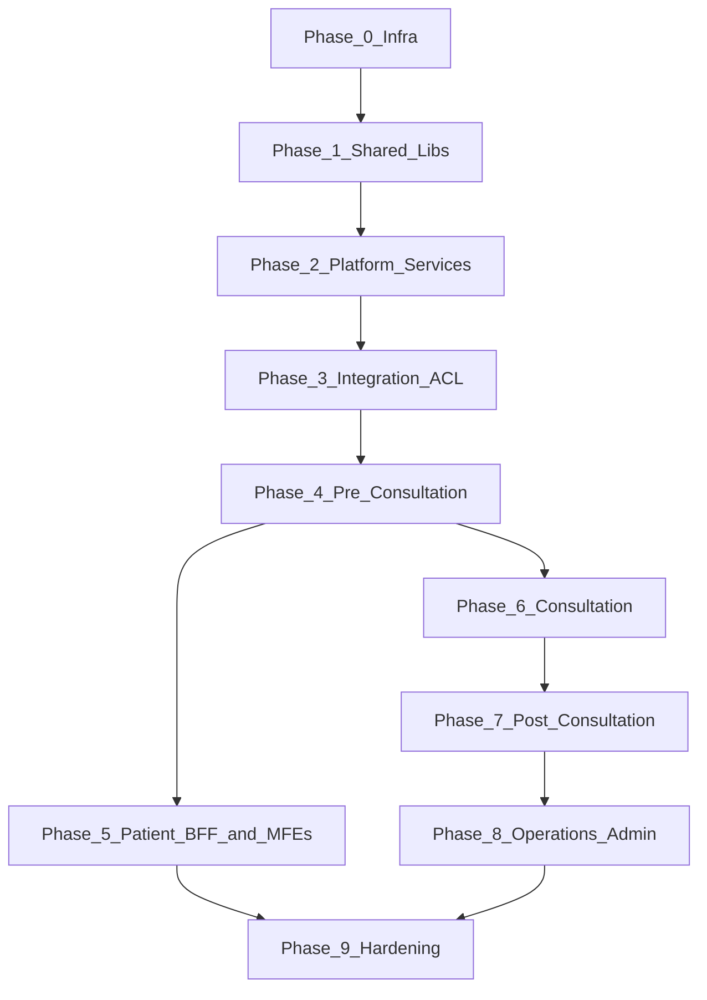

# Telemedicine Platform — Build Sequence

Recommended order for implementing services, shared modules, and frontend artifacts. Each step assumes the previous layers are runnable (even if stubbed). **Build backend depth before frontend features that depend on it.**

---

## Principles

1. **Shared libraries first** — every service depends on them; changing them later is expensive.
2. **Platform before domain** — config, audit, and scheduler are cross-cutting dependencies.
3. **Integration ACL early** — waiting-room, identity, and clinical-docs call external systems through it.
4. **BFFs after domain APIs** — BFFs aggregate; they should not contain business logic or persistence.
5. **Frontend packages before MFEs** — MFEs compose packages; shells come last for each persona.
6. **One vertical slice at a time** — finish patient pre-consultation end-to-end before physician/admin depth.

---

## Phase 0 — Infrastructure & tooling

| Step | Artifact | Why first |
|------|----------|-----------|
| 0.1 | Consul, PostgreSQL, Redis, Kafka, MinIO, Keycloak (compose) | Service discovery, events, cache, object storage, auth |
| 0.2 | Prometheus, Jaeger | Observability from day one |
| 0.3 | `external-simulators` (:8200) | No vendor credentials; Part 4 adds admin API, latency/errors, stateful scenarios |
| 0.4 | Gateway routes + CORS for shells (:3000, :3010, :3020) | Single entry point for all later services |

**Exit criteria:** `docker compose up` brings infra + gateway + consul healthy; simulators respond on `/sim/**`. Part 4: run `scripts/verify-part4.ps1` for admin API, latency, failover, and OpenAPI checks.

---

## Phase 1 — Shared Java libraries (strict order)

Build and publish these Gradle modules before any domain service logic.

| Step | Module | Depends on | Provides |
|------|--------|------------|----------|
| 1.1 | `java-common-core` | — | `ApiResponse`, `ProblemDetail`, errors, IDs, PHI helpers |
| 1.2 | `java-common-web` | core | Global exception handler, pagination |
| 1.3 | `java-common-security` | core | JWT resource server, roles, dev profile bypass |
| 1.4 | `java-common-events` | core | `EventEnvelope`, event types, outbox entity |
| 1.5 | `java-common-observability` | core | Correlation-ID filter, MDC |
| 1.6 | `java-common-persistence` | core, events | `BaseEntity`, outbox repo, Flyway conventions |
| 1.7 | `java-common-integration` | core | `ProviderRegistry`, resilience defaults |
| 1.8 | `java-common-audit` | core, events | `@Audited`, audit event model |
| 1.9 | `java-common-testing` | all above | Test tokens, Testcontainers fixtures |

**Exit criteria:** A template service compiles against all nine modules; `./gradlew test` passes on shared libs.

---

## Phase 2 — Platform edge & platform services

| Step | Artifact | Port | Depends on |
|------|----------|------|------------|
| 2.1 | `gateway` | 8080 | shared security, observability |
| 2.2 | `config-service` | 8112 | persistence, events |
| 2.3 | `audit-service` | 8111 | persistence, events, audit lib |
| 2.4 | `scheduler-service` | 8113 | persistence (job registry) |

**Build config before video/telemetry** — provider selection and feature flags flow from here.

**Exit criteria:** `./gradlew :gateway:check :config-service:check :audit-service:check :scheduler-service:check` passes; `docker compose --profile platform up` registers config, audit, scheduler and BFFs in Consul; `scripts/verify-phase2.ps1` confirms config CRUD, audit chain verify, scheduler catalog, admin BFF config facade, and gateway correlation/OpenAPI.

**Also delivered in Phase 2:** hardened gateway (Redis rate limit, RBAC path map, named circuit breakers, RFC 9457 fallback); BFF skeletons (`patient-bff`, `physician-bff`, `admin-bff`) as aggregation-only facades with no persistence.

---

## Phase 3 — Integration anti-corruption layer

| Step | Artifact | Port | Notes |
|------|----------|------|-------|
| 3.1 | `integration-service` | 8107 | `/v1/appointments/v2` — create, consult, status, reschedule |
| 3.2 | Adapters → simulators | — | HIS, SAP, payment, FONASA, MPI, Zendesk |
| 3.3 | OpenAPI contract | — | `shared/contracts/integration-service.yaml` |

**Exit criteria:** Appointment lifecycle callable via gateway; simulator responses drive happy-path and failure scenarios. Verified by `scripts/verify-part3.ps1` (integration section).

**Delivered (Part 3):** Full ACL with postgres projection, simulator adapters (HIS/SAP/payment/FONASA/MPI/Zendesk), webhooks, internal service APIs, outbox events.

---

## Phase 4 — Pre-consultation domain (patient journey part 1)

Build in this order — each step gates the next in the patient flow.

| Step | Artifact | Port | Key modules |
|------|----------|------|-------------|
| 4.1 | `waiting-room-service` | 8101 | consent → session-link → device-test → queue → status |
| 4.2 | `identity-service` | 8102 | validate, FONASA 2FA (via integration + simulators) |
| 4.3 | `notification-service` | 8106 | templates, channel adapters (stub → real) |

**Exit criteria:** Consent + identity + queue APIs work for a single `appointmentId`; `LinkGenerated` and `IdentityValidated` events published. Verified by `scripts/verify-part3.ps1`.

**Delivered (Part 3):** waiting-room-service (consent, session-link, device-test, queue, status machine, Redis queue, internal jobs), identity-service (FONASA via integration ACL), notification-service (templates, channel adapters, event consumers).

---

## Part 5 — Reusable frontend packages (delivered)

All 17 frontend packages are production-grade libraries consumed by MFEs in Part 6.

| Package | Key capabilities |
|---------|------------------|
| `shared-types` | ProblemDetail, ErrorCode, journey/event types, OpenAPI generation script |
| `design-system` | WCAG 2.1 AA components, patient/clinical themes, Storybook |
| `mfe-registry` | RBAC filtering, config-service MFE enablement, load retry/fallback |
| `api-client` | Retry/backoff, ProblemDetail normalisation, useApiClient hook |
| `auth` | OAuth2 PKCE (Keycloak), silent refresh, RequireAuth/RequireRole |
| `session-context` | BFF hydration, journey gates, sessionStorage persistence |
| `video/chat/telemetry-adapter` | Provider-abstracted adapters with simulator implementations |
| `consent-kit`, `device-test` | API-integrated consent and preflight flows |
| `i18n` | es-CL + en catalogs, Intl formatters |
| `feature-flags` | Safe defaults when config-service unreachable |
| `observability-web` | Web-vitals, journey timing, rate-limited error reporting |
| `test-utils` | renderWithProviders, MSW handlers, fixtures, mock adapters |

**Exit criteria:** `scripts/verify-part5.ps1` green — all package tests pass (≥80% coverage), Storybook builds, `pnpm-lock.yaml` committed, workspace deps declared.

---

## Part 6 — Microfrontends (delivered)

All 14 MFE remotes and 3 host shells are production-grade, consuming Part 5 packages and BFF/domain APIs.

| Persona | Shell | Port | MFEs (ports) |
|---------|-------|------|--------------|
| Patient | `shell` | 3000 | consent (3002), identity (3003), waiting-room (3004), consultation (3005), documents (3006), survey (3007) |
| Physician | `physician-shell` | 3010 | consultation (3011), documentation (3012), patient-context (3013) |
| Administrator | `admin-shell` | 3020 | config (3021), dashboards (3022), audit (3023), access (3024), monitoring (3025) |

**Shell hardening:** Full provider stack (Observability → I18n → Auth → ApiClient → FeatureFlags → Theme → Session); RBAC-aware manifest filtering; journey Stepper (patient); PiP mode (physician via `VITE_PIP_MODE=true`); admin operational layout with snapshot KPIs.

**Exit criteria:** `scripts/verify-part6.ps1` green — all MFE + shell tests pass (≥80% coverage); all apps build; manifests include `roles` + `version`; workspace deps declared; no hardcoded UI strings (i18n namespaces).

---

## Phase 5 — Patient BFF & patient frontend vertical slice

| Step | Artifact | Notes |
|------|----------|-------|
| 5.1 | Frontend packages | `shared-types`, `api-client`, `auth`, `session-context` |
| 5.2 | `consent-kit`, `device-test` | Reusable UI/logic packages |
| 5.3 | `patient-bff` | :8090 — `GET /bff/patient/journey/{appointmentId}` aggregates 4.1–4.3 |
| 5.4 | Patient shell | :3000 — manifest + Module Federation host |
| 5.5 | Patient MFEs (in order) | consent → identity → waiting-room |

**Exit criteria:** Patient can complete consent, identity, and waiting-room flow in the shell against live BFF + services. **Part 6 delivered** — all patient MFEs implemented with journey gating and i18n.

---

## Phase 6 — Consultation domain

| Step | Artifact | Port | Notes |
|------|----------|------|-------|
| 6.1 | `video-service` | 8103 | Vonage / ACS / simulator adapters; session + tokens + chat |
| 6.2 | `telemetry-service` | 8104 | ANURA — **independent** deployable, no compile-time coupling to video |
| 6.3 | Frontend adapters | `video-adapter`, `chat-adapter`, `telemetry-adapter` |
| 6.4 | Patient + physician consultation MFEs | :3004, :3011 |

**Exit criteria:** Video session created with provider failover; chat messages persisted; telemetry token issued separately. Verified by `scripts/verify-part3.ps1`.

**Delivered (Part 3 backend):** video-service, telemetry-service. **Part 6 delivered:** `video-adapter`, `chat-adapter`, `telemetry-adapter` packages + patient/physician consultation MFEs with SplitPanel layout, session controls, and telemetry gates.

---

## Phase 7 — Post-consultation domain

| Step | Artifact | Port | Notes |
|------|----------|------|-------|
| 7.1 | `clinical-docs-service` | 8105 | PDF docs, prescriptions (RecMed/Medipass simulators), MinIO storage |
| 7.2 | `survey-service` | 8108 | dispatch after `ConsultationClosed`, NPS capture |
| 7.3 | Patient MFEs | documents (:3006), survey (:3007) |
| 7.4 | `physician-bff` + documentation MFE | :8091, :3012 |

**Exit criteria:** Document issued and downloadable; survey submitted; physician can submit documentation. Verified by `scripts/verify-part3.ps1`.

**Delivered (Part 3 backend):** clinical-docs-service, survey-service, physician-bff. **Part 6 delivered:** patient documents/survey MFEs + physician documentation MFE.

---

## Phase 8 — Operations & admin

| Step | Artifact | Port | Notes |
|------|----------|------|-------|
| 8.1 | `reporting-service` | 8109 | technical / functional / business KPIs |
| 8.2 | `monitoring-service` | 8110 | event consumption, alerts, SLO snapshot |
| 8.3 | `admin-bff` | 8092 | config, KPI, audit facades |
| 8.4 | Admin shell + MFEs | :3020, :3021–3025 | config, dashboards, audit, access, monitoring |
| 8.5 | Physician shell + remaining MFEs | :3010, :3013 | patient-context |

**Exit criteria:** Admin dashboard shows KPIs; audit search works; monitoring snapshot reflects live sessions. Verified by `scripts/verify-part3.ps1`.

**Delivered (Part 3 backend):** reporting-service, monitoring-service, admin-bff. **Part 6 delivered:** admin shell + 5 admin MFEs; physician shell + patient-context MFE.

---

## Part 4 — External adapters and simulators (hardening)

| Step | Artifact | Notes |
|------|----------|-------|
| 4.0 | `SimulatorEngine` | Per-vendor latency, jitter, error/timeout rates via `/sim/admin` |
| 4.1 | Admin API | `/sim/admin/vendors`, chaos/happy/resilience presets, state dump |
| 4.2 | Stateful stores | Appointment lifecycle, FONASA lockout, video sessions, notify log |
| 4.3 | Enriched payloads | Realistic vendor field sets mirrored in `SimulatorStubs` |
| 4.4 | Scenario catalogue | Vendor-specific `X-Sim-Scenario` values (not-found, unpaid, lockout, …) |
| 4.5 | Production exclusion | `sim` compose profile only; `SimulatorSafetyGuard` blocks prod startup |

**Exit criteria:** `scripts/verify-part4.ps1` green — latency injection, error rates, FONASA verify, Vonage→ACS failover, OpenAPI at `/sim/v3/api-docs`. See [simulator-scenarios.md](./simulator-scenarios.md).

---

## Phase 9 — Hardening (parallel to feature work, mandatory before go-live)

| Step | Area | Deliverable |
|------|------|-------------|
| 9.1 | Security | JWT at gateway (prod profile), RBAC enforcement, secret rotation |
| 9.2 | Resilience | Circuit breakers, DLQ, provider failover drills |
| 9.3 | Data | Flyway migrations replace `ddl-auto: update`; mock → Postgres cutover |
| 9.4 | Performance | k6 journey test — p95 < 300 ms |
| 9.5 | HA/DR | K8s HPA, PDB, DR runbook exercise |
| 9.6 | Docs | TDD, OpenAPI index, operational manual, runbooks, traceability matrix |

**Part 7 delivered** — event consumer wiring, JSON Schemas, Dockerfiles for all services/MFEs, K8s manifests with dev/staging/prod overlays, HA/DR, CI/CD with 80% coverage gates, security hardening, k6 performance suite, Prometheus SLO alerts, go-live docs. Verify with `scripts/verify-part7.ps1`.

---

## Dependency graph (summary)

---

## What not to build early

| Avoid | Reason |
|-------|--------|
| BFF business logic | BFFs aggregate only; logic belongs in domain services |
| Frontend mock APIs | Data comes from backend; use mock datastore on server (see [mock-datastore-plan.md](./mock-datastore-plan.md)) |
| Physician/admin MFEs before patient slice | Validates the hardest journey first |
| Real vendor SDKs | Use `external-simulators` until adapters are stable |
| Shared DB tables across services | Schema-per-service; integrate via APIs and events |

---

## Suggested sprint mapping

| Sprint | Focus |
|--------|-------|
| 1 | Phase 0 + 1 + gateway |
| 2 | Phase 2 + mock datastore foundation |
| 3 | Phase 3 + 4 (waiting-room, identity, notification) |
| 4 | Phase 5 (patient vertical slice) |
| 5 | Phase 6 (consultation) |
| 6 | Phase 7 (post-consultation) |
| 7 | Phase 8 (admin/physician) |
| 8 | Phase 9 (hardening + Postgres cutover) |

---

## Related documents

- [architecture.md](./architecture.md) — repo layout and request flow
- [adding-a-service.md](./adding-a-service.md) — scaffold checklist
- [adding-an-mfe.md](./adding-an-mfe.md) — frontend remote checklist
- [mock-datastore-plan.md](./mock-datastore-plan.md) — JSON mock data for backend development
- [traceability-matrix.md](./traceability-matrix.md) — requirements ↔ modules
